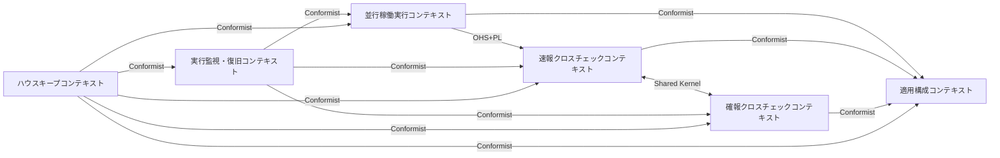
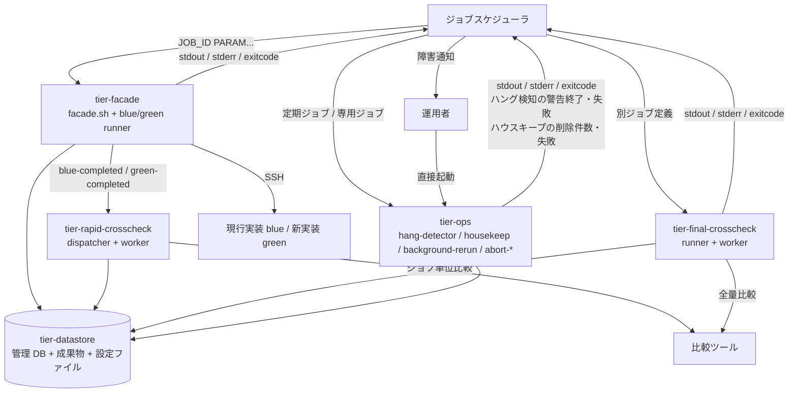
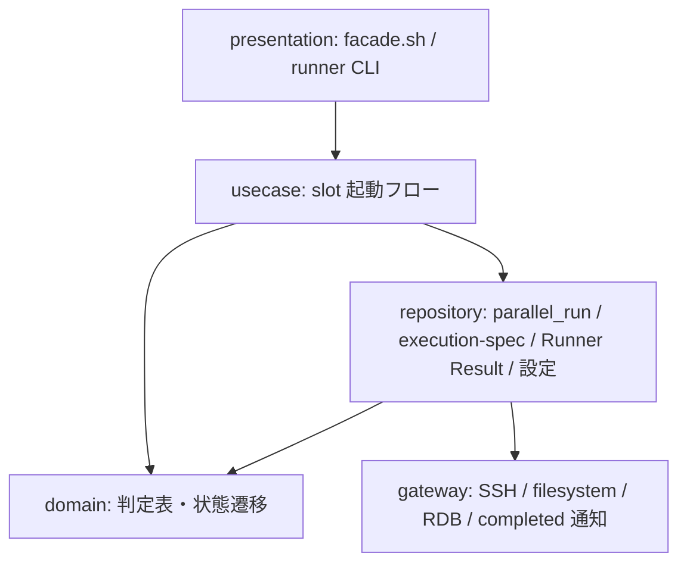
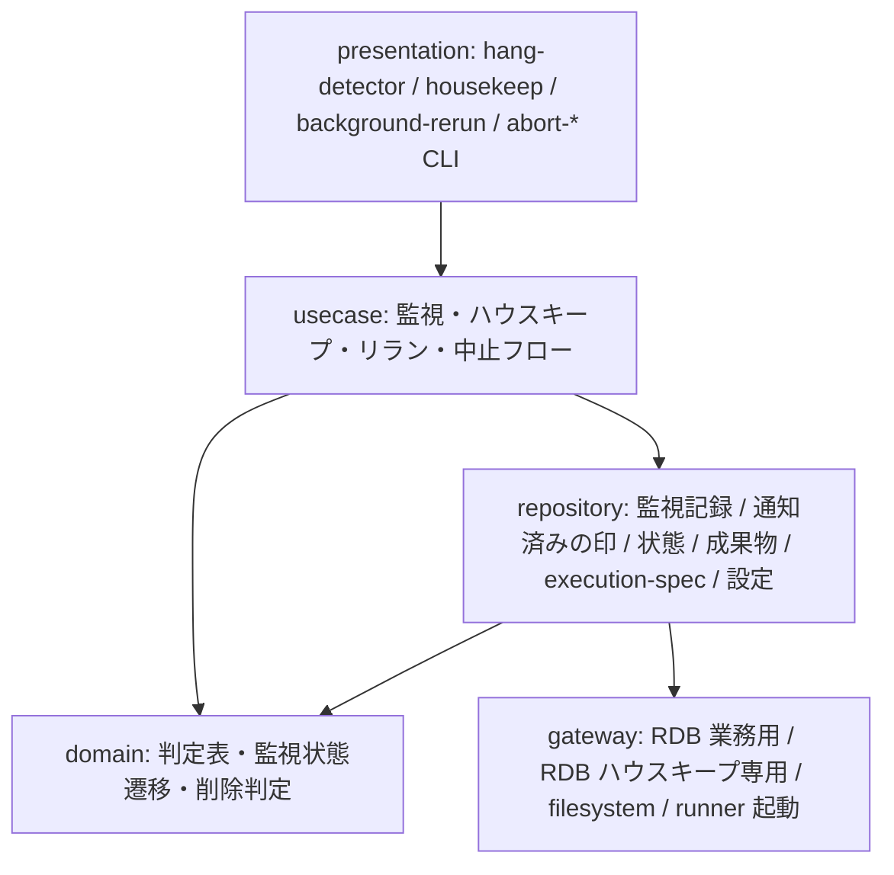
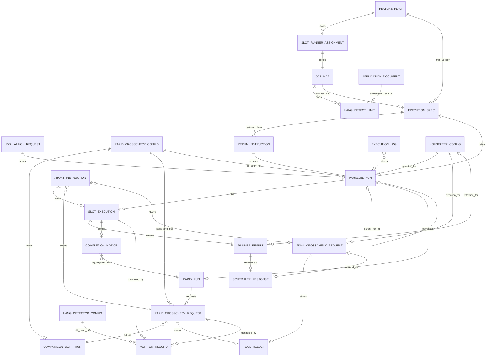

# アーキテクチャ設計書

## 概要

| 項目 | 内容 |
|------|------|
| イベントID | - |
| 作成日時 | - |
| ソース | - |
| 言語 | bash(シェルスクリプト。facade / runner / worker / 監視 / 復旧 / ハウスキープの全スクリプト), SQL(管理 DB のジョブキュー操作。RDB クライアント CLI 経由), JavaScript(CommonJS。BDD の step 定義のみ。実行時には使用しない) |
| フレームワーク | なし(フレームワーク非採用。bash 標準コマンド + ssh + RDB クライアント CLI で構成) |
| 技術的制約 | エアーギャップ環境のオンプレミス Linux。実行時にインターネット接続・外部 SaaS を要求しない, UI 画面を持たない。CLI(標準出力・標準エラー・終了コード)と定期ジョブだけで動作する。運用者への異常の通知もハング検知ジョブの終了結果と標準エラーで行い、ジョブスケジューラの既存のジョブ監視・障害通知で届ける(CLI の出力以外の通知送信手段は持たない)。presentation 系 tier(frontend / web / ui)は作らない, HTTP API は無い。IdP / API Gateway / 認可サービスは導入しない(SSH 鍵と OS 権限のみ), 方針資料の C2/C3/C4 構成(facade / slot runner / rapid-crosscheck runner・worker / final-crosscheck runner・worker / hang-detector / housekeep / background-rerun / abort-*)と Runner Result Contract(stdout.log / stderr.log / exitcode.txt + execution-spec.json)を spec 都合で変更しない, 設定契約(feature flag / slot ジョブマップ / 速報クロスチェック設定 / 確報クロスチェック worker 設定 / ハング検知定期ジョブ設定 / ハウスキープ設定 / 適用文書)の設定所有区分を維持する, 管理 DB は RDB 1 種(ジョブキュー兼管理 DB)。速報側と確報側のデータモデルを分離する, 成果物に特定案件の固有名(製品名・サーバ名・業務名)を記載しない(中立表現), 実行履歴・監査の正本はジョブスケジューラ。relay-gate はファイル(成果物・実行ログ)と管理レコードを残すだけ。保持日数(既定 90 日)を過ぎた終了済みの実行の成果物と管理レコードはハウスキープ定期ジョブが削除する |

## ドメインアーキテクチャ

### コンテキストマップ図

### サブドメイン分類

| ID | 名前 | 分類 | 投資方針 | 関連 BUC | confidence | 根拠 |
|----|------|:----:|---------|---------|:----------:|------|
| SD-005 | 実行履歴のハウスキープ | generic | 既存の定石(保持日数による削除・削除待ちの置き場・冪等な再実行)で最小限に実装する。独自の工夫に投資しない | ハウスキープフロー | 中 | RDRA が独立した業務「ハウスキープ業務」として切り出した(利用者確定)。保持日数を過ぎた終了済みの成果物と管理 DB の行を消す処理はどの実行基盤にも共通する保守機能であり、並行稼働・クロスチェックの差別化に寄与しないため generic とする |

### 境界づけられたコンテキスト (Bounded Context)

| ID | 名前 | 所属 SD | 所有 entity | 所有 BUC | チーム | confidence | 根拠 |
|----|------|:------:|-----------|---------|--------|:----------:|------|
| BC-004 | 実行監視・復旧コンテキスト | SD-003 | E-021, E-023, E-024 | background 実行監視フロー, 実行中止フロー, background 側リランフロー | - | 中 | 状態モデル「監視状態」が独立し、hang-detector / background-rerun / abort-* が通常起動の facade から分離された運用スクリプト群として方針資料に定義されているため |
| BC-005 | 適用構成コンテキスト | SD-004 | E-001, E-002, E-003, E-004, E-005, E-006, E-026, E-027, E-028 | 適用構成定義フロー | - | 中 | 基盤適用設計者だけが扱う設定契約の語彙(feature flag / ジョブマップ / 比較定義(比較ツール起動コマンド)/ ハング検知定期ジョブ設定 / ハウスキープ設定 / 速報クロスチェック設定 / 適用文書)で閉じており、実行系コンテキストは読み取り専用で従うため |
| BC-006 | ハウスキープコンテキスト | SD-005 |  | ハウスキープフロー | - | 中 | RDRA がハウスキープ業務を独立した業務として切り出し(利用者確定)、方針資料も C1 にハウスキープを独立要素として置いている。削除の単位・削除待ちの置き場・専用 DB ロールの語彙は他コンテキストに無く、行の削除という他コンテキストの不変条件(監視は通知のみ、中止は状態更新のみ、速報・確報のモデル所有)と相容れない責務を持つため、実行監視・復旧コンテキストへ統合せず独立 BC とする。自前の永続エンティティは持たず、設定(ハウスキープ設定)は適用構成コンテキストが所有する |

#### ユビキタス言語

**BC-004 実行監視・復旧コンテキスト**

| 用語 | 定義 |
|------|------|
| ハング疑い | exitcode.txt が未出力のまま started-at.txt からの経過時間が hang_detect_limit_minutes を超えた background role。warning(ハング検知ジョブの警告終了と標準エラーの 1 行)で通知するが状態は変更しない |
| ハング検知ジョブの終了結果による通知 | ハング検知ジョブが、その回の見回りで新たに見つけた異常を標準エラーに 1 件 1 行(対象・段階 warning / error・経過時間)で出し、新たな異常が無ければ正常終了、ハング疑いだけなら警告終了、background 実行エラーまたは速報クロスチェック異常が 1 件でもあれば失敗で終えること。運用者へはジョブスケジューラの既存のジョブ監視・障害通知で届く。具体的な終了コードは CLI 契約で確定する |
| 通知済み | 一度知らせた異常を次回以降の見回りで再び知らせないための判定。管理 DB を使う設定では監視記録の monitor_status の遷移で、RAPID_CROSSCHECK_MODE=off では成果物ルート配下の通知済みの印(Runner Result の契約ファイルとは別のファイル)で判定する。通知の判定後に監視記録または印の保存に失敗した異常は次回も通知する |
| 明示中止 | 運用者がプロセス停止を自身で確認し、中止スクリプトに yes と答えて ABORTED へ更新すること。中止できる状態は background slot 実行と確報比較依頼が RUNNING のみ、速報比較依頼は REQUESTED / CLAIMED / RUNNING のいずれか(abort-rapid-crosscheck。CLAIMED を放置すると lease 失効で再 claim されるため運用者が止める手段として必要)。slot の中止は成果物ディレクトリへの aborted.txt 書き込みを正本とし、RAPID_CROSSCHECK_MODE が off 以外なら管理 DB の状態も更新する。abort-blue / abort-green は run の中止として、対象 run に REQUESTED で未着手(worker が claim していない)の速報比較依頼があればそれも ABORTED にする。これは両系の完了通知で依頼が作成された直後に slot を中止した場合の競合窓を塞ぐ保険であり、dispatcher 側の中止済み run 判定と併用する(CLAIMED / RUNNING の依頼は abort-rapid-crosscheck の対象)。スクリプトはプロセスを停止しない |
| background 側リラン | 完了済みまたは明示中止済みの background slot / 速報比較依頼を、元の execution-spec.json から新しい run_id で再実行すること |

**BC-005 適用構成コンテキスト**

| 用語 | 定義 |
|------|------|
| feature flag | 9 キー(BLUE_MODE / GREEN_MODE / RAPID_CROSSCHECK_MODE / BLUE_IMPL / GREEN_IMPL / BLUE_RUNNER / GREEN_RUNNER / RAPID_CROSSCHECK_RUNNER / RAPID_CROSSCHECK_WORKER)で slot ごとの実行モード・実装版・runner 実体・速報クロスチェックモード(foreground / background / off)と完了通知先・worker 実体を切り替える正本。設定版は持たない。運用モード(並行稼働 / 単独本番 / 次世代並行稼働)を組み合わせで表現する |
| ジョブマップ | JOB_ID から実行先(host・user・work_dir・script・fixed_params・hang_detect_limit_minutes)を slot ごとに解決する正本。1 行目ヘッダーの CSV(1 行 1 job_id)で、credential_ref / map_version は末尾の任意列 |
| 速報クロスチェック設定 | 速報クロスチェック用の env 設定ファイル(rapid-crosscheck.env)。管理 DB 接続参照名(RAPID_DB_CONN_REF。値は置かず参照名のみ)・lease 期間(RAPID_LEASE_SEC)・worker の poll 間隔(RAPID_POLL_INTERVAL_SEC)を保持し、facade・slot runner・速報クロスチェック runner・worker が読む。RAPID_CROSSCHECK_MODE=off では不要。ハング検知定期ジョブ設定と同型だが所有項目と読み手が異なるため別ファイル |
| 設定所有区分 | 各設定項目の正本をどこ(feature flag / slot ジョブマップ / ハング検知定期ジョブ設定(管理 DB 接続参照名)/ ハウスキープ設定(保持日数と管理 DB 接続参照名)/ 速報クロスチェック設定(速報の比較ツール起動コマンドを含む)/ 確報クロスチェック worker 設定(確報の比較ツール起動コマンドを含む)/ 適用文書)が所有するかの区分。比較対象は比較ツール側(適用側)が持つ |
| ハウスキープ設定 | ハウスキープ定期ジョブが使う設定。保持日数(正の整数。既定 90 日)と、ハウスキープ専用 DB ロールの管理 DB 接続参照名(値は置かず参照名のみ)を持つ。ファイル名・キー名は仕様で確定する。保持日数は設定検証で正の整数であることを検査する |

**BC-006 ハウスキープコンテキスト**

| 用語 | 定義 |
|------|------|
| 削除の単位 | リランの親子(parent_run_id でつながる実行)をまとめた実行の単位と、確報比較依頼 1 件の 2 種類。実行の単位は単位内のすべての構成要素(並行稼働実行・各 slot・速報比較依頼)が終端し、最も遅い終了日時(管理 DB の行は completed_at、成果物だけの slot は exitcode.txt または aborted.txt の更新時刻。開始日時は使わない)から保持日数を過ぎたときだけ削除対象になる。1 つでも終わっていない構成要素があれば経過日数にかかわらず単位ごと残す |
| 削除待ちの置き場 | 成果物ルート配下に置く、削除対象と判定した成果物の移動先。同じファイルシステム内の 1 回の rename で移してから削除し、置き場に残っているものは判定をやり直さず次回の実行で無条件に削除する。置き場の場所は仕様で確定する |
| ハウスキープ専用 DB ロール | 管理 DB の行の削除だけに使う DB ロール。対象テーブルの SELECT と DELETE だけを持ち、業務用接続ロールには DELETE を足さない |

### コンテキストマップ

| ID | from BC | to BC | パターン | 方向 | 翻訳責務 | 統合イベント | confidence |
|----|---------|-------|:-------:|:----:|---------|--------------|:----------:|
| CM-009 | BC-006 | BC-001 | conformist | downstream | BC-006(ハウスキープ)は BC-001 の成果物(execution-spec.json / exitcode.txt / aborted.txt とその更新時刻)と parallel_run・slot 実行の状態と completed_at、parent_run_id のリラン系譜をそのまま読み、削除の単位と終了日時を判定する。保持日数を過ぎた単位の成果物ディレクトリを削除待ちの置き場へ移してから削除し、parallel_run・slot 実行の行を削除する。状態は変更しない | - | 中 |
| CM-010 | BC-006 | BC-002 | conformist | downstream | BC-006 は BC-002 の rapid_run・速報比較依頼の状態と completed_at を読み、実行の単位の構成要素として終端を判定する。単位が削除対象になったときだけ、その run の rapid_run・速報比較依頼の行を実行の単位と同じトランザクションで削除する。REQUESTED / CLAIMED / RUNNING の依頼を含む単位は残す | - | 中 |
| CM-011 | BC-006 | BC-003 | conformist | downstream | BC-006 は確報比較依頼を実行にひも付けず依頼ごとに扱い、終端状態(SUCCEEDED / FAILED / ABORTED)で completed_at から保持日数を過ぎた依頼の行を削除する | - | 中 |
| CM-012 | BC-006 | BC-004 | conformist | downstream | BC-006 は削除対象になった実行の単位に属する監視記録の行と、RAPID_CROSSCHECK_MODE=off でハング検知が残した通知済みの印を、成果物と同じ順序規則で削除する。監視状態は変更しない | - | 中 |
| CM-013 | BC-006 | BC-005 | conformist | downstream | BC-006 は BC-005 のハウスキープ設定(保持日数と専用 DB ロールの接続参照名)をそのまま読み、保持日数で削除対象を判定する。削除したくない場合は運用者が定期ジョブを登録しない | - | 中 |

### 集約境界の仮説

> 注: これらは戦略段階の仮説です。最終確定は dist-spec or ddd-tactical-implementation で行います。

| ID | BC | root entity | members | invariants | confidence | 備考 |
|----|----|-----------|---------|-----------|:----------:|------|
| AG-004 | BC-004 | E-021 | - | • 監視は monitor_status / hang_suspected_at / alerted_at を記録し通知するだけ。RUNNING を ABORTED にせず、プロセスを停止せず、新しい実行依頼を作成しない • hang_detect_limit_minutes が 0 の role と foreground role は検知対象外 • ハング疑いは warning、background 実行エラーと速報クロスチェック異常は error。その回に新たに見つけた異常だけを標準エラーに 1 件 1 行で出し、ハング検知ジョブを新たな異常なしなら正常終了、warning だけなら警告終了、error が 1 件でもあれば失敗で終える • 通知済みの異常は監視記録の遷移(RAPID_CROSSCHECK_MODE=off では通知済みの印)で再び通知しない。通知の判定後に保存に失敗した異常は次回も通知する | 低 | 仮説。最終確定は dist-spec または ddd-tactical-implementation で行う。リラン指示・中止指示は状態更新の指示であり、集約というより並行稼働実行 / 依頼に対するコマンドとして扱う可能性が高い。通知メールのエンティティ廃止(2026-11-01)により監視記録の単独集約となった |

## システムアーキテクチャ

### システム構成図

### ティア構成

| ID | ティア名 | 説明 | テクノロジー候補 |
|-----|---------|------|----------------|
| tier-ops | 実行監視・復旧ティア | hang-detector(ジョブスケジューラの定期ジョブ)、housekeep(ジョブスケジューラの 1 日 1 回の定期ジョブ)、background-rerun(専用ジョブ)、abort-blue / abort-green / abort-rapid-crosscheck / abort-final-crosscheck(運用者が配置ディレクトリから直接起動する対話 CLI)で構成する。監視は通知のみで、異常はハング検知ジョブ自身の終了結果(警告終了 / 失敗)と標準エラーで知らせ、ジョブスケジューラの既存のジョブ監視・障害通知で運用者へ届ける。中止は状態更新(slot は aborted.txt の書き込みを正本とする)のみ、リランは execution-spec.json からの復元で行う。ハウスキープは保持日数を過ぎた終了済みの実行の単位と確報比較依頼の成果物・管理 DB の行を削除する。ハング検知の管理 DB 接続参照名はハング検知定期ジョブ設定から、ハウスキープの保持日数と専用 DB ロールの接続参照名はハウスキープ設定から読む。ハウスキープは監視・復旧とは別の業務コンテキスト(ハウスキープコンテキスト)だが、ジョブスケジューラの定期ジョブとして facade から分離され、成果物ルートと管理 DB を走査する運用スクリプトという形が hang-detector と同じため、同じティアに置く | シェルスクリプト CLI(bash。定期ジョブ / 専用ジョブ / 対話 CLI), RDB クライアント CLI(監視記録・状態更新・parallel_run 作成。RAPID_CROSSCHECK_MODE=off では使わない), RDB クライアント CLI(ハウスキープ専用 DB ロールの接続。対象テーブルの SELECT と DELETE だけを使い、削除の単位ごとに 1 トランザクションで行を削除する), ファイルシステム走査・書き込み(started-at.txt / exitcode.txt / aborted.txt / execution-spec.json、通知済みの印の一時ファイル → リネーム出力), ファイルシステムの同一ファイルシステム内 rename と削除(ハウスキープの削除待ちの置き場への移動と、置き場からの削除) |
| tier-datastore | データストアティア | 管理 DB(RDB。relay-gate 内部のジョブキュー兼管理 DB。外部システムではない)、成果物ディレクトリ(facade/<run_id>/ 配下の Runner Result と execution-spec.json。成果物ルート配下に RAPID_CROSSCHECK_MODE=off 時のハング検知の通知済みの印とハウスキープの削除待ちの置き場を置く)、設定ファイル(feature flag / ジョブマップ / ハング検知定期ジョブ設定 / ハウスキープ設定 / 速報クロスチェック設定 / 確報クロスチェック worker 設定 / 適用文書)、実行ログファイルで構成する。管理 DB の接続ロールは業務用(行の削除権限なし)とハウスキープ専用(対象テーブルの SELECT と DELETE だけ)に分ける | RDB(単一インスタンス。速報側と確報側のテーブルを分離。接続ロールを業務用とハウスキープ専用に分離), ローカル / 共有ファイルシステム(成果物ディレクトリ・設定ファイル・実行ログ) |

### 実行監視・復旧ティア (tier-ops) の方針・ルール

#### 方針

| ID | 方針名 | 内容 | 根拠 | RDRA/NFR 要素 | 確信度 |
|-----|---------|------|------|--------------|:------:|
| SP-016 | ハング検知判定と対象除外 | 定期ジョブ(5 分ごとなど)として未終端の background role を走査し、started-at.txt と execution-spec.json の hang_detect_limit_minutes から経過時間を判定する。exitcode.txt があり 0 なら正常終了、非 0 なら background 実行エラーとして通知、無く aborted.txt があれば中止済みとして監視記録を終端、どちらも無く上限以内なら継続監視、上限超過ならハング疑いとして通知する。ハング疑い通知済みの対象も再判定し、正常終了(exitcode 0)・実行エラー(非 0)・比較異常(速報比較依頼が NG / FAILED)・中止済みで監視記録を終端する。hang_detect_limit_minutes が 0 の role と foreground role は検知対象から除外する。RAPID_CROSSCHECK_MODE=off でも管理 DB なしで slot 成果物ファイルだけを走査する。完了通知の送信失敗は検知対象に含めない | 条件「ハング検知判定」「ハング検知対象の除外」「slot 実行の状態導出規則」「完了通知失敗の扱い」と状態モデル「監視状態」(通知後・中止後の終端遷移)、NFR C.1.3.1(アプリケーション監視)・C.3.1.1(自動検知+自動通知+自動記録)への対応 | 条件: ハング検知判定, ハング検知対象の除外, slot 実行の状態導出規則, 完了通知失敗の扱い, 状態: 監視状態, 情報: 監視記録, Runner Result, BUC: background 実行監視フロー, NFR C.1.3.1, NFR C.3.1.1, NFR C.1.1.1, NFR C.1.3.2 | 高 |
| SP-017 | 速報比較依頼の異常判定 | 速報比較依頼が FAILED または比較 NG のとき速報クロスチェック異常(error)として通知し、RUNNING のときは状態を変更せずハング疑い(warning)として通知する | 条件「速報比較依頼の異常判定」。ジョブスケジューラ応答に現れない速報異常を見落とさないため | 条件: 速報比較依頼の異常判定, バリエーション: 速報クロスチェック監視判定 | 高 |
| SP-018 | 監視は通知のみ・通知レベル・警告傾向の記録 | 監視は monitor_status(監視対象外 / 監視中 / ハング疑い通知済み / 実行エラー通知済み / 比較異常通知済み / 正常終了)/ hang_suspected_at / alerted_at を記録して運用者へ通知するだけとし、RUNNING を ABORTED にせず、プロセスを停止せず、新しい実行依頼を作成しない。通知はハング検知ジョブ自身の終了結果で行う: その回の見回りで新たに見つけた異常を標準エラーに 1 件 1 行(対象・段階 warning / error・経過時間)で出し、新たな異常が無ければ正常終了、ハング疑い(warning)だけなら警告終了、background 実行エラーまたは速報クロスチェック異常(error)が 1 件でもあれば失敗で終える(具体的な終了コードは CLI 契約で確定する)。運用者へはジョブスケジューラの既存のジョブ監視・障害通知で届き、relay-gate はメールなど CLI の出力以外の通知送信手段を持たない。通知済みの異常は監視記録の遷移規則で再び通知せず、RAPID_CROSSCHECK_MODE=off では成果物ルート配下の通知済みの印(Runner Result の契約ファイルとは別のファイル。一時ファイル → リネームで書く。置き場所とファイル名は仕様で確定)で判定する。通知の判定後に監視記録または印の保存に失敗した異常は次回も通知する(取りこぼさない側に倒す)。通知後に正常終了した実行(通知後正常終了)についても警告時の経過時間を記録し、hang_detect_limit_minutes の調整根拠にする | 条件「監視は通知のみ」「通知レベルの判定」「CLI による提示」「警告傾向の記録」。メール通知の廃止(2026-11-01。利用者が失敗の終了条件を確定)により、運用者が既に見ているジョブスケジューラの障害通知へ通知経路を寄せ、静観か対処かの判断を運用者に委ねるため | 条件: 監視は通知のみ, 通知レベルの判定, CLI による提示, 警告傾向の記録, 外部システム: ジョブスケジューラ, 情報: 監視記録, 実行ログ, アクター: 運用者, バリエーション: 監視状態, NFR C.5.1.1, NFR C.3.2.1, NFR C.3.1.1 | 高 |
| SP-019 | ハング検知上限の調整基準 | hang_detect_limit_minutes は導入時に全ジョブ 60 分とし、正常終了パターンの警告が出そろった時点で運用者がジョブごとに最後の警告の経過時間を基準に調整する。調整はジョブマップの列値を更新して行い、調整日時と調整根拠(警告時経過時間)の記録は適用構成文書に残す(ジョブマップの列には持たない)。変更は次回以降の run の execution-spec.json にのみ反映される | 条件「ハング検知上限の調整基準」と情報「適用構成文書」(運用者の調整記録)への対応 | 条件: ハング検知上限の調整基準, 情報: ハング検知上限設定, 適用構成文書, 監視記録, バリエーション: ハング検知上限設定 | 高 |
| SP-020 | background 側リランの事前検証と復元 | background-rerun は --source-run-id と --role を受け、元の execution-spec.json とファイル正本の状態(exitcode.txt / aborted.txt)を事前検証し、速報有効時は管理 DB の状態も照合する。--role blue / green は元の slot mode が background のときだけ新しい run_id で再実行し、foreground または off ならエラー終了する。--role rapid-crosscheck は業務ジョブを再実行せず速報比較依頼だけを新規作成する。未対応の role、元の実行が見つからない、元の実行が RUNNING(exitcode.txt も aborted.txt も無い)または中止未確認ならエラー終了する。RAPID_CROSSCHECK_MODE=off でも aborted.txt があれば管理 DB なしで background slot をリランできる。最新のジョブマップは再解決せず、元の execution-spec.json から実行パラメータ・host・user・script・work_dir を復元する。新しい parallel_run の parent_run_id には直前のリラン元 run_id を設定し、background slot のリラン由来 run は runner が終端時に、速報比較依頼だけのリラン由来 run は worker が依頼終端時に COMPLETED にする。ハウスキープが成果物を消したあと管理 DB の行が残っている期限切れの実行をリランしようとした場合は、元の execution-spec.json が無いことをエラーとして返す | 条件「リラン事前検証」「リランの実行設定復元」「リラン系譜の追跡」「slot 実行の状態導出規則」と状態モデル「並行稼働実行」(リラン由来 run の COMPLETED 到達)、NFR A.4.1.1 / A.4.1.2 / A.4.1.3(execution-spec と Runner Result からの復旧。縮退運転 off でも中止・リランが成立)への対応 | 条件: リラン事前検証, リランの実行設定復元, リラン系譜の追跡, slot 実行の状態導出規則, 情報: リラン指示, Runner Result, 状態: 並行稼働実行, BUC: background 側リランフロー, NFR A.4.1.1, NFR A.4.1.2, NFR A.4.1.3 | 高 |
| SP-021 | 復旧手段の選択 | background slot 実行と速報比較依頼は専用ジョブの background-rerun で再実行し、foreground slot 実行と確報クロスチェックはジョブスケジューラの正規ジョブを直接再実行する。RUNNING の background 実行は運用者が明示中止してからリランする | 条件「復旧手段の選択」への対応 | 条件: 復旧手段の選択, バリエーション: 再実行経路, リラン対象 role | 高 |
| SP-022 | 中止スクリプトの可否判定と停止確認応答 | abort-blue / abort-green は対象 slot が background かつ RUNNING(exitcode.txt も aborted.txt も無い)のときだけ、abort-rapid-crosscheck は対象の速報比較依頼が REQUESTED / CLAIMED / RUNNING のいずれかのとき、abort-final-crosscheck は対象の確報比較依頼が RUNNING のときだけ ABORTED へ遷移できる(確報の未着手依頼はジョブスケジューラの正規ジョブが同期 polling 中であり runner 側の polling 上限で扱う)。それ以外(終端済み、または確報で RUNNING 以外)は状態を変更せずエラー終了する。現在状態を表示後に「対象ジョブのプロセスは強制終了してありますか？ [yes/no]」と対話確認し、yes のときだけ状態を更新する。abort-rapid-crosscheck は worker のプロセス停止を運用者に確認したうえで status IN (REQUESTED, CLAIMED, RUNNING) を条件とする条件付き UPDATE で ABORTED にする(CLAIMED を放置すると lease 失効で REQUESTED に戻り別の worker が再 claim して比較が実行されるため、中止済み run の依頼を運用者が止める手段。claim 済み worker は RUNNING への条件付き UPDATE が 0 件になり比較を開始しない)。slot の中止は成果物ディレクトリへ aborted.txt(中止日時 1 行)を一時ファイル経由で書くことを正本とし、RAPID_CROSSCHECK_MODE が off でも成立する。off 以外なら管理 DB の slot 実行と並行稼働実行(STARTED / RUNNING のどちらからでも)も ABORTED に更新し、対象 run に REQUESTED で未着手(worker が claim していない)の速報比較依頼があればそれも ABORTED にする(両系の完了通知で依頼が REQUESTED で作成された直後に slot を中止した場合の競合窓を塞ぐ保険。dispatcher 側の中止済み run 判定(SP-009)と併用する。CLAIMED / RUNNING の依頼は変更せず abort-rapid-crosscheck の対象とする。速報比較依頼のみで確報比較依頼には適用しない)。スクリプト自身はプロセス・Pod・SSH 接続先の処理を停止しない。指示者と応答は実行ログに残す | 条件「slot 中止可否判定」「依頼中止可否判定」(速報比較依頼は REQUESTED / CLAIMED / RUNNING、確報比較依頼は RUNNING のみ。CLAIMED 中止時の競合規則)「停止確認応答」「slot 実行の状態導出規則」と状態モデル「並行稼働実行」(STARTED → ABORTED)「クロスチェック依頼」(REQUESTED / CLAIMED / RUNNING → ABORTED)、バリエーション「中止対象種別」、NFR E.7.1.1(運用操作の記録)・A.4.1.3(縮退運転 off でも中止が成立)・C.3.3.1(手動復旧)への対応。CLAIMED の依頼を運用者が止められず lease 失効後に比較が実行される抜けと、両 slot 完了直後に中止した場合に未着手依頼だけが残る競合窓を塞ぐため | 条件: slot 中止可否判定, 依頼中止可否判定, 停止確認応答, slot 実行の状態導出規則, 中止済み run の比較依頼作成除外, 情報: 中止指示, Runner Result, 速報比較依頼(rapid_crosscheck_request), 確報比較依頼(final_crosscheck_request), BUC: 実行中止フロー, 状態: slot 実行, 並行稼働実行, クロスチェック依頼, バリエーション: 中止対象種別, 停止確認応答, NFR E.7.1.1, NFR A.4.1.3, NFR C.3.3.1 | 高 |
| SP-027 | ハウスキープの削除判定 | housekeep はジョブスケジューラの定期ジョブ(1 日 1 回)として起動され、ハウスキープ設定の保持日数(正の整数。既定 90 日)を使って、成果物ルートと管理 DB を毎回走査する(成果物ルートの走査は管理 DB の有無にかかわらず毎回行う)。削除の単位はリランの親子(parent_run_id でつながる実行)をまとめた実行の単位と確報比較依頼 1 件の 2 種類とする。実行の単位は、単位内のすべての構成要素(並行稼働実行・各 slot・速報比較依頼)が終端し、構成要素の終了日時のうち最も遅いもの(管理 DB の行は completed_at、成果物だけの slot は exitcode.txt または aborted.txt の更新時刻。開始日時は使わない)から保持日数を過ぎたときだけ削除対象にする。管理 DB を使う設定では並行稼働実行が COMPLETED / ABORTED、すべての slot 実行と速報比較依頼が SUCCEEDED / FAILED / ABORTED であることを終端の条件とする。RAPID_CROSSCHECK_MODE=off で管理 DB の行が無い実行は、execution-spec.json で起動対象の slot(mode が off の slot は含まない)のすべてに exitcode.txt または aborted.txt があることで判定し、起動対象の slot の成果物ディレクトリや execution-spec.json が無い実行は残して標準エラーに warn を出す。速報比較依頼だけのリランで作られた run は管理 DB の行だけで判定する。1 つでも終わっていない構成要素(RUNNING / CLAIMED / REQUESTED、slot の終了ファイルが無い)があれば経過日数にかかわらず単位ごと残す。確報比較依頼は終端状態で completed_at から保持日数を過ぎたものを依頼ごとに削除対象にする。業務ジョブ(facade)の起動時には削除しない。判定は純粋関数の判定表として domain 層に置く | 条件「ハウスキープの削除判定」「リラン系譜の追跡」「速報クロスチェック有効判定」「slot 実行の状態導出規則」と情報「ハウスキープ設定」への対応。リラン系譜の途中だけを消してリランの親子関係が壊れることと、終わっていない実行を消すことを防ぎ、成果物と管理 DB の量を保持日数分で頭打ちにする(NFR B.3.3.1 のストレージ拡張性の前提) | 条件: ハウスキープの削除判定, リラン系譜の追跡, 速報クロスチェック有効判定, slot 実行の状態導出規則, 情報: ハウスキープ設定, 並行稼働実行(parallel_run), slot 実行, 速報比較依頼(rapid_crosscheck_request), 確報比較依頼(final_crosscheck_request), 実行設定(execution-spec), Runner Result, 状態: 並行稼働実行, slot 実行, クロスチェック依頼, BUC: ハウスキープフロー, 外部システム: ジョブスケジューラ, NFR B.3.3.1 | 高 |
| SP-028 | ハウスキープの削除順序と回復 | 何度実行しても結果が同じになるように削除する。1 つの単位の中では成果物(成果物ディレクトリと通知済みの印)を先に処理し、そのあと管理 DB の行(並行稼働実行・slot 実行・速報実行・速報比較依頼・監視記録、または確報比較依頼)を 1 つのトランザクションで削除する。成果物は削除対象と判定したら、まず成果物ルート配下の削除待ちの置き場へ同じファイルシステム内の 1 回の rename で移してから削除し、置き場に残っているものは判定をやり直さず次回の実行で無条件に削除する(置き場の場所は仕様で確定)。管理 DB の行が残っている間は次回の走査で同じ単位を再び見つけ、既に無いファイルは削除済みとして扱う。管理 DB の行の削除にはハウスキープ設定の接続参照名で解決するハウスキープ専用 DB ロール(対象テーブルの SELECT と DELETE だけ)を使い、業務用接続ロールには DELETE を足さない。削除した件数を標準出力に出し、失敗は標準エラーに出して非 0 で終わる(ジョブスケジューラの障害通知で運用者へ届く) | 条件「ハウスキープの削除順序と回復」と NFR E.5.2.1(ユーザ単位の権限)・C.1.2.1(バックアップ対象)・A.4.1.1(execution-spec と Runner Result からの復旧)への対応。成果物を先に消し DB 行を後に消すことで、途中で失敗しても DB 行が残っている限り次回の走査で再発見でき、削除漏れの成果物が孤立しない。置き場への rename で削除対象の確定と実削除を分け、途中失敗後に判定をやり直さずに済ませる。業務用ロールに DELETE を足さないことで、業務スクリプトの誤りで履歴が消える経路を作らない | 条件: ハウスキープの削除順序と回復, 情報: ハウスキープ設定, 監視記録, Runner Result, 実行ログ, 並行稼働実行(parallel_run), slot 実行, 速報実行(rapid_run), 速報比較依頼(rapid_crosscheck_request), 確報比較依頼(final_crosscheck_request), BUC: ハウスキープフロー, 条件: CLI による提示, NFR E.5.2.1, NFR C.1.2.1, NFR A.4.1.1, NFR E.7.1.1 | 高 |

#### ルール

| ID | ルール名 | 内容 | 根拠 | RDRA/NFR 要素 | 確信度 |
|-----|---------|------|------|--------------|:------:|
| SR-005 | 監視・復旧・ハウスキープのスクリプトの facade からの分離 | hang-detector / housekeep / background-rerun / abort-* は通常起動の facade から分離し、ジョブスケジューラの別ジョブ定義(ハング検知定期ジョブ / ハウスキープ定期ジョブ / background リラン専用ジョブ)または運用者の直接起動で動かす。facade の実行経路にこれらの処理を混ぜない。業務ジョブの起動時に成果物や管理 DB の行を削除しない | 方針資料「ハング監視と background 側の選択リランは通常起動の facade から分離する」「ハウスキープは業務ジョブの起動時には削除しない」への対応 | バリエーション: ジョブスケジューラ起動ジョブ種別, 外部システム: ジョブスケジューラ, BUC: ハウスキープフロー | 高 |

### データストアティア (tier-datastore) の方針・ルール

#### 方針

| ID | 方針名 | 内容 | 根拠 | RDRA/NFR 要素 | 確信度 |
|-----|---------|------|------|--------------|:------:|
| SP-023 | 管理 DB をジョブキューとして使う | MQ を導入せず、管理 DB の依頼レコード(rapid_crosscheck_request / final_crosscheck_request)を worker が poll / claim するジョブキューとして使う。速報側(parallel_run / rapid_run / rapid_crosscheck_request)と確報側(final_crosscheck_request)のテーブルを分離し、監視記録もここに保持する。比較結果は依頼レコードの stdout / stderr / exit_code 列に保存し別テーブルは持たない | システム概要で管理 DB(RDB)が relay-gate 内部のジョブキュー兼管理 DB と定義され、NFR B.2.1.2(〜10 TPS)の低頻度書き込みで十分なため。エアーギャップ環境で追加ミドルウェアを増やさない | システム概要: ジョブキュー兼管理 DB(内部データストア), 条件: 速報と確報のモデル分離, claim 排他, NFR B.2.1.2, NFR B.1.1.1, NFR B.1.1.3, NFR A.2.5.1 | 高 |
| SP-024 | 成果物ファイルを外部 IF の正本にする | Runner Result(started-at.txt / stdout.log / stderr.log / exitcode.txt。中止時のみ aborted.txt)と execution-spec.json はファイルとして成果物ディレクトリに残し、ジョブスケジューラ応答・完了通知・ハング検知・中止・リラン・障害調査が共通に参照する。slot 実行の状態はこのファイル正本から導出し、RAPID_CROSSCHECK_MODE=off では管理 DB なしにファイルだけで slot 実行・監視・中止・リランが成立する | Runner Result Contract と条件「実行履歴はジョブスケジューラの責務」「slot 実行の状態導出規則」への対応。DB 喪失時も execution-spec.json と Runner Result からリランできる(NFR A.3.1.1 / A.4.1.1 / A.4.1.3) | 情報: Runner Result, 実行設定(execution-spec), 条件: 実行履歴はジョブスケジューラの責務, slot 実行の状態導出規則, NFR A.3.1.1, NFR A.3.1.2, NFR A.4.1.1, NFR A.4.1.3, NFR F.1.2.2 | 高 |
| SP-025 | 設定所有区分に基づく設定ファイル配置 | 実装スロット・実装版(BLUE_IMPL / GREEN_IMPL)・runner と完了通知先・worker 実体の割当は feature flag(env 形式 9 キー)、実行先とハング検知上限は該当 slot のジョブマップ(CSV)、速報の比較ツール起動コマンド(1 行。{job_id} を含む)は速報クロスチェック設定、確報の比較ツール起動コマンド(1 行)は確報クロスチェック worker 設定が持ち、比較対象は比較ツール側(適用側)が定義する、ハング検知の管理 DB 接続参照名はハング検知定期ジョブ設定(env 形式。通知の宛先・送信コマンド・件名の項目は持たない)、ハウスキープの保持日数(既定 90 日)とハウスキープ専用 DB ロールの管理 DB 接続参照名はハウスキープ設定(ファイル名・キー名は仕様で確定)、速報クロスチェックの管理 DB 接続参照名(RAPID_DB_CONN_REF)・lease 期間(RAPID_LEASE_SEC)・worker の poll 間隔(RAPID_POLL_INTERVAL_SEC)は速報クロスチェック設定(env 形式 rapid-crosscheck.env。facade・slot runner・速報クロスチェック runner・worker が読み、RAPID_CROSSCHECK_MODE=off では不要)、外部 IF 方針・ネットワーク制約・ホスト配置・hang_detect_limit_minutes の調整記録は適用文書が所有する。所有者はいずれも基盤適用設計者。接続参照名は値を置かず参照名のみとする。feature flag は設定版を持たず、実装版は BLUE_IMPL / GREEN_IMPL、マップ版はジョブマップ側の任意列 map_version、文書版は適用文書が持ち、適用側が版管理する | 条件「設定所有区分」「適用側で定義する事項」と元の方針資料の設定契約(9 キー・CSV 列名)への対応。正本を一意に定め、relay-gate のスクリプトを変更せずに案件・世代を切り替えるため | 条件: 設定所有区分, 適用側で定義する事項, ジョブマップ解決条件, 認証情報の非保存, 情報: feature flag 設定, ジョブマップ, 比較定義, ハング検知定期ジョブ設定, ハウスキープ設定, 速報クロスチェック設定, 適用構成文書, バリエーション: 設定所有区分, アクター: 基盤適用設計者, BUC: 適用構成定義フロー, NFR C.2.2.1, NFR C.1.2.2, NFR E.5.1.1 | 高 |
| SP-026 | バックアップと復旧地点 | 管理 DB は日次のフル+差分バックアップを取り、数時間以内の復旧地点(RPO)と半日以内の復旧(RTO)を目標にする。成果物ディレクトリと管理 DB は最低限のミラーリング(RAID1 相当)に置く。遠隔地の災害対策は基盤単体では持たない | NFR C.1.2.1(フル+差分バックアップ日次)、A.4.1.1(RPO 数時間)、A.4.1.2(RTO 半日)、A.2.5.1(ストレージ冗長化)、A.3.1.1(災害対策なし)への対応 | NFR C.1.2.1, NFR A.4.1.1, NFR A.4.1.2, NFR A.2.5.1, NFR A.3.1.1, NFR A.2.1.1 | 中 |

#### ルール

| ID | ルール名 | 内容 | 根拠 | RDRA/NFR 要素 | 確信度 |
|-----|---------|------|------|--------------|:------:|
| SR-006 | 機密データ非保持 | 管理 DB と成果物には認証情報の値を保存しない(参照名のみ)。保管時暗号化は要求しない。成果物の stdout / stderr に業務データが含まれるかは適用側で確認し、必要ならファイルシステムの OS 権限で保護する | 条件「認証情報の非保存」と NFR E.6.1.1(保管時暗号化なし)・E.5.2.1(OS 権限によるアクセス制御)への対応 | 条件: 認証情報の非保存, NFR E.6.1.1, NFR E.5.2.1 | 高 |

### ティア共通の方針

| ID | 方針名 | 内容 | 根拠 | RDRA/NFR 要素 | 確信度 |
|-----|---------|------|------|--------------|:------:|
| CTP-001 | CLI と定期ジョブだけの提示(UI 画面・通知送信手段なし) | すべてのスクリプトは CLI として起動され、結果を標準出力・標準エラー・終了コードで返す。運用者への異常の通知もハング検知ジョブの終了コード(警告終了 / 失敗)と標準エラーで行い、ジョブスケジューラの既存のジョブ監視・障害通知で運用者へ届ける。relay-gate は CLI の出力以外の通知送信手段(メール等)を持たない。UI 画面・HTTP API・Web ブラウザ対応・WAF は対象外とする。起動口はジョブスケジューラのジョブ定義(業務ジョブ facade / 確報クロスチェックジョブ / ハング検知定期ジョブ / ハウスキープ定期ジョブ / background リラン専用ジョブ)と運用者の直接起動(abort-*)に限る | 条件「CLI による提示」と NFR F.1.1.2(ブラウザ対象外)・F.1.1.3(運用者端末のターミナルのみ)・F.1.2.1(通知送信手段を持たない)・E.10.1.1(WAF なし)・B.1.1.1 / B.1.1.3(少人数の CLI と定期ジョブのみ)への対応。メール通知の廃止(2026-11-01)で、通知経路を運用者が既に見ているジョブスケジューラへ一本化する | 条件: CLI による提示, 通知レベルの判定, 外部システム: ジョブスケジューラ, アクター: 運用者, バリエーション: ジョブスケジューラ起動ジョブ種別, NFR F.1.1.2, NFR F.1.1.3, NFR F.1.2.1, NFR E.10.1.1, NFR B.1.1.1, NFR B.1.1.3 | 高 |
| CTP-002 | 認証・アクセス制御: SSH 鍵と OS 権限のみ | IdP / API Gateway / 認可サービスは導入しない。実行先ホストへは ジョブマップで解決した実行ユーザーで SSH 鍵認証により接続し、管理 DB 接続は閉域セグメント内で行う。認可はジョブマップの実行ユーザーとスクリプト・成果物ディレクトリの OS 権限で行う。管理 DB は接続ロールで権限を分け、管理 DB の行の削除はハウスキープ専用の DB ロール(対象テーブルの SELECT と DELETE だけ)に限り、業務用接続ロールには DELETE を与えない。認証情報は値ではなく参照名で扱う(速報クロスチェック設定・ハング検知定期ジョブ設定・ハウスキープ設定の接続参照名) | NFR E.5.1.1(OS アカウントと SSH 鍵。認証情報は参照名)、E.5.2.1(ユーザ単位の OS 権限と、管理 DB の削除権限をハウスキープ専用ロールに限る)、E.6.1.2(SSH 経路のみ暗号化)と条件「ハウスキープの削除順序と回復」への対応。アクターは社内 2 種のみで利用者のロール概念は無く、DB ロールの分離は業務スクリプトの誤りで履歴が消える経路を作らないための権限分離である | 外部システム: リモート実行ホスト(SSH), システム概要: ジョブキュー兼管理 DB(内部データストア), アクター: 運用者, 基盤適用設計者, 条件: 認証情報の非保存, ハウスキープの削除順序と回復, 情報: ハウスキープ設定, NFR E.5.1.1, NFR E.5.2.1, NFR E.6.1.2 | 高 |
| CTP-003 | run_id 相関と実行ログ方針 | run_id は facade が {ローカルタイムゾーンの yyyymmddThhmmss}-{job_id}-{8 桁 hex 乱数} の形式(例 20260830T203000-JOB001-3f9a1c2e。タイムゾーン指示子なし)で発行し、成果物ディレクトリ名・管理 DB の主キー・リラン系譜の相関キーとして全ティアが同じ値を使う。管理 DB なし(RAPID_CROSSCHECK_MODE=off)でも facade 単独で発行できる。全スクリプトは run_id をキーにした実行ログ(スクリプト名 / run_id / 出力日時 / ログレベル / メッセージ)をファイルに残す。出力日時は run_id の時刻部と同じ時刻軸(ホストのローカルタイムゾーン、ISO 8601 秒精度、タイムゾーン指示子なし)で記録し、運用者が run_id と実行ログを時差の読み替えなしに突き合わせられるようにする。中止・リランの運用操作は指示者と応答を含めて記録し、状態遷移は管理レコードに残す。実行履歴・監査の正本はジョブスケジューラとし、relay-gate のログは障害調査と警告傾向の確認用として 3 ヶ月保管する。relay-gate の管理レコードと成果物はハウスキープの保持日数(既定 90 日)を過ぎた終了済みの実行から削除されるため、それより長い期間の追跡はジョブスケジューラの実行履歴で行う。parent_run_id の数珠つなぎでリラン系譜を追跡できるようにする(ハウスキープはリランの親子をまとめて削除し、系譜の途中だけを消さない) | 条件「実行履歴はジョブスケジューラの責務」「リラン系譜の追跡」、情報「並行稼働実行(parallel_run)」の run_id 形式(利用者決定: ローカルタイムゾーンの時刻 + job_id + hex 乱数)と実行ログの日時(利用者決定: run_id と同じローカルタイムゾーン)、NFR C.6.1.1(ログ保管 3 ヶ月)・E.7.1.1(監査ログ。管理レコードと成果物はハウスキープの保持日数後に削除され、長期の追跡はジョブスケジューラ)と条件「ハウスキープの削除判定」への対応 | 情報: 実行ログ, 並行稼働実行(parallel_run), 条件: 実行履歴はジョブスケジューラの責務, リラン系譜の追跡, ハウスキープの削除判定, 外部システム: ジョブスケジューラ, NFR C.6.1.1, NFR E.7.1.1 | 高 |
| CTP-009 | 運用体制 | 運用サポートは営業時間内(9 時〜17 時)を基本とし、夜間バッチに届くハング検知ジョブの警告終了・失敗(ジョブスケジューラの障害通知)の受け手は運用体制で定める。ハング検知ジョブの警告終了(warning)・失敗(error)を受けて、標準エラーと監視記録で内容を確認し、静観するか対処するかを運用者が判断する運用を前提とする。ハング検知の定期ジョブが稼働中は常時監視する。ハウスキープ定期ジョブの失敗も同じ障害通知で届き、次回の実行で残りを削除できるため即時対応は要さない。これらは適用側で上書き可能な既定値とする | NFR C.5.1.1、C.1.1.1 への対応。C.5.1.1 は 2026-09-05 に利用者が既定値として確定し、2026-11-01 にメール通知の廃止に合わせて通知経路の記述を改めた(方針資料の「ハング検知ジョブを warning は警告終了、error は異常終了させ、ジョブスケジューラの障害通知で静観してもらう運用」が根拠) | アクター: 運用者, 外部システム: ジョブスケジューラ, 条件: 通知レベルの判定, ハウスキープの削除順序と回復, NFR C.5.1.1, NFR C.1.1.1 | 中 |
| CTP-010 | SLI/SLOベースのオブザーバビリティ方針 | 可用性・レイテンシ・エラー率・スループットの4指標をSLIとして定義し、月次エラーバジェットで運用する。facade起動・中継オーバーヘッドのp99レイテンシ、日次確報クロスチェックの夜間バッチウィンドウ8時間以内完了、月次エラー率5%未満をSLOとして持つ。ダッシュボードは新規構築せず組織既存監視(ジョブスケジューラのジョブ監視・障害通知と実行履歴)への統合で代替する。relay-gate からメールのサマリーなどの通知は送らない(2026-11-01 のメール通知廃止に追従) | インフラ設計(MCL product-design)の結果に基づく: product-observability.yamlのSLI/SLO定義をアーキテクチャレベルの方針として明示化する。CTP-007(性能方針)を補強するオブザーバビリティ観点 | infra: product-observability.yaml → sli, slo, alerting | 中 |

### ティア共通のルール

| ID | ルール名 | 内容 | 根拠 | RDRA/NFR 要素 | 確信度 |
|-----|---------|------|------|--------------|:------:|
| CTR-003 | 外部システム連携は gateway 層のアダプタに閉じ込める | リモート実行ホスト(SSH)、比較ツールへの接続・呼び出しと、relay-gate 内部データストアである管理 DB(RDB)へのアクセス(業務用ロールとハウスキープ専用ロールの接続を含む)は各ティアの gateway 層のアダプタスクリプトに閉じ込め、usecase / domain から直接コマンドを呼ばない。RDB 製品固有の SQL 方言・クライアント CLI の差異はアダプタで吸収する | 外部システムが 5 種(ジョブスケジューラ・現行実装・新実装・比較ツール・リモート実行ホスト)あり、比較ツールや RDB 製品の差し替えに備えるため。ジョブスケジューラとは CLI の標準出力・標準エラー・終了コードだけで連携し、呼び出しアダプタは持たない(メール通知は 2026-11-01 に廃止)。管理 DB は外部システムではなく内部データストアだが、製品差異の吸収のため同じ扱いとする。一般的なベストプラクティスとして適用 | 外部システム: リモート実行ホスト(SSH), 比較ツール, 現行実装(blue), 新実装(green), ジョブスケジューラ, システム概要: ジョブキュー兼管理 DB(内部データストア) | デフォルト |
| CTR-006 | オンプレミス代替構成における手動運用への配慮 | 自動スケール・自動フェイルオーバー・オブジェクトストレージのライフサイクル管理はオンプレミス構成では持たない(OS標準機能による手動水平スケール、単一インスタンスDBの手動復旧)。保持日数を過ぎた終了済みの実行の成果物と管理 DB の行、終端した確報比較依頼の削除は、オブジェクトストレージのライフサイクル管理の代わりにハウスキープ定期ジョブ(housekeep.sh。1 日 1 回)が自動で行う。ハウスキープの対象外である実行ログはファイル領域での手動ローテーション(3 ヶ月保管)とする。運用手順書にホスト追加・障害復旧・実行ログのローテーションの手動手順と、ハウスキープ定期ジョブの登録手順(削除したくない場合は登録しない)を明記し、それ以外に自動化が無いことを前提にした運用体制を組む | インフラ設計(MCL product-design)の結果に基づく: product-mapping-onprem.yamlでfidelity=\"partial\"と評価された箇所(実行基盤・管理DB・成果物ストレージ・バックアップ監視)に共通する制約をクロスティアルールとして明示化する。保持期間超過分の削除は 2026-11-01 のハウスキープ新設で手動手順から自動削除へ改めた(条件「ハウスキープの削除判定」) | infra: product-mapping-onprem.yaml → mappings[].fidelity=partial, BUC: ハウスキープフロー, 条件: ハウスキープの削除判定, 情報: ハウスキープ設定, 実行ログ | 中 |
| CTR-007 | ティアは独立プロセス・ティア間のシェル関数共有の規則 | 各ティアの CLI(facade.sh / 各 runner / 各 worker / 運用スクリプト / validate-config.sh)は独立したプロセスとして起動し、原則として他ティアのシェルファイルを source して関数を共有しない。ティア間連携は宣言済みの契約(管理 DB スキーマ、成果物ファイル(Runner Result Contract)、設定ファイル、公開 function(完了通知 blue-completed / green-completed)、終了コード契約)だけで行う。設定ファイルの検証は validate-config.sh(エントリポイントの所有ティアは tier-facade)が全設定ファイル(feature flag / slot ジョブマップ / 速報クロスチェック設定(速報の比較ツール起動コマンドのキーを含む)/ ハング検知定期ジョブ設定 / ハウスキープ設定(保持日数が正の整数であること)/ 確報クロスチェック worker 設定)を tier-facade 自身の解析関数で検証し、他ティアの検証関数を source して委譲しない(クロスチェック簡素化後、速報の起動コマンドの検証は「コマンド部分(先頭の語)が絶対パスで存在し実行可能」「{job_id} を含む」「{params} を使うなら引数 1 つ全体がちょうど {params}」の 3 点で、いずれも CSV クォート解析を要さず、ティア間で共有すべき解析関数も無いため facade 単独で完結する。検証項目の正本は要求 SPEC-004-04 と CLI 契約で、本規則は検証を facade 単独で完結させる構成だけを定める)。将来ティアを増やして同一プロセスにシェルファイルを source する必要が生じた場合に備え、一般規則として: (1) 各ティアが定義するトップレベルの関数名・グローバル変数名にはティア固有の接頭辞を付ける(例: 速報クロスチェックは crosscheck_ / CROSSCHECK_)、(2) facade が共有面として公開する関数は契約に列挙した名前だけを他ティアから呼べる名前とし、それ以外は facade 固有の接頭辞で閉じる、(3) 検証関数ファイルは関数定義だけを行い source 時に副作用(シェルオプションの変更・グローバル変数の上書き・コマンドの実行)を起こさない、(4) 他ティアが定義した名前を再定義しない | validate-config.sh の検証ロジックの委譲と共有関数がティア間の契約として宣言されていない問題、および同一プロセスに source されるティアの名前空間の規則が無い問題への対応。クロスチェック簡素化で速報の設定検証が env の起動コマンド 1 キーの検証に縮退し、facade 単独で完結できるため、ティア間の関数委譲を無くす構成(委譲撤廃)を採用する。CLI 契約の validate-config.sh の tier_note / owner_tier からティア間委譲の記述を外し、UC ティア仕様を追従させるのは下流 spec の責務。名前空間の規則は将来のティア追加に備えた一般規則として残す。方針資料は validate-config.sh の内部構成を定めておらず、本規則と矛盾しない | 条件: 実装固有事項の runner への閉じ込め, 適用側で定義する事項, 情報: 速報クロスチェック設定, ハウスキープ設定, Runner Result, 完了通知, 開発規約: 契約に無いティア間依存の禁止 | 高 |
| CTR-008 | 管理 DB の行と成果物の削除はハウスキープだけが行う | 管理 DB の行(parallel_run / slot 実行 / rapid_run / 速報比較依頼 / 確報比較依頼 / 監視記録)と成果物(成果物ディレクトリ・通知済みの印)を削除するのは tier-ops の housekeep だけとし、ハウスキープ専用 DB ロールの接続で行う。SR-003(速報側データモデルの所有)・SR-004(速報と確報のモデル分離)が定める作成・更新の所有は変えず、保持日数を過ぎた終端済みの行の削除だけをこの規則の例外として housekeep に許す。他ティア(facade / 速報 / 確報 / hang-detector / background-rerun / abort-*)は業務用接続ロールを使い、行と成果物を削除しない。housekeep は状態を更新せず、終わっていない構成要素を含む単位に触れない。管理レコード(event / event_snapshot)のイミュータブル性は保持期間内の追記・状態遷移について保ち、保持期間後の物理削除はハウスキープの削除単位でだけ行う | 条件「ハウスキープの削除順序と回復」(専用 DB ロール、業務用接続ロールに DELETE を足さない)と方針資料「実行管理データの削除には削除権限だけを足したハウスキープ専用の DB ロールを使う」への対応。速報・確報のモデル所有規則とハウスキープによる削除が矛盾して読めないよう、削除の所有をクロスティアで一意に定める | 条件: ハウスキープの削除順序と回復, ハウスキープの削除判定, 速報と確報のモデル分離, 情報: ハウスキープ設定, 並行稼働実行(parallel_run), slot 実行, 速報実行(rapid_run), 速報比較依頼(rapid_crosscheck_request), 確報比較依頼(final_crosscheck_request), 監視記録, システム概要: ジョブキュー兼管理 DB(内部データストア), NFR E.5.2.1 | 高 |

## アプリケーションアーキテクチャ

### tier-facade のレイヤー構成

#### レイヤー依存図

| ID | レイヤー名 | 責務 | 依存許可先 |
|-----|---------|------|----------|
| L-facade-presentation | プレゼンテーション層(CLI エントリ) | facade.sh / blue-runner / green-runner の CLI 入口。JOB_ID [PARAM...] と feature flag の入力検証(foreground slot 排他を含む)、終了コードの決定、foreground の Runner Result の標準出力・標準エラー・終了コードへの無加工中継 | L-facade-usecase |
| L-facade-usecase | ユースケース層 | slot 起動フロー(background 起動 → foreground 起動 → foreground 待機 → 中継)、run_id 発行(モードによらず)と parallel_run 作成(速報有効時のみ)、実行先解決 → execution-spec 確定保存 → 実装実行 → Runner Result 公開 → 完了通知(送信失敗は警告ログのみ)→ リラン由来 run の parallel_run COMPLETED 更新のフロー制御 | L-facade-domain, L-facade-repository |
| L-facade-domain | ドメイン層 | slot 実行モードの判定表(起動可否・foreground 排他)、feature flag 9 キーの検証、run_id の生成規則、並行稼働実行と slot 実行の状態遷移、CSV セル(fixed_params)の解析と引数連結規則、exitcode.txt / aborted.txt → SUCCEEDED / FAILED / ABORTED / RUNNING の状態導出など、副作用を持たない純粋関数 | - |
| L-facade-repository | リポジトリ層 | parallel_run(管理 DB)、execution-spec / Runner Result(成果物ディレクトリ。aborted.txt の有無を含む)、feature flag(env 形式 9 キー)/ ジョブマップ(CSV。credential_ref / map_version は任意列)/ 速報クロスチェック設定(env 形式 rapid-crosscheck.env。速報有効時のみ読み、RAPID_DB_CONN_REF で管理 DB の接続先を解決する)の読み書きを集約単位で提供する | L-facade-domain, L-facade-gateway |
| L-facade-gateway | ゲートウェイ層 | SSH アダプタ(リモート実行ホストで実装スクリプトを作業ディレクトリ・引数付きで実行。host / user 省略時はローカル実行)、ファイルシステムアダプタ(一時ファイル書き込みとリネーム、started-at.txt / exitcode.txt 出力)、RDB クライアントアダプタ(速報クロスチェック設定の接続参照名で接続)、速報クロスチェック runner 呼び出しアダプタ(RAPID_CROSSCHECK_RUNNER が指す実体の blue-completed / green-completed。自 slot の中止状態は判断しない) | - |

#### プレゼンテーション層(CLI エントリ) (L-facade-presentation) の方針・ルール

**方針**

| ID | 方針名 | 内容 | 根拠 | RDRA/NFR 要素 | 確信度 |
|-----|---------|------|------|--------------|:------:|
| LP-001 | 入力検証で拒否する構成 | 両 slot foreground、未知の実行モード、JOB_ID 欠落は入力検証でエラー終了し、どの slot も起動しない。原因は stderr に英語で出す | 条件「foreground slot 排他」への対応 | 条件: foreground slot 排他, 情報: ジョブ起動要求 | 高 |
| LP-002 | 応答の無加工中継 | presentation は foreground の stdout.log / stderr.log / exitcode.txt を加工せず中継する。background slot と速報の結果は応答に反映しない | 条件「ジョブスケジューラ応答の決定」への対応 | 条件: ジョブスケジューラ応答の決定, 情報: ジョブスケジューラ応答 | 高 |

#### ユースケース層 (L-facade-usecase) の方針・ルール

**方針**

| ID | 方針名 | 内容 | 根拠 | RDRA/NFR 要素 | 確信度 |
|-----|---------|------|------|--------------|:------:|
| LP-003 | 起動順序の固定 | usecase は background slot をすべて起動して PID と成果物ディレクトリを確定してから foreground slot を起動し、foreground の PID だけを待機する | 条件「slot 起動順序」への対応 | 条件: slot 起動順序, 状態: 並行稼働実行 | 高 |
| LP-004 | 速報有効時のみ管理 DB に触れる | RAPID_CROSSCHECK_MODE=off のとき usecase は parallel_run 作成・完了通知を行わず、管理 DB の repository を呼ばない。run_id の発行と成果物ディレクトリの作成はモードによらず行う。foreground / background のときは完了通知の送信失敗を警告ログに残すだけで、Runner Result と終了コードは変更しない | 条件「速報クロスチェック有効判定」「完了通知失敗の扱い」への対応 | 条件: 速報クロスチェック有効判定, 完了通知の系統独立, 完了通知失敗の扱い, 情報: 実行ログ | 高 |

#### ドメイン層 (L-facade-domain) の方針・ルール

**方針**

| ID | 方針名 | 内容 | 根拠 | RDRA/NFR 要素 | 確信度 |
|-----|---------|------|------|--------------|:------:|
| LP-005 | 状態遷移と判定表をドメインに集約 | STARTED → RUNNING → COMPLETED / ABORTED、STARTED → ABORTED、RUNNING → SUCCEEDED / FAILED / ABORTED の遷移と、slot 起動可否・引数連結規則・slot 実行の状態導出規則(exitcode.txt があれば SUCCEEDED / FAILED、無く aborted.txt があれば ABORTED、どちらも無ければ RUNNING)・run_id 生成規則({ローカル yyyymmddThhmmss}-{job_id}-{8 桁 hex})の判定はドメイン層の関数として実装し、テスト可能にする。ドメイン層は直接ログ出力を行わない | 条件「slot 起動可否判定」「引数連結規則」「slot 実行の状態導出規則」と状態モデル「並行稼働実行」「slot 実行」、情報「並行稼働実行(parallel_run)」の run_id 形式への対応 | 条件: slot 起動可否判定, 引数連結規則, slot 実行の状態導出規則, 状態: 並行稼働実行, slot 実行, 情報: 並行稼働実行(parallel_run) | 高 |

#### リポジトリ層 (L-facade-repository) の方針・ルール

**方針**

| ID | 方針名 | 内容 | 根拠 | RDRA/NFR 要素 | 確信度 |
|-----|---------|------|------|--------------|:------:|
| LP-006 | execution-spec の一度きり保存 | repository は execution-spec.json を一時ファイル → リネームで一度だけ作成し、既存ファイルがあれば上書きしない。認証情報は参照名のみを書く | 条件「実行設定の確定条件」「認証情報の非保存」「成果物公開判定」への対応 | 条件: 実行設定の確定条件, 認証情報の非保存, 成果物公開判定, 情報: 実行設定(execution-spec) | 高 |

#### ゲートウェイ層 (L-facade-gateway) の方針・ルール

**方針**

| ID | 方針名 | 内容 | 根拠 | RDRA/NFR 要素 | 確信度 |
|-----|---------|------|------|--------------|:------:|
| LP-007 | 異常時も 3 ファイルを揃える | SSH 失敗・起動失敗・ジョブマップ未定義でも gateway は可能な限り stdout.log / stderr.log / exitcode.txt を出力し、失敗理由を stderr.log に残す | 条件「Runner Result 完備条件」「ジョブマップ解決条件」への対応 | 条件: Runner Result 完備条件, ジョブマップ解決条件, 外部システム: リモート実行ホスト(SSH) | 高 |
| LP-022 | 完了通知の送信失敗は警告のみ | 完了通知アダプタの失敗(速報クロスチェック runner の起動失敗・非 0 終了)は技術例外として usecase に返し、usecase は実行ログに warning を残すだけで Runner Result と slot runner の終了コードを変更しない。再送は行わず、復旧は運用者が同一引数で速報クロスチェック runner を再実行する | 条件「完了通知失敗の扱い」への対応。通知失敗で業務ジョブの結果を変えないため | 条件: 完了通知失敗の扱い, 情報: 完了通知, 実行ログ, NFR C.3.3.1 | 高 |

#### レイヤー共通の方針

| ID | 方針名 | 内容 | 根拠 | RDRA/NFR 要素 | 確信度 |
|-----|---------|------|------|--------------|:------:|
| CLP-001 | IF なし(直接依存) | レイヤー間は bash の source による関数呼び出しで直接依存し、抽象 IF は置かない。RDB 製品や比較ツールの差し替えは gateway アダプタの差し替えで吸収する | シェルスクリプトであり抽象化の手段が限られるため。一般的なベストプラクティスとして適用 | なし | デフォルト |
| CLP-002 | 実行ログの出力方針 | usecase 層が run_id 付きの実行ログ(スクリプト名 / run_id / 日時 / レベル / メッセージ)をファイルへ出力する集約ポイントとする。gateway は外部呼び出し(SSH / RDB / 比較ツール)の開始・終了・所要時間・成否を記録し、失敗は技術例外として非 0 で返す。domain 層はログを出さない。ログ出力先は stdout / stderr を汚さない専用ファイルとする。ログの日時はホストのローカルタイムゾーン(プロセスの TZ 環境変数に従う)で ISO 8601 秒精度、タイムゾーン指示子(Z / オフセット)なしとし、run_id の時刻部と同じ時刻軸にそろえる。UTC への統一は行わない。管理 DB の *_at 列は RDB のタイムスタンプ型に委ね、CLI が stdout に表示する日時もローカル時刻で出す。テスト用の時刻注入(RELAY_GATE_NOW)は UTC の Z 付きで受け付け、内部でローカル時刻へ変換してから使う。この方針は全ティアの実行ログ方針に共通し(CLP-004 / CLP-006 が参照)、tier-ops の運用操作記録(CLP-008)も同じ日時規則に従う | 利用者指定: run_id の時刻部(ローカルタイムゾーン)と実行ログの日時を同じ時刻軸にそろえ、障害調査で運用者が時差を読み替えずに突き合わせられるようにする。NFR C.6.1.1(ログ保管)・C.3.1.1(自動記録)・E.7.1.1(監査)への対応 | 情報: 実行ログ, 並行稼働実行(parallel_run), NFR C.6.1.1, NFR C.3.1.1, NFR E.7.1.1 | 高 |

#### レイヤー共通のルール

| ID | ルール名 | 内容 | 根拠 | RDRA/NFR 要素 | 確信度 |
|-----|---------|------|------|--------------|:------:|
| CLR-001 | エラーハンドリングと終了コード | set -euo pipefail を基本とし、domain / repository / gateway のエラーは usecase で 1 回だけログ出力して presentation へ返し、presentation が終了コードを決める。catch の握り潰しと多重ログを禁止する | レイヤー責務の分離。一般的なベストプラクティスとして適用 | なし | デフォルト |

### tier-ops のレイヤー構成

#### レイヤー依存図

| ID | レイヤー名 | 責務 | 依存許可先 |
|-----|---------|------|----------|
| L-ops-presentation | プレゼンテーション層(CLI エントリ) | hang-detector / housekeep / background-rerun(--source-run-id, --role) / abort-*(--run-id)の引数検証、現在状態の表示、停止確認の対話プロンプト、終了コードの決定(hang-detector はその回に新たに見つけた異常の段階から正常終了 / 警告終了 / 失敗を決め、異常を標準エラーに 1 件 1 行で出す。housekeep は削除件数を標準出力に、失敗を標準エラーに出し、失敗があれば非 0 で終える) | L-ops-usecase |
| L-ops-usecase | ユースケース層 | 監視走査 → 判定 → 新たな異常の抽出(通知済みの除外)→ 監視記録または通知済みの印の保存 → 終了結果と標準エラーでの通知(hang-detector)、削除待ちの置き場の残りの無条件削除 → 成果物ルートと管理 DB の走査 → 削除の単位の組み立てと削除判定 → 単位ごとに成果物の置き場への移動と削除 → 管理 DB の行の 1 トランザクション削除 → 件数集計(housekeep)、事前検証 → execution-spec 復元 → 新 run 作成 → background slot / 比較依頼の起動(background-rerun)、可否判定 → 停止確認 → 状態更新(abort-*。abort-blue / abort-green は slot・並行稼働実行に加えて対象 run の未着手の速報比較依頼の ABORTED 化(競合窓の保険)を含む。abort-rapid-crosscheck は REQUESTED / CLAIMED / RUNNING の速報比較依頼、abort-final-crosscheck は RUNNING の確報比較依頼を中止する)のフロー制御 | L-ops-domain, L-ops-repository |
| L-ops-domain | ドメイン層 | slot 実行の状態導出(exitcode.txt / aborted.txt の有無・値)、ハング検知判定表(導出状態 × 経過時間と上限)、速報比較依頼の異常判定表、通知レベル対応表、監視状態の遷移(6 値。通知後・中止後の終端を含む)、リラン事前検証表(role × 元 mode × 導出状態)、中止可否判定表(slot は mode × 導出状態、比較依頼はクロスチェック種別 × 依頼状態(速報は REQUESTED / CLAIMED / RUNNING、確報は RUNNING のみ)。abort-blue / abort-green が併せて中止する速報比較依頼の状態条件(REQUESTED で未着手のみ)を含む)、復旧手段の選択表、ハング検知ジョブの終了結果の決定表(その回の新たな異常の段階 → 正常終了 / 警告終了 / 失敗)、ハウスキープの削除判定表(削除の単位の構成要素の終端判定 × 最も遅い終了日時と保持日数。管理 DB あり / RAPID_CROSSCHECK_MODE=off の成果物だけ / 速報比較依頼だけのリラン run / 確報比較依頼の各判定) | - |
| L-ops-repository | リポジトリ層 | 監視記録(管理 DB)、通知済みの印(RAPID_CROSSCHECK_MODE=off。成果物ルート配下)、slot 実行・parallel_run・比較依頼の状態(管理 DB)、Runner Result / execution-spec.json / aborted.txt(成果物ディレクトリ)、ハング検知上限設定(execution-spec 経由)、ハング検知定期ジョブ設定(env 形式の設定ファイル)、ハウスキープ設定(保持日数と専用 DB ロールの接続参照名)の読み書き。ハウスキープ用に、削除の単位の構成要素(管理 DB の行と成果物の終了日時)の列挙、削除待ちの置き場への移動と削除、削除の単位の管理 DB の行の削除を提供する | L-ops-domain, L-ops-gateway |
| L-ops-gateway | ゲートウェイ層 | RDB クライアントアダプタ(業務用ロールの接続による条件付き UPDATE での ABORTED 遷移・監視記録の保存)、ハウスキープ用 RDB クライアントアダプタ(ハウスキープ設定の接続参照名で解決する専用 DB ロールの接続。削除の単位の行を 1 トランザクションで DELETE)、ファイルシステム走査・書き込みアダプタ(aborted.txt と通知済みの印の一時ファイル → リネーム出力を含む)、ファイルシステム移動・削除アダプタ(削除待ちの置き場への同一ファイルシステム内 rename と置き場からの削除)、slot runner / 速報クロスチェック runner 起動アダプタ(リラン) | - |

#### プレゼンテーション層(CLI エントリ) (L-ops-presentation) の方針・ルール

**方針**

| ID | 方針名 | 内容 | 根拠 | RDRA/NFR 要素 | 確信度 |
|-----|---------|------|------|--------------|:------:|
| LP-016 | 停止確認の対話 | abort-* は現在状態を表示後に「対象ジョブのプロセスは強制終了してありますか？ [yes/no]」と確認し、yes 以外は状態を変更せず終了する | 条件「停止確認応答」への対応 | 条件: 停止確認応答, 情報: 中止指示, バリエーション: 停止確認応答 | 高 |

#### ユースケース層 (L-ops-usecase) の方針・ルール

**方針**

| ID | 方針名 | 内容 | 根拠 | RDRA/NFR 要素 | 確信度 |
|-----|---------|------|------|--------------|:------:|
| LP-017 | 監視は通知のみ | hang-detector の usecase は状態更新・プロセス停止・依頼作成を呼ばない。監視記録(RAPID_CROSSCHECK_MODE=off では通知済みの印)の保存と、その回に新たに見つけた異常の presentation への受け渡し(標準エラーの行と終了結果の段階)だけを行う。通知済みの異常は渡さず、保存に失敗した異常は通知済みにしない(次回も通知する) | 条件「監視は通知のみ」「通知レベルの判定」「警告傾向の記録」への対応。メール送信は 2026-11-01 に廃止 | 条件: 監視は通知のみ, 通知レベルの判定, 警告傾向の記録, 状態: 監視状態 | 高 |
| LP-025 | ハウスキープは削除だけを行う | housekeep の usecase は状態更新・依頼作成・プロセス停止を呼ばない。削除待ちの置き場の残りを無条件に削除したあと、削除の単位ごとに成果物(成果物ディレクトリと通知済みの印)を置き場へ移して削除し、そのあと管理 DB の行を 1 トランザクションで削除する順序を守る。失敗は標準エラーに出して非 0 で終える(失敗後に残りの単位の処理を続けるかは仕様で確定する) | 条件「ハウスキープの削除順序と回復」への対応。途中失敗でも次回の実行で残りを削除できる冪等な構成にするため | 条件: ハウスキープの削除順序と回復, ハウスキープの削除判定, BUC: ハウスキープフロー | 中 |
| LP-018 | リランの復元元の固定 | background-rerun の usecase は最新ジョブマップの repository を呼ばず、元 run の execution-spec.json からのみ実行設定を復元し、新 run_id の parallel_run に parent_run_id を設定する | 条件「リランの実行設定復元」「リラン系譜の追跡」「リラン事前検証」への対応 | 条件: リランの実行設定復元, リラン系譜の追跡, リラン事前検証, 情報: リラン指示 | 高 |

#### ドメイン層 (L-ops-domain) の方針・ルール

**方針**

| ID | 方針名 | 内容 | 根拠 | RDRA/NFR 要素 | 確信度 |
|-----|---------|------|------|--------------|:------:|
| LP-019 | 判定表をドメインに集約 | slot 実行の状態導出・ハング検知判定・対象除外・異常判定・通知レベル・監視状態の遷移(ハング疑い通知済み → 正常終了 / 実行エラー通知済み / 比較異常通知済み、監視中・ハング疑い通知済み → 正常終了(中止済み))・リラン事前検証・中止可否(slot 実行モード × 導出状態、およびクロスチェック種別 × 依頼状態。速報比較依頼は REQUESTED / CLAIMED / RUNNING、確報比較依頼は RUNNING のみ中止可)・復旧手段・ハング検知ジョブの終了結果・ハウスキープの削除判定の各判定表を純粋関数として実装し、テスト可能にする(現在時刻と保持日数は引数で受け取る) | 条件「slot 実行の状態導出規則」「ハング検知判定」「ハング検知対象の除外」「速報比較依頼の異常判定」「通知レベルの判定」「リラン事前検証」「slot 中止可否判定」「依頼中止可否判定」(縦軸クロスチェック種別 × 横軸依頼状態の判定表)「復旧手段の選択」「ハウスキープの削除判定」と状態モデル「監視状態」「クロスチェック依頼」(REQUESTED / CLAIMED / RUNNING → ABORTED)、バリエーション「中止対象種別」への対応 | 条件: slot 実行の状態導出規則, ハング検知判定, ハング検知対象の除外, 速報比較依頼の異常判定, 通知レベルの判定, リラン事前検証, slot 中止可否判定, 依頼中止可否判定, 復旧手段の選択, ハウスキープの削除判定, 状態: 監視状態, クロスチェック依頼, バリエーション: ハング検知判定結果, 監視状態, 中止対象種別, クロスチェック依頼状態 | 高 |

#### リポジトリ層 (L-ops-repository) の方針・ルール

**方針**

| ID | 方針名 | 内容 | 根拠 | RDRA/NFR 要素 | 確信度 |
|-----|---------|------|------|--------------|:------:|
| LP-020 | 管理 DB なしでの監視・中止・リラン | RAPID_CROSSCHECK_MODE=off のとき repository は管理 DB に接続せず、成果物ディレクトリの走査だけで監視対象を列挙し、slot 実行の状態は exitcode.txt / aborted.txt から導出する。通知済みかどうかは監視記録の代わりに成果物ルート配下の通知済みの印(Runner Result の契約ファイルとは別のファイル。一時ファイル → リネームで書く。置き場所とファイル名は仕様で確定)で判定する。abort-blue / abort-green の中止は aborted.txt の書き込みだけで成立し、background-rerun も成果物ファイルだけで事前検証する。housekeep も管理 DB の行が無い実行を成果物だけ(execution-spec.json で起動対象の slot の終了ファイル)で判定して削除する | 条件「ハング検知判定」「通知レベルの判定」「slot 実行の状態導出規則」「ハウスキープの削除判定」と方針資料「off の場合も slot 成果物だけで監視・中止・リラン」「off では成果物ルート配下へ通知済みの印をファイルで残して判定する」への対応 | 条件: ハング検知判定, 通知レベルの判定, 速報クロスチェック有効判定, slot 実行の状態導出規則, ハウスキープの削除判定, 情報: 監視記録, ハング検知上限設定, Runner Result, 実行設定(execution-spec) | 高 |

#### ゲートウェイ層 (L-ops-gateway) の方針・ルール

**方針**

| ID | 方針名 | 内容 | 根拠 | RDRA/NFR 要素 | 確信度 |
|-----|---------|------|------|--------------|:------:|
| LP-021 | 条件付き状態更新と aborted.txt の原子的書き込み | slot の中止は aborted.txt を一時ファイルへ書いて確定名へリネームすることを正本とし、既に exitcode.txt または aborted.txt があれば書かずにエラーを返す。管理 DB の ABORTED への更新(off 以外)は WHERE 句で現在状態(slot 実行は RUNNING かつ background、並行稼働実行は STARTED または RUNNING)を条件にし、競合時は更新件数 0 をエラーとして返す。abort-blue / abort-green が併せて行う速報比較依頼の ABORTED 更新は WHERE status = REQUESTED(worker_id 未設定)を条件にし、該当なし(依頼が無い、または既に CLAIMED / RUNNING 以降)は更新件数 0 を正常として扱い、その依頼には触れない(競合窓の保険であり、dispatcher 側の中止済み run 判定と併用する)。abort-rapid-crosscheck の ABORTED 更新は WHERE status IN ('REQUESTED', 'CLAIMED', 'RUNNING') を条件にし、更新件数 0(終端済み)はエラーとして返す。abort-final-crosscheck は WHERE status = RUNNING を条件にする | 条件「slot 中止可否判定」「依頼中止可否判定」(CLAIMED 中止時の競合規則: status IN 条件の条件付き UPDATE)「slot 実行の状態導出規則」「成果物公開判定」と状態モデル「クロスチェック依頼」(REQUESTED / CLAIMED / RUNNING → ABORTED)への対応。二重実行と worker の claim との競合を DB のトランザクションで防ぐため | 条件: slot 中止可否判定, 依頼中止可否判定, slot 実行の状態導出規則, 成果物公開判定, claim 排他, 状態: クロスチェック依頼, システム概要: ジョブキュー兼管理 DB(内部データストア), 情報: ハング検知定期ジョブ設定, 速報比較依頼(rapid_crosscheck_request) | 高 |
| LP-026 | 削除待ちの置き場への rename と専用ロールでの 1 トランザクション削除 | 成果物の削除は、削除対象の成果物ディレクトリ(と通知済みの印)を成果物ルート配下の削除待ちの置き場へ同じファイルシステム内の 1 回の rename で移してから削除する。既に無いファイルは削除済みとして扱いエラーにしない。管理 DB の行の削除はハウスキープ専用 DB ロールの接続だけで行い、1 つの削除の単位の行(並行稼働実行・slot 実行・速報実行・速報比較依頼・監視記録、または確報比較依頼)を 1 トランザクションで DELETE する。業務用ロールのアダプタには DELETE を実装しない | 条件「ハウスキープの削除順序と回復」への対応。rename で削除対象の確定を原子的にし、DB の行を単位ごとに原子的に消すことで、途中失敗後の再実行で同じ結果になる | 条件: ハウスキープの削除順序と回復, 情報: ハウスキープ設定, システム概要: ジョブキュー兼管理 DB(内部データストア) | 高 |

#### レイヤー共通の方針

| ID | 方針名 | 内容 | 根拠 | RDRA/NFR 要素 | 確信度 |
|-----|---------|------|------|--------------|:------:|
| CLP-007 | IF なし(直接依存) | tier-facade と同じく直接依存とする | 一般的なベストプラクティスとして適用 | なし | デフォルト |
| CLP-008 | 運用操作の記録 | 中止・リランの運用操作は指示者(実行ユーザー)・応答・対象 run_id・role を実行ログに残し、監視記録には monitor_status(6 値)/ hang_suspected_at / alerted_at / 警告時経過時間を残す。hang_detect_limit_minutes の調整記録は監視記録ではなく適用構成文書に残す。ハング検知が通知した異常(対象・段階・経過時間)と、ハウスキープが削除した単位(run_id または確報比較依頼の ID)・件数・失敗も実行ログに残す | 条件「警告傾向の記録」「ハウスキープの削除順序と回復」と NFR E.7.1.1(監査ログ)・C.3.1.1(自動記録)への対応 | 条件: 警告傾向の記録, ハウスキープの削除順序と回復, 情報: 実行ログ, 監視記録, NFR E.7.1.1, NFR C.3.1.1, NFR C.6.1.1 | 高 |

#### レイヤー共通のルール

| ID | ルール名 | 内容 | 根拠 | RDRA/NFR 要素 | 確信度 |
|-----|---------|------|------|--------------|:------:|
| CLR-004 | エラーハンドリングと終了コード | tier-facade の CLR-001 と同一。事前検証エラー・中止不可は状態を変更せず非 0 で終了し、原因を stderr に出す | レイヤー責務の分離 | なし | デフォルト |

## データアーキテクチャ

### ER 図

### エンティティ一覧

#### E-021: 監視記録

- **参照元**: 情報: 監視記録
- **モデル種別**: イベント+スナップショット

| 属性名 | 型 | 説明 | NULL | PK |
|--------|-----|------|:----:|:--:|
| run_id | string | 監視対象 run_id | No | Yes |
| role | string | 監視対象 role | No | Yes |
| target_type | string | 監視対象種別(background slot / 速報比較依頼) | No |  |
| monitor_status | string | 監視対象外 / 監視中 / ハング疑い通知済み / 実行エラー通知済み / 比較異常通知済み / 正常終了(状態モデル「監視状態」の 6 値。ハング疑い通知済みからは正常終了(通知後正常終了)/ 実行エラー通知済み / 比較異常通知済みへ終端し、監視対象が ABORTED になった場合は監視中・ハング疑い通知済みから正常終了(中止済み)で終端する) | No |  |
| started_at | datetime | 開始時刻(started-at.txt) | No |  |
| elapsed_minutes | integer | 経過時間 | No |  |
| hang_detect_limit_minutes | integer | hang_detect_limit_minutes | No |  |
| hang_suspected_at | datetime | hang_suspected_at | Yes |  |
| alerted_at | datetime | alerted_at | Yes |  |
| elapsed_at_alert_minutes | integer | 警告時の経過時間 | Yes |  |

**リレーション**

| 対象エンティティ | カーディナリティ | 説明 |
|-----------------|:---------------:|------|
| E-014 | N:1 | background slot 実行を監視する |
| E-017 | N:1 | 速報比較依頼を監視する |

#### E-025: 実行ログ

- **参照元**: 情報: 実行ログ
- **モデル種別**: イベント

| 属性名 | 型 | 説明 | NULL | PK |
|--------|-----|------|:----:|:--:|
| log_file_path | string | ログファイルパス | No | Yes |
| occurred_at | datetime | 出力日時(ホストのローカルタイムゾーン、ISO 8601 秒精度、タイムゾーン指示子なし。run_id の時刻部と同じ時刻軸) | No | Yes |
| script_name | string | スクリプト名(facade / runner / クロスチェック runner・worker / ハング検知 / ハウスキープ / background-rerun / 中止スクリプト) | No |  |
| run_id | string | run_id | Yes |  |
| level | string | ログレベル | No |  |
| message | text | メッセージ | No |  |

**リレーション**

| 対象エンティティ | カーディナリティ | 説明 |
|-----------------|:---------------:|------|
| E-013 | N:1 | run_id をキーに並行稼働実行を追跡する |

#### E-026: ハング検知定期ジョブ設定

- **参照元**: 情報: ハング検知定期ジョブ設定
- **モデル種別**: リソース

| 属性名 | 型 | 説明 | NULL | PK |
|--------|-----|------|:----:|:--:|
| db_conn_ref | string | 管理 DB 接続参照名(HANG_DB_CONN_REF。認証情報の値は置かず参照名のみ。RAPID_CROSSCHECK_MODE=off では使わない)。異常はハング検知ジョブ自身の終了結果と標準エラーで知らせるため、通知の宛先・送信コマンド・件名の項目は持たない | Yes |  |

**リレーション**

| 対象エンティティ | カーディナリティ | 説明 |
|-----------------|:---------------:|------|
| E-021 | 1:N | 監視記録の保存先(管理 DB 接続参照名)を与える |

#### E-028: ハウスキープ設定

- **参照元**: 情報: ハウスキープ設定
- **モデル種別**: リソース

| 属性名 | 型 | 説明 | NULL | PK |
|--------|-----|------|:----:|:--:|
| retention_days | integer | 保持日数(正の整数。既定 90 日)。削除の単位の最も遅い終了日時からこの日数を過ぎたものを削除対象にする。正の整数であることを設定検証で検査する。キー名は仕様で確定する | No |  |
| db_conn_ref | string | ハウスキープ専用 DB ロール(対象テーブルの SELECT と DELETE だけ)の管理 DB 接続参照名。認証情報の値は置かず参照名のみ。キー名は仕様で確定する | No |  |

**リレーション**

| 対象エンティティ | カーディナリティ | 説明 |
|-----------------|:---------------:|------|
| E-013 | 1:N | 保持日数を過ぎた終了済みの実行の単位(並行稼働実行と、その slot 実行・速報実行・速報比較依頼・監視記録)の削除基準を与える |
| E-019 | 1:N | 終端した確報比較依頼の削除基準(保持日数)を与える |
| E-011 | 1:N | 成果物(Runner Result と execution-spec.json を含む成果物ディレクトリ)の削除基準を与える |
| E-026 | 1:1 | ハング検知定期ジョブ設定と同じく接続参照名だけを持つが、接続するロール(削除権限を持つ専用ロール)と読み手(housekeep)が異なるため別の設定 |

### ストレージマッピング

| エンティティID | ストレージ種別 | 根拠 | 確信度 |
|---------------|:------------:|------|:------:|
| E-021 | RDB | 監視記録は管理 DB(接続先はハング検知定期ジョブ設定の管理 DB 接続参照名)に保持し、monitor_status の 6 値と通知後・中止後の終端を含めて警告傾向の確認と hang_detect_limit_minutes の調整根拠にし、通知済みの異常を再び通知しない判定にも使う。RAPID_CROSSCHECK_MODE=off ではファイルのみで監視し、記録は実行ログに残し、通知済みかどうかは成果物ルート配下の通知済みの印(Runner Result の契約ファイルとは別のファイル。一時ファイル → リネームで書く。置き場所とファイル名は仕様で確定)で判定する。監視記録の行と通知済みの印は、保持日数を過ぎた実行の単位とともにハウスキープが削除する | 中 |
| E-026 | ファイル | ハング検知定期ジョブ設定は env 形式の設定ファイル(hang-detector.env。HANG_DB_CONN_REF だけを持つ)として基盤適用設計者が所有し、hang-detector が起動のたびに読み込む。認証情報は参照名のみ。メール通知の廃止(2026-11-01)で通知先・送信コマンド・件名プレフィックスのキーは無くなった | 高 |
| E-028 | ファイル | ハウスキープ設定は他の設定と同じく基盤適用設計者が所有する設定ファイルとして置き、housekeep が起動のたびに読み込む(ファイル名・キー名は仕様で確定)。認証情報は値を置かずハウスキープ専用 DB ロールの接続参照名のみとする。削除したくない場合は設定ではなく定期ジョブを登録しないことで表す | 高 |

## 凡例

### 確信度

| 確信度 | 意味 |
|:------:|------|
| 高 | RDRA/NFR モデルから明確に推論 |
| 中 | RDRA/NFR モデルから間接推論 |
| 低 | 弱い根拠での推論 |
| デフォルト | 一般的なベストプラクティスを適用 |
| ユーザー指定 | 対話でユーザーが指定 |
