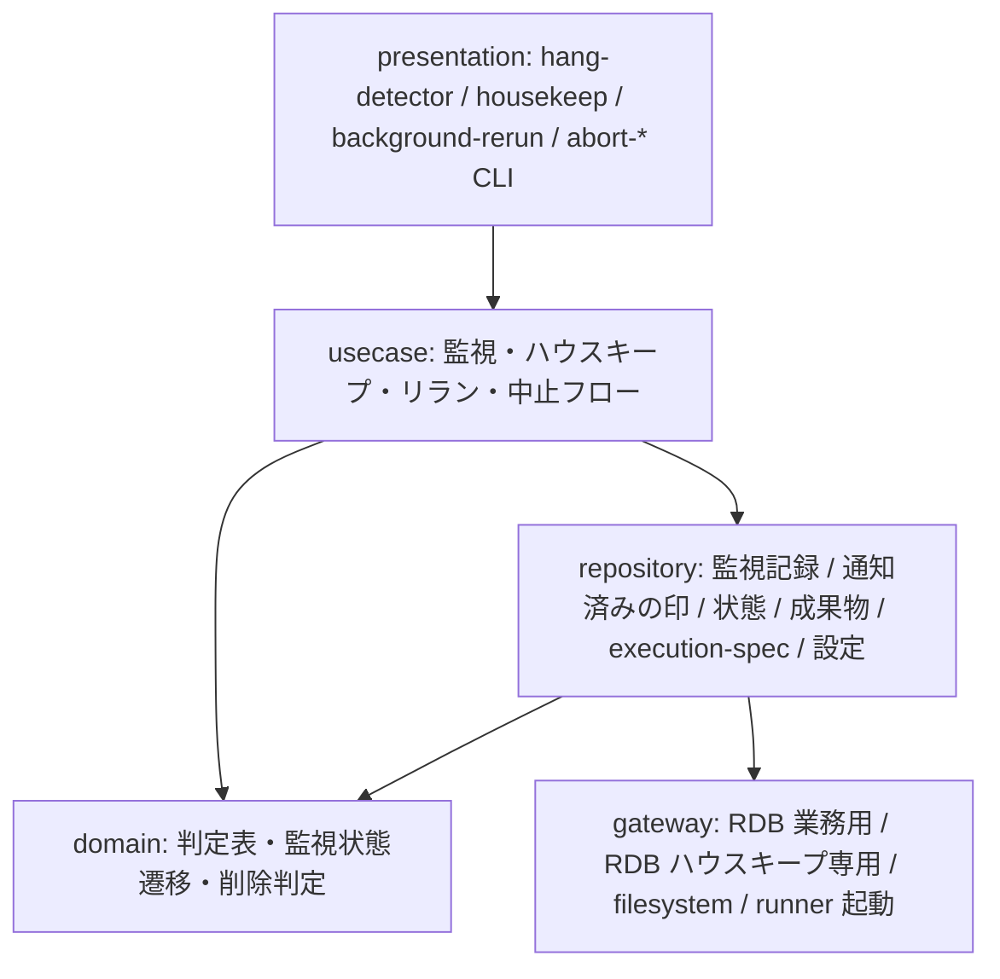

# アーキテクチャ設計書

## 概要

| 項目 | 内容 |
|------|------|
| イベントID | - |
| 作成日時 | - |
| ソース | - |
| 言語 | - |
| フレームワーク | - |
| 技術的制約 | - |

## ドメインアーキテクチャ

### 境界づけられたコンテキスト (Bounded Context)

| ID | 名前 | 所属 SD | 所有 entity | 所有 BUC | チーム | confidence | 根拠 |
|----|------|:------:|-----------|---------|--------|:----------:|------|
| BC-005 | 適用構成コンテキスト | SD-004 | E-001, E-002, E-003, E-004, E-005, E-006, E-026, E-027, E-028 | 適用構成定義フロー | - | 中 | 基盤適用設計者だけが扱う設定契約の語彙(feature flag / ジョブマップ / 比較定義(比較ツール起動コマンド)/ ハング検知定期ジョブ設定 / ハウスキープ設定 / 速報クロスチェック設定 / 適用文書)で閉じており、実行系コンテキストは読み取り専用で従うため |
| BC-006 | ハウスキープコンテキスト | SD-005 |  | ハウスキープフロー | - | 中 | RDRA がハウスキープ業務を独立した業務として切り出し(利用者確定)、方針資料も C1 にハウスキープを独立要素として置いている。削除の単位・削除待ちの置き場・専用 DB ロールの語彙は他コンテキストに無く、行の削除という他コンテキストの不変条件(監視は通知のみ、中止は状態更新のみ、速報・確報のモデル所有)と相容れない責務を持つため、実行監視・復旧コンテキストへ統合せず独立 BC とする。自前の永続エンティティは持たず、設定(ハウスキープ設定)は適用構成コンテキストが所有する |

#### ユビキタス言語

**BC-005 適用構成コンテキスト**

| 用語 | 定義 |
|------|------|
| feature flag | 9 キー(BLUE_MODE / GREEN_MODE / RAPID_CROSSCHECK_MODE / BLUE_IMPL / GREEN_IMPL / BLUE_RUNNER / GREEN_RUNNER / RAPID_CROSSCHECK_RUNNER / RAPID_CROSSCHECK_WORKER)で slot ごとの実行モード・実装版・runner 実体・速報クロスチェックモード(foreground / background / off)と完了通知先・worker 実体を切り替える正本。設定版は持たない。運用モード(並行稼働 / 単独本番 / 次世代並行稼働)を組み合わせで表現する |
| ジョブマップ | JOB_ID から実行先(host・user・work_dir・script・fixed_params・hang_detect_limit_minutes)を slot ごとに解決する正本。1 行目ヘッダーの CSV(1 行 1 job_id)で、credential_ref / map_version は末尾の任意列 |
| 速報クロスチェック設定 | 速報クロスチェック用の env 設定ファイル(rapid-crosscheck.env)。管理 DB 接続参照名(RAPID_DB_CONN_REF。値は置かず参照名のみ)・lease 期間(RAPID_LEASE_SEC)・worker の poll 間隔(RAPID_POLL_INTERVAL_SEC)を保持し、facade・slot runner・速報クロスチェック runner・worker が読む。RAPID_CROSSCHECK_MODE=off では不要。ハング検知定期ジョブ設定と同型だが所有項目と読み手が異なるため別ファイル |
| 設定所有区分 | 各設定項目の正本をどこ(feature flag / slot ジョブマップ / ハング検知定期ジョブ設定(管理 DB 接続参照名)/ ハウスキープ設定(保持日数と管理 DB 接続参照名)/ 速報クロスチェック設定(速報の比較ツール起動コマンドを含む)/ 確報クロスチェック worker 設定(確報の比較ツール起動コマンドを含む)/ 適用文書)が所有するかの区分。比較対象は比較ツール側(適用側)が持つ |
| ハウスキープ設定 | ハウスキープ定期ジョブが使う設定。保持日数(正の整数。既定 90 日)と、ハウスキープ専用 DB ロールの管理 DB 接続参照名(値は置かず参照名のみ)を持つ。接続参照名は、RAPID_CROSSCHECK_MODE が off 以外の設置と確報クロスチェックを使う設置(確報クロスチェック worker の設定がある設置)では必須で、無い・空なら設定エラーとしてハウスキープは何も削除せずに終わる。無し・空にできるのは管理 DB を一切使わない設置(off で確報クロスチェック worker の設定が無い設置)だけで、そのときハウスキープは管理 DB に接続せず、確報比較依頼と管理 DB の行を削除しない。ファイル名・キー名と、確報クロスチェック worker の設定があるとみなす判定方法は仕様で確定する。保持日数は設定検証で正の整数であることを検査する |

**BC-006 ハウスキープコンテキスト**

| 用語 | 定義 |
|------|------|
| 削除の単位 | リランの親子(parent_run_id でつながる実行)をまとめた実行の単位と、確報比較依頼 1 件の 2 種類。実行の単位は単位内のすべての構成要素(並行稼働実行・各 slot・速報比較依頼)が終端し、最も遅い終了日時(管理 DB の行は completed_at、成果物だけの slot は exitcode.txt または aborted.txt の更新時刻。開始日時は使わない)から保持日数を過ぎたときだけ削除対象になる。1 つでも終わっていない構成要素があれば経過日数にかかわらず単位ごと残す |
| 削除待ちの置き場 | 成果物ルート配下に置く、削除対象と判定した成果物の移動先。同じファイルシステム内の 1 回の rename で移してから削除し、置き場に残っているものは判定をやり直さず次回の実行(ハウスキープ設定の検査を通った実行。設定エラーのときは置き場の中身も消さない)で無条件に削除する。置き場の場所は仕様で確定する |
| ハウスキープ専用 DB ロール | 管理 DB の行の削除だけに使う DB ロール。対象テーブルの SELECT と DELETE だけを持ち、業務用接続ロールには DELETE を足さない |

### コンテキストマップ

| ID | from BC | to BC | パターン | 方向 | 翻訳責務 | 統合イベント | confidence |
|----|---------|-------|:-------:|:----:|---------|--------------|:----------:|
| CM-013 | BC-006 | BC-005 | conformist | downstream | BC-006 は BC-005 のハウスキープ設定(保持日数と専用 DB ロールの接続参照名)をそのまま読み、保持日数で削除対象を判定する。あわせて feature flag の RAPID_CROSSCHECK_MODE と、BC-005 の確報クロスチェック worker 設定の有無を判定に使う。off 以外または確報クロスチェック worker の設定がある設置で接続参照名が無い・空なら設定エラーで何も削除せず、管理 DB に接続しないのは off で確報クロスチェック worker の設定が無く接続参照名が無い・空の設置だけとする(SP-027。設定があるとみなす判定方法は仕様で確定する)。削除したくない場合は運用者が定期ジョブを登録しない | - | 中 |

## システムアーキテクチャ

### ティア構成

| ID | ティア名 | 説明 | テクノロジー候補 |
|-----|---------|------|----------------|
| tier-ops | 実行監視・復旧ティア | hang-detector(ジョブスケジューラの定期ジョブ)、housekeep(ジョブスケジューラの 1 日 1 回の定期ジョブ)、background-rerun(専用ジョブ)、abort-blue / abort-green / abort-rapid-crosscheck / abort-final-crosscheck(運用者が配置ディレクトリから直接起動する対話 CLI)で構成する。監視は通知のみで、異常はハング検知ジョブ自身の終了結果(警告終了 / 失敗)と標準エラーで知らせ、ジョブスケジューラの既存のジョブ監視・障害通知で運用者へ届ける。中止は状態更新(slot は aborted.txt の書き込みを正本とする)のみ、リランは execution-spec.json からの復元で行う。ハウスキープは保持日数を過ぎた終了済みの実行の単位と確報比較依頼の成果物・管理 DB の行を削除する。ハング検知の管理 DB 接続参照名はハング検知定期ジョブ設定から、ハウスキープの保持日数と専用 DB ロールの接続参照名はハウスキープ設定から読む。ハウスキープは監視・復旧とは別の業務コンテキスト(ハウスキープコンテキスト)だが、ジョブスケジューラの定期ジョブとして facade から分離され、成果物ルートと管理 DB を走査する運用スクリプトという形が hang-detector と同じため、同じティアに置く | シェルスクリプト CLI(bash。定期ジョブ / 専用ジョブ / 対話 CLI), RDB クライアント CLI(監視記録・状態更新・parallel_run 作成。RAPID_CROSSCHECK_MODE=off では使わない), RDB クライアント CLI(ハウスキープ専用 DB ロールの接続。対象テーブルの SELECT と DELETE だけを使い、削除の単位ごとに 1 トランザクションで行を削除する), ファイルシステム走査・書き込み(started-at.txt / exitcode.txt / aborted.txt / execution-spec.json、通知済みの印の一時ファイル → リネーム出力), ファイルシステムの同一ファイルシステム内 rename と削除(ハウスキープの削除待ちの置き場への移動と、置き場からの削除) |

### 実行監視・復旧ティア (tier-ops) の方針・ルール

#### 方針

| ID | 方針名 | 内容 | 根拠 | RDRA/NFR 要素 | 確信度 |
|-----|---------|------|------|--------------|:------:|
| SP-016 | ハング検知判定と対象除外 | 定期ジョブ(5 分ごとなど)として未終端の background role を走査し、started-at.txt と execution-spec.json の hang_detect_limit_minutes から経過時間を判定する。exitcode.txt があり 0 なら正常終了、非 0 なら background 実行エラーとして通知、無く aborted.txt があれば中止済みとして監視記録を終端、どちらも無く上限以内なら継続監視、上限超過ならハング疑いとして通知する。ハング疑い通知済みの対象も再判定し、正常終了(exitcode 0)・実行エラー(非 0)・比較異常(速報比較依頼が NG / FAILED)・中止済みで監視記録を終端する。hang_detect_limit_minutes が 0 の role と foreground role は検知対象から除外する。RAPID_CROSSCHECK_MODE=off でも管理 DB なしで slot 成果物ファイルだけを走査する。完了通知の送信失敗は検知対象に含めない | 条件「ハング検知判定」「ハング検知対象の除外」「slot 実行の状態導出規則」「完了通知失敗の扱い」と状態モデル「監視状態」(通知後・中止後の終端遷移)、NFR C.1.3.1(アプリケーション監視)・C.3.1.1(自動検知+自動通知+自動記録)への対応 | 条件: ハング検知判定, ハング検知対象の除外, slot 実行の状態導出規則, 完了通知失敗の扱い, 状態: 監視状態, 情報: 監視記録, Runner Result, BUC: background 実行監視フロー, NFR C.1.3.1, NFR C.3.1.1, NFR C.1.1.1, NFR C.1.3.2 | 高 |
| SP-017 | 速報比較依頼の異常判定 | 速報比較依頼が FAILED または比較 NG のとき速報クロスチェック異常(error)として通知し、RUNNING のときは状態を変更せずハング疑い(warning)として通知する | 条件「速報比較依頼の異常判定」。ジョブスケジューラ応答に現れない速報異常を見落とさないため | 条件: 速報比較依頼の異常判定, バリエーション: 速報クロスチェック監視判定 | 高 |
| SP-018 | 監視は通知のみ・通知レベル・警告傾向の記録 | 監視は monitor_status(監視対象外 / 監視中 / ハング疑い通知済み / 実行エラー通知済み / 比較異常通知済み / 正常終了)/ hang_suspected_at / alerted_at を記録して運用者へ通知するだけとし、RUNNING を ABORTED にせず、プロセスを停止せず、新しい実行依頼を作成しない。通知はハング検知ジョブ自身の終了結果で行う: その回の見回りで新たに見つけた異常を標準エラーに 1 件 1 行(対象・段階 warning / error・経過時間)で出し、新たな異常が無ければ正常終了、ハング疑い(warning)だけなら警告終了、background 実行エラーまたは速報クロスチェック異常(error)が 1 件でもあれば失敗で終える(具体的な終了コードは CLI 契約で確定する)。運用者へはジョブスケジューラの既存のジョブ監視・障害通知で届き、relay-gate はメールなど CLI の出力以外の通知送信手段を持たない。通知済みの異常は監視記録の遷移規則で再び通知せず、RAPID_CROSSCHECK_MODE=off では成果物ルート配下の通知済みの印(Runner Result の契約ファイルとは別のファイル。一時ファイル → リネームで書く。置き場所とファイル名は仕様で確定)で判定する。通知の判定後に監視記録または印の保存に失敗した異常は次回も通知する(取りこぼさない側に倒す)。通知後に正常終了した実行(通知後正常終了)についても警告時の経過時間を記録し、hang_detect_limit_minutes の調整根拠にする | 条件「監視は通知のみ」「通知レベルの判定」「CLI による提示」「警告傾向の記録」。メール通知の廃止(2026-11-01。利用者が失敗の終了条件を確定)により、運用者が既に見ているジョブスケジューラの障害通知へ通知経路を寄せ、静観か対処かの判断を運用者に委ねるため | 条件: 監視は通知のみ, 通知レベルの判定, CLI による提示, 警告傾向の記録, 外部システム: ジョブスケジューラ, 情報: 監視記録, 実行ログ, アクター: 運用者, バリエーション: 監視状態, NFR C.5.1.1, NFR C.3.2.1, NFR C.3.1.1 | 高 |
| SP-019 | ハング検知上限の調整基準 | hang_detect_limit_minutes は導入時に全ジョブ 60 分とし、正常終了パターンの警告が出そろった時点で運用者がジョブごとに最後の警告の経過時間を基準に調整する。調整はジョブマップの列値を更新して行い、調整日時と調整根拠(警告時経過時間)の記録は適用構成文書に残す(ジョブマップの列には持たない)。変更は次回以降の run の execution-spec.json にのみ反映される | 条件「ハング検知上限の調整基準」と情報「適用構成文書」(運用者の調整記録)への対応 | 条件: ハング検知上限の調整基準, 情報: ハング検知上限設定, 適用構成文書, 監視記録, バリエーション: ハング検知上限設定 | 高 |
| SP-020 | background 側リランの事前検証と復元 | background-rerun は --source-run-id と --role を受け、元の execution-spec.json とファイル正本の状態(exitcode.txt / aborted.txt)を事前検証し、速報有効時は管理 DB の状態も照合する。--role blue / green は元の slot mode が background のときだけ新しい run_id で再実行し、foreground または off ならエラー終了する。--role rapid-crosscheck は業務ジョブを再実行せず速報比較依頼だけを新規作成する。未対応の role、元の実行が見つからない、元の実行が RUNNING(exitcode.txt も aborted.txt も無い)または中止未確認ならエラー終了する。RAPID_CROSSCHECK_MODE=off でも aborted.txt があれば管理 DB なしで background slot をリランできる。最新のジョブマップは再解決せず、元の execution-spec.json から実行パラメータ・host・user・script・work_dir を復元する。新しい parallel_run の parent_run_id には直前のリラン元 run_id を設定し、background slot のリラン由来 run は runner が終端時に、速報比較依頼だけのリラン由来 run は worker が依頼終端時に COMPLETED にする。ハウスキープが成果物を消したあと管理 DB の行が残っている期限切れの実行をリランしようとした場合は、元の execution-spec.json が無いことをエラーとして返す | 条件「リラン事前検証」「リランの実行設定復元」「リラン系譜の追跡」「slot 実行の状態導出規則」と状態モデル「並行稼働実行」(リラン由来 run の COMPLETED 到達)、NFR A.4.1.1 / A.4.1.2 / A.4.1.3(execution-spec と Runner Result からの復旧。縮退運転 off でも中止・リランが成立)への対応 | 条件: リラン事前検証, リランの実行設定復元, リラン系譜の追跡, slot 実行の状態導出規則, 情報: リラン指示, Runner Result, 状態: 並行稼働実行, BUC: background 側リランフロー, NFR A.4.1.1, NFR A.4.1.2, NFR A.4.1.3 | 高 |
| SP-021 | 復旧手段の選択 | background slot 実行と速報比較依頼は専用ジョブの background-rerun で再実行し、foreground slot 実行と確報クロスチェックはジョブスケジューラの正規ジョブを直接再実行する。RUNNING の background 実行は運用者が明示中止してからリランする | 条件「復旧手段の選択」への対応 | 条件: 復旧手段の選択, バリエーション: 再実行経路, リラン対象 role | 高 |
| SP-022 | 中止スクリプトの可否判定と停止確認応答 | abort-blue / abort-green は対象 slot が background かつ RUNNING(exitcode.txt も aborted.txt も無い)のときだけ、abort-rapid-crosscheck は対象の速報比較依頼が REQUESTED / CLAIMED / RUNNING のいずれかのとき、abort-final-crosscheck は対象の確報比較依頼が RUNNING のときだけ ABORTED へ遷移できる(確報の未着手依頼はジョブスケジューラの正規ジョブが同期 polling 中であり runner 側の polling 上限で扱う)。それ以外(終端済み、または確報で RUNNING 以外)は状態を変更せずエラー終了する。現在状態を表示後に「対象ジョブのプロセスは強制終了してありますか？ [yes/no]」と対話確認し、yes のときだけ状態を更新する。abort-rapid-crosscheck は worker のプロセス停止を運用者に確認したうえで status IN (REQUESTED, CLAIMED, RUNNING) を条件とする条件付き UPDATE で ABORTED にする(CLAIMED を放置すると lease 失効で REQUESTED に戻り別の worker が再 claim して比較が実行されるため、中止済み run の依頼を運用者が止める手段。claim 済み worker は RUNNING への条件付き UPDATE が 0 件になり比較を開始しない)。slot の中止は成果物ディレクトリへ aborted.txt(中止日時 1 行)を一時ファイル経由で書くことを正本とし、RAPID_CROSSCHECK_MODE が off でも成立する。off 以外なら管理 DB の slot 実行と並行稼働実行(STARTED / RUNNING のどちらからでも)も ABORTED に更新し、対象 run に REQUESTED で未着手(worker が claim していない)の速報比較依頼があればそれも ABORTED にする(両系の完了通知で依頼が REQUESTED で作成された直後に slot を中止した場合の競合窓を塞ぐ保険。dispatcher 側の中止済み run 判定(SP-009)と併用する。CLAIMED / RUNNING の依頼は変更せず abort-rapid-crosscheck の対象とする。速報比較依頼のみで確報比較依頼には適用しない)。スクリプト自身はプロセス・Pod・SSH 接続先の処理を停止しない。指示者と応答は実行ログに残す | 条件「slot 中止可否判定」「依頼中止可否判定」(速報比較依頼は REQUESTED / CLAIMED / RUNNING、確報比較依頼は RUNNING のみ。CLAIMED 中止時の競合規則)「停止確認応答」「slot 実行の状態導出規則」と状態モデル「並行稼働実行」(STARTED → ABORTED)「クロスチェック依頼」(REQUESTED / CLAIMED / RUNNING → ABORTED)、バリエーション「中止対象種別」、NFR E.7.1.1(運用操作の記録)・A.4.1.3(縮退運転 off でも中止が成立)・C.3.3.1(手動復旧)への対応。CLAIMED の依頼を運用者が止められず lease 失効後に比較が実行される抜けと、両 slot 完了直後に中止した場合に未着手依頼だけが残る競合窓を塞ぐため | 条件: slot 中止可否判定, 依頼中止可否判定, 停止確認応答, slot 実行の状態導出規則, 中止済み run の比較依頼作成除外, 情報: 中止指示, Runner Result, 速報比較依頼(rapid_crosscheck_request), 確報比較依頼(final_crosscheck_request), BUC: 実行中止フロー, 状態: slot 実行, 並行稼働実行, クロスチェック依頼, バリエーション: 中止対象種別, 停止確認応答, NFR E.7.1.1, NFR A.4.1.3, NFR C.3.3.1 | 高 |
| SP-027 | ハウスキープの削除判定 | housekeep はジョブスケジューラの定期ジョブ(1 日 1 回)として起動され、ハウスキープ設定の保持日数(正の整数。既定 90 日)を使って、成果物ルートと管理 DB を毎回走査する(成果物ルートの走査は管理 DB の有無にかかわらず毎回行う)。削除の単位はリランの親子(parent_run_id でつながる実行)をまとめた実行の単位と確報比較依頼 1 件の 2 種類とする。実行の単位は、単位内のすべての構成要素(並行稼働実行・各 slot・速報比較依頼)が終端し、構成要素の終了日時のうち最も遅いもの(管理 DB の行は completed_at、成果物だけの slot は exitcode.txt または aborted.txt の更新時刻。開始日時は使わない)から保持日数を過ぎたときだけ削除対象にする。管理 DB を使う設定では並行稼働実行が COMPLETED / ABORTED、すべての slot 実行と速報比較依頼が SUCCEEDED / FAILED / ABORTED であることを終端の条件とする。RAPID_CROSSCHECK_MODE=off で管理 DB の行が無い実行は、execution-spec.json で起動対象の slot(mode が off の slot は含まない)のすべてに exitcode.txt または aborted.txt があることで判定し、起動対象の slot の成果物ディレクトリや execution-spec.json が無い実行は残して標準エラーに warn を出す。速報比較依頼だけのリランで作られた run は管理 DB の行だけで判定する。1 つでも終わっていない構成要素(RUNNING / CLAIMED / REQUESTED、slot の終了ファイルが無い)があれば経過日数にかかわらず単位ごと残す。確報比較依頼は終端状態で completed_at から保持日数を過ぎたものを依頼ごとに削除対象にする(RAPID_CROSSCHECK_MODE=off でも、確報クロスチェックを使う設置(確報クロスチェック worker の設定がある設置)では接続参照名が必須のため同じ規則で削除する)。ハウスキープ設定の管理 DB 接続参照名は、RAPID_CROSSCHECK_MODE が off 以外の設置と確報クロスチェックを使う設置では必須とし、無い・空なら設定エラーとして非 0 で終わり、成果物・管理 DB の行・確報比較依頼のいずれも削除しない(削除待ちの置き場の中身も消さない。この設定の検査を走査と削除より先に行う)。管理 DB に接続しないのは、管理 DB を一切使わない設置(RAPID_CROSSCHECK_MODE=off で、確報クロスチェック worker の設定が無く、ハウスキープ設定の管理 DB 接続参照名が無い・空)だけで、このときは次の段の規則を上記より優先する: 管理 DB に接続せず、確報比較依頼と管理 DB の行を削除せず、起動のたびに管理 DB の行を削除しない旨の warn を標準エラーへ 1 行出す。成果物ルートの実行は成果物だけで判定するが、execution-spec.json に記録された速報クロスチェックのモードが off でない実行(off 以外の期間に作られ、管理 DB に終わっていない構成要素があり得る実行)は判定できないものとして経過日数にかかわらず単位ごと残し、標準エラーに warn を出す。off の期間に作られた成果物だけの実行は上記の成果物だけの規則どおりに判定する。これらの warn は終了コードに影響しない(warn の文言、設定のキー名、確報クロスチェック worker の設定があるとみなす判定方法(既存の確報系コマンドの判定と揃える)、設定エラーの終了コードは仕様で確定する)。業務ジョブ(facade)の起動時には削除しない。判定は純粋関数の判定表として domain 層に置く | 条件「ハウスキープの削除判定」「リラン系譜の追跡」「速報クロスチェック有効判定」「slot 実行の状態導出規則」と情報「ハウスキープ設定」への対応。リラン系譜の途中だけを消してリランの親子関係が壊れることと、終わっていない実行を消すことを防ぎ、成果物と管理 DB の量を保持日数分で頭打ちにする(NFR B.3.3.1 のストレージ拡張性の前提)。管理 DB に接続しない設定でも、off 以外の期間に作られた実行を成果物だけで消して管理 DB 側の終わっていない構成要素を見落とさないようにする(2026-11-03 の要求の受け入れ基準の追加に追従)。管理 DB を使う機能が 1 つでもある設置では接続参照名を必須にし、off で確報クロスチェックを使う設置で確報比較依頼が削除されずに増え続けることを防ぐ(2026-11-03 の接続参照名の必須化に追従。NFR B.3.3.1 / F.1.2.1) | 条件: ハウスキープの削除判定, リラン系譜の追跡, 速報クロスチェック有効判定, slot 実行の状態導出規則, 情報: ハウスキープ設定, 並行稼働実行(parallel_run), slot 実行, 速報比較依頼(rapid_crosscheck_request), 確報比較依頼(final_crosscheck_request), 実行設定(execution-spec), Runner Result, 状態: 並行稼働実行, slot 実行, クロスチェック依頼, BUC: ハウスキープフロー, 外部システム: ジョブスケジューラ, NFR B.3.3.1, NFR F.1.2.1 | 高 |
| SP-028 | ハウスキープの削除順序と回復 | 何度実行しても結果が同じになるように削除する。1 つの単位の中では成果物(成果物ディレクトリと通知済みの印)を先に処理し、そのあと管理 DB の行(並行稼働実行・slot 実行・速報実行・速報比較依頼・監視記録、または確報比較依頼)を 1 つのトランザクションで削除する。成果物は削除対象と判定したら、まず成果物ルート配下の削除待ちの置き場へ同じファイルシステム内の 1 回の rename で移してから削除し、置き場に残っているものは判定をやり直さず次回の実行で無条件に削除する(置き場の場所は仕様で確定)。管理 DB の行が残っている間は次回の走査で同じ単位を再び見つけ、既に無いファイルは削除済みとして扱う。管理 DB の行の削除にはハウスキープ設定の接続参照名で解決するハウスキープ専用 DB ロール(対象テーブルの SELECT と DELETE だけ)を使い、業務用接続ロールには DELETE を足さない。削除した件数を標準出力に出し、失敗は標準エラーに出して非 0 で終わる(ジョブスケジューラの障害通知で運用者へ届く)。管理 DB に接続しないとき(SP-027。管理 DB を一切使わない設置だけ)は管理 DB の行の削除の段を行わず、そのことを示す warn は失敗として扱わない。ハウスキープ設定の検査(保持日数と、必須の設置での接続参照名の有無)は削除待ちの置き場の残りの削除を含むすべての削除より先に行い、設定エラーなら置き場の中身も含めて何も削除せずに非 0 で終わる | 条件「ハウスキープの削除順序と回復」と NFR E.5.2.1(ユーザ単位の権限)・C.1.2.1(バックアップ対象)・A.4.1.1(execution-spec と Runner Result からの復旧)への対応。成果物を先に消し DB 行を後に消すことで、途中で失敗しても DB 行が残っている限り次回の走査で再発見でき、削除漏れの成果物が孤立しない。置き場への rename で削除対象の確定と実削除を分け、途中失敗後に判定をやり直さずに済ませる。業務用ロールに DELETE を足さないことで、業務スクリプトの誤りで履歴が消える経路を作らない | 条件: ハウスキープの削除順序と回復, 情報: ハウスキープ設定, 監視記録, Runner Result, 実行ログ, 並行稼働実行(parallel_run), slot 実行, 速報実行(rapid_run), 速報比較依頼(rapid_crosscheck_request), 確報比較依頼(final_crosscheck_request), BUC: ハウスキープフロー, 条件: CLI による提示, NFR E.5.2.1, NFR C.1.2.1, NFR A.4.1.1, NFR E.7.1.1 | 高 |

#### ルール

| ID | ルール名 | 内容 | 根拠 | RDRA/NFR 要素 | 確信度 |
|-----|---------|------|------|--------------|:------:|
| SR-005 | 監視・復旧・ハウスキープのスクリプトの facade からの分離 | hang-detector / housekeep / background-rerun / abort-* は通常起動の facade から分離し、ジョブスケジューラの別ジョブ定義(ハング検知定期ジョブ / ハウスキープ定期ジョブ / background リラン専用ジョブ)または運用者の直接起動で動かす。facade の実行経路にこれらの処理を混ぜない。業務ジョブの起動時に成果物や管理 DB の行を削除しない | 方針資料「ハング監視と background 側の選択リランは通常起動の facade から分離する」「ハウスキープは業務ジョブの起動時には削除しない」への対応 | バリエーション: ジョブスケジューラ起動ジョブ種別, 外部システム: ジョブスケジューラ, BUC: ハウスキープフロー | 高 |

## アプリケーションアーキテクチャ

### tier-ops のレイヤー構成

#### レイヤー依存図

| ID | レイヤー名 | 責務 | 依存許可先 |
|-----|---------|------|----------|
| L-ops-presentation | プレゼンテーション層(CLI エントリ) | hang-detector / housekeep / background-rerun(--source-run-id, --role) / abort-*(--run-id)の引数検証、現在状態の表示、停止確認の対話プロンプト、終了コードの決定(hang-detector はその回に新たに見つけた異常の段階から正常終了 / 警告終了 / 失敗を決め、異常を標準エラーに 1 件 1 行で出す。housekeep は削除件数を標準出力に、失敗を標準エラーに出し、失敗があれば非 0 で終える) | L-ops-usecase |
| L-ops-usecase | ユースケース層 | 監視走査 → 判定 → 新たな異常の抽出(通知済みの除外)→ 監視記録または通知済みの印の保存 → 終了結果と標準エラーでの通知(hang-detector)、ハウスキープ設定の検査(設定エラーなら何も削除せず終了)→ 削除待ちの置き場の残りの無条件削除 → 成果物ルートと管理 DB の走査 → 削除の単位の組み立てと削除判定 → 単位ごとに成果物の置き場への移動と削除 → 管理 DB の行の 1 トランザクション削除 → 件数集計(housekeep)、事前検証 → execution-spec 復元 → 新 run 作成 → background slot / 比較依頼の起動(background-rerun)、可否判定 → 停止確認 → 状態更新(abort-*。abort-blue / abort-green は slot・並行稼働実行に加えて対象 run の未着手の速報比較依頼の ABORTED 化(競合窓の保険)を含む。abort-rapid-crosscheck は REQUESTED / CLAIMED / RUNNING の速報比較依頼、abort-final-crosscheck は RUNNING の確報比較依頼を中止する)のフロー制御 | L-ops-domain, L-ops-repository |
| L-ops-domain | ドメイン層 | slot 実行の状態導出(exitcode.txt / aborted.txt の有無・値)、ハング検知判定表(導出状態 × 経過時間と上限)、速報比較依頼の異常判定表、通知レベル対応表、監視状態の遷移(6 値。通知後・中止後の終端を含む)、リラン事前検証表(role × 元 mode × 導出状態)、中止可否判定表(slot は mode × 導出状態、比較依頼はクロスチェック種別 × 依頼状態(速報は REQUESTED / CLAIMED / RUNNING、確報は RUNNING のみ)。abort-blue / abort-green が併せて中止する速報比較依頼の状態条件(REQUESTED で未着手のみ)を含む)、復旧手段の選択表、ハング検知ジョブの終了結果の決定表(その回の新たな異常の段階 → 正常終了 / 警告終了 / 失敗)、ハウスキープの削除判定表(削除の単位の構成要素の終端判定 × 最も遅い終了日時と保持日数。管理 DB あり / RAPID_CROSSCHECK_MODE=off の成果物だけ / 速報比較依頼だけのリラン run / 確報比較依頼の各判定) | - |
| L-ops-repository | リポジトリ層 | 監視記録(管理 DB)、通知済みの印(RAPID_CROSSCHECK_MODE=off。成果物ルート配下)、slot 実行・parallel_run・比較依頼の状態(管理 DB)、Runner Result / execution-spec.json / aborted.txt(成果物ディレクトリ)、ハング検知上限設定(execution-spec 経由)、ハング検知定期ジョブ設定(env 形式の設定ファイル)、ハウスキープ設定(保持日数と専用 DB ロールの接続参照名)の読み書き。ハウスキープ用に、削除の単位の構成要素(管理 DB の行と成果物の終了日時)の列挙、削除待ちの置き場への移動と削除、削除の単位の管理 DB の行の削除を提供する | L-ops-domain, L-ops-gateway |
| L-ops-gateway | ゲートウェイ層 | RDB クライアントアダプタ(業務用ロールの接続による条件付き UPDATE での ABORTED 遷移・監視記録の保存)、ハウスキープ用 RDB クライアントアダプタ(ハウスキープ設定の接続参照名で解決する専用 DB ロールの接続。削除の単位の行を 1 トランザクションで DELETE)、ファイルシステム走査・書き込みアダプタ(aborted.txt と通知済みの印の一時ファイル → リネーム出力を含む)、ファイルシステム移動・削除アダプタ(削除待ちの置き場への同一ファイルシステム内 rename と置き場からの削除)、slot runner / 速報クロスチェック runner 起動アダプタ(リラン) | - |

#### プレゼンテーション層(CLI エントリ) (L-ops-presentation) の方針・ルール

**方針**

| ID | 方針名 | 内容 | 根拠 | RDRA/NFR 要素 | 確信度 |
|-----|---------|------|------|--------------|:------:|
| LP-016 | 停止確認の対話 | abort-* は現在状態を表示後に「対象ジョブのプロセスは強制終了してありますか？ [yes/no]」と確認し、yes 以外は状態を変更せず終了する | 条件「停止確認応答」への対応 | 条件: 停止確認応答, 情報: 中止指示, バリエーション: 停止確認応答 | 高 |

#### ユースケース層 (L-ops-usecase) の方針・ルール

**方針**

| ID | 方針名 | 内容 | 根拠 | RDRA/NFR 要素 | 確信度 |
|-----|---------|------|------|--------------|:------:|
| LP-017 | 監視は通知のみ | hang-detector の usecase は状態更新・プロセス停止・依頼作成を呼ばない。監視記録(RAPID_CROSSCHECK_MODE=off では通知済みの印)の保存と、その回に新たに見つけた異常の presentation への受け渡し(標準エラーの行と終了結果の段階)だけを行う。通知済みの異常は渡さず、保存に失敗した異常は通知済みにしない(次回も通知する) | 条件「監視は通知のみ」「通知レベルの判定」「警告傾向の記録」への対応。メール送信は 2026-11-01 に廃止 | 条件: 監視は通知のみ, 通知レベルの判定, 警告傾向の記録, 状態: 監視状態 | 高 |
| LP-025 | ハウスキープは削除だけを行う | housekeep の usecase は状態更新・依頼作成・プロセス停止を呼ばない。最初にハウスキープ設定を検査し(RAPID_CROSSCHECK_MODE が off 以外、または確報クロスチェック worker の設定がある設置で接続参照名が無い・空なら設定エラー)、設定エラーなら削除待ちの置き場を含めて何も削除せずに非 0 で終える。設定が正しければ削除待ちの置き場の残りを無条件に削除したあと、削除の単位ごとに成果物(成果物ディレクトリと通知済みの印)を置き場へ移して削除し、そのあと管理 DB の行を 1 トランザクションで削除する順序を守る。失敗は標準エラーに出して非 0 で終える(失敗後に残りの単位の処理を続けるかは仕様で確定する) | 条件「ハウスキープの削除順序と回復」への対応。途中失敗でも次回の実行で残りを削除できる冪等な構成にするため | 条件: ハウスキープの削除順序と回復, ハウスキープの削除判定, BUC: ハウスキープフロー | 中 |
| LP-018 | リランの復元元の固定 | background-rerun の usecase は最新ジョブマップの repository を呼ばず、元 run の execution-spec.json からのみ実行設定を復元し、新 run_id の parallel_run に parent_run_id を設定する | 条件「リランの実行設定復元」「リラン系譜の追跡」「リラン事前検証」への対応 | 条件: リランの実行設定復元, リラン系譜の追跡, リラン事前検証, 情報: リラン指示 | 高 |

#### ドメイン層 (L-ops-domain) の方針・ルール

**方針**

| ID | 方針名 | 内容 | 根拠 | RDRA/NFR 要素 | 確信度 |
|-----|---------|------|------|--------------|:------:|
| LP-019 | 判定表をドメインに集約 | slot 実行の状態導出・ハング検知判定・対象除外・異常判定・通知レベル・監視状態の遷移(ハング疑い通知済み → 正常終了 / 実行エラー通知済み / 比較異常通知済み、監視中・ハング疑い通知済み → 正常終了(中止済み))・リラン事前検証・中止可否(slot 実行モード × 導出状態、およびクロスチェック種別 × 依頼状態。速報比較依頼は REQUESTED / CLAIMED / RUNNING、確報比較依頼は RUNNING のみ中止可)・復旧手段・ハング検知ジョブの終了結果・ハウスキープの削除判定の各判定表を純粋関数として実装し、テスト可能にする(現在時刻と保持日数は引数で受け取る) | 条件「slot 実行の状態導出規則」「ハング検知判定」「ハング検知対象の除外」「速報比較依頼の異常判定」「通知レベルの判定」「リラン事前検証」「slot 中止可否判定」「依頼中止可否判定」(縦軸クロスチェック種別 × 横軸依頼状態の判定表)「復旧手段の選択」「ハウスキープの削除判定」と状態モデル「監視状態」「クロスチェック依頼」(REQUESTED / CLAIMED / RUNNING → ABORTED)、バリエーション「中止対象種別」への対応 | 条件: slot 実行の状態導出規則, ハング検知判定, ハング検知対象の除外, 速報比較依頼の異常判定, 通知レベルの判定, リラン事前検証, slot 中止可否判定, 依頼中止可否判定, 復旧手段の選択, ハウスキープの削除判定, 状態: 監視状態, クロスチェック依頼, バリエーション: ハング検知判定結果, 監視状態, 中止対象種別, クロスチェック依頼状態 | 高 |

#### リポジトリ層 (L-ops-repository) の方針・ルール

**方針**

| ID | 方針名 | 内容 | 根拠 | RDRA/NFR 要素 | 確信度 |
|-----|---------|------|------|--------------|:------:|
| LP-020 | 管理 DB なしでの監視・中止・リラン | RAPID_CROSSCHECK_MODE=off のとき repository は管理 DB に接続せず、成果物ディレクトリの走査だけで監視対象を列挙し、slot 実行の状態は exitcode.txt / aborted.txt から導出する。通知済みかどうかは監視記録の代わりに成果物ルート配下の通知済みの印(Runner Result の契約ファイルとは別のファイル。一時ファイル → リネームで書く。置き場所とファイル名は仕様で確定)で判定する。abort-blue / abort-green の中止は aborted.txt の書き込みだけで成立し、background-rerun も成果物ファイルだけで事前検証する。housekeep も管理 DB の行が無い実行を成果物だけ(execution-spec.json で起動対象の slot の終了ファイル)で判定して削除する | 条件「ハング検知判定」「通知レベルの判定」「slot 実行の状態導出規則」「ハウスキープの削除判定」と方針資料「off の場合も slot 成果物だけで監視・中止・リラン」「off では成果物ルート配下へ通知済みの印をファイルで残して判定する」への対応 | 条件: ハング検知判定, 通知レベルの判定, 速報クロスチェック有効判定, slot 実行の状態導出規則, ハウスキープの削除判定, 情報: 監視記録, ハング検知上限設定, Runner Result, 実行設定(execution-spec) | 高 |

#### ゲートウェイ層 (L-ops-gateway) の方針・ルール

**方針**

| ID | 方針名 | 内容 | 根拠 | RDRA/NFR 要素 | 確信度 |
|-----|---------|------|------|--------------|:------:|
| LP-021 | 条件付き状態更新と aborted.txt の原子的書き込み | slot の中止は aborted.txt を一時ファイルへ書いて確定名へリネームすることを正本とし、既に exitcode.txt または aborted.txt があれば書かずにエラーを返す。管理 DB の ABORTED への更新(off 以外)は WHERE 句で現在状態(slot 実行は RUNNING かつ background、並行稼働実行は STARTED または RUNNING)を条件にし、競合時は更新件数 0 をエラーとして返す。abort-blue / abort-green が併せて行う速報比較依頼の ABORTED 更新は WHERE status = REQUESTED(worker_id 未設定)を条件にし、該当なし(依頼が無い、または既に CLAIMED / RUNNING 以降)は更新件数 0 を正常として扱い、その依頼には触れない(競合窓の保険であり、dispatcher 側の中止済み run 判定と併用する)。abort-rapid-crosscheck の ABORTED 更新は WHERE status IN ('REQUESTED', 'CLAIMED', 'RUNNING') を条件にし、更新件数 0(終端済み)はエラーとして返す。abort-final-crosscheck は WHERE status = RUNNING を条件にする | 条件「slot 中止可否判定」「依頼中止可否判定」(CLAIMED 中止時の競合規則: status IN 条件の条件付き UPDATE)「slot 実行の状態導出規則」「成果物公開判定」と状態モデル「クロスチェック依頼」(REQUESTED / CLAIMED / RUNNING → ABORTED)への対応。二重実行と worker の claim との競合を DB のトランザクションで防ぐため | 条件: slot 中止可否判定, 依頼中止可否判定, slot 実行の状態導出規則, 成果物公開判定, claim 排他, 状態: クロスチェック依頼, システム概要: ジョブキュー兼管理 DB(内部データストア), 情報: ハング検知定期ジョブ設定, 速報比較依頼(rapid_crosscheck_request) | 高 |
| LP-026 | 削除待ちの置き場への rename と専用ロールでの 1 トランザクション削除 | 成果物の削除は、削除対象の成果物ディレクトリ(と通知済みの印)を成果物ルート配下の削除待ちの置き場へ同じファイルシステム内の 1 回の rename で移してから削除する。既に無いファイルは削除済みとして扱いエラーにしない。管理 DB の行の削除はハウスキープ専用 DB ロールの接続だけで行い、1 つの削除の単位の行(並行稼働実行・slot 実行・速報実行・速報比較依頼・監視記録、または確報比較依頼)を 1 トランザクションで DELETE する。業務用ロールのアダプタには DELETE を実装しない | 条件「ハウスキープの削除順序と回復」への対応。rename で削除対象の確定を原子的にし、DB の行を単位ごとに原子的に消すことで、途中失敗後の再実行で同じ結果になる | 条件: ハウスキープの削除順序と回復, 情報: ハウスキープ設定, システム概要: ジョブキュー兼管理 DB(内部データストア) | 高 |

#### レイヤー共通の方針

| ID | 方針名 | 内容 | 根拠 | RDRA/NFR 要素 | 確信度 |
|-----|---------|------|------|--------------|:------:|
| CLP-007 | IF なし(直接依存) | tier-facade と同じく直接依存とする | 一般的なベストプラクティスとして適用 | なし | デフォルト |
| CLP-008 | 運用操作の記録 | 中止・リランの運用操作は指示者(実行ユーザー)・応答・対象 run_id・role を実行ログに残し、監視記録には monitor_status(6 値)/ hang_suspected_at / alerted_at / 警告時経過時間を残す。hang_detect_limit_minutes の調整記録は監視記録ではなく適用構成文書に残す。ハング検知が通知した異常(対象・段階・経過時間)と、ハウスキープが削除した単位(run_id または確報比較依頼の ID)・件数・失敗も実行ログに残す | 条件「警告傾向の記録」「ハウスキープの削除順序と回復」と NFR E.7.1.1(監査ログ)・C.3.1.1(自動記録)への対応 | 条件: 警告傾向の記録, ハウスキープの削除順序と回復, 情報: 実行ログ, 監視記録, NFR E.7.1.1, NFR C.3.1.1, NFR C.6.1.1 | 高 |

#### レイヤー共通のルール

| ID | ルール名 | 内容 | 根拠 | RDRA/NFR 要素 | 確信度 |
|-----|---------|------|------|--------------|:------:|
| CLR-004 | エラーハンドリングと終了コード | tier-facade の CLR-001 と同一。事前検証エラー・中止不可は状態を変更せず非 0 で終了し、原因を stderr に出す | レイヤー責務の分離 | なし | デフォルト |

## データアーキテクチャ

### エンティティ一覧

#### E-028: ハウスキープ設定

- **参照元**: 情報: ハウスキープ設定
- **モデル種別**: リソース

| 属性名 | 型 | 説明 | NULL | PK |
|--------|-----|------|:----:|:--:|
| retention_days | integer | 保持日数(正の整数。既定 90 日)。削除の単位の最も遅い終了日時からこの日数を過ぎたものを削除対象にする。正の整数であることを設定検証で検査する。キー名は仕様で確定する | No |  |
| db_conn_ref | string | ハウスキープ専用 DB ロール(対象テーブルの SELECT と DELETE だけ)の管理 DB 接続参照名。認証情報の値は置かず参照名のみ。RAPID_CROSSCHECK_MODE が off 以外の設置と確報クロスチェックを使う設置(確報クロスチェック worker の設定がある設置)では必須で、無い・空なら設定エラーとしてハウスキープは何も削除しない。無し・空にできる(nullable)のは管理 DB を一切使わない設置だけで、そのときハウスキープは管理 DB に接続せず、確報比較依頼と管理 DB の行を削除しない(削除判定は SP-027)。キー名は仕様で確定する | Yes |  |

**リレーション**

| 対象エンティティ | カーディナリティ | 説明 |
|-----------------|:---------------:|------|
| E-013 | 1:N | 保持日数を過ぎた終了済みの実行の単位(並行稼働実行と、その slot 実行・速報実行・速報比較依頼・監視記録)の削除基準を与える |
| E-019 | 1:N | 終端した確報比較依頼の削除基準(保持日数)を与える |
| E-011 | 1:N | 成果物(Runner Result と execution-spec.json を含む成果物ディレクトリ)の削除基準を与える |
| E-026 | 1:1 | ハング検知定期ジョブ設定と同じく接続参照名だけを持つが、接続するロール(削除権限を持つ専用ロール)と読み手(housekeep)が異なるため別の設定 |

## 凡例

### 確信度

| 確信度 | 意味 |
|:------:|------|
| 高 | RDRA/NFR モデルから明確に推論 |
| 中 | RDRA/NFR モデルから間接推論 |
| 低 | 弱い根拠での推論 |
| デフォルト | 一般的なベストプラクティスを適用 |
| ユーザー指定 | 対話でユーザーが指定 |
