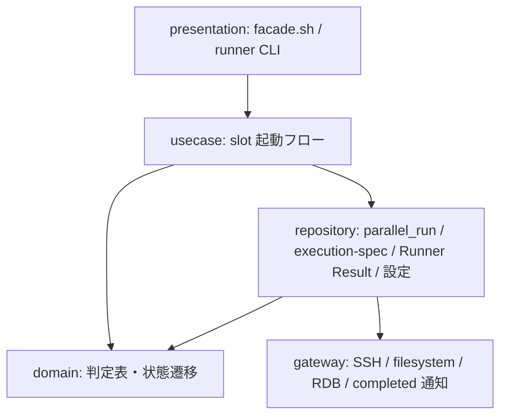

# アーキテクチャ設計書

## 概要

| 項目 | 内容 |
|------|------|
| イベントID | - |
| 作成日時 | - |
| ソース | - |
| 言語 | - |
| フレームワーク | - |
| 技術的制約 | - |

## ドメインアーキテクチャ

### 境界づけられたコンテキスト (Bounded Context)

| ID | 名前 | 所属 SD | 所有 entity | 所有 BUC | チーム | confidence | 根拠 |
|----|------|:------:|-----------|---------|--------|:----------:|------|
| BC-005 | 適用構成コンテキスト | SD-004 | E-001, E-002, E-003, E-004, E-005, E-006, E-026, E-027, E-028 | 適用構成定義フロー | - | 中 | 基盤適用設計者だけが扱う設定契約の語彙(feature flag / ジョブマップ / 比較定義(比較ツール起動コマンド)/ ハング検知定期ジョブ設定 / ハウスキープ設定 / 速報クロスチェック設定 / 適用文書)で閉じており、実行系コンテキストは読み取り専用で従うため |

#### ユビキタス言語

**BC-005 適用構成コンテキスト**

| 用語 | 定義 |
|------|------|
| feature flag | 9 キー(BLUE_MODE / GREEN_MODE / RAPID_CROSSCHECK_MODE / BLUE_IMPL / GREEN_IMPL / BLUE_RUNNER / GREEN_RUNNER / RAPID_CROSSCHECK_RUNNER / RAPID_CROSSCHECK_WORKER)に、slot ジョブマップの場所を書く任意の 2 キー(blue 用と green 用に 1 つずつ。キー名は仕様で確定する)を加えた構成で、slot ごとの実行モード・実装版・runner 実体・速報クロスチェックモード(foreground / background / off)と完了通知先・worker 実体・slot ジョブマップの場所を切り替える正本。任意の 2 キーを書かない 9 キーだけの設定はそのまま通り、未知のキーとして扱うのは 9 キーと任意の 2 キーのどちらでもないキーとする。BLUE_RUNNER / GREEN_RUNNER には、relay-gate が提供する標準の slot runner か、利用者が自作した runner を割り当てる。設定版は持たない。運用モード(並行稼働 / 単独本番 / 次世代並行稼働)を組み合わせで表現する |
| ジョブマップ | JOB_ID から実行先(host・user・work_dir・script・fixed_params・hang_detect_limit_minutes)を slot ごとに解決する正本。1 行目ヘッダーの CSV(1 行 1 job_id)で、credential_ref / map_version は末尾の任意列。slot ごとのジョブマップの場所は feature flag の任意のキーで指定でき(絶対パスと相対パスのどちらも受け付け、相対パスの基準は feature flag の設定ファイルがあるディレクトリ)、キーが無い・空なら設定ファイル置き場の固定の名前(blue-job-map.csv / green-job-map.csv)を使う。feature flag の検証コマンドと実行時の読み手(slot runner など)は、同じ設定から同じジョブマップを選ぶ |
| 標準の slot runner | relay-gate が正式な提供物として提供する slot runner。そのまま BLUE_RUNNER / GREEN_RUNNER に割り当てられ、slot ジョブマップの行に従ってローカル実行(host と user が両方空の行)と SSH 実行(それ以外の行)の両方を扱い、runner の外部 IF(引数、--help の応答、Runner Result Contract の 3 ファイルと execution-spec.json、完了通知)を満たす。これを使う適用で利用者が用意するものは feature flag と slot ジョブマップ(と実行先の実装)だけで、runner のスクリプトは書かない。標準の slot runner が扱わない起動方式・プロトコル(特殊な接続)は、利用者が共通ライブラリと runner の外部 IF に従って runner を自作して割り当てる。参考実装(仮採用)としては扱わない。ファイル構成(1 つの実体を blue と green の両方に割り当てられる形を推奨)・ファイル名・置き場所は仕様で確定する。方針資料に明記の無い利用者決定(2026-11-16)で、方針資料の「適用ごとに実体を割り当てる」とは、割り当てる実体として標準の slot runner を選べる形で両立する |
| 速報クロスチェック設定 | 速報クロスチェック用の env 設定ファイル(rapid-crosscheck.env)。管理 DB 接続参照名(RAPID_DB_CONN_REF。値は置かず参照名のみ)・lease 期間(RAPID_LEASE_SEC)・worker の poll 間隔(RAPID_POLL_INTERVAL_SEC)を保持し、facade・slot runner・速報クロスチェック runner・worker が読む。RAPID_CROSSCHECK_MODE=off では不要。ハング検知定期ジョブ設定と同型だが所有項目と読み手が異なるため別ファイル |
| 設定所有区分 | 各設定項目の正本をどこ(feature flag / slot ジョブマップ / ハング検知定期ジョブ設定(管理 DB 接続参照名)/ ハウスキープ設定(保持日数と管理 DB 接続参照名)/ 速報クロスチェック設定(速報の比較ツール起動コマンドを含む)/ 確報クロスチェック worker 設定(確報の比較ツール起動コマンドを含む)/ 適用文書)が所有するかの区分。slot ジョブマップの場所は feature flag が所有する(任意のキー)。比較対象は比較ツール側(適用側)が持つ |
| ハウスキープ設定 | ハウスキープ定期ジョブが使う設定。保持日数(正の整数。既定 90 日)と、ハウスキープ専用 DB ロールの管理 DB 接続参照名(値は置かず参照名のみ)を持つ。接続参照名は、RAPID_CROSSCHECK_MODE が off 以外の設置と確報クロスチェックを使う設置(確報クロスチェック worker の設定がある設置)では必須で、無い・空なら設定エラーとしてハウスキープは何も削除せずに終わる。無し・空にできるのは管理 DB を一切使わない設置(off で確報クロスチェック worker の設定が無い設置)だけで、そのときハウスキープは管理 DB に接続せず、確報比較依頼と管理 DB の行を削除しない。ファイル名・キー名と、確報クロスチェック worker の設定があるとみなす判定方法は仕様で確定する。保持日数は設定検証で正の整数であることを検査する |

### コンテキストマップ

| ID | from BC | to BC | パターン | 方向 | 翻訳責務 | 統合イベント | confidence |
|----|---------|-------|:-------:|:----:|---------|--------------|:----------:|
| CM-001 | BC-001 | BC-005 | conformist | downstream | BC-001(並行稼働実行)は BC-005 の設定契約(feature flag / slot ジョブマップ)をそのまま読み込み従う。slot ジョブマップの場所も feature flag の任意のキー(無い・空なら固定の名前)に従って決め、検証コマンドと実行時の読み手が同じ場所を使う。翻訳層は持たず、run 開始時に execution-spec.json へ確定保存することで以後の変更から隔離する | - | 中 |

## システムアーキテクチャ

### ティア構成

| ID | ティア名 | 説明 | テクノロジー候補 |
|-----|---------|------|----------------|
| tier-facade | facade / slot runner ティア | ジョブスケジューラの業務ジョブから JOB_ID [PARAM...] で同期起動される CLI。facade.sh が feature flag(9 キー + slot ジョブマップの場所を書く任意の 2 キー)で slot と mode を選択し、run_id を発行して blue / green slot runner を起動し、foreground の Runner Result だけを中継する。slot runner には、relay-gate が正式な提供物として提供する標準の slot runner か、利用者が自作した runner を割り当てる。標準の slot runner はジョブマップ(CSV。場所は feature flag の任意のキーで決まり、無い・空なら固定の名前)で実行先を解決し、ジョブマップの行に従ってローカル実行または SSH 実行で実装スクリプトを実行して Runner Result を出力し、速報有効時(RAPID_CROSSCHECK_MODE が foreground / background)に RAPID_CROSSCHECK_RUNNER へ完了通知を送る。速報有効時の管理 DB 接続参照名は速報クロスチェック設定(rapid-crosscheck.env)から読み、off では読まない | シェルスクリプト CLI(bash), SSH クライアント(リモート実行ホストへの実装スクリプト起動), ローカル / 共有ファイルシステム(成果物ディレクトリ facade/<run_id>/), RDB クライアント CLI(速報有効時のみ parallel_run を作成。接続先は速報クロスチェック設定の RAPID_DB_CONN_REF で解決) |
| tier-datastore | データストアティア | 管理 DB(RDB。relay-gate 内部のジョブキュー兼管理 DB。外部システムではない)、成果物ディレクトリ(facade/<run_id>/ 配下の Runner Result と execution-spec.json。成果物ルート配下に RAPID_CROSSCHECK_MODE=off 時のハング検知の通知済みの印とハウスキープの削除待ちの置き場を置く)、設定ファイル(feature flag / ジョブマップ / ハング検知定期ジョブ設定 / ハウスキープ設定 / 速報クロスチェック設定 / 確報クロスチェック worker 設定 / 適用文書)、実行ログファイルで構成する。管理 DB の接続ロールは業務用(行の削除権限なし)とハウスキープ専用(対象テーブルの SELECT と DELETE だけ)に分ける | RDB(単一インスタンス。速報側と確報側のテーブルを分離。接続ロールを業務用とハウスキープ専用に分離), ローカル / 共有ファイルシステム(成果物ディレクトリ・設定ファイル・実行ログ) |

### facade / slot runner ティア (tier-facade) の方針・ルール

#### 方針

| ID | 方針名 | 内容 | 根拠 | RDRA/NFR 要素 | 確信度 |
|-----|---------|------|------|--------------|:------:|
| SP-001 | facade の責務限定と slot 選択 | facade は JOB_ID [PARAM...] だけを受け取り、feature flag 設定(BLUE_MODE / GREEN_MODE / RAPID_CROSSCHECK_MODE / BLUE_IMPL / GREEN_IMPL / BLUE_RUNNER / GREEN_RUNNER / RAPID_CROSSCHECK_RUNNER / RAPID_CROSSCHECK_WORKER の 9 キーに、slot ジョブマップの場所を書く任意の 2 キー(blue 用と green 用。キー名は仕様で確定する)を加えた構成。設定版は持たない)を起動のたびに読み込んで blue / green slot ごとに foreground / background / off を選択する。元資料の 9 キーと任意の 2 キーは未知キーとして警告せず、どちらでもないキーだけを未知キーとして扱う。任意の 2 キーを書かない 9 キーだけの設定はそのまま通る。比較対象や実装固有の起動方式は判断せず、設定された runner(標準の slot runner か自作の runner かを区別しない)を起動するだけとする。off の slot は起動しない | 条件「facade の責務限定」「slot 起動可否判定」により、ジョブスケジューラ側の定義を実装非依存に保ち runner の差し替えだけで世代交代を可能にするため | 外部システム: ジョブスケジューラ, 情報: ジョブ起動要求, feature flag 設定, 条件: facade の責務限定, slot 起動可否判定, 実装固有事項の runner への閉じ込め, BUC: 実装切替ジョブ実行フロー | 高 |
| SP-002 | foreground slot 排他の入力検証 | blue と green の両方が foreground に設定された構成は入力検証で検出し、どの slot も起動せずエラー終了する。foreground は同時に 1 slot だけ許可する | 条件「foreground slot 排他」。ジョブスケジューラへ返す結果は 1 系統でなければならないため | 条件: foreground slot 排他, バリエーション: slot 実行モード, 運用モード | 高 |
| SP-003 | slot 起動順序と foreground 待機 | background の slot をすべて起動して PID と成果物ディレクトリを確定してから foreground slot を起動し、すべての slot 起動後に foreground の PID だけを待機する。並行稼働実行は STARTED から RUNNING へ遷移する | 条件「slot 起動順序」。foreground が長時間実行中でも background slot を同時に実行させるため | 条件: slot 起動順序, 状態: 並行稼働実行, slot 実行 | 高 |
| SP-004 | ジョブスケジューラ応答の無加工中継 | foreground slot の stdout.log / stderr.log / exitcode.txt をそのまま標準出力・標準エラー・終了コードとしてジョブスケジューラへ中継し、中継完了で並行稼働実行を COMPLETED にする。background slot と速報クロスチェックの結果は応答に含めず待機もしない | 条件「ジョブスケジューラ応答の決定」「速報結果の位置付け」。並行稼働中も単独本番中も運用者が同じ見え方で結果を判定できるようにするため | 条件: ジョブスケジューラ応答の決定, 速報結果の位置付け, 情報: ジョブスケジューラ応答, アクター: 運用者, NFR B.2.1.1 | 高 |
| SP-005 | 確報クロスチェックの非起動 | 確報クロスチェックの制御は feature flag に含めず、facade は確報クロスチェックを起動しない。確報はジョブスケジューラの別ジョブ定義から final-crosscheck-runner を直接起動する | 条件「確報クロスチェック非起動」。確報は日次処理後の別タイミングで全量比較を行うため | 条件: 確報クロスチェック非起動, バリエーション: ジョブスケジューラ起動ジョブ種別 | 高 |
| SP-006 | ジョブマップによる実行先解決と引数連結 | slot runner は自 slot のジョブマップ(1 行目ヘッダーの CSV。列は job_id / host / user / work_dir / script / fixed_params / hang_detect_limit_minutes。credential_ref / map_version は末尾の任意列)に JOB_ID の行が存在するときのみ実行先を解決する。host / user はローカル実行の slot では省略できる。fixed_params は JSON 配列文字列を格納する CSV セル(二重引用符で囲み、セル内の二重引用符は二重化。空は [])で、bash 単独でクォートを解析する。固定引数の後ろに PARAM を順序を変えずに連結し、引数の数と空白・カンマを維持する。JOB_ID 未定義なら非 0 の exitcode.txt と原因を含む stderr.log を出力して終了する。自 slot のジョブマップの場所は feature flag の任意のキー(blue 用と green 用に 1 つずつ。キー名は仕様で確定する)で決まり、キーが無い・空なら設定ファイル置き場の固定の名前(blue-job-map.csv / green-job-map.csv)を使う。値は絶対パスと相対パスのどちらも受け付け、相対パスの基準は feature flag の設定ファイルがあるディレクトリとする(解決の規則は runner / worker の 4 キーと同じ。詳細は仕様の CLI 契約を正とする)。解決した後の場所は、ジョブマップを読むすべての処理(feature flag の検証コマンドによる所在の検査と表示、slot runner のジョブマップ解決、ジョブマップを読む運用系のコマンド)で同じものを使う。slot runner は feature flag の設定ファイルを読まない契約のままとし、解決した後の場所を runner へ渡す方法は仕様で確定する。ジョブマップ単体の検証コマンドは、渡されたパスを検証する動きのまま変えない。標準の slot runner は、host と user が両方空の行をローカル実行、それ以外の行を SSH 実行として扱う | 条件「ジョブマップ解決条件」「引数連結規則」「設定所有区分」。ジョブスケジューラ側の定義に実行先を持たせないため。ジョブマップの場所の指定は、方針資料の利用イメージの資料の設定例(feature flag にジョブマップの場所を書く)に寄せた利用者決定(2026-11-16) | 条件: ジョブマップ解決条件, 引数連結規則, 設定所有区分, 情報: ジョブマップ, slot runner 割当, feature flag 設定, 外部システム: リモート実行ホスト(SSH), 現行実装(blue), 新実装(green) | 高 |
| SP-007 | execution-spec の一度きりの確定保存 | run 開始時(並行稼働実行の STARTED 遷移時)に解決済みの実行設定・追加引数・マップ版(ジョブマップ側の任意列 map_version)・実装版(feature flag の BLUE_IMPL / GREEN_IMPL)・role ごとの hang_detect_limit_minutes を facade/<run_id>/execution-spec.json として一時ファイル経由で一度だけ保存する。以後ジョブマップを変更しても上書きしない。認証情報は値を保存せず参照名だけを保存する | 条件「実行設定の確定条件」「認証情報の非保存」。ハング検知の判定基準・リランの再現性・障害調査の根拠とするため | 条件: 実行設定の確定条件, 認証情報の非保存, 情報: 実行設定(execution-spec), NFR E.5.1.1, NFR E.6.1.1 | 高 |
| SP-008 | 速報クロスチェック有効判定と完了通知の系統独立 | facade はモードによらず run_id を発行し、RAPID_CROSSCHECK_MODE が foreground または background のときのみ parallel_run を作成する。runner は完了時に RAPID_CROSSCHECK_RUNNER が指す速報クロスチェック runner の自系統の公開 function(blue-completed / green-completed)で run_id・job_id・結果を通知する。off のときは完了通知を送らず、速報管理 DB へ接続も書き込みもせず parallel_run も作成しない。完了通知の送信失敗は自動検知しない: slot runner は実行ログに警告を残し、Runner Result と終了コードは変更しない。復旧は運用者が速報クロスチェック runner を同一引数で再実行する(冪等・先勝ち)。runner は相手側の状態や比較依頼の要否を判断せず、自 slot の中止状態(aborted.txt の有無)も判断しない。中止後に実装が走り切って exitcode.txt を公開した場合も通常どおり完了通知を送り、中止済み run の扱いは速報クロスチェック runner に委ねる。速報有効時の管理 DB 接続は速報クロスチェック設定(rapid-crosscheck.env の RAPID_DB_CONN_REF)の接続参照名で解決し、認証情報の値は持たない | 条件「速報クロスチェック有効判定」「完了通知の系統独立」「完了通知失敗の扱い」「中止済み run の比較依頼作成除外」(判断主体は速報クロスチェック runner)と情報「速報クロスチェック設定」。速報 DB 接続設定なしで slot 実行できるようにし、比較規約を rapid-crosscheck 側に閉じ込めるため | 条件: 速報クロスチェック有効判定, 完了通知の系統独立, 完了通知失敗の扱い, 中止済み run の比較依頼作成除外, 情報: 完了通知, 並行稼働実行(parallel_run), feature flag 設定, 速報クロスチェック設定, 実行ログ, バリエーション: 速報クロスチェックモード, NFR C.3.1.1, NFR C.3.3.1 | 高 |

#### ルール

| ID | ルール名 | 内容 | 根拠 | RDRA/NFR 要素 | 確信度 |
|-----|---------|------|------|--------------|:------:|
| SR-001 | Runner Result 完備 | slot 実行が終了したとき成果物ディレクトリに stdout.log / stderr.log / exitcode.txt を揃える。exitcode.txt は数値 1 行で runner の終了コードと一致させる。起動失敗・ジョブマップ未定義・SSH 失敗でも可能な限り 3 ファイルを出力する。started-at.txt は起動時に出力し、aborted.txt(中止日時 1 行)は明示中止時のみ abort-blue / abort-green が出力する。slot 実行の状態はファイル正本から導出する: exitcode.txt があれば SUCCEEDED(0)/ FAILED(非 0)、無く aborted.txt があれば ABORTED、どちらも無ければ RUNNING。background slot のリラン由来 run では、runner が終端時に parallel_run を COMPLETED にする(速報有効時) | 条件「Runner Result 完備条件」「slot 実行の状態導出規則」。ジョブスケジューラ応答・完了通知・ハング検知・中止・リラン・障害調査が同じファイルを共通利用し、RAPID_CROSSCHECK_MODE=off でも状態を判定できるようにするため | 条件: Runner Result 完備条件, slot 実行の状態導出規則, 情報: Runner Result, 状態: slot 実行, 並行稼働実行, バリエーション: Runner Result 成果物種別 | 高 |
| SR-002 | 実装固有事項の runner への閉じ込め | 実装固有の起動方式・ホスト・OS・プロトコル・SSH 接続方法は slot の runner 実体スクリプトに閉じ込める。facade と速報 / 確報の比較規約、ハング検知、リラン、中止の各スクリプトは runner を差し替えても変更しない。relay-gate は、そのまま BLUE_RUNNER / GREEN_RUNNER に割り当てられる標準の slot runner を、正式な構成要素(提供物)として本ティアに置く。標準の slot runner は slot ジョブマップの行に従ってローカル実行と SSH 実行を扱い、runner の外部 IF(引数、--help の応答、Runner Result Contract の 3 ファイルと execution-spec.json、完了通知)を満たす。標準の slot runner を使う適用で利用者が用意するものは feature flag と slot ジョブマップ(と実行先の実装)だけで、runner のスクリプトは書かない。標準の slot runner が扱わない起動方式・プロトコル(特殊な接続)は、利用者が runner を自作して割り当て、その runner に閉じ込める。自作する runner のための共通ライブラリの提供と runner の外部 IF は残す。標準の slot runner を参考実装(仮採用)としては扱わない。ファイル構成(1 つの実体を blue と green の両方に割り当てられる形を推奨)・ファイル名・置き場所・feature flag への書き方の例は仕様で確定する | 条件「実装固有事項の runner への閉じ込め」と NFR F.1.1.1(実装側の OS 差異は runner に閉じ込める)への対応。標準の slot runner の正式な提供は方針資料に明記の無い利用者決定(2026-11-16)で、方針資料の「適用ごとに実体を割り当てる」とは、割り当てる実体として標準の slot runner を選べる形で両立する。runner を差し替えて異なる世代の実装を並行稼働できることは変えない | 条件: 実装固有事項の runner への閉じ込め, 情報: slot runner 割当, 適用構成文書, NFR F.1.1.1, NFR D.2.1.1 | 高 |

### データストアティア (tier-datastore) の方針・ルール

#### 方針

| ID | 方針名 | 内容 | 根拠 | RDRA/NFR 要素 | 確信度 |
|-----|---------|------|------|--------------|:------:|
| SP-023 | 管理 DB をジョブキューとして使う | MQ を導入せず、管理 DB の依頼レコード(rapid_crosscheck_request / final_crosscheck_request)を worker が poll / claim するジョブキューとして使う。速報側(parallel_run / rapid_run / rapid_crosscheck_request)と確報側(final_crosscheck_request)のテーブルを分離し、監視記録もここに保持する。比較結果は依頼レコードの stdout / stderr / exit_code 列に保存し別テーブルは持たない | システム概要で管理 DB(RDB)が relay-gate 内部のジョブキュー兼管理 DB と定義され、NFR B.2.1.2(〜10 TPS)の低頻度書き込みで十分なため。エアーギャップ環境で追加ミドルウェアを増やさない | システム概要: ジョブキュー兼管理 DB(内部データストア), 条件: 速報と確報のモデル分離, claim 排他, NFR B.2.1.2, NFR B.1.1.1, NFR B.1.1.3, NFR A.2.5.1 | 高 |
| SP-024 | 成果物ファイルを外部 IF の正本にする | Runner Result(started-at.txt / stdout.log / stderr.log / exitcode.txt。中止時のみ aborted.txt)と execution-spec.json はファイルとして成果物ディレクトリに残し、ジョブスケジューラ応答・完了通知・ハング検知・中止・リラン・障害調査が共通に参照する。slot 実行の状態はこのファイル正本から導出し、RAPID_CROSSCHECK_MODE=off では管理 DB なしにファイルだけで slot 実行・監視・中止・リランが成立する | Runner Result Contract と条件「実行履歴はジョブスケジューラの責務」「slot 実行の状態導出規則」への対応。DB 喪失時も execution-spec.json と Runner Result からリランできる(NFR A.3.1.1 / A.4.1.1 / A.4.1.3) | 情報: Runner Result, 実行設定(execution-spec), 条件: 実行履歴はジョブスケジューラの責務, slot 実行の状態導出規則, NFR A.3.1.1, NFR A.3.1.2, NFR A.4.1.1, NFR A.4.1.3, NFR F.1.2.2 | 高 |
| SP-025 | 設定所有区分に基づく設定ファイル配置 | 実装スロット・実装版(BLUE_IMPL / GREEN_IMPL)・runner と完了通知先・worker 実体の割当と slot ジョブマップの場所(任意の 2 キー。無い・空なら設定ファイル置き場の固定の名前)は feature flag(env 形式。9 キー + 任意の 2 キー)、実行先とハング検知上限は該当 slot のジョブマップ(CSV)、速報の比較ツール起動コマンド(1 行。{job_id} を含む)は速報クロスチェック設定、確報の比較ツール起動コマンド(1 行)は確報クロスチェック worker 設定が持ち、比較対象は比較ツール側(適用側)が定義する、ハング検知の管理 DB 接続参照名はハング検知定期ジョブ設定(env 形式。通知の宛先・送信コマンド・件名の項目は持たない)、ハウスキープの保持日数(既定 90 日)とハウスキープ専用 DB ロールの管理 DB 接続参照名はハウスキープ設定(ファイル名・キー名は仕様で確定)、速報クロスチェックの管理 DB 接続参照名(RAPID_DB_CONN_REF)・lease 期間(RAPID_LEASE_SEC)・worker の poll 間隔(RAPID_POLL_INTERVAL_SEC)は速報クロスチェック設定(env 形式 rapid-crosscheck.env。facade・slot runner・速報クロスチェック runner・worker が読み、RAPID_CROSSCHECK_MODE=off では不要)、外部 IF 方針・ネットワーク制約・ホスト配置・hang_detect_limit_minutes の調整記録は適用文書が所有する。所有者はいずれも基盤適用設計者。接続参照名は値を置かず参照名のみとする。feature flag は設定版を持たず、実装版は BLUE_IMPL / GREEN_IMPL、マップ版はジョブマップ側の任意列 map_version、文書版は適用文書が持ち、適用側が版管理する | 条件「設定所有区分」「適用側で定義する事項」と元の方針資料の設定契約(9 キー・CSV 列名)への対応。slot ジョブマップの場所を書く任意の 2 キーは、方針資料の利用イメージの資料の設定例に寄せた利用者決定(2026-11-16)で、9 キーだけの設定はそのまま通る。正本を一意に定め、relay-gate のスクリプトを変更せずに案件・世代を切り替えるため | 条件: 設定所有区分, 適用側で定義する事項, ジョブマップ解決条件, 認証情報の非保存, 情報: feature flag 設定, ジョブマップ, 比較定義, ハング検知定期ジョブ設定, ハウスキープ設定, 速報クロスチェック設定, 適用構成文書, バリエーション: 設定所有区分, アクター: 基盤適用設計者, BUC: 適用構成定義フロー, NFR C.2.2.1, NFR C.1.2.2, NFR E.5.1.1 | 高 |
| SP-026 | バックアップと復旧地点 | 管理 DB は日次のフル+差分バックアップを取り、数時間以内の復旧地点(RPO)と半日以内の復旧(RTO)を目標にする。成果物ディレクトリと管理 DB は最低限のミラーリング(RAID1 相当)に置く。遠隔地の災害対策は基盤単体では持たない | NFR C.1.2.1(フル+差分バックアップ日次)、A.4.1.1(RPO 数時間)、A.4.1.2(RTO 半日)、A.2.5.1(ストレージ冗長化)、A.3.1.1(災害対策なし)への対応 | NFR C.1.2.1, NFR A.4.1.1, NFR A.4.1.2, NFR A.2.5.1, NFR A.3.1.1, NFR A.2.1.1 | 中 |

#### ルール

| ID | ルール名 | 内容 | 根拠 | RDRA/NFR 要素 | 確信度 |
|-----|---------|------|------|--------------|:------:|
| SR-006 | 機密データ非保持 | 管理 DB と成果物には認証情報の値を保存しない(参照名のみ)。保管時暗号化は要求しない。成果物の stdout / stderr に業務データが含まれるかは適用側で確認し、必要ならファイルシステムの OS 権限で保護する | 条件「認証情報の非保存」と NFR E.6.1.1(保管時暗号化なし)・E.5.2.1(OS 権限によるアクセス制御)への対応 | 条件: 認証情報の非保存, NFR E.6.1.1, NFR E.5.2.1 | 高 |

## アプリケーションアーキテクチャ

### tier-facade のレイヤー構成

#### レイヤー依存図

| ID | レイヤー名 | 責務 | 依存許可先 |
|-----|---------|------|----------|
| L-facade-presentation | プレゼンテーション層(CLI エントリ) | facade.sh と slot runner(relay-gate が提供する標準の slot runner。blue と green の両方に割り当てる。ファイル構成は仕様で確定する)の CLI 入口。JOB_ID [PARAM...] と feature flag の入力検証(foreground slot 排他を含む)、終了コードの決定、foreground の Runner Result の標準出力・標準エラー・終了コードへの無加工中継 | L-facade-usecase |
| L-facade-usecase | ユースケース層 | slot 起動フロー(background 起動 → foreground 起動 → foreground 待機 → 中継)、run_id 発行(モードによらず)と parallel_run 作成(速報有効時のみ)、実行先解決 → execution-spec 確定保存 → 実装実行 → Runner Result 公開 → 完了通知(送信失敗は警告ログのみ)→ リラン由来 run の parallel_run COMPLETED 更新のフロー制御 | L-facade-domain, L-facade-repository |
| L-facade-domain | ドメイン層 | slot 実行モードの判定表(起動可否・foreground 排他)、feature flag の 9 キーと任意の 2 キー(slot ジョブマップの場所)の検証、slot ジョブマップの場所の解決規則(キーが無い・空なら固定の名前。相対パスの基準は feature flag の設定ファイルがあるディレクトリ)、run_id の生成規則、並行稼働実行と slot 実行の状態遷移、CSV セル(fixed_params)の解析と引数連結規則、exitcode.txt / aborted.txt → SUCCEEDED / FAILED / ABORTED / RUNNING の状態導出など、副作用を持たない純粋関数 | - |
| L-facade-repository | リポジトリ層 | parallel_run(管理 DB)、execution-spec / Runner Result(成果物ディレクトリ。aborted.txt の有無を含む)、feature flag(env 形式。9 キー + 任意の 2 キー)/ ジョブマップ(CSV。credential_ref / map_version は任意列。場所は feature flag の任意のキーから解決し、無い・空なら固定の名前)/ 速報クロスチェック設定(env 形式 rapid-crosscheck.env。速報有効時のみ読み、RAPID_DB_CONN_REF で管理 DB の接続先を解決する)の読み書きを集約単位で提供する | L-facade-domain, L-facade-gateway |
| L-facade-gateway | ゲートウェイ層 | SSH アダプタ(リモート実行ホストで実装スクリプトを作業ディレクトリ・引数付きで実行。host / user 省略時はローカル実行)、ファイルシステムアダプタ(一時ファイル書き込みとリネーム、started-at.txt / exitcode.txt 出力)、RDB クライアントアダプタ(速報クロスチェック設定の接続参照名で接続)、速報クロスチェック runner 呼び出しアダプタ(RAPID_CROSSCHECK_RUNNER が指す実体の blue-completed / green-completed。自 slot の中止状態は判断しない) | - |

#### プレゼンテーション層(CLI エントリ) (L-facade-presentation) の方針・ルール

**方針**

| ID | 方針名 | 内容 | 根拠 | RDRA/NFR 要素 | 確信度 |
|-----|---------|------|------|--------------|:------:|
| LP-001 | 入力検証で拒否する構成 | 両 slot foreground、未知の実行モード、JOB_ID 欠落は入力検証でエラー終了し、どの slot も起動しない。原因は stderr に英語で出す | 条件「foreground slot 排他」への対応 | 条件: foreground slot 排他, 情報: ジョブ起動要求 | 高 |
| LP-002 | 応答の無加工中継 | presentation は foreground の stdout.log / stderr.log / exitcode.txt を加工せず中継する。background slot と速報の結果は応答に反映しない | 条件「ジョブスケジューラ応答の決定」への対応 | 条件: ジョブスケジューラ応答の決定, 情報: ジョブスケジューラ応答 | 高 |

#### ユースケース層 (L-facade-usecase) の方針・ルール

**方針**

| ID | 方針名 | 内容 | 根拠 | RDRA/NFR 要素 | 確信度 |
|-----|---------|------|------|--------------|:------:|
| LP-003 | 起動順序の固定 | usecase は background slot をすべて起動して PID と成果物ディレクトリを確定してから foreground slot を起動し、foreground の PID だけを待機する | 条件「slot 起動順序」への対応 | 条件: slot 起動順序, 状態: 並行稼働実行 | 高 |
| LP-004 | 速報有効時のみ管理 DB に触れる | RAPID_CROSSCHECK_MODE=off のとき usecase は parallel_run 作成・完了通知を行わず、管理 DB の repository を呼ばない。run_id の発行と成果物ディレクトリの作成はモードによらず行う。foreground / background のときは完了通知の送信失敗を警告ログに残すだけで、Runner Result と終了コードは変更しない | 条件「速報クロスチェック有効判定」「完了通知失敗の扱い」への対応 | 条件: 速報クロスチェック有効判定, 完了通知の系統独立, 完了通知失敗の扱い, 情報: 実行ログ | 高 |

#### ドメイン層 (L-facade-domain) の方針・ルール

**方針**

| ID | 方針名 | 内容 | 根拠 | RDRA/NFR 要素 | 確信度 |
|-----|---------|------|------|--------------|:------:|
| LP-005 | 状態遷移と判定表をドメインに集約 | STARTED → RUNNING → COMPLETED / ABORTED、STARTED → ABORTED、RUNNING → SUCCEEDED / FAILED / ABORTED の遷移と、slot 起動可否・引数連結規則・slot 実行の状態導出規則(exitcode.txt があれば SUCCEEDED / FAILED、無く aborted.txt があれば ABORTED、どちらも無ければ RUNNING)・run_id 生成規則({ローカル yyyymmddThhmmss}-{job_id}-{8 桁 hex})の判定はドメイン層の関数として実装し、テスト可能にする。ドメイン層は直接ログ出力を行わない | 条件「slot 起動可否判定」「引数連結規則」「slot 実行の状態導出規則」と状態モデル「並行稼働実行」「slot 実行」、情報「並行稼働実行(parallel_run)」の run_id 形式への対応 | 条件: slot 起動可否判定, 引数連結規則, slot 実行の状態導出規則, 状態: 並行稼働実行, slot 実行, 情報: 並行稼働実行(parallel_run) | 高 |

#### リポジトリ層 (L-facade-repository) の方針・ルール

**方針**

| ID | 方針名 | 内容 | 根拠 | RDRA/NFR 要素 | 確信度 |
|-----|---------|------|------|--------------|:------:|
| LP-006 | execution-spec の一度きり保存 | repository は execution-spec.json を一時ファイル → リネームで一度だけ作成し、既存ファイルがあれば上書きしない。認証情報は参照名のみを書く | 条件「実行設定の確定条件」「認証情報の非保存」「成果物公開判定」への対応 | 条件: 実行設定の確定条件, 認証情報の非保存, 成果物公開判定, 情報: 実行設定(execution-spec) | 高 |

#### ゲートウェイ層 (L-facade-gateway) の方針・ルール

**方針**

| ID | 方針名 | 内容 | 根拠 | RDRA/NFR 要素 | 確信度 |
|-----|---------|------|------|--------------|:------:|
| LP-007 | 異常時も 3 ファイルを揃える | SSH 失敗・起動失敗・ジョブマップ未定義でも gateway は可能な限り stdout.log / stderr.log / exitcode.txt を出力し、失敗理由を stderr.log に残す | 条件「Runner Result 完備条件」「ジョブマップ解決条件」への対応 | 条件: Runner Result 完備条件, ジョブマップ解決条件, 外部システム: リモート実行ホスト(SSH) | 高 |
| LP-022 | 完了通知の送信失敗は警告のみ | 完了通知アダプタの失敗(速報クロスチェック runner の起動失敗・非 0 終了)は技術例外として usecase に返し、usecase は実行ログに warning を残すだけで Runner Result と slot runner の終了コードを変更しない。再送は行わず、復旧は運用者が同一引数で速報クロスチェック runner を再実行する | 条件「完了通知失敗の扱い」への対応。通知失敗で業務ジョブの結果を変えないため | 条件: 完了通知失敗の扱い, 情報: 完了通知, 実行ログ, NFR C.3.3.1 | 高 |

#### レイヤー共通の方針

| ID | 方針名 | 内容 | 根拠 | RDRA/NFR 要素 | 確信度 |
|-----|---------|------|------|--------------|:------:|
| CLP-001 | IF なし(直接依存) | レイヤー間は bash の source による関数呼び出しで直接依存し、抽象 IF は置かない。RDB 製品や比較ツールの差し替えは gateway アダプタの差し替えで吸収する | シェルスクリプトであり抽象化の手段が限られるため。一般的なベストプラクティスとして適用 | なし | デフォルト |
| CLP-002 | 実行ログの出力方針 | usecase 層が run_id 付きの実行ログ(スクリプト名 / run_id / 日時 / レベル / メッセージ)をファイルへ出力する集約ポイントとする。gateway は外部呼び出し(SSH / RDB / 比較ツール)の開始・終了・所要時間・成否を記録し、失敗は技術例外として非 0 で返す。domain 層はログを出さない。ログ出力先は stdout / stderr を汚さない専用ファイルとする。ログの日時はホストのローカルタイムゾーン(プロセスの TZ 環境変数に従う)で ISO 8601 秒精度、タイムゾーン指示子(Z / オフセット)なしとし、run_id の時刻部と同じ時刻軸にそろえる。UTC への統一は行わない。管理 DB の *_at 列は RDB のタイムスタンプ型に委ね、CLI が stdout に表示する日時もローカル時刻で出す。テスト用の時刻注入(RELAY_GATE_NOW)は UTC の Z 付きで受け付け、内部でローカル時刻へ変換してから使う。この方針は全ティアの実行ログ方針に共通し(CLP-004 / CLP-006 が参照)、tier-ops の運用操作記録(CLP-008)も同じ日時規則に従う | 利用者指定: run_id の時刻部(ローカルタイムゾーン)と実行ログの日時を同じ時刻軸にそろえ、障害調査で運用者が時差を読み替えずに突き合わせられるようにする。NFR C.6.1.1(ログ保管)・C.3.1.1(自動記録)・E.7.1.1(監査)への対応 | 情報: 実行ログ, 並行稼働実行(parallel_run), NFR C.6.1.1, NFR C.3.1.1, NFR E.7.1.1 | 高 |

#### レイヤー共通のルール

| ID | ルール名 | 内容 | 根拠 | RDRA/NFR 要素 | 確信度 |
|-----|---------|------|------|--------------|:------:|
| CLR-001 | エラーハンドリングと終了コード | set -euo pipefail を基本とし、domain / repository / gateway のエラーは usecase で 1 回だけログ出力して presentation へ返し、presentation が終了コードを決める。catch の握り潰しと多重ログを禁止する | レイヤー責務の分離。一般的なベストプラクティスとして適用 | なし | デフォルト |

## データアーキテクチャ

### エンティティ一覧

#### E-001: feature flag 設定

- **参照元**: 情報: feature flag 設定
- **モデル種別**: リソース

| 属性名 | 型 | 説明 | NULL | PK |
|--------|-----|------|:----:|:--:|
| blue_mode | string | BLUE_MODE: blue slot 実行モード(foreground / background / off) | No |  |
| green_mode | string | GREEN_MODE: green slot 実行モード(foreground / background / off) | No |  |
| rapid_crosscheck_mode | string | RAPID_CROSSCHECK_MODE(foreground / background / off)。foreground / background は runner が完了通知を送信し速報管理 DB へ書き込む。off は完了通知を送信せず速報管理 DB へ接続も書込みもしない | No |  |
| blue_impl | string | BLUE_IMPL: blue の実装版(execution-spec.json の実装版の出所) | No |  |
| green_impl | string | GREEN_IMPL: green の実装版(execution-spec.json の実装版の出所) | No |  |
| blue_runner | string | BLUE_RUNNER: blue runner 実体スクリプトパス(relay-gate が提供する標準の slot runner、または利用者が自作した runner) | No |  |
| green_runner | string | GREEN_RUNNER: green runner 実体スクリプトパス(relay-gate が提供する標準の slot runner、または利用者が自作した runner) | No |  |
| rapid_crosscheck_runner | string | RAPID_CROSSCHECK_RUNNER: slot runner が完了通知(blue-completed / green-completed)を送る速報クロスチェック runner の実体パス | No |  |
| rapid_crosscheck_worker | string | RAPID_CROSSCHECK_WORKER: 速報クロスチェック worker の実体パス | No |  |
| blue_job_map_location | string | blue 用の slot ジョブマップの場所(任意のキー。キー名は仕様で確定する)。無い・空なら設定ファイル置き場の固定の名前(blue-job-map.csv)を使う。絶対パスと相対パスを受け付け、相対パスの基準は feature flag の設定ファイルがあるディレクトリ | Yes |  |
| green_job_map_location | string | green 用の slot ジョブマップの場所(任意のキー。キー名は仕様で確定する)。無い・空なら設定ファイル置き場の固定の名前(green-job-map.csv)を使う。絶対パスと相対パスを受け付け、相対パスの基準は feature flag の設定ファイルがあるディレクトリ | Yes |  |

**リレーション**

| 対象エンティティ | カーディナリティ | 説明 |
|-----------------|:---------------:|------|
| E-002 | 1:N | feature flag が slot ごとの runner 割当(BLUE_RUNNER / GREEN_RUNNER)と、対応するジョブマップの所在(任意のキー)を所有する |
| E-003 | 1:N | 任意のキーで slot ごとのジョブマップの場所を指定する(無い・空なら固定の名前) |
| E-010 | 1:N | BLUE_IMPL / GREEN_IMPL が execution-spec の実装版として確定保存される |

#### E-002: slot runner 割当

- **参照元**: 情報: slot runner 割当
- **モデル種別**: リソース(SCD2)

| 属性名 | 型 | 説明 | NULL | PK |
|--------|-----|------|:----:|:--:|
| slot | string | slot(blue / green) | No | Yes |
| runner_script_path | string | runner 実体スクリプトパス(relay-gate が提供する標準の slot runner、または利用者が自作した runner) | No |  |
| job_map_location | string | 対応するジョブマップの所在(feature flag の任意のキーで指定。無い・空なら設定ファイル置き場の固定の名前) | No |  |

**リレーション**

| 対象エンティティ | カーディナリティ | 説明 |
|-----------------|:---------------:|------|
| E-003 | 1:1 | slot の runner が参照するジョブマップ |

#### E-005: 適用構成文書

- **参照元**: 情報: 適用構成文書
- **モデル種別**: リソース

| 属性名 | 型 | 説明 | NULL | PK |
|--------|-----|------|:----:|:--:|
| project_id | string | 案件識別 | No | Yes |
| document_version | string | 文書版 | No | Yes |
| external_if_policy | text | 外部 IF の送受信方針 | Yes |  |
| network_constraints | text | ネットワーク制約 | Yes |  |
| host_placement | text | ホスト配置・実行ユーザー方針・DB セグメント構成 | Yes |  |
| runner_location | text | runner 実体の所在(relay-gate が提供する標準の slot runner の割り当て、または自作した runner の所在) | Yes |  |
| hang_limit_adjustment_records | text | 運用者の hang_detect_limit_minutes 調整記録(job_id / role ごとの調整日時と、調整根拠となる警告時経過時間) | Yes |  |

**リレーション**

| 対象エンティティ | カーディナリティ | 説明 |
|-----------------|:---------------:|------|
| E-003 | 1:N | 案件固有事項がジョブマップ定義の根拠となる |
| E-004 | 1:N | ハング検知上限の調整記録を保持する |

### ストレージマッピング

| エンティティID | ストレージ種別 | 根拠 | 確信度 |
|---------------|:------------:|------|:------:|
| E-001 | ファイル | feature flag は元資料の 9 キー(BLUE_MODE / GREEN_MODE / RAPID_CROSSCHECK_MODE / BLUE_IMPL / GREEN_IMPL / BLUE_RUNNER / GREEN_RUNNER / RAPID_CROSSCHECK_RUNNER / RAPID_CROSSCHECK_WORKER)に、slot ジョブマップの場所を書く任意の 2 キー(キー名は仕様で確定する)を加えた env 形式の設定ファイルとして基盤適用設計者が版管理し、facade が起動のたびに読み込む。任意の 2 キーを書かない 9 キーだけの設定はそのまま通る。設定版キーは持たない | 高 |
| E-002 | ファイル | runner 割当は feature flag 設定ファイル内の BLUE_RUNNER / GREEN_RUNNER として所有される。割り当てる実体は、relay-gate が提供する標準の slot runner のスクリプトファイルか、利用者が自作した runner のスクリプトファイル。対応するジョブマップの所在も feature flag 設定ファイル内の任意のキーとして所有される(無い・空なら固定の名前) | 高 |
| E-003 | ファイル | slot ジョブマップは 1 行目ヘッダーの CSV(列: job_id / host / user / work_dir / script / fixed_params / hang_detect_limit_minutes。credential_ref / map_version は末尾の任意列)として適用側が版管理する設定ファイル。置き場所は feature flag の任意のキーで指定でき、無い・空なら設定ファイル置き場の固定の名前を使う。fixed_params は JSON 配列文字列を二重引用符で囲んだセル(内部の二重引用符は二重化)で、bash 単独で解析する。run 開始時に execution-spec.json へ確定保存される | 高 |

## 凡例

### 確信度

| 確信度 | 意味 |
|:------:|------|
| 高 | RDRA/NFR モデルから明確に推論 |
| 中 | RDRA/NFR モデルから間接推論 |
| 低 | 弱い根拠での推論 |
| デフォルト | 一般的なベストプラクティスを適用 |
| ユーザー指定 | 対話でユーザーが指定 |
