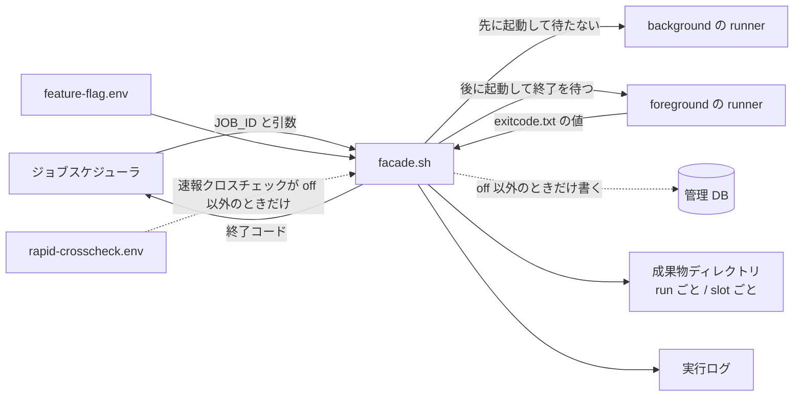

# 作ったものの記録(slot 実行モードを選択して runner を起動する)

- 対象: ジョブスケジューラから呼ばれる入口 `facade.sh`。設定を読み、blue / green の runner を起動する部分
- 結論: **仕様への要求は無い**(要求 0 件。要求の下書きは作っていない)
  - 独立した検証は 3 回目で通過した(仕様と食い違う実装 0 件)
  - 実装者が仕様に無い点を補った前提は 22 件。仕様と矛盾するものは 0 件
  - 元の方針資料(`tmp/RelayGateのしくみ.md` / `tmp/RelayGateの利用イメージ.md`)と食い違う点は見つからなかった
- この記録は最後の確認の資料の元である。仕様を更新する工程への入力ではない

## 1. 最後の確認で答えてほしいこと

| # | 答えてほしいこと | 求める回答 |
|---|---|---|
| 1 | 管理 DB へのつなぎ方(`psql` を使い、接続の参照名を接続サービス名として渡す) | 承認、または別の方式の指定 |
| 2 | 安全性とデータの保存にかかわる前提 7 件(第 4 節の表 A) | 1 件ずつ、承認または却下(却下は「仕様を変える」か「実装を直す」かを添える) |
| 3 | 保留のシナリオ 1 件(第 6 節) | 保留の承認 |
| 4 | そのほかの前提 15 件(第 4 節の表 B) | まとめて承認でよい。気になるものだけ却下 |

- 1 は 2 の 1 件目と同じ内容である。仕様が決めていない点をオーケストレータが決めたため、単独で確認を求める。

## 2. 作ったもの

| 作ったもの | 内容 |
|---|---|
| 入口 `facade/bin/facade.sh` | 引数(JOB_ID と追加の引数)を受け取り、`--help` / `--verbose` に応える |
| 設定の読み込みと検査 | `feature-flag.env` と(速報クロスチェックが off 以外のとき)`rapid-crosscheck.env` を、検証コマンドと同じ検査関数で確かめる |
| 起動の計画 | blue / green それぞれの実行モード(foreground / background / off)から、起動する slot と順番を決める。両方 foreground などの組み合わせは拒否する |
| run の識別子の発行 | ローカルの日時 + JOB_ID + 8 桁の乱数。成果物ディレクトリ名と管理 DB の値に同じものを使う |
| runner の起動 | background を先に、foreground を後に起動する。待つのは foreground だけ。runner には決められた引数と環境変数だけを渡す |
| 管理 DB への記録 | 速報クロスチェックが off 以外のとき、run の行・slot の行・速報クロスチェックの行を作り、状態を「開始」から「実行中」へ進める。off のときは管理 DB に一切つながない |
| 終了コード | foreground の runner が書いた `exitcode.txt` の値を返す |
| 実行ログ | 設定の読み込み、run の開始、slot の起動、状態の変化、エラーを 1 行ずつ残す |
| テスト用の一時 PostgreSQL | テストのたびに起動して捨てる。常設のサービスにはつながない |

- 先行の機能で保留にしていた 3 件のシナリオ(`facade.sh` を起動するもの)は、今回すべて判定して通過した。
- foreground の標準出力・標準エラーをジョブスケジューラへ中継する処理は、次の機能の担当である。今回は作っていない。
- 検証コマンド(`validate-config.sh`)の出力と終了コードは変えていない(変更の前後で 28 通りの結果が一致)。

## 3. 決めたこと(オーケストレータの判断)

| # | 決めたこと | 理由 | 利用者の確認 |
|---|---|---|---|
| 1 | 管理 DB のクライアントは `psql`。接続の参照名(`RAPID_DB_CONN_REF` の値)を接続サービス名として渡す。接続先はクライアント側の接続設定(`pg_service.conf` など)が決める | 仕様と契約は「適用側の DB クライアントの接続設定に委ねる」とだけ書き、コマンド名と渡し方を決めていない | **要る**(第 1 節の 1) |
| 2 | 標準の runner を名指しするシナリオ 1 件は、「ジョブマップの場所を runner へ渡す」までを今回判定する。標準の runner の中身が要る確認は、後続の機能まで保留にする。仕様は変えない | 標準の runner の中身は後続の機能が作る。代役で通すと何も確かめないことになる。先行の機能と同じ扱い | 保留の承認(第 1 節の 3) |
| 3 | テスト用の一時 PostgreSQL を新しく用意した。テーブルは契約の生成物から組み立てる暫定の定義で作る | 正式なテーブル定義(マイグレーション)は別の機能の担当で、まだ無い | 不要(記録) |
| 4 | 「foreground の終了後 10 秒以内に facade が終了する」は、仕様のシナリオどおりに確かめた | 600 秒動く background を待たない、という振る舞いの確認である。速さの検査ではない | 不要(記録) |
| 5 | 3 回目の独立した検証には、「OS の基本コマンドを壊れた代用品に差し替えるなど、実際の運用で起きない条件でだけ出る挙動は、軽い指摘までにする」という条件を付けた | 利用者の方針(作為的な条件を掘り下げない) | 不要(記録) |

### 方針資料との照合(決めたことの 1)

| 資料 | 記述 | 照合の結果 |
|---|---|---|
| しくみ | 速報クロスチェックが off のとき、管理 DB への接続設定なしで slot を実行できる | 一致(off のときは `psql` を 1 回も呼ばない) |
| しくみ | 認証情報そのものは保存せず、参照名だけを保存する | 一致(渡すのは参照名だけ。接続先の値はログにも標準エラーにも出さない) |
| 利用イメージ | RelayGate のデータは PostgreSQL に置く | 一致(`psql` は PostgreSQL のクライアント) |
| しくみ / 利用イメージ | DB クライアントのコマンド名、参照名の渡し方 | 記述なし(矛盾する記述も無い) |

## 4. 実装者が補った前提(22 件)

仕様に書かれていない点を、実装者が決めたものである。独立した検証は 22 件すべてを「仕様に記載なし(矛盾なし)」と判定した。人の判断はまだ無い。

### 表 A: 回答が必須のもの(安全性 4 件、データの保存 3 件)

| 名前 | 分類 | 決めた内容 | 確かめたこと |
|---|---|---|---|
| 管理 DB へのつなぎ方 | 安全性 | `psql` を使い、参照名を接続サービス名として渡す。利用者ごとの `psql` の初期設定ファイルは読まない | 実際の PostgreSQL に参照名だけでつながることを確認 |
| DB クライアントのエラー出力の扱い | 安全性 | `psql` のエラー出力は捨てる。実行ログには「接続の失敗 / 行の追加の失敗 / 行の更新の失敗」と表の名前だけが残る | 接続に失敗させても、接続先の値がログと標準エラーに出ないことを確認 |
| SQL への値の渡し方 | 安全性 | 値(run の識別子、JOB_ID、追加の引数、パス、日時)は SQL の文字列に連結せず、`psql` の変数として渡す | 引用符・バックスラッシュ・改行・空文字を含む引数が、そのまま保存され復元できることを確認 |
| runner へ渡す環境変数 | 安全性 | facade の環境を引き継いだうえで、渡さないと決まっているもの(配置ディレクトリ、接続の参照名、設定ファイルにしか要らないキー、相手 slot のキー)を外す。`PATH` などはそのまま渡る | 親の環境に同じ名前の変数があっても、runner に渡らないことを確認 |
| 書き込みのまとまり | データの保存 | run の行と速報クロスチェックの行は 1 つのまとまりで書く(片方だけ残らない)。slot の行の追加、プロセス番号の記録、「実行中」への更新は、それぞれ別に確定させる | 速報クロスチェックの行の追加を失敗させると、run の行も残らないことを確認 |
| 表と列の名前の持ち方 | データの保存 | 表・列・状態の名前は SQL に直接書く。契約の生成物は実行時に読まない。両者が同じであることはテストで照合する | 照合のテストが通過 |
| 更新が 0 行だったときの扱い | データの保存 | 状態の更新とプロセス番号の記録が 0 行だったら、成功として記録しない。実行ログに更新の失敗を残す。runner は起動済みのため、終了コードは変えない | 0 行のときに「状態が変わった」というログが出ないことを確認 |

### 表 B: まとめて承認でよいもの(15 件)

| 名前 | 分類 | 決めた内容 |
|---|---|---|
| DB の失敗の見分け方 | エラー処理 | `psql` の終了コードで「つながらない」と「SQL の失敗」を見分け、決められた文言に読み替える |
| 失敗した表の特定 | エラー処理 | まとめて書く 2 つの表のどちらで失敗したかを、SQL の中に置いた印で決める |
| runner の入出力のつなぎ先 | エラー処理 | runner の標準入力・標準出力・標準エラーは捨て先につなぐ。facade の終了後に、background の runner がジョブスケジューラの出力先を開いたままにしないため |
| セッションを切り離すコマンドが無い環境 | エラー処理 | `setsid` があれば使って起動する。無い環境(開発機の macOS)ではそのまま起動する。実行環境の Linux では常に使う |
| runner を起動できなかったことの検知 | エラー処理 | 起動のたびに一時的な通信路を作り、「見張りを始めた」という合図の後に、起動の成否を受け取る。起動できなければエラーを 1 行出し、作った行を「失敗」で閉じ、後続の slot を起動せず、終了コード 6 にする |
| 起動の合図を待つ時間 | エラー処理 | 起動の合図を待つ時間に上限を置かない(遅いホストで、起動の成功を失敗と取り違えないため) |
| foreground の終了コードが読めないとき | エラー処理 | `exitcode.txt` が無い・数値でない・255 を超えるときは、標準エラーに何も出さず、実行ログに記録して終了コード 6 にする |
| JOB_ID の文字の違反 | エラー処理 | エラーを 1 行出して終了コード 2 にする(文言を決めた) |
| 実行ログを書けないとき | エラー処理 | 標準エラーに警告を 1 行だけ出し、ログなしで処理を続ける(文言と出す時点を決めた)。`--help` のときはログを開かない |
| 成果物ディレクトリを作れないとき | エラー処理 | エラーを 1 行出して終了コード 6 にする(文言を決めた)。作るのは、管理 DB へ書く前 |
| 検査のエラーの記録 | エラー処理 | 引数や設定の検査のエラーは、標準エラーの内容を変えずに、同じ本文を実行ログにも 1 回ずつ残す |
| テスト用の時刻の検査の順番 | 入力の検査 | テスト用の時刻(`RELAY_GATE_NOW`)の形式は、設定ファイルの検査がすべて通った後に確かめる。暦に無い日時も不正にする |
| 最初のログ行に書く run の識別子 | 出力の形式 | 「設定を読み込んだ」「run を開始した」の行は、run の識別子を発行した後に書き、その識別子を載せる |
| 日時と乱数の作り方 | 出力の形式 | 管理 DB の日時は、ホストのローカル時刻の文字列で渡す。乱数は OS の乱数源から 4 バイト取る。取れなければエラーで終了コード 6 にする |
| `--verbose` で出す内容 | 出力の形式 | 設定ファイルに現れたキーごとに、実行ログへ 1 行を書く(検証コマンドの `--verbose` と同じ内容) |

- 分類の内訳: 安全性 4 / データの保存 3 / エラー処理 11 / 入力の検査 1 / 出力の形式 3
- 人が「仕様を変える」として却下した前提: 0 件(初回のため、まだ判断を受けていない)
- 前提と記録上の番号の対応は付録 A にある。

## 5. テストの結果

| テスト | 件数 | 結果 |
|---|---|---|
| 単体テスト | 640 件 | すべて通過(macOS と Linux) |
| 機能のシナリオ(facade の単位) | 141 件 | すべて通過(macOS) |
| 結合テスト(全機能を通したシナリオ) | 83 件 | 82 件通過、保留 1 件、失敗 0 件。この機能の 19 件は 18 件通過 + 保留 1 件 |
| 受け入れテスト | 14 件 | すべて通過。先行の機能の 17 件と合わせた 31 件も通過 |
| 書式・静的検査 | - | 通過 |

- 保留は通過の件数に含めていない。
- 先行の機能のシナリオ 64 件は、すべて通過した(退行なし。保留だった 2 件は今回通過に変わった)。
- 独立した検証は、実装をわざと壊した複製(起動の順を逆にする、プロセス番号を誤らせる、起動前の記録を外す)で、テストが失敗することも確かめた。

### 独立した検証の経過

| 回 | 重大な指摘 | 内容 | 扱い |
|---|---|---|---|
| 1 回目 | 3 件 | runner を起動できなくても成功として扱う / 接続の参照名が runner に渡る / 検査のエラーが実行ログに残らない | 実装を直した |
| 2 回目 | 1 件 | セッションを切り離すコマンド自体が失敗すると、起動していないのに成功として扱う | 実装を直した(「見張りを始めた」合図を追加) |
| 3 回目 | 0 件 | 残りの指摘 22 件は、すべて第 4 節の前提の確認記録 | 通過 |

- 重大な指摘 4 件は、どれも仕様に書かれていることを実装が満たしていなかったものである。仕様の不足ではないため、要求にしない。

## 6. 保留のシナリオ(1 件)

| 項目 | 内容 |
|---|---|
| シナリオ | 値が空のジョブマップの場所のキーがある slot の runner は、固定の名前のジョブマップで実行先を解決する |
| 今回判定した部分 | facade が既定の場所(`/etc/relay-gate/green-job-map.csv`)を環境変数で runner へ渡す。空の値は渡らない。起動の引数も決められたとおり(通過) |
| 保留にした部分 | runner が実行先を解決して `execution-spec.json` に書く / runner のエラー出力に「ジョブマップが見つからない」の行が無い |
| 保留の理由 | 標準の runner の中身(ジョブマップの解決と結果の出力)は、後続の機能が作る |
| 保留が外れる条件 | 標準の runner が結果を書くようになると、同じテストがそのまま残りの 2 点を判定する(後続の機能で手を入れなくても、保留のままにはならない) |
| しなかったこと | 標準の runner の代役は作っていない。仕様のシナリオも変えていない |

## 7. 既知の制約

| 制約 | 影響 | 扱い |
|---|---|---|
| 標準の runner は、まだ仮の応答しか返さない | 標準の runner を割り当てると、ジョブは実行されず終了コード 6 になる | 後続の機能が中身を作る。初回のリリースは全機能がそろってから行う |
| foreground の標準出力・標準エラーは、まだ中継されない | ジョブスケジューラに届くのは終了コードだけ | 次の機能の担当 |
| 管理 DB のテーブルの正式な定義が無い | テストは暫定の定義で動く。本番のテーブルは別の機能が作る | 暫定である旨をテスト用の定義の先頭に書いた |
| DB クライアントのエラー出力を捨てる | 管理 DB の失敗の細かい原因は、実行ログに残らない(失敗の種類と表の名前は残る) | 第 4 節の表 A で判断を求める |
| `setsid` が無い Linux での動作は確かめていない | facade が強制終了されたときに、background の runner が巻き添えになるおそれがある | 実行環境の Linux には `setsid` がある。開発機の macOS だけ、使わずに起動する |
| runner の起動の合図を待つ時間に上限が無い | 一時的な通信路を外から消すなど、通常起きない条件では待ち続ける | 作為的な条件のため、掘り下げない |
| 機能のシナリオと結合テストは、手元の Linux で流していない | macOS と Linux の差による失敗を、手元では単体テストでしか見つけられない | 手元の Linux の再現環境に Node.js と PostgreSQL が無いため(環境の事情)。CI の受け入れテストは PostgreSQL を入れて流す |

## 8. 仕様への要求にしなかった理由

| 対象 | 判断 | 理由 |
|---|---|---|
| 実装者が補った前提 22 件 | 要求にしない | 仕様と矛盾しない。方針資料にも反しない。人が「仕様を変える」として却下したものだけが要求の候補になり、いまは 0 件 |
| 保留のシナリオの確認 2 点を、後続の機能のシナリオへ移す案 | 要求にしない | 仕様を変えなくても、保留で進められる。仕様自身も「受け取った場所で解決する側は後続の機能で覆う」と注記している |
| ほかの機能の担当を含むシナリオ(開始時刻のファイル、終了コードのファイル、実行時間) | 要求にしない | 仕様の不足ではなく、担当の分け方の記録である。テスト用の runner を置いて確かめた |
| 仕様のシナリオが省いている前提(管理 DB が動いていること、runner の割り当てなど) | 要求にしない | テストが、検査を通る値を補った。書かれた値は変えていない。先行の機能と同じ扱い |
| 独立した検証の重大な指摘 4 件 | 要求にしない | 実装の誤りで、直し済み |
| 「10 秒以内に終了する」のシナリオ | 要求にしない | 振る舞いの確認として、仕様どおりに判定した |

- 速さ・大きな入力・作為的な条件についての指摘や要求は、作っていない(利用者の方針)。

## 付録 A: 前提と記録上の番号の対応

記録は `docs/impl/latest/09730858/stages/attempt-3/` の前提の一覧(`S4_tier-impl.tier-facade.assumptions.yaml`)と、検証の結果(`S5_verify.tier-facade.findings.yaml`)にある。検証の判定は 22 件とも「仕様に記載なし(spec_absent)」、人の判断は 22 件とも「未判断」である。

| 番号 | 記録上の分類 | 名前(第 4 節) | 検証の指摘の重さ |
|---|---|---|---|
| A-001 | security | 管理 DB へのつなぎ方 | major |
| A-002 | security | DB クライアントのエラー出力の扱い | major |
| A-003 | persistence | 書き込みのまとまり | major |
| A-004 | security | SQL への値の渡し方 | major |
| A-005 | error_handling | DB の失敗の見分け方 | minor |
| A-006 | error_handling | 失敗した表の特定 | minor |
| A-007 | error_handling | runner の入出力のつなぎ先 | minor |
| A-008 | error_handling | セッションを切り離すコマンドが無い環境 | minor |
| A-009 | error_handling | runner を起動できなかったことの検知 | minor |
| A-010 | error_handling | foreground の終了コードが読めないとき | minor |
| A-011 | error_handling | JOB_ID の文字の違反 | minor |
| A-012 | input_validation | テスト用の時刻の検査の順番 | minor |
| A-013 | data_format | 最初のログ行に書く run の識別子 | minor |
| A-014 | error_handling | 実行ログを書けないとき | minor |
| A-017 | data_format | 日時と乱数の作り方 | minor |
| A-018 | error_handling | 成果物ディレクトリを作れないとき | minor |
| A-019 | security | runner へ渡す環境変数 | major |
| A-020 | data_format | `--verbose` で出す内容 | minor |
| A-021 | persistence | 表と列の名前の持ち方 | major |
| A-022 | persistence | 更新が 0 行だったときの扱い | major |
| A-023 | error_handling | 検査のエラーの記録 | minor |
| A-024 | error_handling | 起動の合図を待つ時間 | minor |

- A-015 と A-016 は欠番である(仕様に書かれている内容の復唱と判定され、1 回目の後に前提から外した)。
- 前提の一覧の SHA-256: `e0d335eef89821bc32d528473ff6e558cf55b0e659a7bf7802b983ba20fb0261`
- 検証の判定の SHA-256: `6058f950748b1b15951768263e5f1773791ecec66a2a50dc286ac144f9b400ac`

## 付録 B: 原因の分類と根拠

| 分類 | 項目 | 扱い | 根拠 |
|---|---|---|---|
| 仕様起因 | なし | 要求 0 件 | - |
| 要求にしない(記録) | 機能をまたぐシナリオの担当の分け方、仕様のシナリオが省いている前提 | 仕様は変えない | `issues/20261118_091109_cross-uc-scenarios.md` |
| 要求にしない(前提) | 実装者が補った前提 22 件 | 最後の確認で人の判断を求める | attempt-3 の前提の一覧と検証の結果 |
| 実装起因 | 1 回目の重大な指摘 3 件(F-009 / F-019 / F-023)と、状態の更新が 0 行でも成功にしていた点(F-022) | 2 回目の実装で修正済み | `stages/attempt-1/S5_verify.tier-facade.findings.yaml`、`stages/attempt-2/S4_tier-impl.tier-facade.done.yaml` |
| 実装起因 | 2 回目の重大な指摘 1 件(F-001)と、起動前の記録の順を確かめるテストの弱さ(F-002) | 3 回目の実装で修正済み | `stages/attempt-2/S5_verify.tier-facade.findings.yaml`、`stages/attempt-3/S4_tier-impl.tier-facade.done.yaml` |
| 実装起因(記録) | 前提の分類の付け間違い 2 件、仕様の復唱を前提に数えていた 2 件 | 2 回目で記録を直した | `stages/attempt-1/S5_verify.tier-facade.findings.yaml`(F-015 / F-016 / F-024 / F-025) |
| 環境起因 | 手元の Linux の再現環境に Node.js と PostgreSQL が無く、機能のシナリオを Linux で流していない | 要求に含めない。macOS で実測。単体テストと静的検査は Linux でも実測 | `stages/attempt-3/S4_tier-impl.tier-facade.done.yaml` |
| 環境起因 | 3 回目の検証で、macOS の単体テスト 1 件が、同時に流した別の比較の一時ファイルの名前とぶつかって失敗した | 要求に含めない。一時ディレクトリを分けた単独の実行で通過 | `stages/attempt-3/S5_verify.tier-facade.done.yaml` |

- 結合テストと受け入れテストの記録: `stages/S6_uc-bdd.done.yaml` / `stages/S7_atdd.done.yaml`
- 人による前提の却下の記録(`review/review-notes.md`)は無い(初回のため)。
- 仕様: `docs/specs/latest/実装切替業務/実装切替ジョブ実行フロー/slot 実行モードを選択して runner を起動する/`
- 先行の機能の扱い: `docs/impl/latest/65b09d93/feedback/as-built-summary.md`
