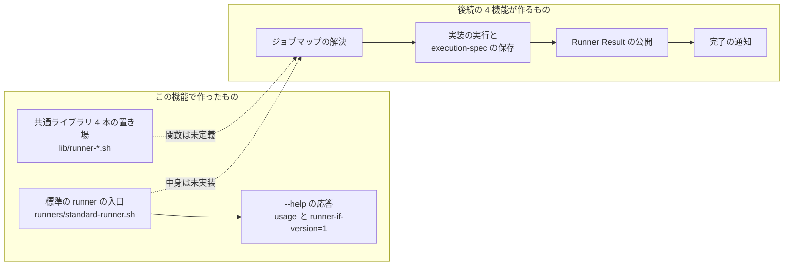

# as-built summary(65b09d93 slot runner の実体スクリプトを割り当てる / 初回の実行、attempt 2)

- 対象: 標準の slot runner の入口(`runners/standard-runner.sh`)と共通ライブラリ 4 本の置き場(tier-facade のみ)
- 結論: **仕様への要求は無い**(要求 0 件、blocker 0 件)。draft は作っていない
  - 起票された 3 件の issue は、どれも出さなくても実装・運用に実害が無い。要求にしない
  - 実装者が補った前提 11 件に、仕様と矛盾するものは無い(矛盾 0 件、記録漏れ 0 件)
  - 独立検証は 2 回目で通過した(blocker 0 / major 0 / minor 12)
- 利用者の方針(2026-11-18): 仕様への要求は、出さないと実害が出るものだけにする
  - 利用者の言葉: 「ずっとどうでも良いエッジケースを考えすぎです。大きなデータに意味はなく、ムダな処理がないことを見たいだけです。」「推奨ですすめるというか、実装の効率が下がるなら仕様を取り下げてもよいです。」
  - 理由: 仕様を変えると全工程の再確認が要り、実装の効率が下がる
- 根拠:
  - `docs/impl/latest/65b09d93/issues/`(3 件)
  - `docs/impl/latest/65b09d93/stages/attempt-1/S5_verify.tier-facade.findings.yaml`(blocker 1 / major 0 / minor 11)
  - `docs/impl/latest/65b09d93/stages/attempt-2/S4_tier-impl.tier-facade.done.yaml` / `S4_tier-impl.tier-facade.assumptions.yaml`(前提 11 件)
  - `docs/impl/latest/65b09d93/stages/attempt-2/S5_verify.tier-facade.findings.yaml`(blocker 0 / major 0 / minor 12)
  - `docs/impl/latest/65b09d93/stages/S6_uc-bdd.done.yaml` / `S7_atdd.done.yaml`
  - `docs/impl/latest/65b09d93/review/review-notes.md` は無い(初回のため、人による前提の却下は 0 件)
- 本ファイルは dist-pipeline への入力ではない

## 1. 最後の確認で見てほしい点

| # | 見てほしい点 | 内容 | 求める判断 |
|---|---|---|---|
| a | この機能の範囲 | 標準の runner の入口、`--help` の応答、共通ライブラリ 4 本の置き場まで。中身は後続の 4 機能が作る | 範囲の承認 |
| b | `--help` 以外で起動したときの仮の扱い | 引数が不正なら終了コード 2、正しければ終了コード 6。どちらも何も出さず、ファイルも書かない | 仮の扱いの承認 |
| c | 置き場所 | `facade/runners/` と `facade/lib/` は数行の入口。本体は `facade/src/` | 承認(2026-11-16 の決定の確認) |
| d | 受け入れテストの仮の割り当て | SPEC-001-04-3 と SPEC-001-04-8 の 2 件 | 割り当ての確定 |
| e | 保留の scenario | tier 1 件 + UC 2 件。`facade.sh` を起動するため、次の機能で判定する | 保留の承認 |
| f | この branch の最初のコミットで削除したテスト | 時間の上限を確かめるテスト 14 件、大きな入力を作るだけのテスト 3 件、重いテストの仕分けの仕組み | 削除の確認 |

### a. この機能の範囲

- 共通ライブラリの本体 4 本は、関数を定義しない空のファイルである。
- 設定の検証(`validate-config.sh --feature-flag`)は変えていない。標準の runner を両 slot に割り当てた設定が、検証を通ることを確かめた。

### b. `--help` 以外で起動したときの仮の扱い

| 起動のしかた | 終了コード | 出力 | ファイル |
|---|---|---|---|
| `--help`(区切りの `--` より前) | 0 | `usage:` の 1 行と `runner-if-version=1` の 1 行 | 書かない |
| 引数が不正 | 2 | 何も出さない | 書かない |
| 引数が正しい | 6(仮置き) | 何も出さない | 書かない |

- 引数が不正とは、次のどれかである。
  - 必須の 4 オプション(`--run-id` / `--job-id` / `--role` / `--mode`)の欠落
  - 値を取る 5 オプションの、値の欠落または空の値
  - `--role` / `--mode` の列挙外の値
  - 未知のオプション
  - `--execution-spec` と PARAM の併用
- 終了コード 6 は「成功を装わない」ための仮置きである。後続の機能が、ジョブの実行と結果の公開に置き換える。
- 仕様は、終了コード 2 と 6 を「結果のファイルを公開したうえで返す」と定める。結果を公開できない段階での扱いは、仕様に無い。
- 初回リリースは全機能がそろってから行う(2026-11-15 の決定)。仮の扱いのまま利用者に届くことは無い。

### c. 置き場所

| 置き場所 | 中身 | 利用者から見た意味 |
|---|---|---|
| `facade/runners/standard-runner.sh` | 数行の入口 | 設定の `BLUE_RUNNER` / `GREEN_RUNNER` に書くパス |
| `facade/lib/runner-resolve.sh` / `runner-spec.sh` / `runner-result.sh` / `runner-notify.sh` | 数行の入口 | 自作の runner が読み込むファイル |
| `facade/src/presentation/standard_runner.sh` | 標準の runner の本体 | 直接は使わない |
| `facade/src/usecase/runner_resolve.sh` / `runner_spec.sh` / `runner_result.sh` / `runner_notify.sh` | 共通ライブラリの本体(いまは空) | 直接は使わない |

- 入口は、配置ディレクトリを「起動されたパスの字面の `runners/` の 1 つ上」で決める。環境変数では受け取らない(仕様どおり)。
- 旧仕様の参考実装 `runners/ssh-runner.sh` は置いていない(仕様どおり)。

### d. 受け入れテストの仮の割り当て

| 受け入れテスト | 確かめた内容 | 結果 |
|---|---|---|
| SPEC-001-04-3 | 標準の runner を両 slot に割り当てた設定が、検証を通る。両 slot の runner のパスと版 1 が表示される | pass |
| SPEC-001-04-8 | 標準の runner が正式な提供物として載っている。参考実装という扱いの runner は無い | pass |

- 割り当てはオーケストレータの仮決めである。利用者の確定を待っている。
- SPEC-001-04-8 の「提供物の一覧」は、CLI の契約の記載と、配置ディレクトリの実物の 2 つで判定した。

### e. 保留の scenario(3 件)

| 段 | scenario | 判定済みの部分 | 保留の部分 |
|---|---|---|---|
| tier | 差し替えた runner 実体は runner IF だけで facade から起動できる | なし | 全体(`facade.sh` の起動と、渡す引数) |
| UC | runner 実体を差し替えても facade は変更不要である | 自作の runner へ差し替えた設定が検証を通る | `facade.sh` の起動以降 |
| UC | facade は設定された runner を runner IF で起動するだけである | 前提の配置 | `facade.sh` の起動以降 |

- `facade.sh` は、次の機能(slot 実行モードを選択して runner を起動する)が作る。
- `facade.sh` が無い間、該当の step は「skipped」を返す。`facade.sh` ができたのに step が未実装なら、失敗する。
- `facade.sh` の代役は作っていない。代役で通しても、何も確かめないことになるためである。

### f. この branch の最初のコミットで削除したテスト

| 対象 | 件数 | 扱い |
|---|---|---|
| 時間の上限を確かめるテスト | 14 件 | 削除 |
| 大きな入力を作るだけのテスト | 3 件 | 削除 |
| 重いテストの印が付いていて、振る舞いを確かめるテスト | 25 件 | 残した(印だけ外した) |
| 重いテストの仕分けの仕組み(`scripts/ci/heavy-test-files.js` / `heavy-tests.json`、CI の該当部分) | - | 削除 |

- 理由は利用者の発言である(「大きなデータに意味はなく、ムダな処理がないことを見たいだけです」「重いテストも削除しても良いくらいです」)。
- コミットは `b720be0`(2026-11-18)である。印の付いていた 42 件の内訳は 14 + 3 + 25 である。
- この機能では、時間の上限を確かめるテストも、大きな入力を作るテストも足していない。

## 2. 全体の状態

| 項目 | 値 |
|---|---|
| ゲート(format / lint / 単体テスト / tier の BDD) | すべて pass |
| 単体テスト(bats) | 570 件すべて ok(macOS と Linux)。この機能で 8 件を足した |
| tier の BDD | 123 scenario(122 pass、1 skipped)。この機能の 11 件は 10 pass、1 skipped |
| UC の BDD | 64 scenario(62 pass、2 skipped)。この機能の 9 件は 7 pass、2 skipped。先行機能の 55 件に退行なし |
| 受け入れテスト | 2 件とも pass。先行機能の 15 件に退行なし |
| 独立検証 | 1 回目 blocker 1 / minor 11 → 2 回目 blocker 0 / major 0 / minor 12 |
| 前提の判定(2 回目) | 仕様どおり 1 / 仕様に記載なし 10 / 仕様と矛盾 0 / 記録漏れ 0 |

- skipped は pass の件数に含めていない。

## 3. issues の判定

| issue | 論点 | 判定 | 理由 |
|---|---|---|---|
| `20261118_012630_cross-uc-scenarios.md` | `facade.sh` を起動する scenario が 3 件ある。`facade.sh` は次の機能の担当 | **要求にしない** | 仕様の不足ではない。機能をまたぐ scenario の責務分担の記録である。scenario は skipped とし、次の機能で `facade.sh` を作った時点で判定する |
| `20261118_012631_probe-timeout-scenarios-assert-elapsed-time.md` | 「10 秒以内に復帰する」scenario が経過時間を合否にしている | **要求にしない** | 待機の上限という振る舞いの確認であり、性能の検査ではない。仕様どおりに実装・判定した。独立検証も、失敗時の振る舞いの確認と判定した |
| `20261118_013500_probe-preparation-failure-scenario-unreachable.md` | 「`--help` 問い合わせの準備に失敗すると…」の scenario の前提(Given)が、書かれたままでは結果(Then)に届かない | **要求にしない** | 文面の直しは実害が無い。テストは、問い合わせの準備だけが失敗する形に step を組んで確かめている。事実は下に残す |

- 3 件の issue ファイルは書き換えていない(起票時の記録として残す)。
- 1 件目と 3 件目の issue は、起票時に「仕様へ要求を出す」案を推奨していた。利用者の方針(2026-11-18)に照らし、要求にしない。
- この判断を覆すべき実害は、見つからなかった。

### 3 件目の事実(記録のみ)

- scenario の前提は「一時ファイルの作成先(環境変数 `TMPDIR`)が存在しないディレクトリを指す」である。
- この前提のままだと、問い合わせより先に、設定ファイルの複製が失敗する。
  - 出力は `error: config snapshot failed ...` で、終了コードは 6 である(契約どおり)。
  - scenario が期待する `error: runner probe failed slot=blue reason=` の行には届かない。
- テストは、前提の文面どおり `TMPDIR` を存在しないディレクトリにしたうえで、設定ファイルの複製だけを別の書ける場所へ逃がす。問い合わせの一時ファイルの作成は、実際に失敗する。
  - 結果: 終了コード 6、`error: runner probe failed slot=blue reason=temp-file-create-failed tmpdir=/nonexistent/tmp` の 1 行、標準出力は空、runner は起動されない。
  - 独立検証も同じ結果を実測した。
- 検証コマンド(`validate-config.sh`)の振る舞いは変えていない。

## 4. 独立検証の指摘の扱い

| 回 | 指摘 | 分類 | 扱い |
|---|---|---|---|
| 1 回目 | 値が空の `--execution-spec ""` を受理し、終了コード 6 を返す(blocker) | 実装起因 | 2 回目で修正した。値を取る 5 オプションすべてで、空の値を終了コード 2 にした。再発防止のテストを 1 件足した |
| 1 回目 | 同じオプションを 2 回書いたときの扱いが前提に無い(minor) | 前提の記録漏れ | 振る舞いは変えず、前提として記録した(後に書いた値を採用する) |
| 1 回目 | PARAM が無いときに区切りの `--` を省けることが前提に無い(minor) | 前提の記録漏れ | 振る舞いは変えず、前提として記録した |
| 2 回目 | 前提 10 件が仕様に記載なし(minor 10 件) | 要求の対象外 | 人が却下していないため、要求にしない(第 6 節) |
| 2 回目 | 「10 秒以内に復帰する」scenario の測り方は仕様の復唱である(minor) | 要求の対象外 | 仕様どおり |
| 2 回目 | 前提の記録 2 か所が不正確(minor 2 件。下記) | 記録の不正確さ | 実装は正しい。仕様起因ではない |

### 前提の記録の不正確な 2 か所(実装は正しい)

- 重複したオプションの前提は「前の値が空でも、後の値で上書きしたあとに検査する」と書く。実際は、空の値をその場で拒否する(終了コード 2)。
  - 正しい記述: 後に書いた値を採用する。ただし空の値は、出現した時点で引数不正にする。
- 「10 秒以内に復帰する」scenario の前提は、分類が「性能」になっている。正しい分類は「失敗時の振る舞い」である。
- 前提のファイルは検証済みの記録のため、ここでは書き換えていない。最後の確認では、上の正しい記述で判断してほしい。

## 5. 仕様との対応

HTTP の API・状態遷移・ヘッダー・DB の操作は、この機能に無い。CLI の出力と終了コードで整理する。

### 仕様どおり

- 標準の runner は `runners/standard-runner.sh` に置く。実行できる通常のファイルである
- `--help` は使い方と `runner-if-version=1` を標準出力に出し、終了コード 0 で終わる
- 配置ディレクトリは、起動されたパスの字面で決める。シンボリックリンクを辿らない。環境変数で受け取らない
- 共通ライブラリ 4 本は、読み込んでも出力・終了・呼び出し側の設定の変更をしない
- 設定の検証は、標準の runner と自作の runner を区別しない
- `--help` に応答しない runner への問い合わせは、待機の上限で打ち切る。runner のプロセスを残さない
- 参考実装の `ssh-runner.sh` は無い

### 仕様の矛盾

- なし(独立検証で、仕様と矛盾する前提は 0 件)
- 記録のみ: 第 3 節の 3 件目(scenario の前提の文面と、設定ファイルの複製の規則の食い違い)。実害が無いため要求にしない

### 仕様の不足

- 要求にするものは無い
- 記録のみ(第 6 節の「仕様に記載なし」の 10 件)

## 6. 実装者が補った前提の一覧(attempt 2、11 件)

人の判断は、まだ無い(最後の確認で求める)。人が「仕様を変える」として却下した前提だけが、仕様への要求の候補になる。

| id | カテゴリ | 前提(要約) | 検証の判定 | 人の判断 |
|---|---|---|---|---|
| A-001 | data_format | 入口は数行にし、本体は `facade/src/` に置く。共通ライブラリの本体 4 本は空にする | 仕様に記載なし | 未判断(見てほしい点 a / c) |
| A-002 | data_format | 入口は配置ディレクトリを自分で決め、環境変数に載せない | 仕様に記載なし | 未判断 |
| A-003 | input_validation | 区切りの `--` より前のどこかに `--help` があれば使い方を出す。後ろの `--help` は PARAM として扱う | 仕様に記載なし | 未判断 |
| A-004 | error_handling | `--help` 以外の起動は何も出さずファイルも書かない。引数不正は 2、正しい引数は 6(仮置き) | 仕様に記載なし | 未判断(見てほしい点 b) |
| A-005 | data_format | `--help` の出力は `usage:` の 1 行と `runner-if-version=1` の 1 行の 2 行にする | 仕様に記載なし | 未判断 |
| A-006 | data_format | 共通ライブラリの入口は、自分のファイルの場所を基準に本体を読み込む | 仕様に記載なし | 未判断 |
| A-007 | performance(検証の分類は error_handling) | 「10 秒以内に復帰する」scenario は、振る舞いの確認として仕様どおりに判定する。測るのは検証コマンドの起動から終了まで | 仕様どおり(復唱) | 未判断 |
| A-008 | error_handling | `facade.sh` を起動する step は、`facade.sh` が無い間は skipped を返す。代役は作らない | 仕様に記載なし | 未判断(見てほしい点 e) |
| A-009 | data_format | テストの配置ディレクトリは、読むだけなら `facade/` そのもの、書くなら一時ディレクトリへの複製にする | 仕様に記載なし | 未判断 |
| A-010 | input_validation | 同じオプションを 2 回書いても引数不正にせず、後に書いた値を採用する(空の値はその場で拒否する) | 仕様に記載なし | 未判断 |
| A-011 | input_validation | PARAM を渡さない起動では、区切りの `--` を省いても受理する | 仕様に記載なし | 未判断 |

- 判定の内訳: 仕様どおり 1 / 仕様に記載なし 10 / 仕様と矛盾 0 / 記録漏れ 0
- 1 回目からの増減: A-004 を更新した(空の値を拒否するオプションに `--execution-spec` を含めた)。A-010 と A-011 を足した
- 人が「仕様を変える」として却下した前提: 0 件

## 7. 原因の分類

| 分類 | 項目 | 扱い | 根拠 |
|---|---|---|---|
| 仕様起因 | なし | - | 要求 0 件 |
| 要求にしない(利用者の方針) | 機能をまたぐ scenario 3 件の責務分担 | 仕様は変えない。次の機能で判定する | issue 1 件目 |
| 要求にしない(利用者の方針) | 「10 秒以内に復帰する」scenario の経過時間の条件 | 仕様は変えない。振る舞いの確認として判定した | issue 2 件目 |
| 要求にしない(利用者の方針) | 問い合わせの準備の失敗の scenario の前提の文面 | 仕様は変えない。step の組み方で確かめた | issue 3 件目 |
| 実装起因 | 値が空の引数の受理 | 2 回目の実装で修正済み | 1 回目の独立検証の blocker |
| 実装起因(記録) | 前提の記録漏れ 2 件、前提の記述の不正確さ 2 か所 | 記録漏れは 2 回目で記録済み。不正確さは第 4 節に正しい記述を書いた | 1 回目・2 回目の独立検証の minor |
| 環境起因 | Linux のコンテナに node が無く、tier の BDD を Linux で流していない | 要求に含めない。macOS で実測した。単体テストと lint は Linux でも実測した | 2 回目の実装の記録 |

## 8. 方針資料との照合

仕様への要求は無いため、方針資料(`tmp/RelayGateのしくみ.md` / `tmp/RelayGateの利用イメージ.md`)と照らす要求も無い。
