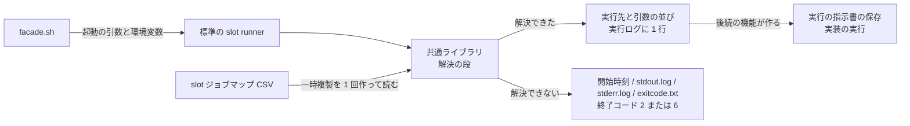

# 作ったものの記録(ジョブマップで JOB_ID から実行先を解決する)

- 対象: slot runner の「解決」の段。ジョブマップから JOB_ID の実行先を決め、実装へ渡す引数の並びを組み立てる部分
- 今回の周回: 前回(2026-11-23)に出した仕様への要求 3 件が仕様へ反映された後の、実装のやり直しである
- 結論: **仕様への新しい要求は 0 件**(下書きは作っていない)
  - 前回の要求 3 件は、仕様に反映済みである。同じ要求は出さない
  - 今回見つかった問題 2 件は、どちらも実装の欠陥で、直し済みである。仕様は変えない
  - 独立した検証は 5 回目で通過した(直すべき指摘 0 件)
  - 実装者が仕様に無い点を補った前提は 23 件。仕様と矛盾するものは 0 件。記録に無かった前提も 0 件
  - 元の方針資料(`tmp/RelayGateのしくみ.md` / `tmp/RelayGateの利用イメージ.md`)と食い違う点は見つからなかった
- この記録は最後の確認の資料の元である。仕様を更新する工程への入力ではない

## 1. 最後の確認で答えてほしいこと

| # | 答えてほしいこと | 求める回答 | 推奨 |
|---|---|---|---|
| 1 | いまの実装とテスト結果を承認するか | 承認、または直す点の指定 | 承認 |
| 2 | 安全性にかかわる前提 5 件(第 5 節の表 A) | 1 件ずつ承認または却下。却下のときは「仕様で決める」か「実装を直す」かを選ぶ | 5 件とも承認 |
| 3 | そのほかの前提 18 件(第 5 節の表 B) | まとめて承認でよい | 承認 |
| 4 | 仕様への要求を 0 件とすること | 承認、または要求にしたい項目の指定 | 承認 |

- 表 A の 5 件のうち 3 件は、前回の確認で承認済みの内容と同じである。ただし前回の承認は、やり直す前の記録に対するものである。今回の記録に対して、改めて回答を求める。
- 表 A の残り 2 件は、今回新しく決めた内容である(前回の確認には無い)。
- 「仕様で決める」として却下した前提だけが、仕様への要求の候補になる。

## 2. 作ったもの

| 作ったもの | 内容 | 今回の変更 |
|---|---|---|
| 起動の引数の検査 | 必須のオプションの欠落、未知のオプション、列挙外の値を、エラー 1 行と終了コード 2 で返す | なし |
| ジョブマップの読み込み | 場所は環境変数で受け取る。無ければ設定ファイル置き場の固定の名前。検証コマンドと同じ関数で確かめる | 一時複製を最終名へ移すときの確認を足した(第 3 節) |
| 実行先の解決 | JOB_ID が完全一致する先頭の行を採る。host と user が両方無い(または空)ならローカル実行 | なし |
| 引数の並びの組み立て | 固定引数を 1 要素 1 引数に展開し、後ろに追加の引数を順に足す | なし |
| 解決できないときの成果物 | 4 ファイルをそろえる。同じ run の結果が既にあれば上書きしない。中止済みの slot には書かない | 成果物を確定名へ移すときの確認を足した(第 3 節) |
| 共通ライブラリ | 解決の段を `lib/runner-resolve.sh` に置き、標準の slot runner が読み込む | 呼び方が仕様の契約になった。コードの動きは変えていない |
| feature flag の検証 | 対応するジョブマップの有無を確かめる | 「無い」と「あるが読めない」を別の文言で報告するようにした(仕様の反映) |

- 解決に成功した後の段(実行の指示書の保存、実装の実行)は、後続の機能の担当である。今回も作っていない。

### 前回の要求 3 件の反映

| 前回の要求 | 仕様の判断記録 | 実装の対応 |
|---|---|---|
| 入力の複製の作業名を、どの mktemp でもプロセスごとに分かれる形に定める | `docs/specs/latest/decisions/spec-decision-041.yaml` | 実装は既にこの形だった。あわせて第 3 節の欠陥 1 を直した |
| 自作の runner が共通ライブラリを呼ぶときの呼び方を定める | `docs/specs/latest/decisions/spec-decision-042.yaml` | 関数の名前・引数・戻り値は仕様どおりだった。自作の runner を想定したシナリオ 5 件を足した |
| 読めないジョブマップの報告の文言をそろえる | `docs/specs/latest/decisions/spec-decision-043.yaml` | feature flag の検証を直した。3 つの読み手 × 9 つの状態で、独立した検証が文言の一致を確かめた |

## 3. 今回見つかった問題(2 件。どちらも実装の欠陥で、直し済み)

2 件は同じ形の欠陥である。`mv` は、移す先がディレクトリ(またはディレクトリへのリンク)のとき、その**中へ**移して成功を返す。実装は `mv` の成功だけを見て「確定名へ移せた」と判断していた。

| # | 場所 | 起きたこと | 仕様の約束 | 見つけた経路 | 直した回 |
|---|---|---|---|---|---|
| 1 | 入力の一時複製を最終名へ移すところ | 最終名に先にディレクトリを置かれると、複製がその中へ入る。置いた利用者は、読み手が開く前に内容を差し替えられる | 影響は複製の失敗までで、内容を読まれたり、すり替えられたりはしない | 仕様の反映を保存したときの自動のセキュリティ確認 | 4 回目の実装 |
| 2 | 解決できないときの成果物を確定名へ移すところ | 確定名がディレクトリだと、成果物がそろっていないのに exitcode.txt を公開して終了コード 2 を返す | 成果物をそろえられないときは終了コード 6 で、exitcode.txt を公開しない | 4 回目の独立した検証(実際に起動して再現) | 5 回目の実装 |

- どちらも、仕様は結果を約束している。約束を守る手段を実装が持っていなかった。このため仕様は変えず、実装を直した。
- 直した後の確認(独立した検証)
  - 入力の複製: 最終名に通常のファイル・ディレクトリ・リンクを先に置いても、複製の失敗(終了コード 6)になり、置かれた内容を読まない
  - 成果物: 4 つの確定名 × 5 種類の先客(ディレクトリ、ディレクトリへのリンク、ファイルへのリンク、切れたリンク、FIFO)の 20 通りで、終了コード 6、exitcode.txt を新しく公開しない、先客の内容は変わらない
  - 確認と移動の間にディレクトリを置かれた場合(4 通り)も、公開の失敗になる
- 欠陥 1 を直したとき、同じ形の箇所を「入力の複製を作る読み手」の範囲で探した。成果物を移す箇所(欠陥 2)は範囲の外で、次の検証まで残った。5 回目では `mv` を使う箇所を全部探し、この 2 か所だけであることを確かめた。
- 前回の記録では、欠陥 2 と同じ配置(成果物の置き場に同じ名前のディレクトリが先にある)を「通常の運用では起きない配置のため、掘り下げない」としていた。今回の検証は、成果物がそろわないまま完了の印(exitcode.txt)を公開する点を、仕様の約束への違反として差し戻した。

### 方針資料との照合

| 資料 | 記述 | 照合の結果 |
|---|---|---|
| しくみ | 後続処理が書き込み途中のファイルを読まないよう、一時ファイルへ出力してから確定名へリネームできる | 一致。直した後も、一時ファイルへ書いてから確定名へ移す。確定名に先客があるときの扱いは記述なし |
| しくみ | slot runner が JOB_ID を実装固有のジョブマップで解決する | 一致 |
| しくみ / 利用イメージ | 一時ファイルや成果物の置き場に、ほかの利用者が先にものを置いた場合の扱い、ディレクトリの権限 | 記述なし(2 ファイルを語で検索して確認。2026-11-24) |

## 4. 決めたこと(オーケストレータの判断)

| # | 決めたこと | 理由 | 利用者の確認 |
|---|---|---|---|
| 1 | 欠陥 1 は仕様を変えず、実装を直す | 仕様の約束(すり替えられない)は妥当で、実装が守れていなかった | 最後の確認で、直したことと再現テストを示す |
| 2 | 欠陥 2 を直すために、やり直しの上限を 5 回へ延ばした | 4 回目の検証で直すべき指摘が 1 件残った | 承認済み |
| 3 | 欠陥 2 の直し方は、欠陥 1 と同じ考え方にする。ただし確定名に先にあるものが通常のファイルなら置き換える | 完了の印が無い slot に残った前回の途中の成果物は、通常の起動で上書きする必要がある | 最後の確認で求める(表 A の 5 件目) |
| 4 | 解決に成功した後、後続の段が無い間は、標準の slot runner は何も書かずに仮の終了コード 6 で終える(前回から変更なし) | 仕様は「次の段へ進む」とだけ書く | 不要(後続の機能で消える) |

## 5. 実装者が補った前提(23 件)

仕様に書かれていない点を、実装者が決めたものである。独立した検証の判定は、23 件とも「仕様に記載なし(矛盾なし)」。「仕様と矛盾」0 件、「記録に無かった」0 件。

前回(27 件 + 記録に無かった 1 件)からの増減は次のとおり。

| 変化 | 件数 | 内容 |
|---|---|---|
| 仕様に入ったため前提から外した | 5 | 解決の入口の呼び方 / 値が無い項目の表し方 / 補助の関数の呼び方 / 通常ファイルでないジョブマップの報告 / 成功した回の二重起動の判定 |
| 内容が入れ替わった | 2 | 一時複製の名前の決め方は仕様に入った。同じ番号の記録は「最終名へ移すときの確認」になった / 二重起動の判定の呼び方は仕様に入った。残ったのは「単独で呼んだときは実行ログに書かない」だけ |
| 新しく足した | 1 | 成果物を確定名へ移すときの確認 |
| 前回と同じ内容 | 20 | うち 1 件(runner も一時複製で読む)は、名前の決め方への言及を 1 文削っただけ |
| 前回の「記録に無かった 1 件」(同じオプションを 2 回渡したときは後のものを採る) | - | 今回の検証では、記録に無い前提として挙がっていない。動きは変えていない |

人の判断: 今回の記録に対しては、まだ無い(第 1 節で求める)。人が却下した前提は 0 件。

### 表 A: 回答が必須のもの(安全性 5 件)

| 名前 | 決めた内容 | 確かめたこと | 前回の確認 |
|---|---|---|---|
| 成果物ディレクトリを runner が作る | 解決に失敗して成果物をそろえるとき、ディレクトリが無ければ runner が親ごと作る。権限は実行時の既定に任せ、後で消さない | facade を介さずに runner を直接起動する単体テスト | 承認済み(同じ内容) |
| credential_ref の警告の対象と出し先 | 値が秘密やパスらしいときの警告は、採用した行についてだけ、実行ログに 1 行出す。値は出さない。解決に失敗する回にも出す。stderr.log には書かない | 値が実行ログと成果物に出ないことを単体テストで確認 | 承認済み(同じ内容) |
| runner も一時複製で読む | runner は起動のたびに、ジョブマップを一時ディレクトリへ 1 回複製して読む(検証コマンドと同じ方式)。権限は所有者だけ。読み終えたら消す。一時ディレクトリに書けないと終了コード 6 になる | 複製の後片付けと、複製に失敗したときの成果物を単体テストで確認 | 承認済み(ほぼ同じ内容) |
| 入力の複製を最終名へ移すときの確認 | 最終名に何か(ファイル・ディレクトリ・リンク)が先にあれば、移さずに複製の失敗にする。移した後も、最終名が自分の持つ通常のファイルであることを確かめる。失敗のとき、先に置かれていたものには触れない | 最終名に 3 種類の先客を置く単体テスト。4 つの読み手すべてが同じ関数を使う | 今回が初めて |
| 成果物を確定名へ移すときの確認 | 確定名の先客が通常のファイルなら置き換える。それ以外(ディレクトリ・リンクなど)なら公開の失敗にする。一時ファイルの名前にリンクや他の利用者のファイルがあるときも失敗にする。移した後も確かめる。失敗のとき、先客には触れない | 単体テスト 6 件と、独立した検証の 24 通り。他の利用者のファイルの場合だけは、別の利用者を用意できずテストしていない(コードの確認のみ) | 今回が初めて |

- 独立した検証は、3 件目(runner も一時複製で読む)の分類を「データの保存」と判定した。実装者の分類は「安全性」である。どちらの分類でも、回答が必須であることは変わらない。

### 表 B: まとめて承認でよいもの(18 件)

| 名前 | 分類 | 決めた内容 |
|---|---|---|
| 解決に成功した後の終わり方 | エラー処理 | 後続の段が無い間は、何も書かずに仮の終了コード 6 |
| 復元の起動 | エラー処理 | この機能では扱わない。前の機能の仮の応答のまま |
| 実行ログのエラーの件数 | エラー処理 | stderr.log に複数行を書く違反でも、実行ログのエラーは 1 回 |
| 空のセルの文言 | エラー処理 | 固定引数と上限のセルが空のときは、検証コマンドと同じ「空である」の文 |
| 結果が既にあるときの警告 | エラー処理 | 警告の文言を決めた。既存の終了コードが数値として読めなければ 6 |
| 成果物を書けないとき | エラー処理 | 実行ログにエラーを残して 6。書きかけは消し、書けたファイルは残す |
| 実行ログを書けないとき | エラー処理 | 何も出さずに、ログなしで解決を続ける |
| 列挙外の値の文言 | エラー処理 | `--role` / `--mode` の値が列挙外のときの文を決めた |
| テスト用の時刻が不正なとき | エラー処理 | ジョブマップを読む前に失敗として成果物をそろえる。開始時刻は実時刻 |
| ヘッダーの違反が重なったとき | エラー処理 | 検証コマンドと同じ順で全件を書く |
| 行の構造の違反が複数あるとき | エラー処理 | 行番号が最小の 1 件だけを書いて止める |
| 二重起動の判定を単独で呼んだとき | エラー処理 | 実行ログを開いていないため、警告を実行ログに書かない。戻り値は仕様どおり |
| 引数の違反とテスト用の時刻の不正が重なったとき | エラー処理 | 引数の違反だけを報告する |
| 値を検査する行の範囲 | 入力の検査 | 値を検査するのは採用した行だけ。行の構造は全行 |
| JOB_ID の文字の検査 | 入力の検査 | runner は文字の種類を検査しない。完全一致だけで決める |
| 引数の違反が複数あるとき | 入力の検査 | 最初の 1 件だけを報告する。順を決めた |
| 失敗したときの開始時刻 | 出力の形式 | 成果物をそろえる時点の時刻を書く |
| 行の探し方 | 性能 | 全行を 1 回だけ走査して、構造の検査と行探しを済ませる(行数に比例) |

- 分類の内訳(実装者の記録): 安全性 5 / エラー処理 13 / 入力の検査 3 / 出力の形式 1 / 性能 1
- 前提と記録上の番号の対応は付録 A にある。

## 6. テストの結果

| テスト | 件数 | 結果 |
|---|---|---|
| 単体テスト | 778 件 | すべて通過(macOS) |
| 機能のシナリオ(facade の単位) | 163 件 | すべて通過 |
| 結合テスト(全機能を通したシナリオ) | 99 件 | 98 件通過、保留 1 件、失敗 0 件。この機能の 16 件はすべて通過 |
| 受け入れテスト | 13 件 | 12 件通過、保留 1 件、失敗 0 件 |
| 書式・静的検査 | - | 通過 |

- 保留は通過の件数に含めていない。保留の 2 件は前回と同じで、どちらも後続の機能の担当部分である。
- 時間を確かめるテスト、大きな入力や作為的な入力のテストは足していない。
- このまとめの段ではテストを実行していない。件数は各段の記録からの転記である。

### 独立した検証の経過(今回の周回)

| 回 | 直すべき指摘 | 内容 | 扱い |
|---|---|---|---|
| 4 回目(仕様の反映後) | 1 件 | 成果物の確定名がディレクトリのとき、成果物がそろわないまま exitcode.txt を公開する(第 3 節の欠陥 2) | 5 回目の実装で直した |
| 5 回目 | 0 件 | 通過。前回の指摘と欠陥 1 の解消を確認 | - |

- 5 回目の「重い指摘 5 件・軽い指摘 19 件」は、23 件が前提の確認記録、1 件が分類の違いの記録である。実装の欠陥の指摘は 0 件。
- 前回の周回の 1〜4 回目の経過は、公開済みの要求と前回の記録にある。

## 7. 保留のシナリオ(前回から変更なし)

| 対象 | 判定した部分 | 保留の部分 | 外れる条件 |
|---|---|---|---|
| 結合テストの 1 件(値が空の場所のキーがある slot は、固定の名前のジョブマップで解決する) | 場所を runner へ渡すことと、解決できたこと | 実行の指示書の中身 | 後続の機能が実行の指示書を保存したとき |
| 受け入れテストの 1 件(固定引数の後ろに追加の引数を順に連結する) | 解決に成功したことと、組み立てた引数の並び(4 個) | 実装が実際に受け取った引数 | 後続の機能が実装を実行したとき |

## 8. 既知の制約

| 制約 | 影響 | 扱い |
|---|---|---|
| 標準の slot runner は、解決に成功しても実装を実行しない | 標準の runner を割り当てると、ジョブは実行されず終了コード 6 になる | 後続の機能が作る。初回のリリースは全機能がそろってから行う |
| Linux で実行していない | macOS と Linux の差による失敗を、手元では見つけられない | 環境の事情。CI で確かめる |
| 成果物の一時ファイルの名前に他の利用者のファイルがある場合を、テストしていない | コードの確認だけにとどまる | 別の利用者を用意できないため。入力の複製の側は、最終名の先客の種類を問わず失敗にするため影響しない |
| 今回足した確認(確定名の先客)は、結合テストと受け入れテストのシナリオには無い | 単体テストと独立した検証の範囲で確かめている | シナリオは仕様からの転写のため、足していない |

## 9. 仕様への要求にしなかったもの

| 対象 | 判断 | 理由 |
|---|---|---|
| 欠陥 1(入力の複製の最終名) | 要求にしない | 実装の欠陥で、直し済み。仕様の約束は変えない |
| 欠陥 2(成果物の確定名) | 要求にしない | 同上 |
| 入力の複製・成果物を移すときの確かめ方(表 A の 4・5 件目) | 要求にしない | 仕様は結果(すり替えられない / そろえられなければ 6)を約束しており、手段は実装の範囲。人が「仕様で決める」として却下した場合だけ、要求の候補になる |
| そのほかの前提 21 件 | 要求にしない | 仕様と矛盾しない。同じ内容の 20 件は、前回の確認で却下が無かった |
| 保留のシナリオ 2 件 | 要求にしない | 担当の分け方の記録である。仕様も「実行の側は後続の機能で覆う」と注記している |
| 前回の要求 3 件 | 再度は出さない | 仕様に反映済み |

## 付録 A: 前提と記録上の番号の対応

記録は `docs/impl/latest/7c41c7cd/stages/attempt-5/` の前提の一覧(`S4_tier-impl.tier-facade.assumptions.yaml`)と、検証の結果(`S5_verify.tier-facade.findings.yaml`)にある。

| 番号 | 記録上の分類 | 名前(第 5 節) | 検証の判定 | 検証の指摘の重さ | 前回との違い |
|---|---|---|---|---|---|
| A-004 | error_handling | 解決に成功した後の終わり方 | spec_absent | minor | 同じ |
| A-005 | error_handling | 復元の起動 | spec_absent | minor | 同じ |
| A-006 | security | 成果物ディレクトリを runner が作る | spec_absent | major | 同じ(分類だけ変更) |
| A-007 | error_handling | 実行ログのエラーの件数 | spec_absent | minor | 同じ |
| A-009 | input_validation | 値を検査する行の範囲 | spec_absent | minor | 同じ |
| A-011 | error_handling | 空のセルの文言 | spec_absent | minor | 同じ |
| A-012 | security | credential_ref の警告の対象と出し先 | spec_absent | major | 同じ |
| A-013 | input_validation | JOB_ID の文字の検査 | spec_absent | minor | 同じ |
| A-014 | error_handling | 結果が既にあるときの警告 | spec_absent | minor | 同じ |
| A-015 | error_handling | 成果物を書けないとき | spec_absent | minor | 同じ |
| A-016 | error_handling | 実行ログを書けないとき | spec_absent | minor | 同じ |
| A-017 | error_handling | 列挙外の値の文言 | spec_absent | minor | 同じ |
| A-018 | input_validation | 引数の違反が複数あるとき | spec_absent | minor | 同じ(分類だけ変更) |
| A-019 | error_handling | テスト用の時刻が不正なとき | spec_absent | minor | 同じ |
| A-020 | data_format | 失敗したときの開始時刻 | spec_absent | minor | 同じ |
| A-022 | security(検証の分類は persistence) | runner も一時複製で読む | spec_absent | major | 1 文を削除 |
| A-023 | performance | 行の探し方 | spec_absent | minor | 同じ |
| A-024 | error_handling | ヘッダーの違反が重なったとき | spec_absent | minor | 同じ |
| A-025 | error_handling | 行の構造の違反が複数あるとき | spec_absent | minor | 同じ |
| A-026 | error_handling | 二重起動の判定を単独で呼んだとき | spec_absent | minor | 内容が入れ替わった |
| A-028 | error_handling | 引数の違反とテスト用の時刻の不正が重なったとき | spec_absent | minor | 同じ |
| A-029 | security | 入力の複製を最終名へ移すときの確認 | spec_absent | major | 内容が入れ替わった |
| A-030 | security | 成果物を確定名へ移すときの確認 | spec_absent | major | 新規 |

- 欠番: A-001 / A-002 / A-003 / A-021 / A-027(仕様に入ったため外した)、A-008 / A-010(前回の周回で外した)。
- 「前回との違い」は、前回の確認の対象だった記録(やり直す前の 4 回目)と、今回の記録の文面を機械的に比べた結果である。
- 前提の一覧の SHA-256: `3194697c1d8300481f2c61dcd20dd5203f5f6de303ec3d7793923425a0161dff`
- 検証の判定の SHA-256: `ba9302a68de943be2cb6d262afc1a820c5c161696212d9c1f9bcf31b65f56864`

## 付録 B: 原因の分類と根拠

| 分類 | 項目 | 扱い | 根拠 |
|---|---|---|---|
| 仕様起因 | なし(0 件) | - | - |
| 実装起因 | 入力の複製の最終名に先にディレクトリがあると、内容をすり替えられる | 4 回目の実装で修正済み | `issues/20261124_001000_snapshot-final-name-directory-swap.md`、`stages/attempt-4/S4_tier-impl.tier-facade.done.yaml` |
| 実装起因 | 成果物の確定名がディレクトリのとき、そろわないまま exitcode.txt を公開する(4 回目の検証の F-001) | 5 回目の実装で修正済み | `stages/attempt-4/S5_verify.tier-facade.findings.yaml`、`stages/attempt-5/S4_tier-impl.tier-facade.done.yaml` |
| 実装起因(記録) | 前提の分類の付け間違い 3 件(4 回目の検証の F-005 / F-016 / F-020) | 5 回目で記録を直した | 同上 |
| 記録のみ | 前提 1 件の分類が、実装者(安全性)と検証(データの保存)で違う(5 回目の検証の F-024) | 直さない。4 回目の検証は「安全性」と判定しており、検証の側の判定が回によって違う。回答が必須であることは同じ | `stages/attempt-5/S5_verify.tier-facade.findings.yaml` |
| 要求にしない(前提) | 前提 23 件 | 人が「仕様で決める」として却下したものは無い | 5 回目の前提の一覧と検証の結果 |
| 要求にしない(記録) | 機能をまたぐシナリオの担当の分け方(前回の周回で整理済み) | 仕様は変えない | `issues/20261123_142047_cross-uc-scenarios.md` |
| 環境起因 | Linux で実行していない | 要求に含めない。CI で確かめる | 4・5 回目の `S4_tier-impl.tier-facade.done.yaml` の linux_runs |

- 結合テストと受け入れテストの記録: `stages/S6_uc-bdd.done.yaml` / `stages/S7_atdd.done.yaml`
- 前回の確認の記録: `review/review-notes.md`(前提の却下は 0 件。今回の記録に対する確認はまだ無い)
- 公開済みの要求(前回): `feedback-requests/20261123_175902_impl_feedback_7c41c7cd.md`
- 仕様: `docs/specs/latest/実装切替業務/実装切替ジョブ実行フロー/ジョブマップで JOB_ID から実行先を解決する/`
