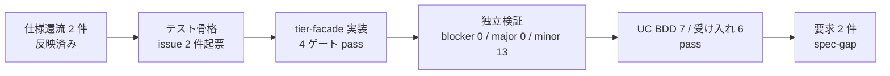

# as-built summary(dcd8234d クロスチェックのジョブマップと比較定義を定義する / 仕様還流後の再実行)

- 対象: `validate-config.sh --rapid-crosscheck`(速報の起動コマンド `RAPID_COMPARE_COMMAND` の設定検証。tier-facade)
- 位置づけ: 2 件の仕様還流(2026-10-10 のクロスチェック簡素化、2026-10-27 の起動コマンドを引数ごとに分ける決まり)の反映後に、attempt-4 のまま再実行した結果の記録。前サイクル(旧 2 tier 構成)の as-built と draft は本ファイルと新しい draft で置き換えた
- 結論: **仕様起因の要求 2 件**(spec-gap 2 / blocker 0)。draft は `docs/impl/latest/dcd8234d/feedback/draft.md`
- 2026-10-27 refresh: 人のレビューで前提 A-009 が仕様変更として却下されたため、要求 CR-dcd8234d-010 を追加した。CR-dcd8234d-009 は変更していない
- 本ファイルは dist-pipeline への入力ではない

## 根拠にした入力

| 入力 | 内容 |
|---|---|
| `issues/20261027_083500_cross-uc-scenarios.md` | UC 横断 Scenario 0 件の記録(責務分担の記録で仕様疑義ではない) |
| `issues/20261027_083600_params-rule-vs-usdm-two-checks.md` | 検証項目が要求 2 点・仕様 3 点で食い違う(仕様疑義) |
| `stages/attempt-4/S5_verify.tier-facade.findings.yaml` | blocker 0 / major 0 / minor 13 |
| `stages/attempt-4/S4_tier-impl.tier-facade.assumptions.yaml` | 実装者が補った前提 12 件(独立検証の判定はすべて「仕様に記載なし」) |
| `stages/S6_uc-bdd.done.yaml` / `S7_atdd.done.yaml` | UC BDD 7 件・受け入れ 6 件 pass。新規 issue 0 件 |
| `review/review-notes.md` | 「2026-10-27 仕様還流後の再レビュー」節: 機能は承認、要求 CR-dcd8234d-009 は公開、前提 A-009 は仕様変更として却下、A-012 と残り 10 件は承認 |

## 1. 全体の状態

| 項目 | 値 |
|---|---|
| ゲート(format / lint / tdd / bdd_tier) | すべて pass(bats 373 件、tier BDD 46 シナリオ) |
| UC BDD | この UC の 7 シナリオ pass(全体 43) |
| 受け入れテスト | SPEC-004-04-5 / -6 / -7 / -8 / -10 / -11 の 6 件 pass。-10 は `{params}` を引数に含めない値だけで判定 |
| 独立検証 | blocker 0 / major 0 / minor 13(前提 12 件 + テスト構造 1 件) |
| 管理 DB | この UC は DB に触れない |

## 2. 原因の分類

| 入力 | 分類 | 扱い | 理由 |
|---|---|---|---|
| 検証項目が要求 2 点・仕様 3 点(issue 083600) | 仕様起因 | 要求 CR-dcd8234d-009 | 要求 SPEC-004-04 の本文と受け入れ基準 -10 が、仕様(CLI 契約・spec.md・tier-facade.md)の `{params}` 位置規則と両立しない。API 要約にも 3 点目が無い。実装では解消できない |
| UC 横断 Scenario 0 件(issue 083500) | 該当なし | 要求にしない | 責務分担の記録。確報の起動コマンド(SPEC-004-04-9)は別 UC の担当で、仕様どおり |
| F-009(前提 A-009、引用符の外し方) | 仕様起因 | 要求 CR-dcd8234d-010 | 人が仕様変更として却下。CLI 契約の 2 か所の引用符の外し方を、今の実装の規則(先頭と末尾を別々に 1 文字ずつ外す。対の一致は求めない)に揃えて書く。実装は変更しない |
| F-001〜F-008 / F-010〜F-012(前提 11 件、仕様に記載なし) | 該当なし | 要求にしない | 人が承認(A-012 と残り 10 件)。仕様と矛盾する前提は 0 件 |
| F-013(単体テストで同じ関数を 2 回実行) | 実装起因 | 次の実装で直す | テスト規約(1 テスト 1 呼び出し)からの逸脱。仕様の問題ではない |

## 3. 実装の到達点(仕様どおり / 不足 / 矛盾)

この UC は HTTP endpoint・状態遷移・header を持たない。CLI の引数・出力・終了コードで分ける。

| 区分 | 項目 | 状態 |
|---|---|---|
| 仕様どおり | 検証ルール 1〜5(必須キー / 絶対パス / 実行可能 / `{job_id}` / `{params}` の位置)と違反文言 | 実装済み |
| 仕様どおり | stdout の固定順(config= / path: / command_path: / has_job_id_placeholder= / status= / violations=) | 実装済み |
| 仕様どおり | 終了コード 0 / 2 / 6、内部障害時は stdout を出さない | 実装済み |
| 仕様どおり | 旧検証種別(`--crosscheck-job-map` / `--target-catalog`)の廃止(未知のオプションとして終了コード 2) | 実装済み |
| 仕様どおり | 入力をシェルとして解釈しない(記号・`$(...)` を文字のまま扱う) | 実装済み(独立検証で比較ツールが実行されないことを確認) |
| 矛盾 | 要求 SPEC-004-04 の「2 点だけ・引数部分は検査しない」と仕様の `{params}` 位置規則 | 仕様側に合わせた。要求 CR-dcd8234d-009 |
| 不足 | この UC の API 要約に `{params}` 位置違反の文言・終了コード 2 の理由が無い | CLI 契約・tier-facade.md に合わせた。要求 CR-dcd8234d-009 |
| 不足 | 前提 12 件(第 4 節)の細部 | 既存の実装(feature flag 設定の読み込み・検証)に揃えて補った。A-009 の引用符の外し方は要求 CR-dcd8234d-010 で仕様に明記する |
| 範囲外 | `--final-crosscheck`(確報の起動コマンド) | 別 UC の担当。所有 UC の実装までは終了コード 6(前提 A-012) |

## 4. 実装者が補った前提の一覧

独立検証の判定は 12 件すべて「仕様に記載なし」(矛盾 0 / 一覧外 0)。人の判断は承認 11 件、仕様変更として却下 1 件(A-009)。

| id | カテゴリ | 前提 | 確信度 | 独立検証 | 人の判断 |
|---|---|---|---|---|---|
| A-001 | 入力検査 | 形式違反(NUL / UTF-8 / BOM / CR / KEY=VALUE でない行)があれば全件報告して終了コード 2。検証ルールは評価しない | medium | 記載なし | 承認 |
| A-002 | エラー処理 | stdout は検証ルールを評価したときだけ出す。ファイル不在・形式違反・内部障害では出さない | medium | 記載なし | 承認 |
| A-003 | 出力形式 | 必須キー欠落・空のとき command_path: - / has_job_id_placeholder=false / violations=1 | medium | 記載なし | 承認 |
| A-004 | 入力検査 | 絶対パスでないときは実行可能の検査をせず 1 行だけ出す。`{job_id}` と `{params}` の検査は独立に行う | high | 記載なし | 承認 |
| A-005 | 入力検査 | 空白だけの値は空とみなし、必須キー違反にする | high | 記載なし | 承認 |
| A-006 | 入力検査 | 「存在し実行可能」は通常ファイルかつ実行権限ありで判定(ディレクトリは拒否) | high | 記載なし | 承認 |
| A-007 | 入力検査 | 同じキーが複数行にあれば後の行で検証し、重複は警告しない | medium | 記載なし | 承認 |
| A-008 | 入力検査 | キーと値の前後空白を除く。キーが空の行は KEY=VALUE でない行として拒否 | medium | 記載なし | 承認 |
| A-009 | 入力検査 | 値の先頭末尾の引用符は対になっているかを見ずに 1 文字ずつ除く(feature flag 設定と同じ規則) | low | 記載なし | 却下(仕様変更) |
| A-010 | 入力検査 | RAPID_COMPARE_COMMAND 以外のキーは検証せず、未知キーの警告も出さない | medium | 記載なし | 承認 |
| A-011 | 出力形式 | `--verbose` で、現れたキーを出現順に info 行で出す(値は出さない) | medium | 記載なし | 承認 |
| A-012 | エラー処理 | `--final-crosscheck` は所有 UC の実装まで「未実装」として終了コード 6 | medium | 記載なし | 承認 |

補足: A-009 は、CLI 契約の中で引数分割の決まり(「引用符を 1 組だけ除く」)と env ファイルの決まり(「feature flag の設定契約に従う」)の書き方が揃っておらず、対になっていない引用符の扱いが一意に読めない。独立検証は立証済みの仕様違反とは扱っていない。レビューで仕様変更として却下され(期待: 2 か所の記述を今の実装の規則に揃える。実装は変更しない)、要求 CR-dcd8234d-010 として追加した。

## 5. 前サイクルの issue と要求の回収状況(確認のみ)

| 前サイクルの入力 | 状態 |
|---|---|
| `issues/20261010_084142_cross-uc-scenarios.md` | 旧仕様(比較定義 CSV / 対象カタログ)向け。今サイクルの issue 083500 で置き換え済み |
| `issues/20261010_084142_facade-dispatch-and-csv-parser-outside-tiers.md` | 公開済み要求(20261010_104636)で回収済み。簡素化の反映で UC の tier が tier-facade だけになり、ティア間の委譲は無くなった |
| `issues/20261010_092630_tier-handler-function-namespace-collision.md` | 同上で回収済み |
| `issues/20261010_093000_tier-bdd-placeholder-scenario-given-then-mismatch.md` | 同上で回収済み |
| 公開済み要求 20261010_104636(簡素化ほか 4 件)/ 20261027_053600(引数ごとに分けて起動) | 仕様に反映済み。今サイクルでは要求にしない |
