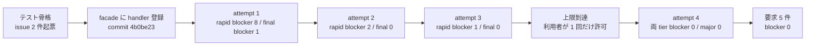

# as-built summary(dcd8234d クロスチェックのジョブマップと比較定義を定義する / attempt 4)

- 対象: `validate-config.sh --crosscheck-job-map`(tier-rapid-crosscheck)と `validate-config.sh --target-catalog`(tier-final-crosscheck)
- 位置づけ: 独立検証の attempt 上限(3)到達後、利用者の承認で開いた attempt 4 で両 tier が pass した時点の記録
- 結論: **仕様起因の要求 4 件**(blocker 0)。draft は `docs/impl/latest/dcd8234d/feedback/draft.md`。初版は 5 件。2026-10-10 のレビュー対話での仕様選択(第 7 節。案 A)を refresh 第 1 回で反映して 6 件にし、同日の第 2 回(第 8 節。簡素化)で CR-007 に統合して 4 件(CR-007 / 001 / 002 / 003)にした
- 根拠:
  - `docs/impl/latest/dcd8234d/issues/` の 4 件
  - `docs/impl/latest/dcd8234d/stages/attempt-4/S5_verify.tier-rapid-crosscheck.findings.yaml`(blocker 0 / major 0 / minor 18)
  - `docs/impl/latest/dcd8234d/stages/attempt-4/S5_verify.tier-final-crosscheck.findings.yaml`(blocker 0 / major 0 / minor 18)
  - `docs/impl/latest/dcd8234d/stages/attempt-4/S4_tier-impl.*.assumptions.yaml`(前提 18 件 × 2 tier)
  - `docs/impl/latest/dcd8234d/stages/S6_uc-bdd.done.yaml` / `S7_atdd.done.yaml`(新規 issue 0 件)
  - `docs/impl/latest/dcd8234d/review/review-notes.md`(人のレビューは未実施。`spec_change` の却下 0 件)
- 本ファイルは dist-pipeline への入力ではない

## 1. 全体の状態

| 項目 | 値 |
|---|---|
| ゲート(format / lint / tdd / bdd_tier) | 両 tier とも pass(bats: rapid 106 件 / final 57 件。macOS と Ubuntu 24.04 の両方) |
| UC BDD | pass(本 UC 7 Scenario / 28 step。全体 43 Scenario) |
| ATDD | pass(SPEC-004-04-5 の 1 Scenario) |
| 独立検証(attempt 4) | rapid: blocker 0 / major 0 / minor 18。final: blocker 0 / major 0 / minor 18 |
| 前提の判定 | 両 tier とも spec_absent 18 / consistent 0 / contradicts 0 / unlisted 0 |
| 性能(NFR B.2.1.1) | ジョブマップ 5,000 行 + 参照先カタログ 5,000 行で約 2.2 秒(macOS)。対象カタログ 5,000 行で 1.2〜1.7 秒(Linux) |

## 2. issues の分類

| issue | 論点 | 分類 | 扱い |
|---|---|---|---|
| `20261010_084142_cross-uc-scenarios.md` | UC 横断 Scenario の責務分担の記録 | 記録(仕様疑義ではない)。ただし SPEC-004-04 の Then「同じ CSV クォート解析関数が使われ」は実装構造の要求で、実行結果で判定できない | **仕様起因** → CR-dcd8234d-002 |
| `20261010_084142_facade-dispatch-and-csv-parser-outside-tiers.md` | validate-config.sh の委譲先登録が facade 側に無い。CSV 解析関数の共有が契約に無い | 登録はオーケストレータが facade に固定パス source の hook を追加して解消(commit 4b0be23)。契約宣言の不足は残る | **仕様起因** → CR-dcd8234d-001 |
| `20261010_092630_tier-handler-function-namespace-collision.md` | 同一シェルに source される tier の関数名が衝突 | 実装は接頭辞で回避済み。規則が仕様・dev-rules に無い | **仕様起因** → CR-dcd8234d-003(dev-rules への追記は `learnings/*_proposal-context.md`) |
| `20261010_093000_tier-bdd-placeholder-scenario-given-then-mismatch.md` | tier BDD の Given(`--fast`)と Then(`value=--blue {blue}`)の不一致 | step 定義で代替済み。仕様の矛盾は残る | **仕様起因** → CR-dcd8234d-004 |

## 3. 原因の分類

| 分類 | 項目 | 扱い | 根拠 |
|---|---|---|---|
| 仕様起因 | tier 間の関数共有と handler 登録が契約未宣言 | CR-001 | issue 2 件目、前提 final A-018 / A-019、review-notes の未決 (a)(b) |
| 仕様起因 | 受け入れ基準に実装構造の要求が混在 | CR-002 | issue 1 件目、S6 done `cross_uc_handling.same_csv_parser` |
| 仕様起因 | 名前空間の規則が無い | CR-003 | issue 3 件目 |
| 仕様起因 | tier BDD の Given / Then 不一致 | CR-004 | issue 4 件目 |
| 仕様起因 | 契約に無い違反文言 3 件と参照先カタログの `expected` の基準 | CR-005 | 前提 rapid A-008 / A-016 / A-022、final A-006。独立検証が A-022 を人の確認対象と明記 |
| 実装起因(修正済み) | attempt 1 の blocker 9 件(rapid 8 / final 1) | attempt 2 で修正。要求にしない | attempt-1 findings、attempt-2 S4 done |
| 実装起因(修正済み) | attempt 2 の blocker 2 件(参照先カタログのクォート不正行・空白だけの行を受理) | attempt 3 で修正。要求にしない | attempt-2 findings F-007 / F-018 |
| 実装起因(修正済み) | attempt 3 の blocker 1 件(1 列ヘッダーのカタログで空白だけの行を受理) | attempt 4 で修正(前提 A-024 追加)。要求にしない | attempt-3 findings F-018、attempt-4 S4 done(rapid) |
| 環境起因 | なし | - | 両 tier の `environment_failures: []`。Linux コンテナの bats は root 権限で読み取り権限のテスト 1 件が skip(macOS では pass) |
| 対象外 | spec_absent の前提 32 件(CR-005 で扱う 4 件を除く) | S9 で人が前提として回答する。`spec_change` で却下された前提だけ refresh で要求に加える | 第 5 節 |

### 要求にしなかったもの

- 参照先カタログへの共通入力規則(config_input_rules)の適用そのもの。attempt 1〜3 の blocker の多くはこの観点の不足だったが、契約の `scope` は参照先にも適用されると読め、S4 の固定指示でも明示されたため、仕様の不足ではなく実装の読み落としとして扱う(学びに記録)。
- 出力順・集計の母集団・検証の打ち切り範囲・`--verbose` の出力対象などの前提(両 tier 計 32 件)。先行 UC と同じく、人が前提として承認する対象であり、仕様の文言に関わるものではない。
- attempt 1〜3 の findings はすべて解消済みの履歴であり、要求にしない。

## 4. 仕様との対応(実装済みの契約)

HTTP endpoint・状態遷移・header は本 UC に無い。CLI の出力と終了コードで整理する。

### 仕様どおり

- `--crosscheck-job-map`: 宣言 3 件(exit_code_contract / target_catalog_path / catalog_version)の検証、列順固定のヘッダー、列数 6、job_id の形式・重複、compare_command の実行可能、プレースホルダ(`{blue}` `{green}` / `{catalog_version}` `{business_date}`)、comparison_type の列挙、full 行の予約 job_id と最大 1 行、対象カタログ参照の解決、CSV クォート
- `--target-catalog`: 列順固定のヘッダー(5 列)、必須 3 列、target_type の列挙、複数版の受理と版の集計、重複対象(`lines=` は初出行を含む全行)、CSV クォート
- 両方: 入力の守備範囲(NUL / 不正な UTF-8 / BOM / CR / ヘッダー列名の重複 / 空白だけの行)の原因別の拒否と hint、単一スナップショット、内部障害の終了コード 6、制御文字の可視表記、stdout の固定順、終了コード 0 / 2 / 6、RDB に触れない
- NFR B.2.1.1: 5,000 行を 10 秒以内(両 tier とも Linux で実測)

### 仕様の矛盾

- tier-rapid-crosscheck.md の BDD「compare_options にプレースホルダが無い」の Given と Then(CR-004)
- 「直接依存で共有する」(tier md)と「契約に無い tier 間依存の禁止」(dev-rules)(CR-001)

### 仕様の不足

- tier 間の共有面と handler 登録方法(CR-001)
- 受け入れ基準の Then の実装構造の要求(CR-002)
- 同一シェルに source される tier の名前空間(CR-003)
- 違反文言 3 件と参照先カタログの `expected` の基準(CR-005)

## 5. 実装者が補った前提の一覧(attempt 4、36 件)

人の判断: 未実施(S9 で回答する)。「扱い」列は本 summary での分類。

### tier-rapid-crosscheck(18 件)

| id | カテゴリ | 前提(要約) | 判定 | 扱い |
|---|---|---|---|---|
| A-001 | input_validation | 宣言は `#` の直後に空白 0 個以上の `name=value`。形に合わないコメント行は無視 | spec_absent | 前提として承認を取る |
| A-002 | input_validation | 宣言はヘッダー行より前のコメント行だけから読む | spec_absent | 前提として承認を取る |
| A-003 | input_validation | 同名の宣言は初出を採用し 2 回目以降を違反にする | spec_absent | 前提として承認を取る |
| A-004 | input_validation | 宣言の値は空白を除かず比較。空の値は `is invalid` | spec_absent | 前提として承認を取る |
| A-005 | error_handling | 集計不能な段階(ファイル不在・守備範囲違反・ヘッダー不正)では stdout を出さない | spec_absent | 前提として承認を取る |
| A-008 | input_validation | 相対パスの compare_command は `is not absolute` で違反 | spec_absent | **CR-005**(文言) |
| A-011 | error_handling | 参照先カタログの形式違反は共通文言で全件報告し、参照未解決も出す | spec_absent | 前提として承認を取る |
| A-012 | input_validation | 参照解決は両宣言が妥当なときだけ。相対パスはカレントディレクトリ基準 | spec_absent | 前提として承認を取る |
| A-013 | data_format | `--verbose` の info は列数 6 で解析できた行だけ | spec_absent | 前提として承認を取る |
| A-014 | data_format | 宣言が不正でも stdout には宣言値をそのまま出す | spec_absent | 前提として承認を取る |
| A-015 | error_handling | stderr の種別間の出力順 | spec_absent | 前提として承認を取る |
| A-016 | input_validation | full 行の compare_targets が `catalog` 以外なら `is not catalog` で違反 | spec_absent | **CR-005**(文言) |
| A-018 | input_validation | クォート不正・列数不一致の行は列検証と重複検査の対象外 | spec_absent | 前提として承認を取る |
| A-019 | error_handling | 重複列名は `duplicate column` と `header mismatch` の両方を出す | spec_absent | 前提として承認を取る |
| A-021 | data_format | `actual=` の列名はカンマ・二重引用符を含めば CSV と同じ引用で出す | spec_absent | 前提として承認を取る |
| A-022 | input_validation | 参照先カタログの `expected` はそのヘッダーの列数(1 列なら `expected=1 actual=1`) | spec_absent(独立検証が S9 確認対象と明記) | **CR-005**(基準) |
| A-023 | error_handling | 参照先カタログのヘッダーがクォート不正なら列数不一致は報告しない | spec_absent | 前提として承認を取る |
| A-024 | input_validation | 空白だけの行は解析後の 1 セルで判定。`" "` も拒否、`""` は拒否しない(attempt 4 で追加) | spec_absent | 前提として承認を取る |

### tier-final-crosscheck(18 件)

| id | カテゴリ | 前提(要約) | 判定 | 扱い |
|---|---|---|---|---|
| A-001 | data_format | `--verbose` の info 行の項目と行番号 | spec_absent | 前提として承認を取る |
| A-002 | data_format | `--verbose` の info は列検証を通過した行だけ | spec_absent | 前提として承認を取る |
| A-004 | error_handling | 集計不能な段階では stdout を出さない | spec_absent | 前提として承認を取る |
| A-005 | error_handling | hint はファイル内容の違反(終了コード 2)のときだけ最後に 1 回 | spec_absent | 前提として承認を取る |
| A-006 | error_handling | 許可文字違反の catalog_version は `is invalid` | spec_absent | **CR-005**(文言) |
| A-007 | input_validation | 空の target_type は `is empty` だけ(`not in table,file` は重ねない) | spec_absent | 前提として承認を取る |
| A-009 | data_format | `catalog_versions=` は初出順 | spec_absent | 前提として承認を取る |
| A-010 | data_format | 集計と重複検査は列数 5 の全データ行(他列の違反行を含む) | spec_absent | 前提として承認を取る |
| A-011 | input_validation | 重複検査はキー 3 列が非空の行だけ | spec_absent | 前提として承認を取る |
| A-012 | data_format | 複数キーの `duplicate target` は初出行の昇順 | spec_absent | 前提として承認を取る |
| A-014 | error_handling | 守備範囲の違反があれば他の検証に進まない | spec_absent | 前提として承認を取る |
| A-015 | error_handling | 同一行の複数の形式違反は BOM → NUL → UTF-8 → CR の順 | spec_absent | 前提として承認を取る |
| A-016 | error_handling | ヘッダー不一致のときはクォート不正だけを合わせて報告 | spec_absent | 前提として承認を取る |
| A-017 | error_handling | 共有関数が source されていなければ `internal command failed commands=job_map_repo_load`(6) | spec_absent | 前提として承認を取る(CR-001 で共有面が契約化されれば不要になる) |
| A-018 | data_format | handler の配置と関数名 `validate_config_target_catalog <path> <verbose>` | spec_absent | **CR-001**(登録方法)。前提としても承認を取る |
| A-019 | data_format | CSV 解析は facade の `job_map_repo_load` / `csv_parse`、表記は `cli_field_*` を使う | spec_absent | **CR-001**(共有面)。前提としても承認を取る |
| A-020 | performance | 行数に比例する実装(連想配列、LC_ALL=C を 1 回) | spec_absent | 前提として承認を取る |
| A-021 | data_format | `actual=` の列名の引用表記(attempt 2 で追加) | spec_absent | 前提として承認を取る |

- 判定の内訳: 両 tier とも spec_absent 18 / consistent 0 / contradicts 0 / unlisted 0
- 人が `spec_change` で却下した前提: 0 件(レビュー未実施)
- 独立検証が人の確認対象と明記した前提: rapid A-022

## 6. 方針資料との照合

- CR-001 / CR-003: 方針資料はスクリプトの内部構成(tier 間の関数共有・名前空間)を定めていない。どちらに決めても矛盾しない。
- CR-002: 方針資料は「同じ CSV 形式」とだけ定める。関数の共有は方針資料の要求ではないため、受け入れ基準から外しても意図は変わらない。
- CR-004 / CR-005: 方針資料は違反文言と BDD の例を定めていない。追加・修正は矛盾しない。

## 7. レビュー対話での仕様選択(案 A。2026-10-10 refresh で追記)

- 入力: `docs/impl/latest/dcd8234d/review/review-notes.md`「2026-10-10 レビュー対話での仕様選択」。承認(review_approved)は記録せず、S8 を refresh で再実行した
- 利用者の問い: 「target-catalog.csv は何の対象か。クロスチェック自体は別ツールが行うので対象一覧は不要。速報は blue/green のジョブ情報を渡し、確報は何も渡さずキックするだけ」
- 照合結果: 方針資料(`tmp/RelayGateのしくみ.md` 42 行目)は「比較対象の定義は、適用側で定義します」と定める。確報依頼のデータ項目「business_date」「対象カタログの版」は方針資料にもあるが、対象カタログの列・検証・`{catalog_path}` の受け渡しは仕様策定フェーズの推論(`docs/specs/latest/_inference.md` #5 仮採用。本 UC の tier-final-crosscheck.md も「所在は _inference.md #5 仮採用」と注記)
- 決定(案 A): 確報クロスチェックは比較ツールを起動するだけにする。対象カタログ(target-catalog.csv / `validate-config.sh --target-catalog` / 確報依頼の catalog_version)と business_date を relay-gate から外す(relay-gate はアプリ独自 DB の業務日付を参照できない)。速報の `{blue}` / `{green}` の受け渡しは変えない。方針資料側の確報依頼データ項目は利用者がそろえる
- 分類: **仕様起因(方針資料との乖離)** → CR-dcd8234d-006 を追加。実装起因ではない(実装は仮採用の仕様どおりで、独立検証も pass)
- 既存要求の整理:
  - CR-001: 確報ティアの検証関数が無くなるため、対象を facade と速報クロスチェックの 2 ティア間に絞った
  - CR-002: Then の文言だけを対象に残し、Scenario 名・受け入れ基準の「対象カタログ」の削除は CR-006 に寄せた
  - CR-003: 衝突の実例は確報側の関数だったが、規則の不在は残るため要求は維持。完了条件の対象ティアを facade / 速報に直した
  - CR-004: 変更なし
  - CR-005: `catalog_version is invalid` の文言(final A-006)と参照先カタログの `expected` の基準(rapid A-022)は対象自体が廃止されるため CR-006 に吸収。速報側の違反文言 2 件(rapid A-008 / A-016)だけを残した
- 本 UC の確報側成果物(final-crosscheck/ の `validate_config_target_catalog` と bats 57 件、速報側の検証ルール 9)は、仕様反映後の再実装で削除される。前提一覧(第 5 節)のうち確報ティア 18 件と速報ティアの参照解決に関する前提(A-011 / A-012 / A-022 / A-023)は、仕様反映後は対象が無くなる
- 学び: `learnings/20261010_172853_tentative-spec-confirm-before-impl.md`(仮採用注記のある設定ファイルは実装前に利用者確認する)

## 8. レビュー対話での仕様選択(第 2 回。簡素化。2026-10-10 refresh 第 2 回で追記)

- 入力: `docs/impl/latest/dcd8234d/review/review-notes.md`「2026-10-10 レビュー対話での仕様選択(第 2 回。簡素化案で確定)」。第 1 回(案 A)向けの S9 再生成は方針変更のため中断し、承認(review_approved)は記録していない
- 利用者の元の構想: 「blue / green runner → DB ← worker → 比較ツール」「確報 runner → DB ← worker → 比較ツール」。速報はジョブ ID を渡し、確報はパラメータなし。worker は任意の比較コマンドを 1 つ定義でき、速報はそのパラメータを動的に渡せる。現在の仕様(ジョブ ID ごとの比較定義 CSV・比較対象 / 定義版の列・成果物パスの受け渡し・対象カタログ・検証ルール群)は複雑にし過ぎ
- 想定環境の制約: runner と worker は別ネットワークセグメントで動く。worker はファイルパスを渡されても読めない。必要な情報は DB の依頼レコードに含める
- 照合結果: 方針資料(`tmp/RelayGateのしくみ.md` 42 行目「比較対象の定義は、適用側で定義します」/ 261 行目「worker は stdout・stderr・exitcode を依頼レコードへ保存」/ 595〜625 行目の状態と終了コードの対応、`tmp/RelayGateの利用イメージ.md` 326 行目「速報も確報も同じ比較ツールのパターン。違いは対象の量」)と一致する。比較定義 CSV の列構造・`{blue}` `{green}` の成果物パス・対象カタログ・worker のファイル保存・`comparison_results` の抽出は仕様策定の推論(`_inference.md` #5 仮採用ほか)で、方針資料に無い
- 確定した内容(7 点): (a) worker に必要な情報は DB の依頼レコードに含める / (b) 速報の起動コマンドは設定 1 行(`{job_id}` 必須、`{run_id}` `{params}` `{blue_exit_code}` `{green_exit_code}` 任意)、確報は 1 行・プレースホルダなし / (c) 完了通知は run_id / job_id / exit_code(artifact_uri を外す) / (d) worker の結果保存は依頼レコードの stdout / stderr / exitcode 列だけ。0 → SUCCEEDED、非 0 または起動失敗 → FAILED / (e) `comparison_results`(difference_count / report_uri の抽出)を廃止 / (f) 確報の依頼レコードは識別子・状態・時刻・結果だけ / (g) 比較定義 CSV の行構造・比較対象と定義版の列・対象カタログ・`{blue}` `{green}`・worker のファイル保存・検証ルール群を廃止。検証は「コマンドが絶対パスで実行可能」「速報に `{job_id}` がある」の 2 点
- 分類: **仕様起因(方針資料との乖離。環境制約の未反映)** → CR-dcd8234d-007 に統合。実装起因ではない(実装は仮採用の仕様どおりで、独立検証も pass)
- 既存要求の整理(6 件 → 4 件):
  - CR-007(新規・主要求): 上記 (a)〜(g) を正本ごとに書いた。本 UC の範囲を「速報の起動コマンド 1 行の設定とその検証」に縮小し、`tier-final-crosscheck.md` を削除する。方針資料側(確報依頼の business_date / 対象カタログの版、所有者の表、rapid_run の artifact_uri)は利用者がそろえる
  - CR-006(案 A): CR-007 に吸収して削除
  - CR-001 / CR-003: 簡素化後も `validate-config.sh` の入口(facade)が速報側の検証関数を読み込む構成が残るなら維持。委譲自体を無くす構成を採る場合は不要になる旨を 4 項に追記
  - CR-002: 対象カタログの記述削除を CR-007 に寄せたうえで、「同じ CSV 解析関数」の文言を振る舞いに直す要求として維持。設定の置き場が env になる場合は書き直し不要とし、新しい受け入れ基準にも実装構造を書かない要求に広げた
  - CR-004(BDD の Given / Then 不一致)/ CR-005(違反文言 2 件): 該当の検証ルール(`{blue}` `{green}` 必須、compare_targets 固定値、compare_command の文言)自体が廃止されるため、CR-007 の完了条件「残す検証 2 点の文言を契約に明記する」に吸収して削除
- 本 UC の成果物への影響: 速報ティア(bats 106 件)の検証ルール群と確報ティア(bats 57 件)の対象カタログ検証は、仕様反映後の再実装でほぼ全面的に置き換わる。前提一覧(第 5 節)36 件のうち、CSV 構造・宣言・参照解決・対象カタログに関するものは対象が無くなる
- 学び: `learnings/20261010_175258_separate-network-segments-pass-values-via-db.md`(別セグメントの runner / worker 間ではファイルパスを受け渡しに使えない。依頼レコードに必要値を持たせる)。提案: `learnings/20261010_104636_proposal-skill.md` 提案 6(S1 でプロセス間の受け渡し経路を配置図と照合する)
