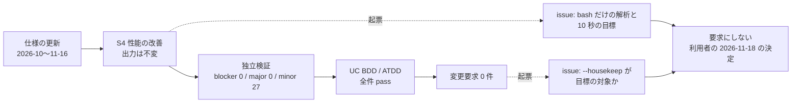

# as-built summary(eff24f55 slot ごとのジョブマップを定義する / 2026-11-16 の再実行、attempt 6)

- 対象: `validate-config.sh --job-map`(tier-facade のみ)
- 位置づけ: いちど完了した UC の、仕様の更新(2026-10〜2026-11-16)に伴う再実行。機能の直しは無く、S4 は `--job-map` の所要時間を縮める変更だけ(出力のバイト列と終了コードは不変)
- 結論: **仕様への要求は無い**(要求 0 件、blocker 0 件)。draft は公開しない
  - 性能: 実際の利用で想定する形の入力(4,999 行・8 MB 弱)は、行数に比例する時間で終わることを確かめた(Linux で 3.8〜8.1 秒)。行の長さの 2 乗に比例する処理は今回除いた
  - 目標から外すために作った入力の遅さは扱わない(利用者の 2026-11-18 の決定)
  - 下書きにあった要求 2 件(CR-eff24f55-008 / 009)は、利用者の 2026-11-18 の指示で取り下げた
    - 利用者の言葉: 「大きなデータに意味はなく、ムダな処理がないことを見たいだけです」「実装の効率が下がるなら仕様を取り下げてもよいです」
    - 理由: 仕様を変えると、この機能の全工程の再確認が要り、実装の効率が下がる。現在の仕様は性能を「目標値であり、入力の制限でも合否の検査でもない」と既に書いている
  - 前提 26 件と記録漏れの 1 件(V-001)は、2026-11-17 に利用者がすべて承認した
- 根拠:
  - `docs/impl/latest/eff24f55/issues/20261116_062901_job-map-bash-only-parse-exceeds-performance-target.md`(S4 で起票)
  - `docs/impl/latest/eff24f55/issues/20261116_090543_housekeep-not-in-performance-target-scope.md`(本 S8 で起票)
  - `docs/impl/latest/eff24f55/stages/attempt-6/S5_verify.tier-facade.findings.yaml`(blocker 0 / major 0 / minor 27)
  - `docs/impl/latest/eff24f55/stages/attempt-6/S4_tier-impl.tier-facade.assumptions.yaml`(前提 26 件)
  - `docs/impl/latest/eff24f55/stages/attempt-6/S4_tier-impl.tier-facade.done.yaml`(`output_equivalence` / `performance`)
  - `docs/impl/latest/eff24f55/stages/S6_uc-bdd.done.yaml` / `S7_atdd.done.yaml`(全件 pass)
  - `docs/impl/latest/eff24f55/review/review-notes.md`(`spec_change` の却下 0 件)
- 本ファイルは dist-pipeline への入力ではない

## 1. 全体の状態

| 項目 | 値 |
|---|---|
| ゲート(format / lint / tdd / bdd_tier) | すべて pass(bats 579 件中、変更していない時間のテスト 1 件が負荷で時間切れ → 単独の再実行で ok。tier BDD 112 Scenario) |
| 独立検証のゲート | 通常の bats 537 件(macOS / Linux)・重いテスト 42 件(Linux)・tier BDD 112 Scenario がすべて pass |
| 出力の不変 | 実装者 139 入力 × 両 OS × ロケール 3 通り、検証者 896 比較 × 両 OS で差 0 |
| 独立検証 | blocker 0 / major 0 / minor 27 |
| 前提の判定 | consistent 1 / spec_absent 25 / contradicts 0 / unlisted 1 |
| 性能の目標(目標値。合否の検査ではない) | 既知の 9 通りのうち Linux で 10 秒以内が 9 通り(最大 8.1 秒)。10 秒を超えて残る形は第 2 節 |

## 2. 今回の変更と仕様との関係

| 変更 | 仕様との関係 |
|---|---|
| 報告行の可視表記をまとめて作る(sed / tr の起動は一定回数) | 出力のバイト列は不変。補助コマンドの失敗は既存の `config_input_rules.internal_failure`(終了コード 6・error 1 行)に従う |
| CSV の行をすべて窓なしの解析で分ける、fixed_params の状態機械を断片で読む | セルの解析は bash だけのまま(`csv_rules`)。受理する文法は不変 |
| 検証全体を C ロケールで行う | 出力のバイト列はロケール 4 通りで不変 |

### 10 秒を超えて残る入力(記録のみ。要求にしない)

- 上 3 つは、目標から外すために作った形である。所要時間は数に比例する(2 乗ではない)。
- 実際の利用で想定する形の入力は、Linux で 3.8〜8.1 秒である。
- 作為的な入力の遅さは扱わない(利用者の 2026-11-18 の決定)。

| 入力 | Linux | macOS | 理由 |
|---|---|---|---|
| 1 行が 8 MiB の fixed_params(エスケープが数十万個) | 96.6 秒 | 105.7 秒 | JSON のエスケープ 1 つあたり約 35 マイクロ秒 |
| 1 行が 8 MiB の fixed_params(要素約 137 万個) | 39.3 秒 | 43.3 秒 | CSV の `""` が約 270 万個(1 つあたり約 12 マイクロ秒) |
| ヘッダーに未知の列名が約 206 万個 | 測っていない | 102.8 秒 | 列ごとの検査と warn 行(1 列あたり約 50 マイクロ秒) |
| 制御文字だらけの job_id など(macOS だけ) | 8〜9 秒 | 10〜12 秒 | BSD sed と bash の文字列の扱い。解析の制約とは無関係 |

## 3. issues の解消判定

| issue | 論点 | 判定 | 根拠 |
|---|---|---|---|
| `20260919_161456_cross-uc-scenarios.md` | UC 横断 Scenario の責務分担 | 要求不要(過去の run で処理済み) | 仕様疑義ではない。S6 / S7 pass |
| `20260919_183305_control-char-notation-and-internal-error-undefined.md` | 制御文字の表記・内部障害 | 解消済み | CLI 契約 `conventions.output_format.control_chars` / `config_input_rules.internal_failure` |
| `20260919_195500_malformed-input-policy-undefined.md` | 入力の守備範囲 | 解消済み | CLI 契約 `config_input_rules` |
| `20260919_210000_file-replaced-between-scan-and-parse.md` | 検証中の差し替え | 解消済み | CLI 契約 `config_input_rules.snapshot.validate_config` |
| `20260922_120000_duplicate-job-id-lines-contract-vs-bdd.md` | 重複 job_id の `lines=` | 解消済み | CLI 契約 / tier-facade.md / spec.md が「初出行を含む」に統一 |
| `20260922_120100_credential-ref-warning-boundary-undefined.md` | credential_ref の警告境界 | 解消済み | CLI 契約 `columns.credential_ref.on_format_violation` |
| `20261116_062901_job-map-bash-only-parse-exceeds-performance-target.md` | bash だけの解析と 10 秒の目標 | **要求にしない**(利用者の 2026-11-18 の決定) | 現在の仕様は性能を「目標値であり、入力の制限でも合否の検査でもない」と既に書いている。10 秒を超えるのは目標から外すために作った入力だけで、仕様の不足として扱わない |
| `20261116_090543_housekeep-not-in-performance-target-scope.md` | `--housekeep` が目標の対象か | **要求にしない**(利用者の 2026-11-18 の決定) | 目標は検査ではない。ハウスキープの機能を実装するときに、実装の効率を下げてまで決める事柄ではない |

- 2 つの issue ファイルは書き換えていない(起票時の記録として残す)。判定はこの表と `stages/S8_feedback.done.yaml` の `resolution.issues` に記録した。
- fd678b04 の issue `20261113_063000_other-validation-kinds-exceed-performance-target.md` の提案 4(制約か目標を利用者に確認する)は、今回の利用者の決定(仕様は変えない)で答えが出た。

## 4. 仕様との対応(実装済みの契約)

HTTP endpoint・状態遷移・header は本 UC に無い。CLI の出力と終了コードで整理する。

### 仕様どおり

- 必須 5 列・任意 4 列、列名での対応付け、ヘッダーの重複・欠落の拒否、入力の守備範囲(NUL / 不正な UTF-8 / BOM / CR)、単一スナップショット、補助コマンドの失敗の区分(終了コード 6)、重複 job_id の `lines=`、credential_ref の warn、制御文字の可視表記、stdout の固定順、終了コード 0 / 2 / 3 / 6
- 性能は目標値として扱い、大きさで拒否・警告しない。目標を超えても結果は変えない(`config_input_rules.performance_target`)

### 仕様の矛盾

- なし(独立検証の contradicts 0 件)

### 仕様の不足

- 要求にするものは無い
- 記録のみ(利用者の 2026-11-18 の決定で要求にしない)
  - 性能の目標の「内容によらず」が、目標から外すために作った入力まで含むと読める点
  - `--housekeep` が目標の対象に並んでいない点(検証種別 5 つのうち 4 つを並べて「すべて」と書く)

## 5. 原因の分類

| 分類 | 項目 | 扱い | 根拠 |
|---|---|---|---|
| 仕様起因 | なし | - | 要求 0 件 |
| 要求にしない(利用者の決定) | bash だけの解析と 10 秒の目標 | 仕様は変えない。作為的な入力の遅さは扱わない | issue `20261116_062901_...`、利用者の 2026-11-18 の指示 |
| 要求にしない(利用者の決定) | `--housekeep` が目標の対象か | 仕様は変えない | issue `20261116_090543_...`、利用者の 2026-11-18 の指示 |
| 実装起因 | なし | - | contradicts 0 件。人の `implementation_change` の却下 0 件 |
| 環境起因 | 開発機の負荷(load average 18〜45)で、変更していない時間のテストが時間切れ(macOS 11.6 秒 → 単独 7.5 秒、Linux 10.8 秒 → 単独 5.7 秒) | 要求に含めない。重いテストを分ける運用にした(learnings) | S4 done の `gate_runs[].flaky` |
| 環境起因 | 独立検証の初回で、並走した検証と bats が同じ TMPDIR を使い、BSD 系 mktemp の固定テンプレートで作成が競合 | 要求に含めない。TMPDIR を分けて再実行し全件 pass | S5 findings の `observations` |
| 環境起因 | macOS の所要時間が Linux より長い(BSD sed と bash の文字列の扱い) | 要求に含めない。事実として第 2 節に記録した | S4 done の `performance` |

### 要求にしなかったもの

- spec_absent の minor 25 件(F-001〜F-018、F-020〜F-026)
  - 要求の対象は「人が `spec_change` で却下した前提」だけ。`review-notes.md` に `spec_change` の却下は 0 件
  - 22 件は利用者が過去に承認した前提の引き継ぎ(内容不変)。新しい要求にしない
  - 新規 4 件(A-059〜A-062)は S9 で承認を求める(第 6 節)
- 復唱 1 件(F-019 / A-055): 契約どおりの内容で、前提ではない
- unlisted 1 件(F-027 / V-001。検証全体を C ロケールで行う): 前提の記録漏れであり、仕様の不足ではない。S9 で判断を求める(第 6 節)

## 6. S9 で確認した前提(要求ではない)

2026-11-17 に利用者が、下の 5 件を含む 26 件と V-001 をすべて承認した(却下 0 件。前提に由来する新しい要求は無い)。下表の「回答」列は、レビュー前に求めた回答の要否である。

| 前提 | 内容 | 推奨 | 回答 |
|---|---|---|---|
| A-059(新規、performance) | 報告行の値を元のまま溜め、stderr へ出す直前にまとめて可視表記にする(4,096 バイト以上なら sed / tr を一定回数)。fixed_params= は解析で作った要素の表記を使う。出力のバイト列は値ごとに置き換える方式と同じ | 承認 | 任意 |
| A-060(新規、error_handling) | まとめて作る sed / tr の失敗は、溜めた報告行も stdout も出さず `commands=<sed|tr|sed,tr>` の error 1 行と終了コード 6。map_version の可視表記は stderr を出す前に作る | 承認 | 任意 |
| A-061(新規、performance) | CSV の行をすべて単語分割で分ける。csv_rules の「bash 単独で 1 文字ずつ状態機械で解析する」を、受理する文法と bash 単独の制約として読み、実装の手段は単語分割でもよいとする | 承認 | **必須**(仕様の文言の読み方を決めるため。`spec_change` で却下なら、refresh で csv_rules の文言を直す要求を足す。承認されたため要求は無い) |
| A-062(新規、performance) | fixed_params の JSON の状態機械を断片で読み、要素の表記も同時に作る。早期判定は printf の書式で行う。受理する文法と要素は 1 文字ずつの状態機械と同じ | 承認 | 任意 |
| V-001(記録漏れ。F-027) | 検証全体(`validate_job_map_query`)を `local LC_ALL=C` で行い、呼び出し元のロケール変数は関数の終わりで元に戻る。出力はロケール 4 通りで不変 | 承認(前提として記録した扱いにする) | **必須**(前提ファイルに無いため、S9 で 1 件の判断として残す) |

### 前回の承認からの変化(引き継いだ 22 件)

| 前提 | 変化 | 扱い |
|---|---|---|
| A-016(推奨値 60 との差の専用 info 行を出さない) | 前回の判定は consistent(復唱)、今回は spec_absent。2026-09-23 に利用者が案 A で承認済み。内容は不変 | 新しい要求にしない。承認済みのまま |
| A-055(複製の削除の失敗は commands=rm で終了コード 6) | 前回は consistent、今回は restatement(復唱) | 新しい要求にしない |
| A-050 / A-051(バイト点検の違反での停止・同じ行の違反の並び) | 前回の記録から外した | 仕様に入った(`config_input_rules.byte_checks.stop` / `order`)ため前提でなくなった |

### 下書きの要求 2 件の経過(どちらも取り下げ)

| 日付 | できごと |
|---|---|
| 2026-11-16 | 要求 2 件の下書きを作った(性能の目標と bash だけの解析 / `--housekeep` を目標の対象に含める) |
| 2026-11-17 | 利用者が内容を決めた(1 件目は対象外の形を数で定める、2 件目は 5 種類すべてを対象にする) |
| 2026-11-18(1 通目) | 利用者の指示で、1 件目を「目標はムダな処理がないことの目安」に作り直した |
| 2026-11-18(2 通目) | 利用者の指示で、2 件とも取り下げた。仕様は変えない |

- 取り下げの理由: 仕様を変えると、この機能の全工程の再確認が要り、実装の効率が下がる。
- 変わらない前提: 性能は目標値であり、入力の制限でも合否の検査でもない。行数に比例する時間で処理できる実装を選ぶ。

## 7. 実装者が補った前提の一覧(attempt 6、26 件)

人の判断: 2026-11-17 のレビューで 26 件すべてと V-001 を承認(却下 0 件)。「前回」列は 2026-10-06 のレビューの判断。

| id | カテゴリ | 前提(要約) | 判定 | 前回の判断 |
|---|---|---|---|---|
| A-005 | error_handling | ヘッダーのクォート不正時はクォート不正だけを全件報告 | spec_absent | 一括承認 |
| A-006 | error_handling | ヘッダー不一致時は列検証と重複検査を省く | spec_absent | 一括承認 |
| A-008 | data_format | missing= は契約の列順 | spec_absent | 一括承認 |
| A-010 | error_handling | 解析不能行は列検証・重複検査・版集計の対象外 | spec_absent | 一括承認 |
| A-014 | data_format | fixed_params= の JSON は空白なし、`/` と非 ASCII はエスケープしない | spec_absent | 一括承認 |
| A-016 | data_format | 推奨値 60 との差の専用 info 行を出さない | spec_absent(前回は consistent) | 案 A で承認 |
| A-017 | data_format | map_version の distinct 値は初出順 | spec_absent | 一括承認 |
| A-018 | data_format | distinct 値の空は `-` で表記 | spec_absent | 一括承認 |
| A-019 | data_format | info: resolved は検証を通過した行だけ | spec_absent | 一括承認 |
| A-020 | data_format | stderr の種別間の出力順 | spec_absent | 一括承認 |
| A-022 | input_validation | 形式違反の job_id も重複検査の対象、空は除外 | spec_absent | 一括承認 |
| A-025 | data_format | 複数の重複 job_id の error 行は初出行の昇順 | spec_absent | 一括承認 |
| A-043 | error_handling | 検証器内部の障害も commands=<関数名> で終了コード 6 | spec_absent | 一括承認 |
| A-044 | error_handling | 補助コマンドの出力の妥当性も検査 | spec_absent | 一括承認 |
| A-049 | error_handling | 重複列名と必須列欠落を同時に報告 | spec_absent | 一括承認 |
| A-052 | data_format | BSD 系 mktemp では作業名を付け直す | spec_absent | 一括承認 |
| A-053 | error_handling | tr / sed の commands= の帰属規則 | spec_absent | 案 A で承認 |
| A-054 | data_format | unknown column は出現ごとに 1 行 | spec_absent | 一括承認 |
| A-055 | error_handling | 複製の削除 rm の失敗は commands=rm で終了コード 6 | restatement | 一括承認 |
| A-056 | error_handling | 複製の工程と削除の同時失敗は複製の失敗を優先 | spec_absent | 一括承認 |
| A-057 | data_format | 補助コマンドと削除の同時失敗は失敗順に連結 | spec_absent | 一括承認 |
| A-058 | data_format | `key=value` / `key: value` の空白判定は ASCII 6 種 | spec_absent | 案 A で承認 |
| A-059 | performance | **新規**: 報告行をまとめて可視表記にする | spec_absent | 未判断 |
| A-060 | error_handling | **新規**: まとめて作る sed / tr の失敗の扱い | spec_absent | 未判断 |
| A-061 | performance | **新規**: CSV をすべて窓なしで解析する(csv_rules の読み方) | spec_absent | 未判断 |
| A-062 | performance | **新規**: JSON の状態機械を断片で読む | spec_absent | 未判断 |

- 判定の内訳: consistent 1(A-055 の判定は findings の kind では restatement)/ spec_absent 25 / contradicts 0 / unlisted 1(V-001)
- 前回(24 件)からの増減: A-050 / A-051 を外し(-2)、A-059〜A-062 を足した(+4)
- 人が `spec_change` で却下した前提: 0 件

## 8. 方針資料との照合

仕様への要求は無いため、方針資料と照らす要求も無い。取り下げた 2 件について確かめた内容を、記録として残す。

| 取り下げた要求 | 方針資料の該当する記載 | 結果 |
|---|---|---|
| CR-008 | しくみ・利用イメージとも、設定ファイルの検査の性能・解析の手段(bash / awk)の記載は無い。利用イメージは fixed_params を固定引数が数個の JSON 配列(例: 3 要素)とし、引数の数と空白・カンマを維持すると書く | 食い違わない(目標から外すために作った 3 つの形は、方針資料の想定から外れる) |
| CR-009 | しくみ・利用イメージとも、ハウスキープを 1 日 1 回の定期ジョブ・保持日数の既定 90 日として示す。設定の検証の性能の記載は無い | 食い違わない |
