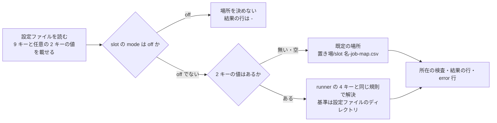
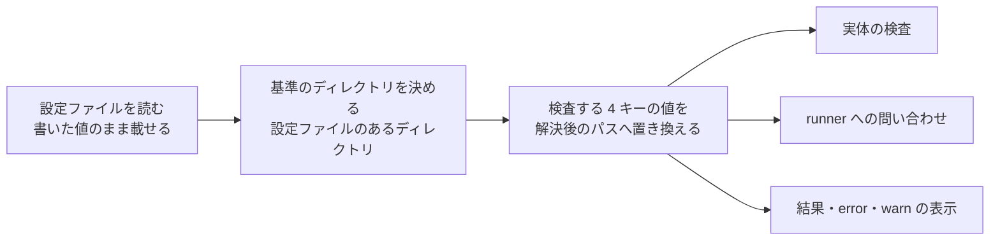

# As-built summary: feature flag を設定する(fd678b04)

この summary は dist-pipeline への入力ではない。新しい回の記録を上に足し、前の回の記録は下に残す。

## 今回の記録(2026-11-16。ジョブマップの場所を書く任意の 2 キーと、一時的な保持の条件が仕様へ反映された後の再実行)

- 対象 tier: tier-facade(`validate-config.sh --feature-flag`)
- 位置づけ: 2026-11-16 に、次の 2 点が仕様へ入った。反映後の仕様で全工程をやり直し、実装を追従させた
  - feature-flag.env に、slot ジョブマップの場所を書く任意の 2 キー `BLUE_JOB_MAP_CSV` / `GREEN_JOB_MAP_CSV` を足す(利用者の決定)
  - 読み取りの途中だけ作業用の領域に値を置くことを許す条件(1 つ前の回に公開した要求 1 件の反映)
- 入力:
  - `stages/attempt-6/S5_verify.tier-facade.findings.yaml`(blocker 0 / major 0 / minor 26)
  - `stages/attempt-6/S4_tier-impl.tier-facade.assumptions.yaml`(25 件)
  - `stages/attempt-5/S5_verify.tier-facade.findings.yaml`(blocker 1 件。Linux の lint)
  - `stages/attempt-5/S4_tier-impl.tier-facade.done.yaml`、`stages/attempt-6/S4_tier-impl.tier-facade.done.yaml`
  - `stages/S6_uc-bdd.done.yaml`(54/54 pass)、`stages/S7_atdd.done.yaml`(5/5 pass)
  - `issues/` の 5 件(今回の新規起票は 0 件)
  - `review/review-notes.md`(2026-11-15 の最終確認より後の利用者の回答は無い。前提の却下は 0 件)
- 結果: 仕様起因の要求は 0 件。下書きは作っていない(未公開の下書きも無い)

### 今回 1. 原因分類

| # | 事象 | 根拠 path | 分類 | 扱い |
|---|---|---|---|---|
| 1 | 独立検証の 1 回目で、Linux の lint が失敗した(ShellCheck 0.9.0 が、省略できる引数を持つ関数を引数なしで呼ぶ 2 か所に診断を出した。macOS の 0.11.0 では出ない) | attempt 5 の findings の F-001、`.github/workflows/ci.yml` の lint の手順 | 実装起因 | 実装をやり直して解消(呼び出しで作業ディレクトリを明示して渡す。挙動は変えていない)。要求に含めない |
| 2 | 1 回目の実装の段で、Linux のゲートを実行していなかった | `stages/attempt-5/S4_tier-impl.tier-facade.done.yaml` の environment | 実装の進め方 | 学びに記録。要求に含めない |
| 3 | Linux のイメージに node が無く、tier の BDD は Linux で実行していない。shfmt も無く、CI と同じ版を別に取得して使った | `stages/attempt-6/S4_tier-impl.tier-facade.done.yaml` の linux_runs | 環境起因 | 記録のみ。macOS では 4 つのゲートすべて pass。Linux では lint・format・単体テストが pass |
| 4 | ジョブマップの場所の実装で新しく補った前提 2 件 | 前提の記録の A-045 / A-046、findings の F-024 / F-025 | 実装の内部の決め方 1 件、仕様から決まること 1 件 | 要求に含めない(理由は下) |
| 5 | 前提の記録に無かった判断 1 件(入力の複製に失敗したときの内部の戻り値) | findings の F-026 | 実装の内部の決め方 | 要求に含めない(理由は下) |
| 6 | 引き継いだ前提 23 件 | 前提の記録、findings の F-001〜F-023 | 2026-11-15 の最終確認で承認済み | 要求に含めない。判断は変わっていない(4 件は 2 キーに合わせて文面だけ直した) |
| 7 | 1 つ前の回に公開した要求 1 件(一時的な保持の条件) | `feedback-requests/20261115_145719_impl_feedback_fd678b04.md`、`cli-command-contract.yaml` の `config_input_rules.env_files` | 反映済み | 要求にしない。対応する前提は、仕様に明記されたため前提から外れた |
| 8 | 既存の issue 5 件 | `issues/` | 反映済み、または事実の記録 | 要求にしない |
| 9 | 性能の目標との差 | findings の performance の観点の記録 | 事実の記録(利用者の決定: 目標であり、入力の制限でも合否の検査でもない) | 要求にも blocker にもしない。今回は差を測り直していない |
| 10 | 未実装の検証種別への暫定の応答(A-020 / A-039) | 前提の記録 | 実装起因(段階実装) | 所有する UC の実装で解消。要求に含めない |

仕様起因: 0 件 / 実装起因: #1・#2・#10 / 環境起因: #3 / 実装の内部の決め方・仕様から決まること: #4・#5 / 承認済み: #6 / 反映済み: #7・#8 / 事実の記録: #9。

#4 と #5 を要求にしない理由は次のとおり。判断の基準は、これまでの回と同じ「利用者に見える挙動が、仕様から 1 つに決まるか」。

| 対象 | 内容 | 利用者に見える挙動 | 判断 |
|---|---|---|---|
| A-045 | 決めたジョブマップの場所を、2 キーと同じ名前の変数に上書きせず、別の変数に持つ | 変わらない。仕様は、決めた場所を使う先(所在の検査・結果の行・error 行・runner への受け渡し)を定めている。プロセスの中の持ち方は出力に現れない | 仕様に書かなくてよい(実装の内部の事情)。別の変数にしたのは、既定の場所が相対パスのまま使われることがあり、同じ変数を上書きすると 2 回目の呼び出しで結果が変わるため |
| A-046 | 検証コマンドを起動したプロセスの環境に 2 キーと同じ名前の変数があっても、その値を使わない | 仕様から 1 つに決まる。場所の規則は「ファイルにキーが無い・値が空なら既定の場所」で、環境の変数を見る例外が無い。「検証コマンドが表示する場所と、同じ設定で起動された runner が使う場所は同じ」という保証も、環境の値を使うと成り立たない | 仕様に書き足さなくてよい。独立検証の 2 回目の判定は「仕様どおり」 |
| 記録に無かった判断 | 入力の複製に失敗したとき、読み込みの関数は内部の戻り値 7 を返し、上の層がコマンドの終了コード 6 へ変える | 変わらない。コマンドの終了コード 6 と error・hint の行は仕様どおり(独立検証が実測)。7 は関数どうしの間だけの値で、利用者には現れない | 仕様に書かなくてよい(実装の内部の事情)。次に前提の記録を更新するときに、記録へ足す |

補足: A-046 は、独立検証の 1 回目が「仕様に定めが無い」、2 回目が「仕様どおり」と判定した。仕様は、ジョブを起動するコマンドについてだけ「環境に同じ名前の変数があっても使わない」と明記し、検証コマンドについては明記していない。挙動は上の 2 つの規則から 1 つに決まるため要求にしていないが、読み手によって判定が分かれた事実は最終確認で見せる。

### 今回 2. 任意の 2 キーの実装事実

| 項目 | 実装の事実 | 仕様との関係 |
|---|---|---|
| 2 キーの位置づけ | 値を取り込むキーに足した。未知キーの warn は出さない。同じキーの重複の判定はほかのキーと同じ | 仕様どおり |
| 値があるとき | runner / worker の 4 キーと同じ関数で解決する(規則を複写していない)。絶対パスはそのまま、相対パスは設定ファイルのあるディレクトリが基準。`.`・`..` を畳まない | 仕様どおり |
| キーが無い・値が空・引用符だけのとき | 既定の場所(置き場のディレクトリ + slot の名前 + `-job-map.csv`)。置き場が相対パスなら相対パスのまま使う | 仕様どおり |
| off の slot | 場所を決めず、所在も検査しない。結果の行は `-` | 仕様どおり |
| mode が列挙外・欠落・空の slot | off でないとして場所を決め、所在を検査する | 仕様どおり |
| 使う場所 | 所在の検査、結果の `blue_job_map` / `green_job_map` の行、ジョブマップが無いときの error 行 | 仕様どおり |
| 決めた場所の持ち方 | 2 キーと同じ名前の変数を上書きせず、別の変数に持つ(A-045) | 内部の決め方 |
| 起動元の環境の同名の変数 | 使わない。読み込みの最初に未設定にする(A-046) | 仕様から決まる |
| 一時的な保持の条件 | 読み込みの処理は変えていない。仕様の条件をすべて満たしていることを、自動テスト 6 件で固定した | 仕様どおり |

テストの結果は次のとおり。

| 段 | 結果 |
|---|---|
| 追従前の実測 | 失敗は単体テスト 6 / tier の BDD 11 / UC の BDD 3 / 受け入れ 2。理由はすべて「2 キーが未実装」 |
| 単体テスト(bats) | 535 件 pass(macOS、Linux のコンテナ)。今回 19 件を追加 |
| tier の BDD | 111 場面 pass(macOS) |
| UC の BDD | 54 場面 pass(この機能は 20。ほかの 2 機能の 34 場面も退行なし) |
| 受け入れ(ATDD) | 5 場面 pass |
| 独立検証の独自の入力 | 338 通り + シンボリックリンクなどの 5 通りが期待どおり |
| 独立検証の作り込んだ誤り | 6 種類を、既存のテストがすべて検出 |

Linux(CI と同じ Ubuntu 24.04 のコンテナ)の確認結果は次のとおり。

| ゲート | 1 回目(attempt 5) | 2 回目(attempt 6) |
|---|---|---|
| lint(ShellCheck 0.9.0) | 失敗(診断 2 件) | pass(診断 0 件) |
| format(shfmt 3.13.1) | 実装の段では未実行 | pass |
| 単体テスト(bats) | 独立検証で pass | 535 件 pass(実装者と独立検証の両方) |
| tier の BDD | 未実行(イメージに node が無い) | 未実行(同じ理由) |

### 今回 3. 実装済み外部 IF の仕様照合

HTTP endpoint は無い。CLI コマンドと設定ファイル契約を対象にする。1 つ前の回から変わった行だけを示す。

| 対象 | 仕様どおり | 不足(仕様に無く実装で判断) | 矛盾 |
|---|---|---|---|
| slot ジョブマップの場所(任意の 2 キー) | 場所の決め方・off の扱い・所在の検査・結果の行・error 行とも仕様どおり | 決めた場所の内部の持ち方(A-045) | なし |
| 起動元の環境にある同名の変数 | 使わない(場所の規則と、検証と起動で同じ場所になる保証から決まる。A-046) | なし | なし |
| 9 キーと任意の 2 キー以外のキーの値を取り込まない | 同名の変数・runner の環境変数へ値が入らない。読み取りの途中の一時的な保持は、仕様の条件どおり(今回から仕様にある) | なし | なし |
| 入力の複製の失敗 | error・hint の行と終了コード 6 は仕様どおり | 関数どうしの間の戻り値(記録に無かった判断) | なし |

### 今回 4. 実装者が補った前提の一覧

独立検証の判定: 仕様に定めが無い 22 件 / 仕様どおり 3 件 / 仕様と矛盾 0 件 / 記録漏れ 1 件。「承認済み」は、2026-11-15 の最終確認で同じ id の前提が承認されたことを指す(再実行のため、今回の最終確認で改めて確認する)。「文面を更新」は、任意の 2 キーに合わせて対象の範囲の書き方だけを直したことを指す。

| id | カテゴリ | 前提(要約) | 独立検証の判定 | 人の判断 | 扱い |
|---|---|---|---|---|---|
| A-017 | error_handling | 検証種別 0 個のときの error・hint の文言 | 定め無し | 承認済み。今回は未 | 要求に含めない |
| A-018 | error_handling | 検証種別 2 個以上のときの error・hint の文言 | 定め無し | 承認済み。今回は未 | 要求に含めない |
| A-019 | input_validation | 値の欠落・位置引数の判定と文言 | 定め無し | 承認済み。今回は未 | 要求に含めない |
| A-020 | error_handling | 入口が受け付けるが未実装の検証種別は終了コード 6 | 定め無し | 承認済み。今回は未 | 要求に含めない(段階実装) |
| A-023 | data_format | 空白とみなす文字の集合と、切替を適用するキー | 定め無し | 承認済み。今回は未 | 要求に含めない |
| A-024 | performance | runner の待機上限の監視は 0.1 秒間隔 | 定め無し | 承認済み。今回は未 | 要求に含めない |
| A-025 | data_format | 準備失敗の理由の語彙 | 定め無し | 承認済み。今回は未 | 要求に含めない |
| A-027 | error_handling | 起動失敗と runner の exec 失敗の切り分け | 定め無し | 承認済み。今回は未 | 要求に含めない |
| A-029 | error_handling | 行数の不一致は補助コマンドの失敗 | 定め無し | 承認済み。今回は未 | 要求に含めない |
| A-030 | performance | 時間を確認する自動テストの入力 5 通りと、「8 MB」を 8 MiB と読むこと | 定め無し | 承認済み。今回は未 | 要求に含めない(性能は目標値) |
| A-031 | performance | 可視表記の結果を控えて再利用する(合計 64 MiB まで) | 定め無し | 承認済み(文面を更新)。今回は未 | 要求に含めない(処理の方法) |
| A-032 | performance | 値ごとの置き換えの窓(1,024 バイト)と閾値 | 定め無し | 承認済み。今回は未 | 要求に含めない(処理の方法) |
| A-033 | performance | 表示する値が合計 4,096 バイト以上なら外部コマンドでまとめて置き換える | 定め無し | 承認済み(文面を更新)。今回は未 | 要求に含めない(処理の方法) |
| A-034 | error_handling | まとめて置き換えるコマンドの失敗時に出す名前 | 定め無し | 承認済み。今回は未 | 要求に含めない |
| A-035 | error_handling | 行の構造を取り出す sed の失敗・想定外の出力は終了コード 6 | 仕様どおり | 承認済み。今回は未 | 要求に含めない |
| A-036 | performance | 行ごとの処理を sed 1 回で行う | 定め無し | 承認済み(文面を更新)。今回は未 | 要求に含めない(処理の方法) |
| A-037 | error_handling | 内部の関数を単体で呼んだときは bash の置き換えに切り替える | 定め無し | 承認済み。今回は未 | 要求に含めない |
| A-038 | performance | 大きな値を埋め込む行は溜めずに直接出す | 定め無し | 承認済み。今回は未 | 要求に含めない(処理の方法) |
| A-039 | error_handling | 未実装の `--housekeep` は未知のオプションとして終了コード 2 | 定め無し | 承認済み。今回は未 | 要求に含めない(段階実装) |
| A-041 | input_validation | 検査しないキーの値は解決せず、書いた値のまま持つ | 定め無し | 承認済み。今回は未 | 要求に含めない(出力に現れない) |
| A-042 | data_format | 作業ディレクトリは bash の `$PWD` をそのまま使う | 仕様どおり | 承認済み。今回は未 | 要求に含めない |
| A-043 | data_format | 解決後のパスで 4 キーと同じ名前の変数を上書きする | 定め無し | 承認済み。今回は未 | 要求に含めない(出力に現れない) |
| A-044 | input_validation | 設定ファイルのパスが空のまま内部の関数を単体で呼んだときは、作業ディレクトリを基準にする | 定め無し | 承認済み(文面を更新)。今回は未 | 要求に含めない(利用者は到達できない) |
| A-045 | data_format | 決めたジョブマップの場所を、2 キーと同じ名前の変数に上書きせず別の変数に持つ | 定め無し | 未(今回新規) | 要求に含めない(出力に現れない) |
| A-046 | input_validation | 検証コマンドを起動したプロセスの環境に 2 キーと同じ名前の変数があっても使わない | 仕様どおり(1 回目の検証は「定め無し」) | 未(今回新規) | 要求に含めない(仕様から 1 つに決まる) |
| 記録に無かった判断 | error_handling | 入力の複製の失敗は内部の戻り値 7。上の層がコマンドの終了コード 6 へ変える | 記録漏れ(機能の欠陥ではない) | 未(今回新規) | 要求に含めない(利用者に現れない) |

1 つ前の回の A-040(読み取りの途中の一時的な保持)は、仕様に明記されたため一覧から外れた。

### 今回 5. 元の方針資料との照合

要求が 0 件のため、要求の照合は無い。実装した 2 キーを照合した。

| 対象 | `tmp/RelayGateのしくみ.md` | `tmp/RelayGateの利用イメージ.md` | 結果 |
|---|---|---|---|
| 2 キーを書かない設定 | feature flag の設定例は 9 キーだけ | (下の行) | 9 キーだけの設定は既定の場所のジョブマップを使い、そのまま検証を通る。食い違いなし |
| 2 キーの名前と値の書き方 | 記載なし | 設定例は、語尾が `_JOB_MAP_CSV` のキーに `./` で始まる相対パスを書く | 語尾と相対パスの書き方が一致する。ジョブマップを設定ファイルと同じディレクトリに置けば検証を通る。食い違いなし |
| 起動元の環境の同名の変数を使わない | 記載なし | 記載なし | 食い違いなし |

成果物に特定案件の固有名詞は書いていない。

## 1 つ前の記録(2026-11-15 夕方。runner / worker の相対パスが仕様へ反映された後の再実行)

追記(2026-11-16): この回の要求 1 件は、2026-11-15 の最終確認で利用者が案 A(一時的な保持を許す)を選び、公開された。2026-11-16 に仕様へ反映済み。

- 対象 tier: tier-facade(`validate-config.sh --feature-flag`)
- 位置づけ: 2026-11-15 午後に、利用者の決定で「feature-flag.env の runner / worker の 4 キーに相対パスを受け付け、基準を設定ファイルのあるディレクトリにする」変更が仕様へ入った。反映後の仕様で全工程をやり直し、実装を追従させた
- 入力:
  - `stages/attempt-5/S5_verify.tier-facade.findings.yaml`(blocker 0 / major 1 / minor 27)
  - `stages/attempt-5/S4_tier-impl.tier-facade.assumptions.yaml`(24 件)
  - `stages/S2_test-scaffold.done.yaml`(追従前の実測の失敗 25 件)、`stages/S6_uc-bdd.done.yaml`(50/50 pass)、`stages/S7_atdd.done.yaml`(pass)
  - `issues/` の 5 件(今回の新規起票は 0 件)
  - `review/review-notes.md`(午後の下書きの後に追加された利用者の回答は無い)
- 結果: 仕様起因の要求は 1 件のまま。午後に作った未公開の下書き `feedback/draft.md`(feedback ID `20261115_145719_impl_feedback_fd678b04`)を、今回の検証の実測に合わせて更新した。feedback ID・作成時刻・要求の番号は変えていない。blocker の要求は 0 件

### 夕方の回 1. 原因分類

| # | 事象 | 根拠 path | 分類 | 扱い |
|---|---|---|---|---|
| 1 | 「9 キー以外のキーの値をプロセスの変数・環境変数へ取り込まない」に対し、実装は読み取りの途中だけ作業用の変数に全行を置く。この一時的な保持を許すかどうかの境界が仕様に無い(午後の回と同じ。実装の読み取り処理は変わっていない) | findings の F-020(major)、前提 A-040、`cli-command-contract.yaml` の `config_input_rules.env_files`、`facade/src/repository/feature_flag_config.sh` の 155〜196 行 | 仕様起因(欠落) | 要求 1 件(CR-fd678b04-001)。選択肢と推奨つき。利用者が最終確認で選ぶ |
| 2 | runner / worker の 4 キーの相対パス(基準は設定ファイルのあるディレクトリ) | `docs/pipeline/feedback-requests/20261115_runner_relative_path.md`、`docs/specs/events/20261115_164000_feedback_runner_relative_path/`、`cli-command-contract.yaml` の `runner_path_resolution` | 反映済み(仕様も実装も) | 要求にしない |
| 3 | 午前に公開した要求 4 件(性能は目標値 / error 行の順 / 列挙外の mode / 9 キー以外の値を取り込まない) | `feedback-requests/20261115_093126_impl_feedback_fd678b04.md` | 反映済み | 要求にしない |
| 4 | 相対パスの実装で新しく補った前提 4 件(A-041〜A-044) | findings の F-021〜F-024、前提の記録 | 実装の内部の決め方(矛盾なし) | 要求にしない(理由は下) |
| 5 | 既存の issue 5 件 | `issues/` | 反映済み、または事実の記録 | 要求にしない |
| 6 | 性能の目標との差 | findings の performance の観点の記録 | 事実の記録(利用者の決定: 目標であり、入力の制限でも合否の検査でもない) | 要求にも blocker にもしない。今回は差を測り直していない。特定のデータで時間を確認する既存の自動テストは残した |
| 7 | 未実装の検証種別への暫定の応答(A-020 / A-039) | 前提の記録 | 実装起因(段階実装) | 所有する UC の実装で解消。要求に含めない |
| 8 | ジョブを起動するコマンドの起動時検証で、違反が 2 つ以上あるときにどの 1 行を出すか | `docs/todo.md` | 別の UC(未実装)の範囲 | この UC の要求に含めない(記録済み) |
| 9 | リランのコマンドが、起動前に 4 キーの実体を検査するかどうか(相対パスの仕様の反映中に見つかった読み方の違い) | `docs/specs/events/20261115_164000_feedback_runner_relative_path/` | 別の UC(未実装)の範囲 | この UC の要求に含めない |
| 10 | 独立検証の Linux のイメージに node と shfmt が無く、Linux では 4 つのゲートの全部は実行していない(重点の bats 55 件は pass。実装者は Linux で bats 509 件を pass) | findings の observations、`stages/attempt-5/S4_tier-impl.tier-facade.done.yaml` | 環境起因 | 記録のみ。macOS では 4 つのゲートすべて pass |

仕様起因: 1 件の要求(#1)/ 反映済み: #2・#3・#5 / 実装の内部の決め方: #4 / 事実の記録: #6 / 実装起因: #7 / 範囲外: #8・#9 / 環境起因: #10。

#4(新しい前提 4 件)を要求にしない理由は次のとおり。判断の基準は「利用者に見える挙動が、仕様から 1 つに決まるか」。

| 前提 | 内容 | 利用者に見える挙動 | 判断 |
|---|---|---|---|
| A-041 | 検査しないキー(off の slot、速報 off)の値は解決せず、書いた値のまま内部に持つ | 変わらない。検査しないキーは表示が `-` で、検査も起動もしないと仕様が定めている | 要求にしない |
| A-042 | 設定ファイルのパスが相対パスのときの作業ディレクトリは、bash の `$PWD` をそのまま使う | 仕様が「シェルの `$PWD` の論理パス」と定めており、1 つに決まる(独立検証の判定は「仕様どおり」) | 要求にしない |
| A-043 | 解決後のパスで 4 キーと同じ名前の変数を上書きし、元の値は残さない | 変わらない。仕様は解決後のパスを使う場所と表示を定めており、内部の持ち方は出力に現れない | 要求にしない |
| A-044 | 設定ファイルのパスが空のまま内部の関数を単体で呼んだときは、作業ディレクトリを基準にする | 利用者は到達できない。コマンドはパスの無い指定を拒否する | 要求にしない |

補足: 要求 #1 は、利用者が前提を却下して生じた要求ではない。独立検証が「安全上の前提で、人の回答が要る」とした点を、最終確認で利用者が選べるように、選択肢と推奨を付けて要求の候補にした(午後の回と同じ扱い)。利用者が「実装を変える」を選んだ場合は、実装の変更とあわせて仕様へ書く内容が案 B になる。

### 夕方の回 2. 相対パスの解決の実装事実

変えたのは、読み取りの後の「4 キーの値から実体のパスを決める」部分だけである。読み取り(設定に書いた値をそのまま載せる)は変えていない。

| 項目 | 実装の事実 | 仕様との関係 |
|---|---|---|
| 絶対・相対の判定 | 値の先頭の 1 文字が `/` なら絶対パス、それ以外は相対パス。`~`・環境変数・コマンド置換は展開しない | 仕様どおり |
| 基準のディレクトリ | 設定ファイルのパスの、最後の `/` より前。設定ファイルのパスが相対パスなら、作業ディレクトリを前に付けてから決める | 仕様どおり |
| 解決後のパス | 基準 + `/` + 値 を連結するだけ。`.`・`..`・連続する `/` を畳まず、シンボリックリンクも辿らない | 仕様どおり |
| 使う場所 | 実体の検査、runner への `--help` の問い合わせ、結果の 4 行、実体が無いときの error 行、runner が応答しないときの warn 行 | 仕様どおり |
| 出さなくなった行 | 4 キーの `error: path is not absolute`(比較ツール起動コマンドの同じ文言は残る) | 仕様どおり |
| 追加した関数 | 基準のディレクトリ・解決後のパス・4 キーの置き換えの 3 つ。置き場は `facade/src/domain/feature_flag.sh`。実行時の読み手(別の UC)がそのまま再利用できる | 内部の決め方(A-043) |
| 検査しないキー | 解決しない(A-041) | 内部の決め方 |

テストの結果は次のとおり。

| 段 | 結果 |
|---|---|
| 追従前の実測 | 失敗 25 件。理由はすべて「相対パスの解決が未実装」 |
| 単体テスト(bats) | 509 件 pass(macOS、Linux のコンテナ) |
| tier の BDD | 97 場面 pass(この UC の feature は 49) |
| UC の BDD | 50 場面 pass(この UC の feature は 16。相対パスの 2 場面を含む) |
| 受け入れ(ATDD) | 1 場面 pass |
| 独立検証の独自の入力 | 320 通り pass(パスの組み合わせ 98、作業ディレクトリ 4、mode の組み合わせ 216、未知キーの値 1、大きな入力 1) |
| 独立検証の作り込んだ誤り | 意味を変える 4 種類を、追加したテストがすべて検出 |

### 夕方の回 3. 実装済み外部 IF の仕様照合

HTTP endpoint は無い。CLI コマンドと設定ファイル契約を対象にする。午後の回から変わった行だけを示す(ほかの行は午後の回 2 のとおり)。

| 対象 | 仕様どおり | 不足(仕様に無く実装で判断) | 矛盾 |
|---|---|---|---|
| runner / worker の 4 キーの相対パスの解決 | 判定・基準・連結・使う場所・表示とも仕様どおり | 検査しないキーを解決しない(A-041)、解決後のパスの内部の持ち方(A-043)、パスが空のまま内部の関数を呼んだとき(A-044) | なし |
| 作業ディレクトリ | 仕様どおり(シェルの `$PWD`。A-042 は仕様の復唱) | なし | なし |
| 結果の 4 行と error・warn 行のパス | 解決後のパスを出す。制御文字は可視表記 | 準備失敗の理由に出す `runner=` も解決後のパス(A-025) | なし |
| 9 キー以外のキーの値を取り込まない | 同名の変数・runner の環境変数へ値が入らないことを実測で確認 | 読み取りの途中の作業用の変数への一時的な保持(A-040 → 要求 1 件) | なし |

### 夕方の回 4. 実装者が補った前提の一覧

独立検証の判定: 仕様に定めが無い 23 件 / 仕様どおり(復唱)1 件 / 仕様と矛盾 0 件 / 記録漏れ 0 件。「午前に承認」は、2026-11-15 午前の最終確認で同じ id の前提が承認されたことを指す(再実行のため、今回の最終確認で改めて確認する)。「文面を更新」は、相対パスの変更に合わせて前提の文面を書き直したことを指す。

| id | カテゴリ | 前提(要約) | 独立検証の判定 | 人の判断 | 扱い |
|---|---|---|---|---|---|
| A-017 | error_handling | 検証種別 0 個のときの error・hint の文言 | 定め無し | 午前に承認。今回は未 | 要求に含めない |
| A-018 | error_handling | 検証種別 2 個以上のときの error・hint の文言 | 定め無し | 午前に承認。今回は未 | 要求に含めない |
| A-019 | input_validation | 値の欠落・位置引数の判定と文言 | 定め無し | 午前に承認。今回は未 | 要求に含めない |
| A-020 | error_handling | 入口が受け付けるが未実装の検証種別は終了コード 6 | 定め無し | 午前に承認。今回は未 | 要求に含めない(段階実装) |
| A-023 | data_format | 空白とみなす文字の集合と、切替を適用するキー | 定め無し | 午前に承認。今回は未 | 要求に含めない |
| A-024 | performance | runner の待機上限の監視は 0.1 秒間隔 | 定め無し | 午前に承認。今回は未 | 要求に含めない |
| A-025 | data_format | 準備失敗の理由の語彙(`runner=` は解決後のパス) | 定め無し | 午前に承認(文面を更新)。今回は未 | 要求に含めない |
| A-027 | error_handling | 起動失敗と runner の exec 失敗の切り分け | 定め無し | 午前に承認。今回は未 | 要求に含めない |
| A-029 | error_handling | 行数の不一致は補助コマンドの失敗(`commands=tr,sed`) | 定め無し | 午前に承認。今回は未 | 要求に含めない |
| A-030 | performance | 時間を確認する自動テストの入力 5 通りと、「8 MB」を 8 MiB と読むこと | 定め無し | 午前に承認した内容のうち仕様に入らなかった部分。今回は未 | 要求に含めない(性能は目標値。テストは利用者の決定により残す) |
| A-031 | performance | 可視表記の結果を控えて再利用する(合計 64 MiB まで。4 キーは解決後のパス) | 定め無し | 午前に承認(文面を更新)。今回は未 | 要求に含めない(処理の方法) |
| A-032 | performance | 値ごとの置き換えの窓(1,024 バイト)と閾値 | 定め無し | 午前に承認。今回は未 | 要求に含めない(処理の方法) |
| A-033 | performance | 表示する値が合計 4,096 バイト以上なら外部コマンドでまとめて置き換える(4 キーは解決後のパス) | 定め無し | 午前に承認(文面を更新)。今回は未 | 要求に含めない(処理の方法) |
| A-034 | error_handling | まとめて置き換えるコマンドの失敗時に `commands=` へ出す名前 | 定め無し | 午前に承認。今回は未 | 要求に含めない |
| A-035 | error_handling | 行の構造を取り出す sed の失敗・想定外の出力は終了コード 6 | 定め無し(終了コード 6 は仕様どおり。検出の方法だけが定め無し) | 午前に承認。今回は未 | 要求に含めない |
| A-036 | performance | 行ごとの処理を sed 1 回で行う | 定め無し | 午前に承認。今回は未 | 要求に含めない(処理の方法) |
| A-037 | error_handling | 内部の関数を単体で呼んだときは bash の置き換えに切り替える | 定め無し | 午前に承認(文面を更新)。今回は未 | 要求に含めない |
| A-038 | performance | 大きな値を埋め込む行は溜めずに直接出す(埋め込むパスは解決後のパス) | 定め無し | 午前に承認(文面を更新)。今回は未 | 要求に含めない(処理の方法) |
| A-039 | error_handling | 未実装の `--housekeep` は未知のオプションとして終了コード 2 | 定め無し | 未 | 要求に含めない(段階実装) |
| A-040 | security | 「取り込まない」は、キーに対応する変数・環境変数へ値を載せないことと読む。読み取りの途中だけ作業用の変数に全行が入り、読み終えたとき・失敗したときに空にする | 定め無し(major。回答が要る) | 未 | 要求 1 件(推奨: 一時的な保持を許し、条件を仕様に書く) |
| A-041 | input_validation | 検査しないキーの値は解決せず、書いた値のまま持つ | 定め無し | 未(今回新規) | 要求に含めない(出力に現れない) |
| A-042 | data_format | 作業ディレクトリは bash の `$PWD` をそのまま使う | 仕様どおり(復唱) | 不要 | 要求に含めない |
| A-043 | data_format | 解決後のパスで 4 キーと同じ名前の変数を上書きする。置き換えは 2 か所から呼ぶ(2 回呼んでも結果は同じ) | 定め無し | 未(今回新規) | 要求に含めない(出力に現れない) |
| A-044 | input_validation | 設定ファイルのパスが空のまま内部の関数を単体で呼んだときは、作業ディレクトリを基準にする | 定め無し | 未(今回新規) | 要求に含めない(利用者は到達できない) |

独立検証は、前提 4 件(A-019 / A-025 / A-039 / A-041)のカテゴリを実装者と違う分類に判定した。分類の違いだけで、前提の内容と扱いは変わらない。

### 夕方の回 5. 元の方針資料との照合

| 対象 | `tmp/RelayGateのしくみ.md` | `tmp/RelayGateの利用イメージ.md` | 結果 |
|---|---|---|---|
| 要求(一時的な保持の可否) | feature flag の設定例として 9 キーを示す。facade は「feature flag を読み込む」とだけ書く。読み取りの途中の値の持ち方の記載なし | 設定例を示すだけで、記載なし | どちらの案も食い違いなし |
| 実装した相対パスの解決 | 設定例は `BLUE_RUNNER=./blue-runner.sh` など、4 キーとも相対パス | 設定例は 4 キーとも `./` で始まる相対パス | 設定例の書き方が、実体を設定ファイルと同じディレクトリに置けば検証を通る(UC の BDD の場面で確認) |

成果物に特定案件の固有名詞は書いていない。

## 2 つ前の記録(2026-11-15 午後。要求 4 件が仕様へ反映された後の再実行)

- 対象 tier: tier-facade(`validate-config.sh --feature-flag`)
- 位置づけ: 2026-11-15 午前に公開した要求 4 件が同日に仕様へ反映されたため、反映後の仕様で全工程をやり直した。実装の挙動は変えていない(テスト 15 件の追加とコメントの修正だけ)
- 入力:
  - `stages/attempt-5/S5_verify.tier-facade.findings.yaml`(blocker 0 / major 1 / minor 19)
  - `stages/attempt-5/S4_tier-impl.tier-facade.assumptions.yaml`(20 件)
  - `stages/S2_test-scaffold.done.yaml`、`stages/S6_uc-bdd.done.yaml`(48/48 pass)、`stages/S7_atdd.done.yaml`(pass)
  - `issues/` の 5 件(今回の新規起票は 0 件)
- 結果: 仕様起因の要求は 1 件。`feedback/draft.md`(feedback ID `20261115_145719_impl_feedback_fd678b04`)にまとめた。blocker の要求は 0 件

### 午後の回 1. 原因分類

| # | 事象 | 根拠 path | 分類 | 扱い |
|---|---|---|---|---|
| 1 | 「9 キー以外のキーの値をプロセスの変数・環境変数へ取り込まない」に対し、実装は読み取りの途中だけ作業用の変数に全行を置く。この一時的な保持を許すかどうかの境界が仕様に無い | findings の F-020(major)、前提 A-040、`cli-command-contract.yaml` の `config_input_rules.env_files`、`facade/src/repository/feature_flag_config.sh` の読み取り処理 | 仕様起因(欠落) | 要求 1 件(CR-fd678b04-001)。選択肢と推奨つき。利用者が最終確認で選ぶ |
| 2 | 午前に公開した要求 4 件(性能は目標値 / error 行の順 / 列挙外の mode / 9 キー以外の値を取り込まない) | `feedback-requests/20261115_093126_impl_feedback_fd678b04.md`、`docs/specs/events/20261115_142000_feedback_impl_feedback_fd678b04_cycle3/`、`docs/nfr/events/20261115_135000_feedback_impl_feedback_fd678b04_cycle3/` | 反映済み | 要求にしない。前提 A-010 / A-016 / A-028 は仕様に明記されたため前提から外れた |
| 3 | 既存の issue 5 件 | `issues/20260917_*.md`(2 件)、`issues/20261113_021600_*.md`、`issues/20261113_063000_*.md`、`issues/20261115_090000_*.md` | 反映済み、または事実の記録 | 要求にしない。error 行の順は仕様に入り、今回のテストで順を固定した。性能の 2 件は目標との差の記録 |
| 4 | 性能の目標との差 | findings の `performance_non_gating` | 事実の記録(利用者の決定: 目標であり、入力の制限でも合否の検査でもない) | 要求にも blocker にもしない。今回は差を測り直していない。特定のデータで時間を確認する既存の自動テストは残した |
| 5 | 仕様の更新履歴の概要文が、tier の BDD の追加を「4 場面」と書く。実際の追加は Scenario 4 本 + Scenario Outline 1 本(実行は 7) | `stages/S2_test-scaffold.done.yaml` の observations、`docs/specs/events/20261115_142000_.../spec-event.md` | 仕様の記録の数え方の揺れ | 要求にしない(理由は下) |
| 6 | Linux のコンテナで、共有マウント上の一時ディレクトリを使うと実行権限の判定が変わり、テスト 1 件が失敗 | findings の `environment_failures` | 環境起因(解消済み) | 記録のみ。コンテナ内の一時ディレクトリで 481 件すべて pass |
| 7 | 未実装の検証種別への暫定の応答(`--final-crosscheck` は終了コード 6、`--housekeep` は未知のオプションで終了コード 2) | 前提 A-020 / A-039 | 実装起因(段階実装) | 所有する UC の実装で解消。要求に含めない |
| 8 | ジョブを起動するコマンドの起動時検証で、違反が 2 つ以上あるときにどの 1 行を出すか | `docs/todo.md` | 別の UC(未実装)の範囲 | この UC の要求に含めない(記録済み) |

仕様起因: 1 件の要求(#1)/ 反映済み・記録: #2〜#4 / 要求にしない軽微な揺れ: #5 / 環境起因: #6 / 実装起因: #7 / 範囲外: #8。

#5 を要求にしない理由は次のとおり。

- 仕様の本文(tier-facade.md の BDD)と feature ファイルは行単位で完全に一致しており、実装とテストが参照する記述に矛盾は無い
- 不一致があるのは更新履歴の概要文だけで、「場面」を Scenario Outline も 1 と数えれば 5、数えなければ 4 という数え方の違いである
- 更新履歴は書き換えない記録であり、直しても実装・テスト・利用者の判断は変わらない

補足: 要求 #1 は、利用者が前提を却下して生じた要求ではない。独立検証が「安全上の前提で、人の回答が要る」とした点を、最終確認で利用者が選べるように、選択肢と推奨を付けて要求の候補にした。利用者が「実装を変える」を選んだ場合は、実装の変更とあわせて仕様へ書く内容が案 B になる。

### 午後の回 2. 実装済み外部 IF の仕様照合

HTTP endpoint は無い。CLI コマンドと設定ファイル契約を対象にする。

| 対象 | 仕様どおり | 不足(仕様に無く実装で判断) | 矛盾 |
|---|---|---|---|
| 引数・検証種別の排他 | 検証種別は 1 つだけ。0 個・2 個以上は終了コード 2 | error・hint の文言(A-017 / A-018 / A-019)、未実装の検証種別への応答(A-020 / A-039) | なし |
| stdout 15 行と `key=value` / `key: value` の切替 | 仕様どおり | 空白とみなす文字の集合(A-023) | なし |
| stderr の行の順(info → 未知キーの warn → error → runner 未応答の warn。error 行どうしの順を含む) | 仕様どおり。独立検証が 324 通りの入力で、契約から作った期待値と全行・順・終了コードを照合し一致 | なし(error 行どうしの順は今回から仕様にある) | なし |
| mode が列挙外・欠落・空の slot の検査 | 仕様どおり(今回から仕様にある) | なし | なし |
| 9 キー以外のキーの値を取り込まない | 同名の変数・runner の環境変数へ値が入らないことを実測で確認 | 読み取りの途中の作業用の変数への一時的な保持(A-040 → 要求 1 件) | なし |
| 補助コマンドの失敗(error 1 行・stdout なし・終了コード 6) | 仕様どおり。A-035 は仕様の復唱 | 失敗の検出方法と `commands=` に出す名前(A-029 / A-034 / A-037) | なし |
| runner `--help` の問い合わせ | 待機上限 4 秒・逐次・1 slot 4.6 秒以内 | 監視の間隔(A-024)、準備失敗の理由の語彙(A-025)、起動失敗の切り分け(A-027) | なし |
| 性能(5,000 行以内かつ 8 MB 以内を 10 秒以内) | 目標値として扱う(入力を制限しない。超えても結果は変わらない) | 時間を確認する自動テストの入力の選び方と「8 MB」の読み方(A-030)、処理の方法(A-031 / A-032 / A-033 / A-036 / A-038) | なし |
| 管理 DB | 接続しない | なし | なし |

### 午後の回 3. 実装者が補った前提の一覧

独立検証の判定: 仕様に定めが無い 19 件 / 仕様どおり(復唱)1 件 / 仕様と矛盾 0 件 / 記録漏れ 0 件。「午前に承認」は、2026-11-15 午前の最終確認で同じ id の前提が承認されたことを指す(再実行のため、今回の最終確認で改めて確認する)。

| id | カテゴリ | 前提(要約) | 独立検証の判定 | 人の判断 | 扱い |
|---|---|---|---|---|---|
| A-017 | error_handling | 検証種別 0 個のときの error・hint の文言 | 定め無し | 午前に承認。今回は未 | 要求に含めない |
| A-018 | error_handling | 検証種別 2 個以上のときの error・hint の文言 | 定め無し | 午前に承認。今回は未 | 要求に含めない |
| A-019 | input_validation | 値の欠落・位置引数の判定と文言 | 定め無し | 午前に承認。今回は未 | 要求に含めない |
| A-020 | error_handling | 入口が受け付けるが未実装の検証種別は終了コード 6 | 定め無し | 午前に承認。今回は未 | 要求に含めない(段階実装) |
| A-023 | data_format | 空白とみなす文字の集合と、切替を適用するキー | 定め無し | 午前に承認。今回は未 | 要求に含めない |
| A-024 | performance | runner の待機上限の監視は 0.1 秒間隔 | 定め無し | 午前に承認。今回は未 | 要求に含めない |
| A-025 | data_format | 準備失敗の理由の語彙 | 定め無し | 午前に承認。今回は未 | 要求に含めない |
| A-027 | error_handling | 起動失敗と runner の exec 失敗の切り分け | 定め無し | 午前に承認。今回は未 | 要求に含めない |
| A-029 | error_handling | 行数の不一致は補助コマンドの失敗(`commands=tr,sed`) | 定め無し | 午前に承認。今回は未 | 要求に含めない |
| A-030 | performance | 時間を確認する自動テストの入力 5 通りと、「8 MB」を 8 MiB と読むこと | 定め無し | 文面を書き換えた(午前に承認した内容のうち、仕様に入らなかった部分)。今回は未 | 要求に含めない(性能は目標値。テストは利用者の決定により残す) |
| A-031 | performance | 可視表記の結果を控えて再利用する(合計 64 MiB まで) | 定め無し | 午前に承認。今回は未 | 要求に含めない(処理の方法) |
| A-032 | performance | 値ごとの置き換えの窓(1,024 バイト)と閾値 | 定め無し | 午前に承認。今回は未 | 要求に含めない(処理の方法) |
| A-033 | performance | 表示する値が合計 4,096 バイト以上なら外部コマンドでまとめて置き換える | 定め無し | 午前に承認。今回は未 | 要求に含めない(処理の方法) |
| A-034 | error_handling | まとめて置き換えるコマンドの失敗時に `commands=` へ出す名前 | 定め無し | 午前に承認。今回は未 | 要求に含めない |
| A-035 | error_handling | 行の構造を取り出す sed の失敗は終了コード 6 | 仕様どおり(復唱) | 不要 | 要求に含めない |
| A-036 | performance | 行ごとの処理を sed 1 回で行う | 定め無し | 午前に承認。今回は未 | 要求に含めない(処理の方法) |
| A-037 | error_handling | domain の関数を単体で呼んだときは bash の置き換えに切り替える | 定め無し | 午前に承認。今回は未 | 要求に含めない |
| A-038 | performance | 大きな値を埋め込む行は溜めずに直接出す | 定め無し | 午前に承認。今回は未 | 要求に含めない(処理の方法) |
| A-039 | error_handling | 未実装の `--housekeep` は未知のオプションとして終了コード 2 | 定め無し | 未(今回新規) | 要求に含めない(段階実装) |
| A-040 | security | 「取り込まない」は、キーに対応する変数・環境変数へ値を載せないことと読む。読み取りの途中だけ作業用の変数に全行が入り、読み終えたとき・失敗したときに空にする | 定め無し(major。回答が要る) | 未(今回新規) | 要求 1 件(推奨: 一時的な保持を許し、条件を仕様に書く) |

### 午後の回 4. 元の方針資料との照合

| 要求 | `tmp/RelayGateのしくみ.md` | `tmp/RelayGateの利用イメージ.md` | 結果 |
|---|---|---|---|
| 一時的な保持の可否 | feature flag の設定例として 9 キーを示す。facade は「feature flag を読み込む」とだけ書く。読み取りの途中の値の持ち方の記載なし | 設定例を示すだけで、記載なし | どちらの案も食い違いなし |

成果物に特定案件の固有名詞は書いていない。

## 3 つ前の記録(2026-11-15 午前。要求 4 件を公開した回)

- 対象 tier: tier-facade(`validate-config.sh --feature-flag`)
- 位置づけ: 2026-09 に完了した UC を、その後の仕様更新へ追従させる再実行(2026-11-13 開始)。実装は attempt 5 で確定
- 入力:
  - `issues/` の 2026-11 の 3 件(2026-09 の 2 件は前回までに反映済みで、要求にしない)
  - `stages/attempt-5/S5_verify.tier-facade.findings.yaml`(blocker 2 / major 1 / minor 20)
  - `stages/attempt-5/S4_tier-impl.tier-facade.assumptions.yaml`(21 件)
  - `stages/S6_uc-bdd.done.yaml`(46/46 pass。injections 0 / issues 0)、`stages/S7_atdd.done.yaml`(pass)
  - `review/review-notes.md` の 2026-11-13 と 2026-11-15 の節(利用者の決定)
- 結果: 仕様起因の要求は 4 件。feedback ID `20261115_093126_impl_feedback_fd678b04` として公開し、同日に 4 件とも仕様へ反映された。blocker の要求は 0 件

### 前回 1. 利用者の決定(性能の扱い)

| 日付 | 原文 | この summary での扱い |
|---|---|---|
| 2026-11-13 | 5,000行 8MB 10sec以内は パフォーマンスの目標値であって、入力を制限する仕様ではありません | 大きさで入力を拒否・警告しない。仕様へ「目標値」と書き足す要求にする |
| 2026-11-15 | 目標であってチェックではないです | 目標を超えても不合格にしない。性能の指摘 2 件は blocker として扱わず、目標との差の事実として要求に添える |

### 前回 2. 原因分類

| # | 事象 | 根拠 path | 分類 | 扱い |
|---|---|---|---|---|
| 1 | 性能の記載が「目標値」か「合否の検査」か読み分けられない。大きさの条件(8 MB)が無い。適用する検証種別が書かれていない | `issues/20261115_090000_performance-target-gaps-not-gating.md`、`issues/20261113_063000_other-validation-kinds-exceed-performance-target.md`、`docs/nfr/latest/nfr-grade.md` の B.1.1.2 / B.2.1.1、`cli-command-contract.yaml` の `config_input_rules.rules` | 仕様起因 | 要求 1 件目(CR-fd678b04-001) |
| 2 | runner の応答待ち(最大 9.2 秒)と検査の時間の関係。「残り 0.8 秒」は数 MB の設定で成り立たない | findings の F-001、`cli-command-contract.yaml` の `runner_help_probe.response_time_budget` | 仕様起因(記載の矛盾) | 要求 1 件目に含める。F-001 の実測は目標との差の事実として添える |
| 3 | UTF-8 ロケールで 3 行・8 MiB 弱が約 10 秒 | findings の F-002 | 目標との差(合否の検査ではない) | 要求 1 件目に事実として添える。実装で縮める余地あり(検査全体をバイト単位で動かす。未実測)。利用者が望めばこの UC の中で直す |
| 4 | `--rapid-crosscheck` / `--job-map` が数 MB の入力で 10 秒を超える | `issues/20261113_063000_...md`、findings の `measurements.other_kinds_*` | 他 UC の実装起因 + 仕様起因(適用範囲が未記載) | 適用範囲だけを要求 1 件目に含める。実装の改善は各検証種別を所有する UC で行う。本 UC の変更で遅くなったものは無い(変更の前後で出力・時間が同じ) |
| 5 | `--feature-flag` の error 行が 2 行以上出るときの順が仕様に無い | `issues/20261113_021600_feature-flag-error-line-order-undefined.md`、前提 A-016(spec_absent) | 仕様起因(欠落) | 要求 2 件目(CR-fd678b04-002)。選択肢と推奨つき |
| 6 | mode が列挙外・欠落のとき、従属キーを検査するかが仕様に無い | 同 issue の「関連して気づいた点」、前提 A-028(spec_absent) | 仕様起因(欠落) | 要求 3 件目(CR-fd678b04-003)。選択肢と推奨つき |
| 7 | 9 キー以外の値をプロセスの変数へ取り込まない(安全側の判断)。仕様に定めが無い | 前提 A-010(spec_absent。major、回答が要る) | 仕様起因(欠落) | 要求 4 件目(CR-fd678b04-004)。選択肢と推奨つき |
| 8 | 独立検証の環境の不足(コンテナに shfmt / node が無い)。初回の一時ディレクトリの競合 | findings の `environment_failures` / `verification_details.initial_environment_interference` | 環境起因 | 記録のみ。macOS のゲートは全件 pass。要求に含めない |
| 9 | 未実装の検証種別(`--final-crosscheck`)への暫定の応答(終了コード 6) | 前提 A-020 | 実装起因(段階実装) | 担当 UC の実装で解消。要求に含めない |
| 10 | 2026-09 の issue 2 件(UC をまたぐシナリオ) | `issues/20260917_*.md` | 前回までに解消 | 要求にしない |

仕様起因: 4 件の要求(#1〜#2 を 1 件に統合、#5、#6、#7)/ 他 UC の実装起因: 1 件(#4 の実装部分)/ 環境起因: 1 件(#8)/ 実装起因: 1 件(#9)/ 解消済み: 1 件(#10)。

補足: 要求 2〜4 件目は、利用者が前提を却下して生じた要求ではない。仕様に定めが無い点を最終確認で利用者が決めるために、選択肢と推奨を付けて要求の候補にした。利用者が「仕様に書かない」を選んだ要求は、最終確認の後に draft から外す。

### 前回 3. 性能目標との差(事実。blocker として扱わない)

独立検証は、5,000 行以内かつ 8 MiB 以内の入力を 68 通り測った。10 秒を超えたのは次の 2 通りだけである。

| 入力 | Linux | macOS | 原因 |
|---|---|---|---|
| 約 7.5 MB・4,997 行で、runner が 2 つとも応答しない | 11.0〜11.1 秒 | 14.0〜14.4 秒 | runner の応答待ち(仕様どおり最大 9.2 秒)に検査の時間が加わる |
| 3 行・8 MiB 弱で、ロケールが C.UTF-8 | 9.9〜10.2 秒 | 10.4〜10.6 秒 | 長い文字列の長さ・比較が文字単位になる(ロケール C では 4.1〜8.4 秒) |

5,006 行のファイルと約 9.4 MB のファイルは、拒否も警告もされず終了コード 0 だった(入力を制限しないという決定のとおり)。

### 前回 4. 実装済み外部 IF の仕様照合

HTTP endpoint は無い。CLI コマンドと設定ファイル契約を対象にする。

| 対象 | 仕様どおり | 不足(仕様に無く実装で判断) | 矛盾 |
|---|---|---|---|
| `validate-config.sh --feature-flag <path> [--verbose]` の引数・排他 | 検証種別は 1 つだけ。0 個・2 個以上は終了コード 2 | error・hint の文言(A-017 / A-018 / A-019)、未実装の検証種別の応答(A-020) | なし |
| stdout 15 行と `key=value` / `key: value` の切替 | 仕様どおり | 空白とみなす文字の集合(A-023) | なし |
| stderr の行の種類の順(info → 未知キーの warn → error → runner 未応答の warn) | 仕様どおり | error 行どうしの順(A-016 → 要求 2 件目) | なし |
| feature-flag.env の読み取り(バイト・改行の検査、行の構造の検査、キーごとの検査) | 仕様どおり。独立検証が過去 2 版と 436 条件で出力を比べ差分 0 | 列挙外の mode の従属キーの検査(A-028 → 要求 3 件目)、未知キーの値を取り込まない(A-010 → 要求 4 件目) | なし |
| 補助コマンドの失敗(error 1 行・stdout なし・終了コード 6) | 仕様どおり | 失敗の検出方法と `commands=` に出す名前(A-029 / A-034 / A-037)。A-035 は仕様の復唱 | なし |
| runner `--help` の問い合わせ | 待機上限 4 秒・逐次・1 slot 4.6 秒以内は仕様どおり | 監視の間隔(A-024)、準備失敗の理由の語彙(A-025)、起動失敗の切り分け(A-027) | 「残り 0.8 秒で 10 秒以内」は数 MB の設定で成り立たない(要求 1 件目) |
| 性能(5,000 行・8 MB・10 秒) | 目標値として実装(入力を制限しない) | 大きさの条件・目標値であること・適用範囲が仕様に無い(A-030 → 要求 1 件目) | なし |
| 管理 DB | 接続しない | なし | なし |

### 前回 5. 実装者が補った前提の一覧

独立検証の判定: 仕様に定めが無い 20 件 / 仕様どおり(復唱)1 件 / 仕様と矛盾 0 件 / 記録漏れ 0 件。今回の再実行での人の判断は、最終確認でこれから行う。

| id | カテゴリ | 前提(要約) | 独立検証の判定 | 人の判断 | 扱い |
|---|---|---|---|---|---|
| A-010 | security | 取り込むのは 9 キーだけ。未知キーの値をプロセスの変数に載せない | 定め無し(major。回答が要る) | 2026-09 の 3 回の確認ですべて承認。今回は未 | 要求 4 件目(推奨: 仕様に書く) |
| A-016 | data_format | error 行どうしの順は 2026-09 完了時の実装の順 | 定め無し | 2026-09 に承認。今回は未 | 要求 2 件目(推奨: 現行の順を仕様に書く) |
| A-017 | error_handling | 検証種別 0 個のときの error・hint の文言 | 定め無し | 2026-09 に承認。今回は未 | 要求に含めない |
| A-018 | error_handling | 検証種別 2 個以上のときの error・hint の文言 | 定め無し | 2026-09 に承認。今回は未 | 要求に含めない |
| A-019 | input_validation | 値の欠落・位置引数の判定と文言 | 定め無し | 2026-09 に承認。今回は未 | 要求に含めない |
| A-020 | error_handling | 未実装の検証種別は終了コード 6 | 定め無し | 2026-09 に承認。今回は未 | 要求に含めない(段階実装) |
| A-023 | data_format | 空白とみなす文字の集合と、切替を適用するキー | 定め無し | 2026-09 に承認(1 回目)。今回は未 | 要求に含めない |
| A-024 | performance | runner の待機上限の監視は 0.1 秒間隔 | 定め無し | 2026-09 に承認。今回は未 | 要求に含めない |
| A-025 | data_format | 準備失敗の理由の語彙 | 定め無し | 2026-09 に承認。今回は未 | 要求に含めない |
| A-027 | error_handling | 起動失敗と runner の exec 失敗の切り分け | 定め無し | 2026-09 に承認。今回は未 | 要求に含めない |
| A-028 | input_validation | 列挙外・欠落の mode も「off でない」として従属キーを検査する | 定め無し | 未(今回新規) | 要求 3 件目(推奨: 現行どおりと仕様に書く) |
| A-029 | error_handling | 行数の不一致は補助コマンドの失敗(`commands=tr,sed`) | 定め無し | 未(今回新規) | 要求に含めない |
| A-030 | performance | 性能目標は 5,000 行以内かつ 8 MiB 以内を 10 秒以内。入力は制限しない | 定め無し | 2026-11-13 / 11-15 の利用者の決定に基づく | 要求 1 件目 |
| A-031 | performance | 可視表記の結果を控えて再利用する(合計 64 MiB まで) | 定め無し | 未(今回新規) | 要求に含めない(処理の方法) |
| A-032 | performance | 値ごとの置き換えの窓(1,024 バイト)と閾値 | 定め無し | 未(今回新規) | 要求に含めない(処理の方法) |
| A-033 | performance | 表示する値が合計 4,096 バイト以上なら外部コマンドでまとめて置き換える | 定め無し | 2026-11-13 の利用者の決定「まとめて変換する方式」に基づく | 要求に含めない(処理の方法) |
| A-034 | error_handling | まとめて置き換えるコマンドの失敗時に `commands=` へ出す名前 | 定め無し | 未(今回新規) | 要求に含めない |
| A-035 | error_handling | 行の構造を取り出す sed の失敗は終了コード 6 | 仕様どおり(復唱) | 不要 | 要求に含めない |
| A-036 | performance | 行ごとの処理を sed 1 回で行う | 定め無し | 未(今回新規) | 要求に含めない(処理の方法) |
| A-037 | error_handling | domain の関数を単体で呼んだときは bash の置き換えに切り替える | 定め無し | 未(今回新規) | 要求に含めない |
| A-038 | performance | 大きな値を埋め込む行は溜めずに直接出す | 定め無し | 未(今回新規) | 要求に含めない(処理の方法) |

「2026-09 に承認」は、`review/review-notes.md` の 2026-09-17 / 09-18 の承認対話で同じ id の前提が承認されたことを指す(再実行のため、今回の最終確認で改めて確認する)。

### 前回 6. 元の方針資料との照合

| 要求 | `tmp/RelayGateのしくみ.md` | `tmp/RelayGateの利用イメージ.md` | 結果 |
|---|---|---|---|
| 1 件目(性能は目標値) | 設定ファイルの規模・検査時間の記載なし | 記載なし | 食い違いなし(規模の前提は 2026-09-21 の利用者の決定で新しく決めたもの) |
| 2 件目(error 行の順) | 検証コマンドの出力の順の記載なし | 記載なし | どちらの案も食い違いなし |
| 3 件目(列挙外の mode) | mode は foreground / background / off の 3 値。列挙外の扱いの記載なし | 記載なし | どちらの案も食い違いなし |
| 4 件目(未知キーの値) | 設定契約は 9 キーだけを示す。未知キーの扱いの記載なし | 記載なし | 「feature flag が持つのは 9 キーだけ」という方針に沿う |

成果物に特定案件の固有名詞は書いていない。
