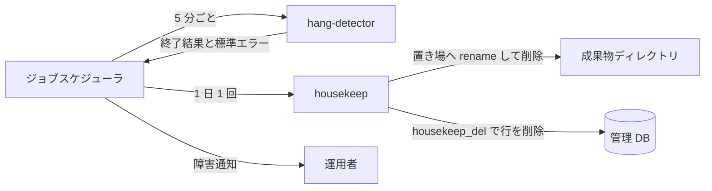

# 変更サマリ

- event_id: 20261101_124000_feedback_mail_removal_housekeeping
- trigger_event: usdm:20261101_121000_feedback_mail_removal_housekeeping, rdra:20261101_121000_feedback_mail_removal_housekeeping, nfr:20261101_122000_feedback_mail_removal_housekeeping, arch:20261101_123000_feedback_mail_removal_housekeeping
- created_at: 2026-11-01T12:40:00Z
- mode: 差分更新(infra-event-diff.yaml。MCL は全面再実行せず該当箇所のみ差分更新 = skipped_targeted_update)
- feedback request: 20261101_mail_removal_housekeeping(direct work unit: なし。causal work unit: CR-e4ea8aaa-001#1(メール削除)/ CR-e4ea8aaa-002#1(ハウスキープ新設)。packet: docs/pipeline/feedback-runs/20261101_mail_removal_housekeeping/stage-packets/infrastructure.md)

本イベントは、上流で確定した 2 つの変更をインフラ設計へ追従させる。

1. メール通知の廃止: relay-gate はメールを送らない。ハング検知の異常はハング検知ジョブ自身の終了結果(異常なし = 正常終了、ハング疑いだけ = 警告終了、実行エラー・比較異常が 1 件でも = 失敗)と標準エラー(1 件 1 行)で知らせ、ジョブスケジューラの障害通知で運用者へ届く
2. ハウスキープの新設: housekeep.sh を 1 日 1 回のジョブスケジューラの定期ジョブで動かし、保持日数(既定 90 日)を過ぎた終了済みの実行の成果物と管理 DB の行を削除する。成果物は削除待ちの置き場へ rename してから削除し、DB の行は専用ロールで 1 トランザクションで削除する

## 追加

| ファイル | 追加内容 |
|---|---|
| product-workload-model.yaml | REQ-DB-007(業務用ロールに DELETE なし、ハウスキープ専用ロール)、REQ-ART-004(削除待ちの置き場と通知済みの印)、REQ-SCH-003(終了結果による通知) |
| product-impl-onprem.yaml | 管理 DB の housekeep_del ロール(6 テーブルへの SELECT / DELETE のみ)と housekeep_delete、成果物の notified_marks / housekeep_staging / capacity、ハウスキープ定期ジョブの定義、検証規則 7 件(timer / cron 未登録、ロール 2 件、置き場の同一ファイルシステム、設定のキー構成 2 件、定期ジョブ登録) |
| product-observability.yaml | 指標 housekeep_deleted_units、アラート alert-housekeep-failure |
| product-conformance-onprem.yaml | REQ-DB-007 / REQ-ART-004(conformant)、REQ-SCH-003(partial) |
| ansible relay-gate-postgresql | housekeep_del の作成と 6 テーブルへの SELECT / DELETE 付与、app_rw / ops_ro に DELETE が無いことの検査 |
| ansible relay-gate-runtime | 削除待ちの置き場の作成、同一ファイルシステムの検査、timer 未登録の検査 |
| ansible relay-gate-config | ハウスキープ設定の配置と非空検査、hang-detector.env のキー構成検査 |

## 変更

| ファイル | 変更内容 |
|---|---|
| product-input.yaml(2 か所の同一コピー) | 組織内 SMTP の前提を外し、通知をジョブスケジューラの障害通知へ。E-022 を除去し E-028 を追加 |
| product-workload-model.yaml | alerting_channel、ハング検知定期ジョブ設定のキー(HANG_DB_CONN_REF だけ)、容量の頭打ち |
| product-mapping-onprem.yaml | DB ロール 3 種、成果物の gap(cron 削除 → ハウスキープ)、定期ジョブの登録先、ジョブスケジューラ連携の gap、fallback 監視 |
| product-impl-onprem.yaml | hang-detector の systemd timer を廃止しジョブスケジューラの定期ジョブへ。app_rw の権限を DELETE なしへ |
| product-observability.yaml | アラートの channel をメールから障害通知へ、日次メールサマリーをジョブスケジューラの既存監視へ |
| product-cost-hints.yaml | storage_tiering を保持日数によるハウスキープ削除へ |
| product-decision-004.yaml | status を superseded にし失効理由を追記(判断記録として保持) |
| product-decision-005.yaml | 既存監視が無い場合の代替を cron メールからジョブスケジューラの定期ジョブへ |
| relay-gate-target-architecture.md | Postfix を削除し、ジョブスケジューラによる定期起動と障害通知、housekeep の辺を追加 |
| ansible site.yml / backup / runtime handlers、README、terraform | mail ロールの参照、cron メール、timer handler、SMTP ポートを削除 |
| infra-event.yaml | ヘッダーを今回のイベントへ更新し、各成果物の description に 20261101 差分の注記を追記。IaC は 4 ロールへ |

## 削除

| 対象 | 理由 |
|---|---|
| infra/product/onprem/ansible/roles/relay-gate-mail/(tasks / handlers) | メール通知の廃止 |
| canonical element product.messaging.mail_notification(REQ-MAIL-001 / 002)と対応するマッピング・実装コンポーネント impl.messaging.mail_relay・適合性 2 行 | メール通知の廃止 |
| relay-gate-hang-detector.timer(実装仕様・runtime ロール・handler) | 異常の通知経路がジョブスケジューラの終了結果判定だけになったため、定期起動もジョブスケジューラで行う |
| セグメント間の許可ポート 25(SMTP) | メール通知の廃止 |

## 変えていないもの

- translation(workload_type / availability_tier / latency / data_classification / traffic / consistency / cost_posture / target_clouds)
- サーバ構成・ネットワークセグメント・RDBMS 選定・成果物の配置方式・バックアップ方式・実行ログのローテーション(3 ヶ月)
- foundation-context / shared-platform-context のコピー(プロジェクトルートの MCL 入力のコピーのため。SMTP の記述が残る点は確認推奨項目として報告)
- product-decision-001〜003

## work unit の扱い

| work unit | 種別 | status | 理由 |
|---|---|---|---|
| CR-e4ea8aaa-001#1 | causal | changed | インフラ設計にメール通知の要素・ロール・設定キー・ポート・図が残っていたため削除し、通知経路をジョブスケジューラの障害通知へ改めた |
| CR-e4ea8aaa-002#1 | causal | changed | ハウスキープの専用 DB ロール・削除待ちの置き場・設定・定期ジョブ・容量の頭打ちが未反映だったため追加した |

## arch フィードバック

- なし(controller の指示により Phase4 を実行しない。hang-detector の systemd timer の廃止は arch の定義に infra を合わせたもので、arch に戻す新しい知見ではない)
