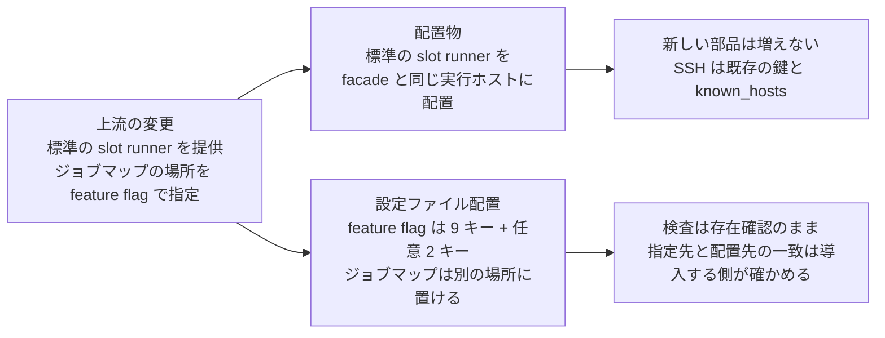

# 変更サマリ

- event_id: 20261116_020000_feedback_standard_runner_job_map_location
- trigger_event: arch:20261116_015000_feedback_standard_runner_job_map_location(usdm / rdra: 20261116_013000_feedback_standard_runner_job_map_location、nfr: 20261116_014000_feedback_standard_runner_job_map_location)
- created_at: 2026-11-16T02:00:00Z
- mode: 差分更新(infra-event-diff.yaml。MCL product-design の全量再実行なし: skipped_targeted_update)
- feedback request: 20261116_standard_runner_job_map_location(direct work unit: なし。causal work unit: CR-65b09d93-001#1(relay-gate が標準の slot runner を正式に提供する)、CR-65b09d93-002#1(slot ジョブマップの場所を feature flag に書けるようにし、書かなければ固定の名前を使う)。packet: docs/pipeline/feedback-runs/20261116_standard_runner_job_map_location/stage-packets/infrastructure.md)
- 利用者決定(2026-11-16): 標準の slot runner(ローカル実行と SSH 実行)を正式に提供し、特殊な接続だけ利用者が runner を自作する。ジョブマップの場所は feature flag の任意の 2 キーで書け、書かなければ固定の名前を使う

## 変わったこと

| 項目 | これまで | 今回 |
|---|---|---|
| slot runner | 配置物の一覧に標準の提供物としては書かれていない。runner は適用側のもの、という読み方ができた | relay-gate の提供物として、facade と同じ実行ホストに構築手順で配置する。割り当てるのは標準か自作の runner。特殊な接続だけ自作 |
| feature flag | 9 キー | 9 キー + slot ジョブマップの場所を書く任意の 2 キー(blue 用と green 用。キー名は仕様で確定)。9 キーだけの設定もそのまま通る |
| ジョブマップの場所 | 設定ファイル置き場の固定の名前だけ | 任意のキーで別の場所を指定できる。無い・空なら固定の名前。絶対パスと相対パスを受け付け、相対パスの基準は feature-flag.env のあるディレクトリ |
| 別の場所に置く設置の扱い | 書かれていない | 所有者・読み取り専用の扱い、正本(構成管理リポジトリ)は設定ファイル置き場と同じ |
| 構築時の検査 | 存在確認だけ | 変えない。feature-flag.env の値は判定せず、指定先と配置先が一致することは導入する側が確かめる |

## 追加

- 標準の slot runner を実行ホストの配置物として書いた記述(README の前提、runtime ロールのコメント、impl の execution_hosts.slot_runner、mapping の script_runtime_hosts、workload の script_runtime_hosts と REQ-COMP-002 の rationale、MCL 入力、ターゲットアーキテクチャ図)(CR-65b09d93-001#1)
- ジョブマップの場所を feature flag の任意の 2 キーで変えられる記述(README の前提、config ロールと inventory 例のコメント、impl の config_store、mapping、workload、MCL 入力、適合性 notes、ターゲットアーキテクチャ図)(CR-65b09d93-002#1)

## 変更

- infra/product/onprem/README.md: 前提に、標準の slot runner の配置(facade と同じ実行ホスト、DB ホストには置かない、割り当て先、特殊な接続だけ自作、SSH は既存の鍵と known_hosts、新しい接続経路は増えない)と、ジョブマップの置き場所(任意の 2 キー、無い・空なら固定の名前、絶対パスと相対パス、相対パスの基準、別の場所に置く設置の配布と検査)を追記
- infra/product/onprem/ansible/roles/relay-gate-runtime/tasks/main.yml: コメントに、標準の slot runner を facade と同じ実行ホストに配置すること、自作の runner も同じホストに置くこと、新しい接続経路は増えないことを追記(タスクは不変)
- infra/product/onprem/ansible/roles/relay-gate-config/tasks/main.yml: ジョブマップ配置タスクの前に、置き場所を feature flag の任意のキーで変えられること、別の場所を指定する設置では適用側が loop と配置先を差し替えること、このロールは feature-flag.env の値を判定しないことをコメントで追記(タスクは不変)
- infra/product/onprem/ansible/inventory.ini.example: 実行ホストの変数の前に、ジョブマップの置き場所の注記を追記(変数は足さない)
- docs/mcl/product/output/product-impl-onprem.yaml: execution_hosts に slot_runner を追加。config_store の contents を 9 キー + 任意 2 キーとジョブマップの場所の決まり方に、検証規則「feature-flag.env のキー」を 9 キーと任意の 2 キーに限られる内容に、ownership と backup に別の場所に置く設置の扱いを追記
- docs/mcl/product/output/product-mapping-onprem.yaml: script_runtime_hosts の configuration_notes に標準の slot runner と自作の runner を、config_store の configuration_notes に任意 2 キーとジョブマップの場所を追記
- docs/mcl/product/output/product-workload-model.yaml: script_runtime_hosts の説明、REQ-COMP-002 の rationale、config_store の説明と制約を同様に更新
- docs/mcl/product/input/product-input.yaml(と直下のコピー。同一内容): 制約の runner に標準の slot runner を含むこと、config_store の説明、script_runtime_hosts の説明を更新(translation のフィールドは不変)
- docs/cloud-context/conformance/product/product-conformance-onprem.yaml: REQ-CFG-001 の notes を 9 キー + 任意 2 キーとジョブマップの場所に更新(判定は不変)
- docs/cloud-context/generated-md/product/relay-gate-target-architecture.md: facade ノードを標準の slot runner(ローカル実行と SSH 実行、自作の runner は同じホスト)に、設定ノードを 9 キーと任意 2 キー、ジョブマップの場所は feature flag で変更可に更新

## 削除

- なし

## 変えなかったもの

- translation(workload_type / availability_tier / latency / data_classification / traffic / consistency / cost_posture / target_clouds)
- ミドルウェア、ネットワーク経路、ポート、ホストの種類: 標準の slot runner は facade と同じ実行ホストで動くシェルスクリプトで、SSH は既存の実行ユーザーの鍵と known_hosts を使う
- 構築時の検査: 設定ファイルの存在確認だけ
- 構築の変数名とタスク、site.yml、terraform、backup ロール
- product-observability.yaml / product-cost-hints.yaml / product-decision-*.yaml: runner の提供元とジョブマップの場所に触れていない

## 照合結果(causal work unit)

| work unit | status | 反映先 |
|---|---|---|
| CR-65b09d93-001#1 | changed | README の前提、runtime ロールのコメント、impl の execution_hosts.slot_runner、mapping / workload / MCL 入力の script_runtime_hosts、ターゲットアーキテクチャ図 |
| CR-65b09d93-002#1 | changed | README の前提、config ロールと inventory 例のコメント、impl / mapping / workload / MCL 入力の config_store、適合性 REQ-CFG-001、ターゲットアーキテクチャ図 |
