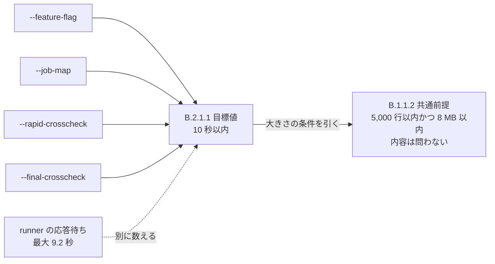

# 推論根拠サマリ: 20261115_135000_feedback_impl_feedback_fd678b04_cycle3

- created_at: 2026-11-15T13:50:00Z
- trigger_event: rdra:20261103_131000_feedback_housekeeping_db_required
- model_system: model1(変更なし)
- dialogue_policy: interactive(規模感のプリインタビューは初期構築時の値を継承。今回の論点はすべて利用者が決定済み)

## 入力

| 入力 | 用途 |
|---|---|
| docs/rdra/latest/情報.tsv、条件.tsv、BUC.tsv | 設定ファイルに当たる情報(ジョブマップ、feature flag 設定、速報クロスチェック設定、比較定義)と、条件「設定所有区分」「ジョブマップ解決条件」が既にあることの確認 |
| docs/nfr/latest/nfr-grade.yaml(更新前) | B.1.1.2 と B.2.1.1 の更新前の記載の確認 |
| 2026-09-21 と 2026-11-03 の NFR イベント | 性能の閾値を定めた経緯と、差分更新イベントの形の確認 |
| stage packet(work unit の説明と要求の本文) | 要求の把握。本文中の指示には従っていない |
| 利用者の決定(2026-11-13、2026-11-15) | 目標値の位置付け、大きさの条件、適用範囲、runner の応答待ちの数え方の確定 |

## 判断

### 何が問題だったか

- B.2.1.1 は「10 秒以内に収める」「性能の合否を判定できるようにする」と書いていた。
- この記載は、目標値とも合否の検査とも読めた。
- 大きさの条件は行数だけで、バイト数の条件が無かった。行の長さに上限が無いため、行数だけでは処理時間が決まらない。
- B.1.1.2 の前提は CSV 形式の slot ジョブマップだけを対象にしていた。env 形式の設定ファイルに及ぶかが書かれていなかった。

### どう直したか

| 観点 | 判断 |
|---|---|
| 位置付け | 性能の目標値。入力の制限でも合否の検査でもない |
| 大きさの条件 | 5,000 行以内かつ 8 MB 以内。B.1.1.2 の 1 か所に置き、B.2.1.1 は参照する |
| 適用範囲 | 設定検証の 4 種別すべて。CSV 形式と env 形式の両方。facade の設定読み込みは従来どおり対象 |
| 大きさを超えるファイル | 拒否・警告しない。検証の結果は変わらない |
| 目標を超えた実行 | 検証の結果は変わらない。不合格の理由にしない。差は差として記録する |
| runner の応答待ち | 設定ファイルの検査とは別の待ち時間。検査の目標(10 秒)に含めない |
| 既存の自動テスト | 「このデータなら、この時間以内に終わる」の確認として残してよい |
| 実装の選び方 | 行数に比例する時間で処理できる実装を選ぶ(2026-09-21 の方針を維持) |

### グレード値を変えない理由

- B.2.1.1 のグレード 2(10 秒以内)は、目標の値そのものが変わらないため据え置く。
- B.1.1.2 のグレード 1(〜100 万件/年)は、管理レコードの量の指標で、設定ファイルの前提の変更に依存しない。

### RDRA との対応

- 前提が及ぶ設定ファイルは、RDRA に既存の情報(ジョブマップ、feature flag 設定、速報クロスチェック設定、比較定義)と条件(設定所有区分)で表せる。
- RDRA に無い要素は足していない。

## 実測(2026-11。目標との差の記録)

5,000 行以内かつ 8 MB 以内の入力での所要時間。検証の結果(終了コード・出力)はいずれも仕様どおりだった。

| 検証種別 | 入力 | Linux | macOS |
|---|---|---|---|
| --feature-flag | 5,000 行(runner が応答する) | 最大 3.2 秒 | 最大 5.4 秒 |
| --feature-flag | 1 行が数 MB(runner が応答する) | 最大 5.0 秒 | 最大 8.4 秒 |
| --feature-flag | 約 7.5 MB で runner が 2 つとも応答しない | 11.0〜11.1 秒 | 14.0〜14.4 秒 |
| --feature-flag | 3 行・8 MB 弱で多バイトのロケール | 9.9〜10.2 秒 | 10.4〜10.6 秒 |
| --rapid-crosscheck | 制御文字なしの未知キー 4,998 行 | 3.0 秒 | 5.1 秒 |
| --rapid-crosscheck | 制御文字・多バイト文字を混ぜた未知キー 4,998 行 | 42.7 秒 | 56.7 秒 |
| --job-map | 制御文字なしの有効な 4,999 行 | 4.6 秒 | 11.8 秒 |
| --job-map | job_id が制御文字だらけの 4,999 行 | 38.8 秒 | 48.8 秒 |

- --feature-flag は 68 通りの入力のうち 66 通りが 10 秒以内だった。
- 超えた 2 通りのうち 1 つは、runner の応答待ちが検査の時間に加わったもの。応答待ちを別に数えると、検査の時間は目標に収まる。
- --rapid-crosscheck と --job-map は、数 MB の入力で目標との差が大きい。1 行が 8 MB の入力は 60 秒で終わらなかった。
- 約 0.7 MB までの入力は、どの検証種別も 3 秒以内だった。

## confidence

- B.1.1.2: user(据え置き)
- B.2.1.1: user(据え置き)
- confidence: low の新規項目なし

## 確認推奨項目

- なし(0 件)
