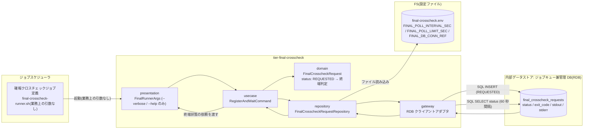
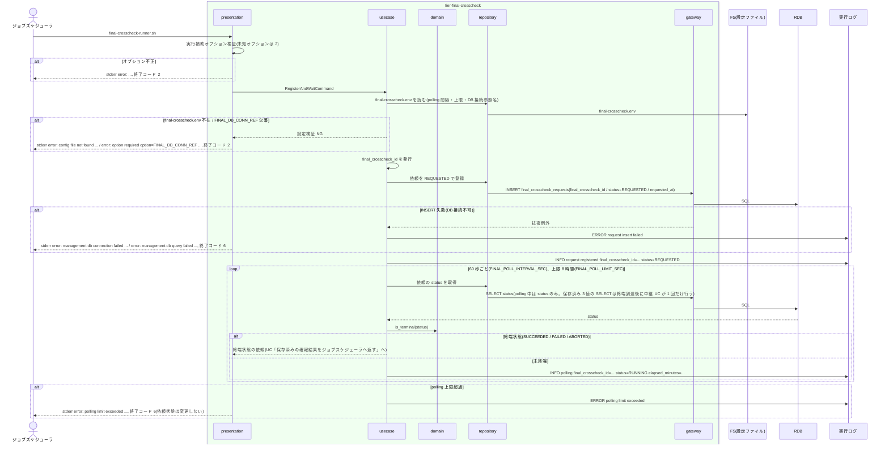

# 確報比較依頼を登録して終端状態まで待機する

## 概要

ジョブスケジューラの確報クロスチェックジョブ定義から業務上の引数なしで起動された `final-crosscheck-runner.sh` が、識別子・状態・時刻・結果だけを持つ確報比較依頼(`final_crosscheck_requests`)を REQUESTED で 1 件登録し、SUCCEEDED / FAILED / ABORTED の終端状態になるまで 60 秒間隔で同期 polling する。依頼に business_date や対象カタログの版などの業務パラメータは持たせない。確報の制御は feature flag に含めず、速報側の `rapid_runs` / `rapid_crosscheck_requests` には触れない。終端状態到達後の中継は UC「保存済みの確報結果をジョブスケジューラへ返す」が担う。

## データフロー



| レイヤー | データモデル | 変換内容 |
|---------|------------|---------|
| presentation | FinalRunnerArgs(`--verbose` / `--help` のみ) | 実行補助オプションの検証。未知オプションは終了コード 2。業務上の引数は受け付けない |
| usecase | RegisterAndWaitCommand(poll_interval_sec, poll_limit_sec) | final_crosscheck_id を発行し、登録 → polling → 終端判定のフロー制御 |
| domain | FinalCrosscheckRequest(status) | `is_terminal(status)` = status ∈ {SUCCEEDED, FAILED, ABORTED} |
| repository | FinalCrosscheckRequestRepository | 依頼レコードを INSERT / SELECT する(識別子・状態・時刻・結果だけ) |
| gateway | RDB クライアントアダプタ | SQL 実行。接続失敗・SQL 失敗は技術例外として非 0 で返す |
| 出力 | 終端状態の依頼(stdout / stderr / exit_code) | UC「保存済みの確報結果をジョブスケジューラへ返す」へ渡す |

## 処理フロー



## バリエーション一覧

| バリエーション名 | 値 | 処理内容 | 適用 tier | 適用箇所 |
|----------------|---|---------|----------|---------|
| クロスチェック種別 | 確報クロスチェック | ジョブスケジューラの別ジョブ定義から起動し、`final_crosscheck_requests` を使う | tier-final-crosscheck | `final-crosscheck-runner.sh` |
| クロスチェック依頼状態 | REQUESTED | runner が登録時に設定する初期状態 | tier-final-crosscheck | `register_request` |
| クロスチェック依頼状態 | CLAIMED / RUNNING | polling 中の未終端状態。待機を継続する | tier-final-crosscheck | `wait_until_terminal` |
| クロスチェック依頼状態 | SUCCEEDED / FAILED / ABORTED | 終端状態。polling を抜けて中継へ進む | tier-final-crosscheck | `is_terminal` |
| ジョブスケジューラ起動ジョブ種別 | 確報クロスチェックジョブ | 業務ジョブ(facade)とは別のジョブ定義から起動する | tier-final-crosscheck | `final-crosscheck-runner.sh` |

## 分岐条件一覧

| 条件名 | 判定ルール | 適用 tier | 適用箇所 | BDD Scenario |
|--------|----------|----------|---------|-------------|
| 確報依頼の登録条件 | ジョブスケジューラから業務上の引数なしで起動されたら、識別子・状態・時刻・結果だけを持つ依頼を REQUESTED で 1 件登録し、status ∈ {SUCCEEDED, FAILED, ABORTED} になるまで同期 polling する | tier-final-crosscheck | `final-crosscheck-runner.sh` / `register_request` / `wait_until_terminal` | 引数なしで確報依頼を登録して SUCCEEDED まで待機する |
| 速報と確報のモデル分離 | `final_crosscheck_requests` のみを読み書きし、`rapid_runs` / `rapid_crosscheck_requests` / `parallel_runs` に SELECT / INSERT / UPDATE を発行しない | tier-final-crosscheck | `FinalCrosscheckRequestRepository` | 速報側テーブルを変更しない |
| 確報クロスチェック非起動 | feature flag(`BLUE_MODE` / `GREEN_MODE` / `RAPID_CROSSCHECK_MODE`)を読まない。facade からは起動されない | tier-final-crosscheck | `final-crosscheck-runner.sh`(feature flag ファイルを open しない) | feature flag を読まずに起動する |
| 依頼状態遷移規則 | runner は REQUESTED で作成するだけで、以降の遷移(CLAIMED / RUNNING / 終端)は worker と abort-final-crosscheck が行う。polling 中に status を UPDATE しない | tier-final-crosscheck | `wait_until_terminal` | polling 上限超過で終了コード 6 になり依頼は変更されない |

## 計算ルール一覧

| 計算名 | 入力情報 | 計算式/ロジック | 出力情報 | 適用 tier |
|--------|---------|---------------|---------|----------|
| final_crosscheck_id 発行 | 起動時刻(ホストのローカルタイムゾーン)、8 桁 hex 乱数 | `{ローカル yyyymmddThhmmss}-final-{8 桁 hex}`(例 `20260830T210000-final-7b2c9e1f`。run_id と同じ規則で、時刻部はプロセスの `TZ` に従うローカル時刻でタイムゾーン指示子を付けない。管理 DB のシーケンスに依存しない。BDD の例示値は `TZ=UTC` を前提にし、RELAY_GATE_NOW 設定時はその値をローカルタイムゾーンへ変換した時刻部になる) | 確報比較依頼.final_crosscheck_id | tier-final-crosscheck |
| 終端判定 | 確報比較依頼.status | status ∈ {SUCCEEDED, FAILED, ABORTED} なら true | 待機終了フラグ | tier-final-crosscheck |
| polling 上限判定 | 登録時刻、現在時刻、FINAL_POLL_LIMIT_SEC(既定 28800) | now - requested_at > FINAL_POLL_LIMIT_SEC なら上限超過 | 終了コード 6 | tier-final-crosscheck |
| polling 経過時間 | requested_at、現在時刻 | floor((now - requested_at) / 60) を `elapsed_minutes` として実行ログに残す | 実行ログ | tier-final-crosscheck |

## 状態遷移一覧

| 状態モデル | 遷移元 | 遷移先 | トリガー | 事前条件 | 事後処理 | 適用 tier |
|-----------|--------|--------|---------|---------|---------|----------|
| クロスチェック依頼 | `[*]` | REQUESTED | `final-crosscheck-runner.sh` の依頼登録 | 実行補助オプション検証 OK、final-crosscheck.env が読める | 実行ログに `request registered`、60 秒間隔の polling 開始 | tier-final-crosscheck |

## 関連 RDRA モデル

| モデル種別 | 要素名 | 関連 |
|-----------|--------|------|
| 業務 | クロスチェック業務 | この UC が属する業務 |
| BUC | 確報クロスチェックフロー | この UC を含む BUC |
| アクター | 運用者 | 受益者(確報ジョブの結果を読む) |
| 情報 | ジョブ起動要求 | ジョブスケジューラから業務上の引数なしで受け取る起動 |
| 情報 | 確報比較依頼(final_crosscheck_request) | REQUESTED で登録し polling する |
| 状態 | クロスチェック依頼 | `[*]` → REQUESTED |
| 条件 | 確報依頼の登録条件 | 登録と同期 polling |
| 条件 | 速報と確報のモデル分離 | 速報側テーブルに触れない |
| 条件 | 確報クロスチェック非起動 | feature flag を読まない |
| 条件 | 依頼状態遷移規則 | runner は REQUESTED の作成のみ |
| 画面 | final-crosscheck runner 待機出力(→ CLI 出力) | 待機中は stdout / stderr に出さず実行ログに残す |
| イベント | 確報ジョブの起動 | ジョブスケジューラからの起動 |
| イベント | 確報比較依頼の登録と polling | 管理 DB への INSERT / SELECT |
| 外部システム | ジョブスケジューラ | 起動元 |
| 内部データストア | ジョブキュー兼管理 DB(RDB) | 依頼レコードの保存先(relay-gate 内部の構成要素。外部システムではない) |

## 関連 USDM

| REQ ID | SPEC ID | 対応 BDD Scenario |
|--------|---------|------------------|
| REQ-006 | SPEC-006-01 | 引数なしで確報依頼を登録して SUCCEEDED まで待機する(SPEC-006-01) |
| REQ-006 | SPEC-006-04 | 速報側テーブルを変更しない(SPEC-006-04) |
| REQ-011 | SPEC-011-03 | 確報依頼の列は識別子・状態・時刻・結果だけである(SPEC-011-03) |

> 機械可読の正本は `spec-event.yaml` の `use_cases[].usdm`(本表と同内容)。「対応 BDD Scenario」列は本 UC の `Scenario:` 名(接尾の SPEC ID を含む完全名)を「 / 」で区切って列挙し、Scenario 名以外の補足は「※」以降に置く。区切りは人が読む用で、Scenario 名自体に「 / 」を含むものがあるため機械分割には使わず、機械照合は `spec-event.yaml` の `scenarios[]` を使う。

## E2E 完了条件(BDD)

### 正常系

```gherkin
Feature: 確報比較依頼を登録して終端状態まで待機する

  Scenario: 引数なしで確報依頼を登録して SUCCEEDED まで待機する(SPEC-006-01)
    Given final-crosscheck.env に FINAL_POLL_INTERVAL_SEC=1 FINAL_POLL_LIMIT_SEC=30 が設定されている(既定は 60 秒 / 28800 秒。テストは間隔を 1 秒に落として所要時間を抑える)
    And 別プロセスが 3 秒後に、runner が登録した最新の依頼(final_crosscheck_requests で requested_at が最大の行)を status=SUCCEEDED exit_code=0 stdout="all 42 targets matched\n" stderr="" に更新する(worker の代替)
    When ジョブスケジューラが final-crosscheck-runner.sh を業務上の引数なしで起動する
    Then final_crosscheck_requests に status=REQUESTED の行が 1 件登録され、その行には business_date 列・catalog_version 列が存在しない
    And runner は 1 秒間隔で status を polling し、status=SUCCEEDED になるまで終了しない(実行ログに "INFO polling final_crosscheck_id=<id> status=REQUESTED" が 2 行以上残る)
    And 終端到達後、標準出力は "all 42 targets matched\n" と完全一致し、終了コード 0 で終了する
    And 実行ログに "request registered final_crosscheck_id=<id> status=REQUESTED" が残る(<id> は `^[0-9]{8}T[0-9]{6}-final-[0-9a-f]{8}$` 形式。末尾 8 hex は乱数で起動時刻依存のため形式一致で検証する。本 spec の他シナリオの `20260830T210000-final-7b2c9e1f` は例示値)

  Scenario: 確報依頼の列は識別子・状態・時刻・結果だけである(SPEC-011-03)
    Given final-crosscheck.env に FINAL_POLL_INTERVAL_SEC=1 が設定されている
    And 別プロセスが 3 秒後に、runner が登録した最新の依頼を status=SUCCEEDED exit_code=0 stdout="" stderr="" に更新する
    When final-crosscheck-runner.sh を業務上の引数なしで起動する
    Then 登録された行は final_crosscheck_id / status / worker_id / lease_until / requested_at / started_at / completed_at / exit_code / stdout / stderr / error_summary の列だけを持つ
    And business_date 列・catalog_version 列は存在しない

  Scenario: 速報側テーブルを変更しない(SPEC-006-04)
    Given rapid_runs / rapid_crosscheck_requests / parallel_runs の行数がそれぞれ 3 件である
    And final-crosscheck.env に FINAL_POLL_INTERVAL_SEC=1 が設定されている
    And 別プロセスが 3 秒後に、runner が登録した最新の依頼を status=FAILED exit_code=3 stdout="diff found: 12 rows\n" stderr="" に更新する
    When final-crosscheck-runner.sh を業務上の引数なしで実行する
    Then runner は終了コード 3 で終了し、final_crosscheck_requests だけが 1 件増える
    And rapid_runs / rapid_crosscheck_requests / parallel_runs の行数は 3 件のままである

  Scenario: feature flag を読まずに起動する
    Given feature flag ファイルが存在しない
    And final-crosscheck.env が存在し FINAL_DB_CONN_REF が設定されている
    When final-crosscheck-runner.sh を業務上の引数なしで実行する
    Then 依頼は status=REQUESTED で登録され、feature flag 不在を理由にしたエラーは出ない
```

### 異常系

```gherkin
  Scenario: polling 上限超過で終了コード 6 になり依頼は変更されない
    Given final-crosscheck.env に FINAL_POLL_INTERVAL_SEC=1 FINAL_POLL_LIMIT_SEC=3 が設定されている
    And final-crosscheck-worker.sh が稼働していない
    When final-crosscheck-runner.sh を業務上の引数なしで実行する
    Then 終了コード 6 で終了する
    And stderr に "error: polling limit exceeded final_crosscheck_id=<id> status=REQUESTED limit_sec=3" が出る(<id> は登録された依頼の final_crosscheck_id と一致し、形式は `^[0-9]{8}T[0-9]{6}-final-[0-9a-f]{8}$`)
    And final_crosscheck_requests の該当行は status=REQUESTED のままである

  Scenario: final-crosscheck.env が存在しない
    Given RELAY_GATE_CONFIG_DIR に final-crosscheck.env が無い
    When final-crosscheck-runner.sh を業務上の引数なしで実行する
    Then 終了コード 2 で終了する
    And stderr に "error: config file not found path: " で始まる行が出る
    And final_crosscheck_requests に行は登録されない

  Scenario: 未知のオプションを渡す
    When final-crosscheck-runner.sh --business-date 2026-08-30 を実行する
    Then 終了コード 2 で終了する
    And stderr に "error: unknown option option=--business-date" が出る
    And final_crosscheck_requests に行は登録されない
```

## ティア別仕様

- [確報クロスチェックティア](tier-final-crosscheck.md)

### 統合 API Spec

- [CLI コマンド契約](../../../_cross-cutting/api/cli-command-contract.yaml)(`final-crosscheck-runner.sh`)
- [AsyncAPI Spec](../../../_cross-cutting/api/asyncapi.yaml)(`channels.final-crosscheck-requests` publish)
