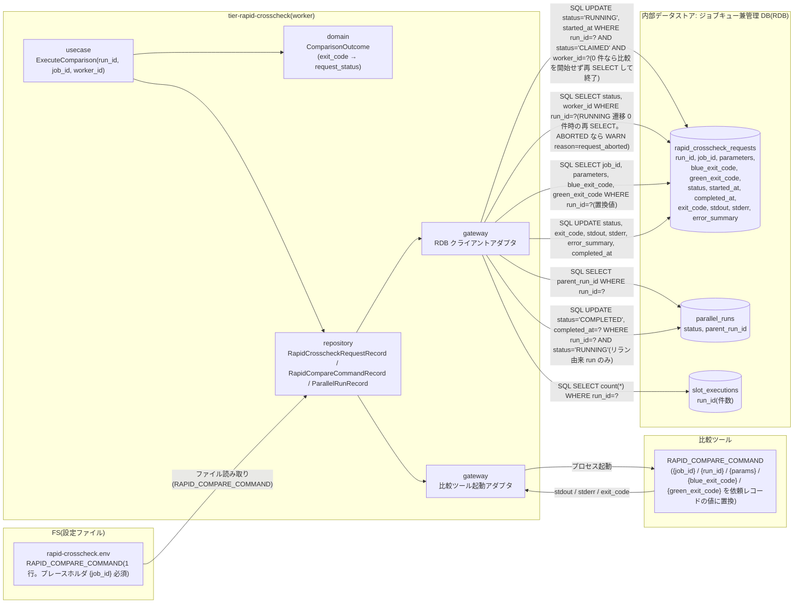
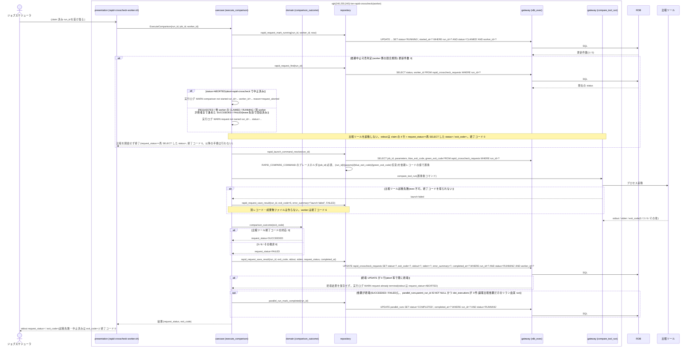

# 比較ツールでジョブ単位比較を実行して結果を登録する

## 概要

claim した速報クロスチェック worker が依頼を CLAIMED → RUNNING に条件付き UPDATE(`WHERE run_id = ? AND status = 'CLAIMED' AND worker_id = ?`)で遷移させ、更新件数が 1 のときだけ比較ツールでジョブ単位比較を起動する。更新件数が 0 件(abort-rapid-crosscheck で ABORTED 済み、または lease 失効で別 worker に回収済み)なら比較ツールを起動せず終了コード 0 で終了する(条件「依頼中止可否判定」の worker 側の競合規則。arch LP-024)。起動コマンドは速報クロスチェック設定(rapid-crosscheck.env。情報「速報クロスチェック設定」)の `RAPID_COMPARE_COMMAND`(1 行の文字列)のプレースホルダを依頼レコード(rapid_crosscheck_requests)の値で置換して組み立てる: `{job_id}`(必須)= job_id、`{run_id}` = run_id、`{params}` = parameters、`{blue_exit_code}` = blue_exit_code、`{green_exit_code}` = green_exit_code(任意)。worker が読む入力は管理 DB の依頼レコードと自身の設定ファイル(rapid-crosscheck.env)だけで、runner と worker は別ネットワークセグメントで動き worker はファイルパス(成果物 URI)を読めないため、比較ツールへ渡す値は依頼レコードの値だけとする。比較ツールの stdout / stderr / exit_code を依頼レコードの列へそのまま保存し、exit_code 0 → SUCCEEDED、3(比較 NG)/ 6(実行エラー)/ その他非 0 → FAILED とする。起動自体に失敗した場合は依頼を FAILED / exit_code=6 / error_summary=`launch failed` で終端する。速報比較の結果は依頼レコードの stdout / stderr / exit_code で参照するため、別レコードや成果物ファイルは作らない(worker は成果物ディレクトリ・started-at.txt を作らない)。速報比較依頼だけを新規作成したリラン由来(background-rerun --role rapid-crosscheck)の parallel_run は foreground slot を持たないため、依頼が終端した時点で worker が RUNNING → COMPLETED にする。結果はジョブスケジューラへの応答に影響させず、確報側(final_*)には触れない。

## データフロー



| レイヤー | データモデル | 変換内容 |
|---------|------------|---------|
| usecase | ExecuteComparison | RUNNING 遷移(条件付き UPDATE。0 件なら依頼を再 SELECT して実行ログに WARN を残し、比較を開始せず終了)→ 起動コマンド解決(RAPID_COMPARE_COMMAND のプレースホルダ置換)→ 比較ツール起動 → stdout / stderr / exit_code を依頼レコードへ保存 → リラン由来 run の COMPLETED 遷移 |
| domain | ComparisonOutcome | exit_code → 依頼状態(0=SUCCEEDED / 非 0 または起動失敗=FAILED)の対応表。値は変換せず保存する |
| repository | RapidCrosscheckRequestRecord | 依頼レコードの run_id / job_id / parameters / blue_exit_code / green_exit_code を読み、起動コマンドのプレースホルダ置換に使う |
| repository | RapidCompareCommandRecord | rapid-crosscheck.env の `RAPID_COMPARE_COMMAND`(1 行)を読む |
| repository | ParallelRunRecord | 依頼終端後、`parallel_runs.parent_run_id IS NOT NULL` かつ当該 run_id の `slot_executions` 行が 0 件(速報比較依頼だけを新規作成したリラン由来)なら `status='RUNNING'` 条件付きで COMPLETED に更新 |
| gateway(比較ツール) | プロセス起動 | RAPID_COMPARE_COMMAND のプレースホルダを依頼レコードの値で置換した文字列をコマンドとして起動し、stdout / stderr / exit_code を得る |

## 処理フロー



## バリエーション一覧

| バリエーション名 | 値 | 処理内容 | 適用 tier | 適用箇所 |
|----------------|---|---------|----------|---------|
| 比較ツール終了コード | 0(比較 OK) | 依頼 SUCCEEDED | tier-rapid-crosscheck | comparison_outcome |
| 比較ツール終了コード | 3(比較 NG・警告終了) | 依頼 FAILED | tier-rapid-crosscheck | comparison_outcome |
| 比較ツール終了コード | 6(実行エラー・エラー終了) | 依頼 FAILED | tier-rapid-crosscheck | comparison_outcome |
| クロスチェック依頼状態 | RUNNING / SUCCEEDED / FAILED | 本 UC で遷移する状態 | tier-rapid-crosscheck | rapid_request_mark_running / rapid_request_save_result |
| クロスチェック依頼状態 | ABORTED | RUNNING 遷移 0 件時の再 SELECT で観測する(遷移 UC は「実行を ABORTED へ遷移させる」)。比較を開始せず終了コード 0 | tier-rapid-crosscheck | rapid_request_find |
| 速報クロスチェックのプロセス役割 | worker | 本 UC の実行主体 | tier-rapid-crosscheck | rapid-crosscheck-worker.sh |

## 分岐条件一覧

| 条件名 | 判定ルール | 適用 tier | 適用箇所 | BDD Scenario |
|--------|----------|----------|---------|-------------|
| 依頼状態遷移規則 | CLAIMED → RUNNING(started_at 設定。条件付き UPDATE `status='CLAIMED' AND worker_id=?`。0 件なら比較を開始しない)、RUNNING → SUCCEEDED(exit_code 0)/ FAILED(非 0 または起動失敗)(条件付き UPDATE `status='RUNNING' AND worker_id=?`。0 件 = 比較中に ABORTED 済みで終端結果を保存しない) | tier-rapid-crosscheck | execute_comparison(usecase) | 比較 OK で SUCCEEDED を登録する / CLAIMED の依頼が ABORTED になった後の RUNNING 条件付き UPDATE は 0 件で比較を開始しない |
| 依頼中止可否判定 | worker 側の競合規則: claim 後・比較開始前の CLAIMED → RUNNING を `UPDATE rapid_crosscheck_requests SET status='RUNNING', started_at=? WHERE run_id=? AND status='CLAIMED' AND worker_id=?` の条件付き UPDATE で行い、更新件数 0 なら比較ツールを起動せず終了コード 0。0 件のとき依頼を再 SELECT し、status=ABORTED(abort-rapid-crosscheck で中止済み)なら実行ログ `WARN comparison not started run_id=... worker_id=... reason=request_aborted`、それ以外(lease 失効で回収済み: REQUESTED / 他 worker の CLAIMED / RUNNING / 別 worker が終端まで進めた SUCCEEDED / FAILED)は `WARN request not owned run_id=... status=...`。stderr には出さない。stdout(--once)は claim の 4 行 + `request_status=<再 SELECT した現在の status>` / `exit_code=-`。運用者側の中止可否(速報 = REQUESTED / CLAIMED / RUNNING、確報 = RUNNING のみ)は UC「実行を ABORTED へ遷移させる」 | tier-rapid-crosscheck | rapid_request_mark_running(repository)/ execute_comparison(usecase) | CLAIMED の依頼が ABORTED になった後の RUNNING 条件付き UPDATE は 0 件で比較を開始しない |
| 起動コマンドの解決 | rapid-crosscheck.env の `RAPID_COMPARE_COMMAND`(1 行の文字列)のプレースホルダを依頼レコードの値で置換する: `{job_id}`(必須)= job_id、`{run_id}` = run_id、`{params}` = parameters、`{blue_exit_code}` = blue_exit_code、`{green_exit_code}` = green_exit_code(任意)。置換後の文字列をコマンドとして起動する。ファイルパス(成果物 URI)は渡さない(worker は別ネットワークセグメントで動きファイルパスを読めない) | tier-rapid-crosscheck | rapid_launch_command_resolve(repository)/ execute_comparison | 起動コマンドのプレースホルダが依頼レコードの値で置換される(SPEC-005-03) |
| 結果の保存条件 | 比較ツールを起動して終了コードを得たら stdout / stderr / exit_code を依頼レコードの列へそのまま保存する(別レコード・成果物ファイルは作らない)。起動自体に失敗した場合は依頼を FAILED / exit_code=6 / error_summary=`launch failed` で終端する。終端 UPDATE 0 行(ABORTED 済み等)は終端結果を保存しない | tier-rapid-crosscheck | rapid_request_save_result(repository)/ execute_comparison | 比較ツールの起動に失敗する(SPEC-005-03) / 比較 NG(3)で FAILED を登録する |
| 比較ツール終了コードの対応 | 0 → SUCCEEDED、3 → FAILED、6 → FAILED、その他非 0 → FAILED。値は変換せず exit_code 列へ保存 | tier-rapid-crosscheck | comparison_outcome(domain) | 比較 NG(3)で FAILED を登録する |
| 速報結果の位置付け | 依頼の FAILED や worker の終了コードはジョブスケジューラ応答に影響しない。worker 自身は `--once` で依頼を終端まで処理できれば 0(起動自体の失敗など worker 側の実行エラーのときだけ 6) | tier-rapid-crosscheck | rapid-crosscheck-worker.sh(presentation) | 比較 NG(3)で FAILED を登録する |
| 速報と確報のモデル分離 | 書き込み先は rapid_crosscheck_requests のみ。final_* を触らない | tier-rapid-crosscheck | execute_comparison | 比較 OK で SUCCEEDED を登録する |

## 計算ルール一覧

| 計算名 | 入力情報 | 計算式/ロジック | 出力情報 | 適用 tier |
|--------|---------|---------------|---------|----------|
| 依頼状態の決定 | exit_code | 0 → SUCCEEDED、それ以外(3 / 6 / その他非 0 / 起動失敗)→ FAILED | rapid_crosscheck_requests.status | tier-rapid-crosscheck |
| 起動コマンドの組み立て | RAPID_COMPARE_COMMAND, run_id, job_id, parameters, blue_exit_code, green_exit_code | `RAPID_COMPARE_COMMAND` の `{job_id}` / `{run_id}` / `{params}` / `{blue_exit_code}` / `{green_exit_code}` を依頼レコードの値で置換する(`{job_id}` は必須。他は任意) | 起動コマンド | tier-rapid-crosscheck |
| error_summary | stderr / 起動失敗 | 比較ツールを起動できたときは stderr の先頭 1 行(256 文字まで。exit_code 0 なら NULL)、起動自体に失敗したときは `launch failed` | rapid_crosscheck_requests.error_summary | tier-rapid-crosscheck |
| completed_at | 比較ツール終了時刻 | ホストのローカルタイムゾーンの ISO 8601 秒精度(タイムゾーン指示子なし。run_id の時刻部と同じ時刻軸) | rapid_crosscheck_requests.completed_at | tier-rapid-crosscheck |

## 状態遷移一覧

| 状態モデル | 遷移元 | 遷移先 | トリガー | 事前条件 | 事後処理 | 適用 tier |
|-----------|--------|--------|---------|---------|---------|----------|
| クロスチェック依頼 | CLAIMED | RUNNING | 比較開始 | 自 worker が claim 済み(worker_id 一致)。条件付き UPDATE(`status='CLAIMED' AND worker_id=?`)で遷移し、0 件(abort-rapid-crosscheck で ABORTED 済み、または lease 失効で回収済み)なら比較を開始しない | started_at 設定(0 件のときは何もせず終了コード 0) | tier-rapid-crosscheck |
| クロスチェック依頼 | RUNNING | SUCCEEDED | 比較ツール exit_code 0 | — | stdout / stderr / exit_code を依頼レコードへ保存 | tier-rapid-crosscheck |
| クロスチェック依頼 | RUNNING | FAILED | 比較ツール exit_code 非 0(3 / 6 / その他)または起動失敗 | — | stdout / stderr / exit_code を依頼レコードへ保存(起動失敗は exit_code=6 / error_summary=`launch failed`)。hang-detector が error 通知 | tier-rapid-crosscheck |
| 並行稼働実行 | RUNNING | COMPLETED | 依頼の終端(SUCCEEDED / FAILED) | `parallel_runs.parent_run_id IS NOT NULL` かつ当該 run_id の `slot_executions` 行が 0 件(速報比較依頼だけを新規作成したリラン由来。業務ジョブを再実行していない) | `UPDATE parallel_runs SET status='COMPLETED', completed_at=? WHERE run_id=? AND status='RUNNING'`(条件付き。0 行なら何もしない。実行ログ `INFO parallel_run status changed from=RUNNING to=COMPLETED run_id=...`)。通常 run(foreground slot あり)は facade の中継完了で COMPLETED になるため本 UC では更新しない | tier-rapid-crosscheck |

## 関連 RDRA モデル

| モデル種別 | 要素名 | 関連 |
|-----------|--------|------|
| 業務 | クロスチェック業務 | この UC が属する業務 |
| BUC | 速報クロスチェックフロー | この UC を含む BUC(アクティビティ: ジョブ単位比較の実行) |
| アクター | 運用者 | 受益者(自動) |
| 情報 | 速報比較依頼(rapid_crosscheck_request) | 更新する。起動コマンドの置換値(job_id / parameters / blue_exit_code / green_exit_code)と比較ツールの stdout / stderr / exit_code を保持する |
| 情報 | 速報クロスチェック設定 | rapid-crosscheck.env を読む。属性: 速報比較ツール起動コマンド(RAPID_COMPARE_COMMAND)、管理 DB 接続参照名(RAPID_DB_CONN_REF。値は置かず参照名のみ)。本 UC は RAPID_COMPARE_COMMAND を起動する(tier-rapid-crosscheck) |
| 情報 | 実行ログ | worker の実行ログ |
| 情報 | 並行稼働実行(parallel_run) | 速報比較依頼だけのリラン由来 run を依頼終端時に COMPLETED にする(状態.tsv の遷移 UC) |
| 状態 | クロスチェック依頼 | CLAIMED → RUNNING(条件付き UPDATE。0 件なら比較を開始しない)→ SUCCEEDED / FAILED。CLAIMED → ABORTED / RUNNING → ABORTED の遷移 UC は「実行を ABORTED へ遷移させる」 |
| 状態 | 並行稼働実行 | RUNNING → COMPLETED(リラン由来 run の終端) |
| 条件 | 依頼状態遷移規則 | 適用 |
| 条件 | 依頼中止可否判定 | 適用(worker 側の競合規則 = CLAIMED → RUNNING の条件付き UPDATE が 0 件なら比較を開始しない。tier-rapid-crosscheck) |
| 条件 | 起動コマンドの解決 | 適用(RAPID_COMPARE_COMMAND のプレースホルダを依頼レコードの値で置換) |
| 条件 | 比較ツール終了コードの対応 | 適用 |
| 条件 | 速報結果の位置付け | 適用 |
| 条件 | 結果の保存条件 | 適用(比較ツールの stdout / stderr / exit_code を依頼レコードへ保存。起動失敗は FAILED / exit_code=6 / launch failed) |
| 画面 | rapid-crosscheck worker 比較実行出力(→ CLI 出力) | stdout / 実行ログ |
| イベント | ジョブ単位比較の起動 | 比較ツールのプロセス起動 |
| 外部システム | 比較ツール | 起動する |
| 内部データストア | ジョブキュー兼管理 DB(RDB) | 書き込み先(relay-gate 内部の構成要素。外部システムではない) |

## 関連 USDM

| REQ ID | SPEC ID | 対応 BDD Scenario |
|--------|---------|-----------------|
| REQ-005 | SPEC-005-03 | 比較 OK で SUCCEEDED を登録する(SPEC-005-03) / 起動コマンドのプレースホルダが依頼レコードの値で置換される(SPEC-005-03) / 比較ツールの起動に失敗する(SPEC-005-03) |
| REQ-007 | SPEC-007-01 | 比較 OK で SUCCEEDED を登録する(SPEC-005-03) ※ RUNNING → SUCCEEDED |
| REQ-007 | SPEC-007-03 | 比較 NG(3)で FAILED を登録する(SPEC-007-03) |
| REQ-011 | SPEC-011-02 | 比較 OK で SUCCEEDED を登録する(SPEC-005-03) ※ rapid_crosscheck_requests の列(stdout / stderr / exit_code)で結果を保持 |
| REQ-011 | SPEC-011-06 | 速報比較依頼だけのリラン由来 run は依頼終端で parallel_run を COMPLETED にする(SPEC-011-06) |
| REQ-010 | SPEC-010-02 | CLAIMED の依頼が ABORTED になった後の RUNNING 条件付き UPDATE は 0 件で比較を開始しない(SPEC-010-02) |

> 機械可読の正本は `spec-event.yaml` の `use_cases[].usdm`(本表と同内容)。「対応 BDD Scenario」列は本 UC の `Scenario:` 名(接尾の SPEC ID を含む完全名)を「 / 」で区切って列挙し、Scenario 名以外の補足は「※」以降に置く。区切りは人が読む用で、Scenario 名自体に「 / 」を含むものがあるため機械分割には使わず、機械照合は `spec-event.yaml` の `scenarios[]` を使う。

## E2E 完了条件(BDD)

### 正常系

```gherkin
Feature: 比較ツールでジョブ単位比較を実行して結果を登録する

  Scenario: 比較 OK で SUCCEEDED を登録する(SPEC-005-03)
    Given RAPID_CROSSCHECK_MODE=background で rapid_crosscheck_requests に run_id=20260830T113000-JOB001-3f9a1c2e, job_id=JOB001, parameters=`[]`, blue_exit_code=0, green_exit_code=0, status=REQUESTED の行がある
    And 速報クロスチェック設定 $RELAY_GATE_CONFIG_DIR/rapid-crosscheck.env に `RAPID_COMPARE_COMMAND=/opt/compare/compare.sh --job {job_id}` の行がある
    And 比較ツール /opt/compare/compare.sh は終了コード 0、stdout に `result=OK rows=1000`、stderr に何も返さない
    When ジョブスケジューラが `rapid-crosscheck-worker.sh --once --worker-id worker-01` を起動する
    Then 終了コードは 0 で stdout に `request_status=SUCCEEDED` と `exit_code=0` が出る
    And 依頼の status は `SUCCEEDED`、exit_code は 0、started_at と completed_at はローカル ISO 8601(タイムゾーン指示子なし)の値である
    And 依頼の stdout 列は比較ツールの標準出力 `result=OK rows=1000` をそのまま含み、stderr 列は空である(速報比較の結果は依頼レコードの stdout / stderr / exit_code で参照する)
    And facade/20260830T113000-JOB001-3f9a1c2e/rapid-crosscheck/ ディレクトリと started-at.txt は作られない
    And final_crosscheck_requests は変更されない

  Scenario: 起動コマンドのプレースホルダが依頼レコードの値で置換される(SPEC-005-03)
    Given rapid_crosscheck_requests に run_id=20260830T113000-JOB001-3f9a1c2e, job_id=JOB001, parameters=`["--date","2026-08-30"]`, blue_exit_code=0, green_exit_code=0, status=REQUESTED の行がある
    And rapid-crosscheck.env に `RAPID_COMPARE_COMMAND=/opt/compare/echo-args.sh {job_id} {run_id} {params} {blue_exit_code} {green_exit_code}` の行がある
    And 比較ツール /opt/compare/echo-args.sh は受け取った引数を stdout にそのまま出力して終了コード 0 を返す
    When `rapid-crosscheck-worker.sh --once --worker-id worker-01` を起動する
    Then 依頼の stdout 列は job_id=`JOB001`、run_id=`20260830T113000-JOB001-3f9a1c2e`、params=`["--date","2026-08-30"]`、blue_exit_code=`0`、green_exit_code=`0` を順に受け取ったことを示す(RAPID_COMPARE_COMMAND のプレースホルダが依頼レコードの値で置換されて起動された)
    And 依頼の status は `SUCCEEDED`、exit_code は 0 である

  Scenario: 速報比較依頼だけのリラン由来 run は依頼終端で parallel_run を COMPLETED にする(SPEC-011-06)
    Given background-rerun --role rapid-crosscheck が作成した parallel_runs に run_id=20260830T150000-JOB001-5e5e5e5e, parent_run_id=20260830T113000-JOB001-3f9a1c2e, status=RUNNING の行があり、同 run_id の slot_executions 行は 0 件である
    And rapid_crosscheck_requests に run_id=20260830T150000-JOB001-5e5e5e5e, job_id=JOB001, status=REQUESTED の行があり、RAPID_COMPARE_COMMAND が設定され比較ツールは終了コード 0 を返す
    When `rapid-crosscheck-worker.sh --once --worker-id worker-01` を起動する
    Then 依頼の status は `SUCCEEDED` になり、parallel_runs の run_id=20260830T150000-JOB001-5e5e5e5e の status は `COMPLETED` になる
    And 実行ログに "INFO parallel_run status changed from=RUNNING to=COMPLETED run_id=20260830T150000-JOB001-5e5e5e5e" が残る
    And 元の run_id=20260830T113000-JOB001-3f9a1c2e の parallel_runs の status は変わらない
```

### 異常系

```gherkin
  Scenario: 比較 NG(3)で FAILED を登録する(SPEC-007-03)
    Given status=REQUESTED の依頼 run_id=20260830T113000-JOB001-3f9a1c2e, job_id=JOB001 と、RAPID_COMPARE_COMMAND の設定がある
    And 比較ツールは終了コード 3、stdout に `result=NG mismatch=12`、stderr に `rows differ` を返す
    When `rapid-crosscheck-worker.sh --once --worker-id worker-01` を起動する
    Then worker の終了コードは 0 で stdout に `request_status=FAILED` と `exit_code=3` が出て、依頼の status は `FAILED`、exit_code は 3 である
    And 依頼の stdout 列は `result=NG mismatch=12` を、stderr 列は `rows differ` をそのまま含み、error_summary は stderr 先頭行である
    And 業務ジョブのジョブスケジューラ応答は変わらない

  Scenario: 比較ツールの起動に失敗する(SPEC-005-03)
    Given status=REQUESTED の依頼 run_id=20260830T113000-JOB001-3f9a1c2e, job_id=JOB001 があり、RAPID_COMPARE_COMMAND の先頭の語(コマンド部分)が実行できない(実行権限なし)
    When `rapid-crosscheck-worker.sh --once --worker-id worker-01` を起動する
    Then 依頼の status は `FAILED`、exit_code は 6、error_summary は `launch failed` である
    And 依頼のほかに別レコードや成果物ファイルは作られない(facade/20260830T113000-JOB001-3f9a1c2e/rapid-crosscheck/ ディレクトリは作られない)
    And stdout に `request_status=FAILED`、`exit_code=6` が出て、stderr に `error: compare tool launch failed run_id=20260830T113000-JOB001-3f9a1c2e command=/opt/compare/compare.sh` が出て、worker の終了コードは 6 である

  Scenario: CLAIMED の依頼が ABORTED になった後の RUNNING 条件付き UPDATE は 0 件で比較を開始しない(SPEC-010-02)
    Given RAPID_CROSSCHECK_MODE=background で worker-01 が rapid_crosscheck_requests の run_id=20260830T113000-JOB001-3f9a1c2e, job_id=JOB001 を claim し、status=CLAIMED, worker_id=worker-01, started_at=NULL である
    And 比較開始前に運用者が `abort-rapid-crosscheck.sh --run-id 20260830T113000-JOB001-3f9a1c2e` を実行して yes と答え、依頼が status=ABORTED, completed_at 設定済みになった
    When worker-01 が `UPDATE rapid_crosscheck_requests SET status='RUNNING', started_at=? WHERE run_id='20260830T113000-JOB001-3f9a1c2e' AND status='CLAIMED' AND worker_id='worker-01'` を実行する
    Then 更新件数は 0 件で、比較ツールは起動されない
    And 依頼の status は `ABORTED` のまま、started_at は NULL のままである
    And stdout に claim の 4 行(`run_id=` / `job_id=` / `worker_id=` / `lease_until=`)に続けて `request_status=ABORTED`、`exit_code=-` が出て、stderr には何も出ない
    And worker-01 の実行ログに `WARN comparison not started run_id=20260830T113000-JOB001-3f9a1c2e worker_id=worker-01 reason=request_aborted` が残り、終了コードは 0 である

  Scenario: 比較中に依頼が中止されていたら結果を保存しない
    Given worker-01 が run_id=20260830T113000-JOB001-3f9a1c2e を RUNNING にして比較ツールを起動中に、依頼が abort-rapid-crosscheck で ABORTED になっている
    When 比較ツールが終了コード 0 で終了する
    Then 終端 UPDATE(`WHERE status='RUNNING' AND worker_id=?`)は 0 件で、依頼の status は `ABORTED` のまま、exit_code / stdout / stderr 列は保存されない
    And stdout に `request_status=ABORTED`、`exit_code=-` が出る
    And worker-01 の実行ログに `WARN request already terminal run_id=20260830T113000-JOB001-3f9a1c2e status=ABORTED` が残り、終了コードは 0 である
```

## ティア別仕様

- [速報クロスチェックティア](tier-rapid-crosscheck.md)

### 統合 API Spec

- [CLI コマンド契約](../../../_cross-cutting/api/cli-command-contract.yaml)(`rapid-crosscheck-worker.sh`)
- [AsyncAPI Spec](../../../_cross-cutting/api/asyncapi.yaml)(channel `rapid-crosscheck-requests` を subscribe)
