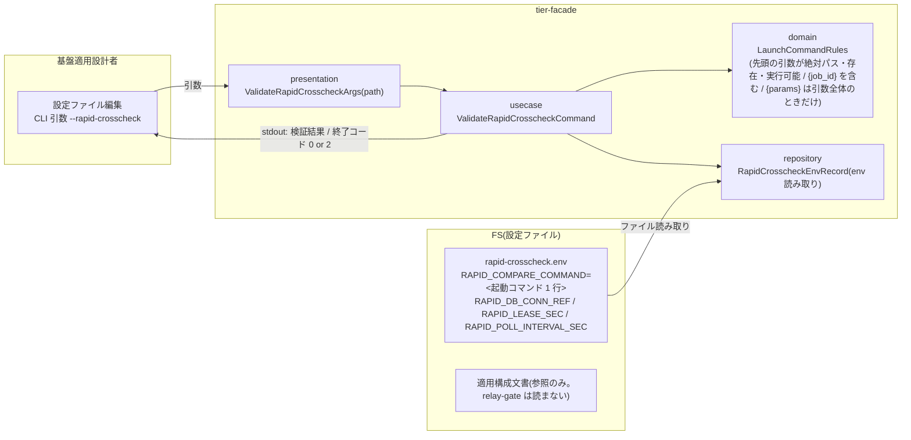
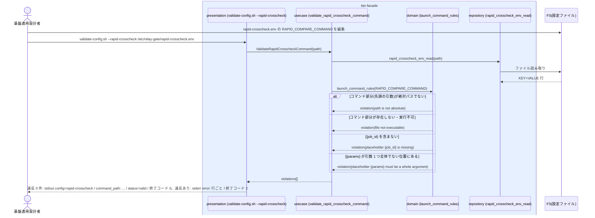

# クロスチェックのジョブマップと比較定義を定義する

## 概要

基盤適用設計者が、速報クロスチェックの比較ツール起動コマンドを 1 行の文字列として速報クロスチェック設定ファイル(`rapid-crosscheck.env` の `RAPID_COMPARE_COMMAND`)に設定し、`validate-config.sh --rapid-crosscheck <path>` で検証する。比較対象の定義は適用側(比較ツール側)が持ち、relay-gate は比較対象の一覧を持たない。起動コマンドのプレースホルダは速報比較依頼レコードの値だけで、`{job_id}` を必須、`{run_id}` / `{params}` / `{blue_exit_code}` / `{green_exit_code}` を任意とする。速報 worker はこのコマンドを CLI 契約 `shared_rules.compare_command_argv` に従って空白区切りで引数の並びに分け、各引数の中で依頼レコードの値へ置換して起動する(本 UC は起動そのものを対象にせず、設定と検証だけを対象にする)。検証は起動コマンドのコマンド部分(先頭の語 = shared_rules.compare_command_argv で分けた先頭の引数)が絶対パスで存在・実行可能であること、`{job_id}` を含むこと、`{params}` を使うなら引数 1 つ全体のときだけであることの 3 点を見る(`{job_id}` の有無と `{params}` の位置のほかは、引数部分の内容を検査しない。記号や空白を含む設定は拒否しない)。検証は facade ティアが単独で行い、他ティアへ委譲しない(arch CTR-007)。確報の起動コマンド(`final-crosscheck.env` の `FINAL_COMPARE_COMMAND`)の設定と検証は UC「比較ツールで日次全量比較を実行して結果を保存する」が持つ。RDB には触れない。

## データフロー



| レイヤー | データモデル | 変換内容 |
|---------|------------|---------|
| presentation | ValidateRapidCrosscheckArgs | 引数のパスをそのまま使う(`--rapid-crosscheck <path>` は値必須。既定パスによる補完はしない) |
| usecase | ValidateRapidCrosscheckCommand | env を読み、`RAPID_COMPARE_COMMAND` に domain ルールを適用し、違反を全件収集 |
| domain | LaunchCommandRules | 純粋関数の検証表(下記「設定契約」)。検査対象はコマンド部分(先頭の語)・`{job_id}` の有無・`{params}` の位置の 3 点だけ |
| repository | RapidCrosscheckEnvRecord | env 読み取り(KEY=VALUE。入力の守備範囲は CLI 契約 `config_input_rules`)。RDB には触れない |
| 出力 | stdout `key=value`、stderr `error:` 行(違反ごと) | 終了コード 0 / 2 / 6(検証器の内部障害。CLI 契約 `config_input_rules.internal_failure`) |

## 処理フロー



## バリエーション一覧

| バリエーション名 | 値 | 処理内容 | 適用 tier | 適用箇所 |
|----------------|---|---------|----------|---------|
| 設定所有区分 | 速報クロスチェック設定 | 速報の比較ツール起動コマンド(RAPID_COMPARE_COMMAND)の正本。本 UC で設定・検証する | tier-facade | validate-config.sh --rapid-crosscheck |
| 設定所有区分 | feature flag / slot ジョブマップ | 本 UC では触れない(別 UC) | — | — |
| 設定所有区分 | 確報クロスチェック worker 設定 | 確報の比較ツール起動コマンド(FINAL_COMPARE_COMMAND)。別 UC「比較ツールで日次全量比較を実行して結果を保存する」で設定・検証 | — | — |
| 設定所有区分 | 適用文書 | 外部 IF 方針・ネットワーク制約・ホスト配置・比較対象の定義。relay-gate は読まない | — | — |

## 分岐条件一覧

| 条件名 | 判定ルール | 適用 tier | 適用箇所 | BDD Scenario |
|--------|----------|----------|---------|-------------|
| 適用側で定義する事項 | 比較対象の定義は比較ツール側(適用側)が持つ。relay-gate は比較ツールの起動コマンド 1 行だけを設定し、比較対象の一覧を持たない。外部 IF 方針・ネットワーク制約・ホスト配置は適用文書に置き、validate-config は検証対象にしない | tier-facade | validate-config.sh --rapid-crosscheck | 速報の起動コマンドを検証する |
| 起動コマンドの検証(コマンド部分) | 起動コマンドのコマンド部分(先頭の語 = shared_rules.compare_command_argv で空白区切りに分けた先頭の引数)が絶対パスで、存在し、実行可能である。この検査は先頭の引数だけに行う。`{job_id}` の有無と `{params}` の位置のほかは、引数部分の内容(存在しないパスや未知の語を含む)を検査しない | tier-facade | launch_command_rules | コマンド部分が実行できない / 引数部分の内容は検査しない(SPEC-004-04) |
| 起動コマンドの検証(プレースホルダ) | 速報の起動コマンドに `{job_id}` が含まれる(速報 worker が依頼レコードの job_id で置換するため必須)。`{params}` を使うなら引数 1 つ全体がちょうど `{params}` のときだけ許し、それ以外の位置(引数の一部に `{params}` を含む)は違反とする。`{run_id}` / `{blue_exit_code}` / `{green_exit_code}` は任意で、有無を検査しない | tier-facade | launch_command_rules | {job_id} プレースホルダが無い / {params} が引数全体でない位置にある |
| 速報結果の位置付け | 起動コマンド設定の検証結果はジョブスケジューラの業務ジョブ応答に影響しない(設計者の直接起動) | tier-facade | validate-config.sh --rapid-crosscheck | 速報の起動コマンドを検証する |

## 計算ルール一覧

| 計算名 | 入力情報 | 計算式/ロジック | 出力情報 | 適用 tier |
|--------|---------|---------------|---------|----------|
| コマンド部分の抽出 | RAPID_COMPARE_COMMAND の値(1 行) | shared_rules.compare_command_argv に従って空白区切りで引数の並びに分け、先頭の引数をコマンド部分とする | stdout `command_path: <先頭の引数>` | tier-facade |
| {job_id} プレースホルダの検査 | RAPID_COMPARE_COMMAND の値(1 行) | 文字列に `{job_id}` が含まれるか | stdout `has_job_id_placeholder=true|false` | tier-facade |
| {params} 位置の検査 | RAPID_COMPARE_COMMAND の引数の並び | `{params}` が現れる引数は、その引数全体がちょうど `{params}` であること。引数の一部に `{params}` を含む場合は違反 | violation `placeholder {params} must be a whole argument`(invalid 時) | tier-facade |

## 状態遷移一覧

| 状態モデル | 遷移元 | 遷移先 | トリガー | 事前条件 | 事後処理 | 適用 tier |
|-----------|--------|--------|---------|---------|---------|----------|
| 該当なし(設定ファイルの定義・検証のみ。状態モデルは遷移しない) | — | — | — | — | — | — |

## 関連 RDRA モデル

| モデル種別 | 要素名 | 関連 |
|-----------|--------|------|
| 業務 | 適用構成業務 | この UC が属する業務 |
| BUC | 適用構成定義フロー | この UC を含む BUC(アクティビティ: クロスチェック定義の設定) |
| アクター | 基盤適用設計者 | 設定・検証する(提供者) |
| 情報 | 速報クロスチェック設定 | 設定する。速報の比較ツール起動コマンド(`RAPID_COMPARE_COMMAND`。1 行。`{job_id}` 必須)を含む。形式は env(KEY=VALUE)。入力の守備範囲(形式から外れた入力の拒否、1 時点の内容だけで判定、内部障害の終了コード 6)は CLI 契約 `config_input_rules` に従う |
| 情報 | 比較定義 | 定義する(速報の比較ツール起動コマンド 1 行) |
| 情報 | 適用構成文書 | 参照(relay-gate は読まない。比較対象の定義は適用側) |
| 条件 | 適用側で定義する事項 | 適用 |
| 条件 | 設定所有区分 | 適用 |
| 条件 | 比較定義の選択 | 適用(起動コマンドを依頼レコードの値で置換する) |
| 画面 | 速報クロスチェック設定検証出力(→ CLI 出力) | validate-config.sh の stdout / stderr / 終了コード |
| 外部システム | 比較ツール | 起動コマンドのコマンド部分の実体 |

## 関連 USDM

| REQ ID | SPEC ID | 対応 BDD Scenario |
|--------|---------|-----------------|
| REQ-004 | SPEC-004-01 | 速報の起動コマンドを検証する(SPEC-004-01) |
| REQ-004 | SPEC-004-04 | 速報の起動コマンドを検証する(SPEC-004-01) / 引数部分の内容は検査しない(SPEC-004-04) / コマンド部分が絶対パスでない / コマンド部分が実行できない / {job_id} プレースホルダが無い / {params} が引数全体でない位置にある / {params} が引数 1 つ全体なら valid / クロスチェックジョブマップと対象カタログの検証種別は無い(SPEC-004-04) ※ 設定は env の 1 行(旧 CSV 形式の AC は簡素化で廃止)。起動コマンドの検証 3 点(コマンド部分 / `{job_id}` / `{params}` の位置)。受け入れ基準 5 = 速報の起動コマンドを検証する、6 = コマンド部分が絶対パスでない、7 = コマンド部分が実行できない、8 = {job_id} プレースホルダが無い。基準 9 と基準 10 の確報側は UC「比較ツールで日次全量比較を実行して結果を保存する」。受け入れ基準 10(`{params}` を引数の一部に含まず `{job_id}` を含む任意の引数部分)= 引数部分の内容は検査しない、受け入れ基準 11 = クロスチェックジョブマップと対象カタログの検証種別は無い(基準の前半「設定ファイル置き場にそれらのファイルが無い」は配布物と CLI 契約 config_files の一覧で確認し BDD の対象外。BDD は後半の検証種別が無いことを判定する)、受け入れ基準 12(`--args={params}`)= {params} が引数全体でない位置にある |
| REQ-013 | SPEC-013-01 | 速報の起動コマンドを検証する(SPEC-004-01) ※ スクリプト変更なしで差し替え |
| REQ-005 | SPEC-005-03 | コマンド部分が実行できない ※ 起動コマンドの差し替え |

> 機械可読の正本は `spec-event.yaml` の `use_cases[].usdm`(本表と同内容)。「対応 BDD Scenario」列は本 UC の `Scenario:` 名(接尾の SPEC ID を含む完全名)を「 / 」で区切って列挙し、Scenario 名以外の補足は「※」以降に置く。区切りは人が読む用で、機械照合は `spec-event.yaml` の `scenarios[]` を使う。

## E2E 完了条件(BDD)

### 正常系

```gherkin
Feature: クロスチェックのジョブマップと比較定義を定義する

  Scenario: 速報の起動コマンドを検証する(SPEC-004-01)
    Given /etc/relay-gate/rapid-crosscheck.env の内容が次である
      """
      RAPID_DB_CONN_REF=rapid_db
      RAPID_COMPARE_COMMAND=/opt/compare/compare.sh --job {job_id} --run {run_id}
      """
    And /opt/compare/compare.sh が実行可能である
    When 基盤適用設計者が `validate-config.sh --rapid-crosscheck /etc/relay-gate/rapid-crosscheck.env` を実行する
    Then 終了コード 0 で stdout に `config=rapid-crosscheck`、`path: /etc/relay-gate/rapid-crosscheck.env`、`command_path: /opt/compare/compare.sh`、`has_job_id_placeholder=true`、`status=valid` がこの順で出る
    And stderr に error 行は出ない
    And 管理 DB への接続は行われず、relay-gate のスクリプトは変更されていない

  Scenario: 起動コマンドを差し替えて検証する
    Given rapid-crosscheck.env の RAPID_COMPARE_COMMAND を `/opt/compare/compare-v2.sh --job {job_id}` に変更し、/opt/compare/compare-v2.sh が実行可能である
    When `validate-config.sh --rapid-crosscheck /etc/relay-gate/rapid-crosscheck.env` を実行する
    Then 終了コード 0 で stdout に `command_path: /opt/compare/compare-v2.sh`、`status=valid` が出る

  Scenario: 引数部分の内容は検査しない(SPEC-004-04)
    Given rapid-crosscheck.env の RAPID_COMPARE_COMMAND が `/opt/compare/compare.sh --job {job_id} --in /no/such/path unknown-word` で、引数部分に存在しないパスと未知の語を含み、`{params}` を引数の一部に含まない
    And /opt/compare/compare.sh が実行可能である
    When `validate-config.sh --rapid-crosscheck /etc/relay-gate/rapid-crosscheck.env` を実行する
    Then 終了コード 0 で stdout に `command_path: /opt/compare/compare.sh`、`has_job_id_placeholder=true`、`status=valid` が出る
    And stderr に error 行は出ない
```

### 異常系

```gherkin
  Scenario: コマンド部分が実行できない
    Given rapid-crosscheck.env の RAPID_COMPARE_COMMAND が `/opt/compare/missing.sh --job {job_id}` でコマンド部分が存在しない
    When `validate-config.sh --rapid-crosscheck /etc/relay-gate/rapid-crosscheck.env` を実行する
    Then 終了コードは 2 で stderr に `error: file not executable key=RAPID_COMPARE_COMMAND path=/opt/compare/missing.sh` の 1 行だけが error 行として出る

  Scenario: コマンド部分が絶対パスでない
    Given rapid-crosscheck.env の RAPID_COMPARE_COMMAND が `compare.sh --job {job_id}` で先頭の語が絶対パスでない
    When `validate-config.sh --rapid-crosscheck /etc/relay-gate/rapid-crosscheck.env` を実行する
    Then 終了コードは 2 で stderr に `error: path is not absolute key=RAPID_COMPARE_COMMAND path=compare.sh` の 1 行だけが error 行として出る

  Scenario: {job_id} プレースホルダが無い
    Given rapid-crosscheck.env の RAPID_COMPARE_COMMAND が `/opt/compare/compare.sh --run {run_id}` で `{job_id}` を含まない
    When `validate-config.sh --rapid-crosscheck /etc/relay-gate/rapid-crosscheck.env` を実行する
    Then 終了コードは 2 で stderr に `error: placeholder {job_id} is missing key=RAPID_COMPARE_COMMAND value=/opt/compare/compare.sh --run {run_id}` の 1 行だけが error 行として出る

  Scenario: {params} が引数全体でない位置にある
    Given rapid-crosscheck.env の RAPID_COMPARE_COMMAND が `/opt/compare/compare.sh --job {job_id} --args={params}` で、`{params}` が `--args=` と同じ引数の一部になっている
    When `validate-config.sh --rapid-crosscheck /etc/relay-gate/rapid-crosscheck.env` を実行する
    Then 終了コードは 2 で stderr に `error: placeholder {params} must be a whole argument key=RAPID_COMPARE_COMMAND value=/opt/compare/compare.sh --job {job_id} --args={params}` の 1 行だけが error 行として出る

  Scenario: {params} が引数 1 つ全体なら valid
    Given rapid-crosscheck.env の RAPID_COMPARE_COMMAND が `/opt/compare/compare.sh --job {job_id} {params}` で、`{params}` が独立した 1 引数であり /opt/compare/compare.sh が実行可能である
    When `validate-config.sh --rapid-crosscheck /etc/relay-gate/rapid-crosscheck.env` を実行する
    Then 終了コード 0 で stdout に `status=valid` が出る

  Scenario Outline: クロスチェックジョブマップと対象カタログの検証種別は無い(SPEC-004-04)
    Given /etc/relay-gate/<file> が存在する
    When `validate-config.sh <option> /etc/relay-gate/<file>` を実行する
    Then 終了コードは 2 で stderr に `error: unknown option option=<option>` が出る
    And stdout に検証結果(`config=` 行)は出ない

    Examples:
      | option               | file                   |
      | --crosscheck-job-map | crosscheck-job-map.csv |
      | --target-catalog     | target-catalog.csv     |
```

## ティア別仕様

- [facade ティア](tier-facade.md)(速報クロスチェック設定 `RAPID_COMPARE_COMMAND` の `--rapid-crosscheck` 検証。facade 単独で全設定ファイルを検証する。arch CTR-007)

### 統合 API Spec

- [CLI コマンド契約](../../../_cross-cutting/api/cli-command-contract.yaml)(`validate-config.sh --rapid-crosscheck`)
- [AsyncAPI Spec](../../../_cross-cutting/api/asyncapi.yaml)(本 UC は publish / subscribe しない)
