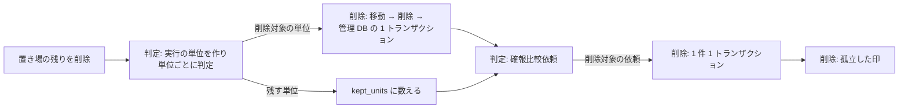

# ハウスキープフロー

## 概要

ジョブスケジューラのハウスキープ定期ジョブ(1 日 1 回)が `housekeep.sh` を起動し、保持日数(既定 90 日)を過ぎた終了済みの実行の成果物と管理 DB の履歴、終端した確報比較依頼を自動で削除する。
運用者は定期ジョブを登録するだけで、消してよいものの判断を負わない。削除したくない場合は定期ジョブを登録しない。

## 所属 UC 一覧

| UC | アクター | 役割 |
|----|----------|------|
| [保持日数を過ぎた終了済みの実行と確報比較依頼を判定する](保持日数を過ぎた終了済みの実行と確報比較依頼を判定する/spec.md) | ジョブスケジューラ(定期ジョブ)/ 運用者(受益者)/ 基盤適用設計者(設定の所有者) | ハウスキープ設定を読み、リランの親子をまとめた実行の単位と確報比較依頼ごとに削除するか残すかを判定する。設定検証 `validate-config.sh --housekeep` を含む |
| [成果物と管理 DB の履歴を削除する](成果物と管理%20DB%20の履歴を削除する/spec.md) | ジョブスケジューラ(定期ジョブ)/ 運用者(受益者) | 削除対象を、置き場への移動 → 削除 → 管理 DB の 1 トランザクションの順で削除し、件数と失敗を返す |

2 つの UC は `housekeep.sh` の 1 回の実行を構成する。

## UC 間の依存・整合条件

| 先行 UC | 後続 UC | 引継ぐ情報 / 契約参照 | 整合条件・失敗時の扱い |
|---------|---------|---------------------|----------------------|
| [成果物と管理 DB の履歴を削除する](成果物と管理%20DB%20の履歴を削除する/spec.md)(置き場の残りの削除) | [保持日数を過ぎた終了済みの実行と確報比較依頼を判定する](保持日数を過ぎた終了済みの実行と確報比較依頼を判定する/spec.md) | 置き場が空であること | 置き場の残りは判定せずに削除する。削除に失敗しても判定へ進み、最後に 6 で終える |
| [保持日数を過ぎた終了済みの実行と確報比較依頼を判定する](保持日数を過ぎた終了済みの実行と確報比較依頼を判定する/spec.md) | [成果物と管理 DB の履歴を削除する](成果物と管理%20DB%20の履歴を削除する/spec.md) | 削除対象の単位(run_id の集合、root_run_id、最も遅い終了日時)、削除対象の確報比較依頼(final_crosscheck_id)。契約 `shared_rules.housekeep_rules` | 判定のあとで単位に新しい実行が加わった場合は、管理 DB の削除が外部キー違反でロールバックし、次回の判定で単位を残す |
| [保持日数を過ぎた終了済みの実行と確報比較依頼を判定する](保持日数を過ぎた終了済みの実行と確報比較依頼を判定する/spec.md)(管理 DB の接続・SELECT の失敗) | [成果物と管理 DB の履歴を削除する](成果物と管理%20DB%20の履歴を削除する/spec.md) | なし | 単位・確報比較依頼・孤立した印を処理しない。管理 DB の行の有無が分からない run ディレクトリを成果物だけで消さない |

## 共有定義への参照

| RDRA要素 / 状態モデル | 定義先(ファイル + ID / 見出し) | 適用 UC |
|---------------------|--------------------------------|---------|
| 条件「ハウスキープの削除判定」 | [条件.tsv](../../../../../rdra/latest/条件.tsv) | [判定](保持日数を過ぎた終了済みの実行と確報比較依頼を判定する/spec.md) |
| 条件「リラン系譜の追跡」 | [条件.tsv](../../../../../rdra/latest/条件.tsv) | [判定](保持日数を過ぎた終了済みの実行と確報比較依頼を判定する/spec.md) |
| 条件「速報クロスチェック有効判定」 | [条件.tsv](../../../../../rdra/latest/条件.tsv) | [判定](保持日数を過ぎた終了済みの実行と確報比較依頼を判定する/spec.md)、[削除](成果物と管理%20DB%20の履歴を削除する/spec.md) |
| 条件「ハウスキープの削除順序と回復」 | [条件.tsv](../../../../../rdra/latest/条件.tsv) | [削除](成果物と管理%20DB%20の履歴を削除する/spec.md) |
| 条件「CLI による提示」 | [条件.tsv](../../../../../rdra/latest/条件.tsv) | [削除](成果物と管理%20DB%20の履歴を削除する/spec.md) |
| 状態モデル 並行稼働実行 / slot 実行 / クロスチェック依頼(終端状態) | [状態.tsv](../../../../../rdra/latest/状態.tsv) | 両 UC(状態は変更しない) |
| 判定と削除の規則 | [CLI コマンド契約](../../_cross-cutting/api/cli-command-contract.yaml) `shared_rules.housekeep_rules` | 両 UC |
| 成果物ルート直下の構成と run ディレクトリの列挙 | [CLI コマンド契約](../../_cross-cutting/api/cli-command-contract.yaml) `shared_rules.artifact_root_entries` | 両 UC |
| ハウスキープ設定 housekeep.env | [CLI コマンド契約](../../_cross-cutting/api/cli-command-contract.yaml) `config_files` | [判定](保持日数を過ぎた終了済みの実行と確報比較依頼を判定する/spec.md) |
| 6 テーブルと外部キー、ハウスキープ専用 DB ロール | [RDB スキーマ](../../_cross-cutting/datastore/rdb-schema.yaml) | 両 UC |
