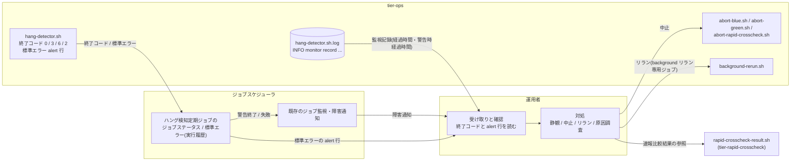
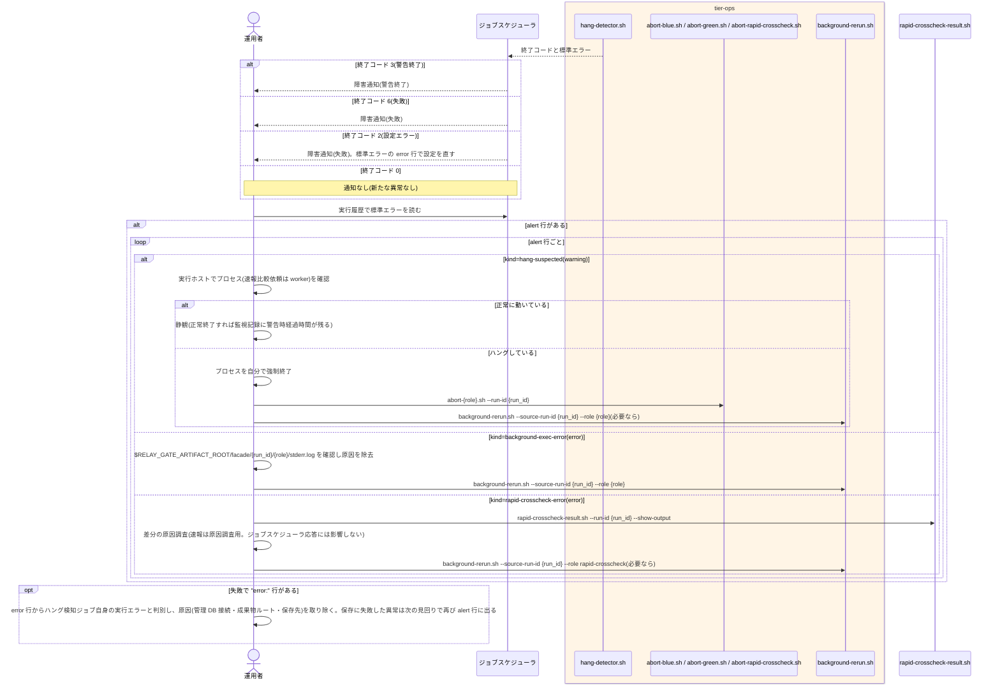

# ハング検知ジョブの異常終了を確認する

## 概要

運用者が、ハング検知ジョブ(`hang-detector.sh`)の警告終了または失敗を、ジョブスケジューラの既存のジョブ監視・障害通知で受け取る。
ハング疑いは警告終了、background 実行エラーと速報クロスチェック異常は失敗で届く。
運用者は、ジョブの標準エラーに 1 件 1 行で出た alert 行(対象・段階・経過時間)と監視記録で異常の内容を確認し、静観するか、実行中止(`abort-*`)・リラン(`background-rerun.sh`)で対処するかを判断する。
ジョブスケジューラのジョブステータスに現れない background 異常を見落とさないための別経路の通知であり、この UC は運用者が読んで判断する UC である。
alert 行の出し方は UC「ハング疑い・実行エラー・比較異常を通知する」、終了コードの定義は UC「background 実行の経過時間と終了状態を判定する」の tier 仕様が正本である。

## データフロー



| 入力元 | 受取先 | 内容 | 使い方 |
|---|---|---|---|
| hang-detector.sh の終了コード | ジョブスケジューラのジョブステータス | 0 = 正常 / 3 = 警告終了 / 6 = 失敗 / 2 = 設定エラー | 障害通知の有無と重要度 |
| hang-detector.sh の標準エラー | ジョブスケジューラの実行履歴 | `alert: level=... kind=... run_id=... role=... job_id=... elapsed_minutes=...` | 対象と段階を特定し、対処コマンドの引数に run_id と role をそのまま使う |
| 監視記録 | 運用者 | 実行ログ `hang-detector.sh.log` の `INFO monitor record` 行(off 以外は管理 DB の monitor_records にも同じ内容) | 経過時間・警告時経過時間・監視状態の確認 |

## 処理フロー



## バリエーション一覧

| バリエーション名 | 値 | 処理内容 | 適用 tier | 適用箇所 |
|----------------|---|---------|----------|---------|
| 通知レベル | warning | alert 行の `level=warning`。warning だけの回は終了コード 3(警告終了)。静観候補(正常に動いていれば待つ) | tier-ops | 標準エラーの alert 行 |
| 通知レベル | error | alert 行の `level=error`。1 行でもあれば終了コード 6(失敗)。対処要(リラン・原因調査) | tier-ops | 標準エラーの alert 行 |
| ハング検知判定結果 | ハング疑い | kind=hang-suspected。プロセス確認 → 静観、または停止 + `abort-{role}.sh` | tier-ops | 運用手順 |
| ハング検知判定結果 | 実行エラー | kind=background-exec-error。stderr.log 確認 → `background-rerun.sh --role {role}` | tier-ops | 運用手順 |
| ハング検知判定結果 | 比較異常 | kind=rapid-crosscheck-error(下記「速報クロスチェック監視判定」) | tier-ops | 運用手順 |
| ハング検知判定結果 | 監視対象外 / 正常終了または中止済み / 監視中 | alert 行は出ない(中止済みは監視記録が終端し、以後 alert 行は出ない) | tier-ops | — |
| 速報クロスチェック監視判定 | 速報クロスチェック異常(FAILED / 比較 NG) | kind=rapid-crosscheck-error role=rapid-crosscheck。`rapid-crosscheck-result.sh --run-id` で原因調査 | tier-ops | 運用手順 |
| 速報クロスチェック監視判定 | ハング疑い(RUNNING 継続) | kind=hang-suspected role=rapid-crosscheck。worker 確認 → `abort-rapid-crosscheck.sh` | tier-ops | 運用手順 |
| run role(成果物ディレクトリ区分) | blue / green / rapid-crosscheck | alert 行の `role=`。対処コマンド名と成果物パスの決定 | tier-ops | 運用手順 |
| 中止対象種別 | background slot 実行 / 速報比較依頼 | 対処で使う abort コマンドの選択 | tier-ops | 運用手順 |
| リラン対象 role | blue / green / rapid-crosscheck | 対処で使う `background-rerun.sh --role` | tier-ops | 運用手順 |

## 分岐条件一覧

| 条件名 | 判定ルール | 適用 tier | 適用箇所 | BDD Scenario |
|--------|----------|----------|---------|-------------|
| 通知レベルの判定 | 警告終了(3)は warning の alert 行だけ(静観可)。失敗(6)は error の alert 行が 1 行以上、またはハング検知ジョブ自身の実行エラー(`error:` 行)。error の alert 行が無い失敗は後者で、warning の alert 行があればそれも確認する | tier-ops | ジョブステータスと標準エラー(UC「background 実行の経過時間と終了状態を判定する」の終了コード表) | ジョブスケジューラで警告終了・失敗と warning・error の行から異常を判定できる(SPEC-012-01) / alert 行が無い失敗はハング検知ジョブ自身の実行エラーとして扱う |
| CLI による提示 | 提示は終了コードと標準エラーだけ。UI 画面も CLI の出力以外の通知手段も無い。alert 行の run_id と role をそのまま `abort-*` / `background-rerun.sh` / `rapid-crosscheck-result.sh` の引数に使える | tier-ops | 標準エラーの alert 行 | スクリプトの結果を標準出力・標準エラー・終了コードで判定できる(SPEC-012-01) / 設定ファイル一式に CLI の出力以外で知らせる設定項目は無い(SPEC-012-01) |
| 監視は通知のみ | 警告終了・失敗を受けても relay-gate は自動で中止・リランしない。対処は運用者の判断と操作で行う | tier-ops | 運用手順 | ハング疑いの警告終了を受け取って静観する(SPEC-008-04) |

## 計算ルール一覧

| 計算名 | 入力情報 | 計算式/ロジック | 出力情報 | 適用 tier |
|--------|---------|---------------|---------|----------|
| alert 行からの読み取り | 標準エラーの alert 行 | `alert: level={level} kind={kind} run_id={run_id} role={role} job_id={job_id} elapsed_minutes={n}` を固定順で読む | level / kind / run_id / role / job_id / 経過時間 | tier-ops(読み替え) |
| 対処コマンドの選択 | kind、role、run_id | hang-suspected → `abort-{role}.sh --run-id {run_id}`(role=rapid-crosscheck は `abort-rapid-crosscheck.sh`)/ background-exec-error → `background-rerun.sh --source-run-id {run_id} --role {role}` / rapid-crosscheck-error → `rapid-crosscheck-result.sh --run-id {run_id} --show-output` | 実行するコマンド | tier-ops(読み替え) |
| 成果物の場所 | run_id、role | `$RELAY_GATE_ARTIFACT_ROOT/facade/{run_id}/{role}/`(stdout.log / stderr.log / exitcode.txt)。速報比較依頼は成果物ディレクトリを持たず、依頼レコードを `rapid-crosscheck-result.sh` で参照する | 確認するファイル | tier-ops(読み替え) |

## 状態遷移一覧

| 状態モデル | 遷移元 | 遷移先 | トリガー | 事前条件 | 事後処理 | 適用 tier |
|-----------|--------|--------|---------|---------|---------|----------|
| 監視状態 | — | — | 該当なし(確認は状態を変えない。対処による遷移は実行中止フロー / background 側リランフローの UC に記載) | — | — | tier-ops |

## 関連 RDRA モデル

| モデル種別 | 要素名 | 関連 |
|-----------|--------|------|
| 業務 | 実行監視業務 | この UC が属する業務 |
| BUC | background 実行監視フロー | この UC を含む BUC(アクティビティ: 通知の確認と対処判断) |
| アクター | 運用者 | 障害通知の受け手・判断者 |
| 情報 | 監視記録 | 経過時間・警告時経過時間・監視状態の確認 |
| 情報 | 実行ログ | `hang-detector.sh.log` の `INFO monitor record` 行(off では監視記録の内容はここだけに残る) |
| 条件 | 通知レベルの判定 | 警告終了 / 失敗と warning / error の読み方 |
| 条件 | CLI による提示 | 終了コードと標準エラーだけで提示 |
| 条件 | 監視は通知のみ | 対処は運用者 |
| 画面 | hang-detect 通知確認出力(→ ジョブスケジューラで見る標準エラーの alert 行) | 運用者が読む出力 |
| イベント | ハング検知ジョブの警告終了・失敗の通知 | ジョブスケジューラの障害通知 |
| 外部システム | ジョブスケジューラ | ジョブステータス・実行履歴・障害通知 |

## 関連 USDM

| REQ ID | SPEC ID | 対応 BDD Scenario |
|--------|---------|------------------|
| REQ-012 | SPEC-012-01 | スクリプトの結果を標準出力・標準エラー・終了コードで判定できる(SPEC-012-01) / ジョブスケジューラで警告終了・失敗と warning・error の行から異常を判定できる(SPEC-012-01) / 設定ファイル一式に CLI の出力以外で知らせる設定項目は無い(SPEC-012-01) |
| REQ-008 | SPEC-008-07 | ジョブスケジューラで警告終了・失敗と warning・error の行から異常を判定できる(SPEC-012-01) / ハング疑いの警告終了を受け取って静観する(SPEC-008-04) ※ 受け手の観点。終了コードと alert 行の出し方は UC「ハング疑い・実行エラー・比較異常を通知する」 |
| REQ-008 | SPEC-008-04 | ハング疑いの警告終了を受け取って静観する(SPEC-008-04) |
| REQ-008 | SPEC-008-01 | 実行エラーの失敗を受け取ってリランする(SPEC-008-01) |
| REQ-008 | SPEC-008-02 | 速報クロスチェック異常の失敗を受け取って原因調査する(SPEC-008-02) |

> 機械可読の正本は `spec-event.yaml` の `use_cases[].usdm`(本表と同内容)。「対応 BDD Scenario」列は本 UC の `Scenario:` 名(接尾の SPEC ID を含む完全名)を「 / 」で区切って列挙し、Scenario 名以外の補足は「※」以降に置く。区切りは人が読む用で、Scenario 名自体に「 / 」を含むものがあるため機械分割には使わず、機械照合は `spec-event.yaml` の `scenarios[]` を使う。

## E2E 完了条件(BDD)

### 正常系

```gherkin
Feature: ハング検知ジョブの異常終了を確認する

  Scenario: スクリプトの結果を標準出力・標準エラー・終了コードで判定できる(SPEC-012-01)
    Given CLI 契約(cli-command-contract.yaml)に relay-gate のすべてのスクリプトが定義されている
    When ジョブスケジューラまたは運用者が各スクリプトを起動して結果を確認する
    Then どのスクリプトも GUI を必要とせず、契約の各コマンドに stdout / stderr / exit_codes が定義されており、結果は標準出力・標準エラー・終了コードだけで判定できる

  Scenario: ジョブスケジューラで警告終了・失敗と warning・error の行から異常を判定できる(SPEC-012-01)
    Given ハング検知ジョブが、ハング疑いだけを新たに見つけた回に標準エラーへ "alert: level=warning kind=hang-suspected run_id=20260830T113000-JOB001-3f9a1c2e role=green job_id=JOB001 elapsed_minutes=74" を出して終了コード 3 で終わった
    When 運用者がジョブスケジューラでハング検知ジョブの結果を確認する
    Then ジョブステータスは警告終了で、標準エラーの warning の行から対象 run_id=20260830T113000-JOB001-3f9a1c2e role=green のハング疑い(経過 74 分)と判定できる
    Given 次の回にハング検知ジョブが標準エラーへ "alert: level=error kind=background-exec-error run_id=20260830T114000-JOB002-5e6f7a8b role=blue job_id=JOB002 elapsed_minutes=64" を出して終了コード 6 で終わった
    When 運用者がジョブスケジューラでハング検知ジョブの結果を確認する
    Then ジョブステータスは失敗で、標準エラーの error の行から対象 run_id=20260830T114000-JOB002-5e6f7a8b role=blue の background 実行エラーと判定できる

  Scenario: 設定ファイル一式に CLI の出力以外で知らせる設定項目は無い(SPEC-012-01)
    Given CLI 契約の config_files に定義された relay-gate の設定ファイル一式(feature-flag.env / blue-job-map.csv / green-job-map.csv / rapid-crosscheck.env / final-crosscheck.env / hang-detector.env / housekeep.env)
    When 通知の宛先・送信コマンドなど、CLI の出力以外で運用者へ知らせるための設定項目を探す
    Then そのような設定項目はどのファイルにも存在しない

  Scenario: ハング疑いの警告終了を受け取って静観する(SPEC-008-04)
    Given RAPID_CROSSCHECK_MODE=background で運用しており、ジョブスケジューラの障害通知で、ハング検知ジョブが警告終了(終了コード 3)したと受け取った
    And ジョブの標準エラーに "alert: level=warning kind=hang-suspected run_id=20260830T113000-JOB001-3f9a1c2e role=green job_id=JOB001 elapsed_minutes=74" がある
    When 運用者が実行ホストで green のプロセスが正常に動いていることを確認し、静観する
    Then relay-gate 側では slot 実行の状態は RUNNING のままで、中止もリランも自動では行われない
    And 次の見回りのハング検知ジョブは同じ異常の alert 行を出さず、ほかに新たな異常が無ければ終了コード 0 で終わる
    And その後 green が exitcode.txt=0 で終了すると、hang-detector.sh.log の "INFO monitor record run_id=20260830T113000-JOB001-3f9a1c2e role=green" で始まる行に monitor_status=COMPLETED と elapsed_minutes_at_alert=74 が残る

  Scenario: 実行エラーの失敗を受け取ってリランする(SPEC-008-01)
    Given ジョブスケジューラの障害通知で、ハング検知ジョブが失敗(終了コード 6)したと受け取った
    And ジョブの標準エラーに "alert: level=error kind=background-exec-error run_id=20260830T113000-JOB001-3f9a1c2e role=green job_id=JOB001 elapsed_minutes=74" がある
    When 運用者が $RELAY_GATE_ARTIFACT_ROOT/facade/20260830T113000-JOB001-3f9a1c2e/green/stderr.log で原因を確認して取り除き、ジョブスケジューラの background リラン専用ジョブから background-rerun.sh --source-run-id 20260830T113000-JOB001-3f9a1c2e --role green を起動する
    Then 新しい run_id で green が再実行され、parent_run_id に 20260830T113000-JOB001-3f9a1c2e が設定される

  Scenario: 速報クロスチェック異常の失敗を受け取って原因調査する(SPEC-008-02)
    Given ジョブスケジューラの障害通知で、ハング検知ジョブが失敗(終了コード 6)したと受け取った
    And ジョブの標準エラーに "alert: level=error kind=rapid-crosscheck-error run_id=20260830T113000-JOB001-3f9a1c2e role=rapid-crosscheck job_id=JOB001 elapsed_minutes=65" がある
    And rapid_crosscheck_requests に run_id=20260830T113000-JOB001-3f9a1c2e status=FAILED exit_code=3 があり、比較ツールの出力が stdout / stderr 列に保存されている
    When 運用者が rapid-crosscheck-result.sh --run-id 20260830T113000-JOB001-3f9a1c2e --show-output を実行する
    Then 依頼の status=FAILED exit_code=3 と比較ツールの stdout / stderr が表示され、運用者は差分の原因調査に進む
    And 業務ジョブのジョブスケジューラ応答(foreground の結果)は変更されない
```

### 異常系

```gherkin
  Scenario: ハング疑いの後にプロセスがハングしていたので中止する
    Given RAPID_CROSSCHECK_MODE=background で、ハング検知ジョブの標準エラーに "alert: level=warning kind=hang-suspected run_id=20260830T113000-JOB001-3f9a1c2e role=green job_id=JOB001 elapsed_minutes=74" があり、実行ホストでプロセスが応答していない
    And monitor_records の該当行は monitor_status=HANG_SUSPECTED_NOTIFIED である
    When 運用者がプロセスを自分で強制終了し、abort-green.sh --run-id 20260830T113000-JOB001-3f9a1c2e を実行して停止確認に yes と答える
    Then facade/20260830T113000-JOB001-3f9a1c2e/green/aborted.txt が書かれ、管理 DB の slot 実行も ABORTED になる(RAPID_CROSSCHECK_MODE=off なら aborted.txt だけで中止が成立する)
    And 次回のハング検知ジョブは exitcode.txt が無く aborted.txt がある slot 実行を中止済み(判定 COMPLETED)として監視記録を monitor_status=COMPLETED で終端し、以後同じ run_id / role の alert 行を出さない(経過時間にかかわらず)

  Scenario: alert 行が無い失敗はハング検知ジョブ自身の実行エラーとして扱う
    Given ジョブスケジューラの障害通知で、ハング検知ジョブが失敗(終了コード 6)したと受け取った
    And ジョブの標準エラーに "error: management db connection failed conn_ref=relaygate-db" があり、"alert: level=error" で始まる行は無い
    When 運用者がジョブスケジューラでハング検知ジョブの結果を確認する
    Then 運用者は background 異常ではなくハング検知ジョブ自身の実行エラーと判別できる
    And 管理 DB の接続を回復させた次の見回りでは、ハング検知ジョブの終了コードは新たに知らせる異常に応じた値(0 / 3 / 6)に戻る
```

## ティア別仕様

- [実行監視・復旧ティア](tier-ops.md)

### 統合 API Spec

- [CLI コマンド契約](../../../_cross-cutting/api/cli-command-contract.yaml)(`hang-detector.sh` の終了コードと標準エラー、対処に使う `abort-*.sh` / `background-rerun.sh` / `rapid-crosscheck-result.sh`)
