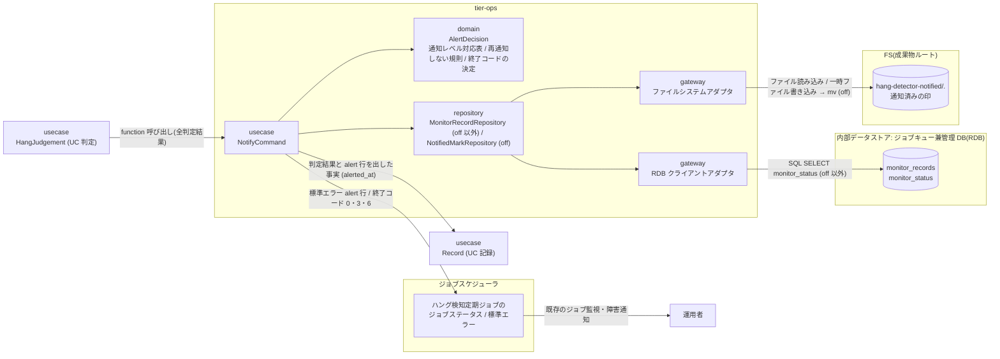
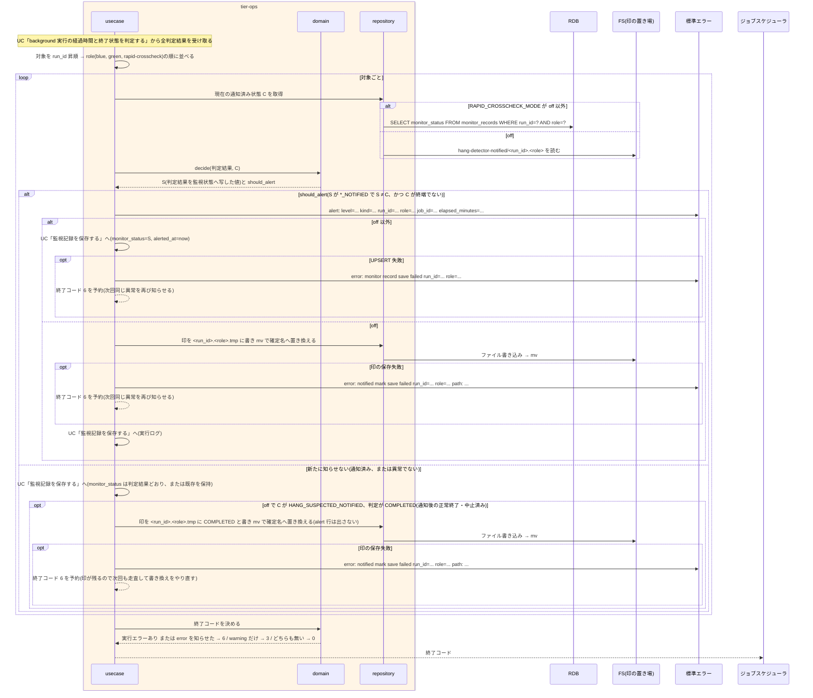

# ハング疑い・実行エラー・比較異常を通知する

## 概要

`hang-detector.sh` が、UC「background 実行の経過時間と終了状態を判定する」の判定結果のうち、その回の見回りで新たに見つけた異常を、標準エラーの alert 行(1 件 1 行)と自身の終了コードで知らせる。
ハング疑いだけなら警告終了(3)、background 実行エラーまたは速報クロスチェック異常が 1 件でもあれば失敗(6)、新たな異常が無ければ 0 で終わる。
運用者にはジョブスケジューラの既存のジョブ監視・障害通知で届く(受け取りは UC「ハング検知ジョブの異常終了を確認する」)。
通知済みの異常は再び知らせない。判定には、RAPID_CROSSCHECK_MODE が off 以外では監視記録の monitor_status、off では成果物ルート配下の通知済みの印を使う。
alert 行を出したあとで監視記録または印の保存に失敗した異常は、次の見回りで再び知らせる(知らせ漏れより重複を選ぶ)。
監視は通知のみで、RUNNING を ABORTED へ変更せず、プロセスを止めず、依頼を作らない。CLI の出力以外の通知手段は持たない。

## データフロー



| レイヤー | データモデル | 変換内容 |
|---------|------------|---------|
| usecase | NotifyCommand(HangJudgement の一覧、現在の通知済み状態) | 対象を並べ替える → 対象ごとに再通知の要否を決める → alert 行を出す → 記録・印を保存する → 終了コードを決める |
| domain | AlertDecision(kind, level, next_status, should_alert) | 判定結果 → 通知種別 / 段階 / 次の監視状態。現在の通知済み状態と比べて新たに知らせるかを決める |
| domain | HangAlertLine(level, kind, run_id, role, job_id, elapsed_minutes) | 標準エラーに出す 1 行 |
| repository | MonitorRecordRepository(off 以外) | 現在の monitor_status を読む(行が無ければ MONITORING 扱い)。保存は UC「監視記録を保存する」 |
| repository | NotifiedMarkRepository(off) | 通知済みの印を読む(無ければ MONITORING 扱い)。alert 行を出した対象の印と、ハング疑いを知らせたあとで正常終了・中止した対象の COMPLETED への書き換えを、一時ファイル経由で書く |

## 処理フロー



## バリエーション一覧

| バリエーション名 | 値 | 処理内容 | 適用 tier | 適用箇所 |
|----------------|---|---------|----------|---------|
| 通知レベル | warning | ハング疑い。alert 行の `level=warning`。新たに知らせる異常が warning だけなら終了コード 3(警告終了) | tier-ops | `decide_alert` / `decide_exit_code` |
| 通知レベル | error | background 実行エラー・速報クロスチェック異常。alert 行の `level=error`。1 件でもあれば終了コード 6(失敗) | tier-ops | `decide_alert` / `decide_exit_code` |
| ハング検知判定結果 | ハング疑い | kind=hang-suspected、level=warning、S=HANG_SUSPECTED_NOTIFIED | tier-ops | `decide_alert` |
| ハング検知判定結果 | 実行エラー | kind=background-exec-error、level=error、S=EXEC_ERROR_NOTIFIED | tier-ops | `decide_alert` |
| ハング検知判定結果 | 比較異常 | kind=rapid-crosscheck-error、level=error、S=COMPARE_ERROR_NOTIFIED | tier-ops | `decide_alert` |
| ハング検知判定結果 | 監視対象外 / 正常終了または中止済み / 監視中 | alert 行を出さない(中止済みは知らせずに終端) | tier-ops | `decide_alert` |
| 速報クロスチェック監視判定 | 速報クロスチェック異常(FAILED / 比較 NG) | kind=rapid-crosscheck-error、level=error、role=rapid-crosscheck | tier-ops | `decide_alert` |
| 速報クロスチェック監視判定 | ハング疑い(RUNNING 継続) | kind=hang-suspected、level=warning、role=rapid-crosscheck。依頼の状態は変更しない | tier-ops | `decide_alert` |
| 速報クロスチェック監視判定 | 正常 | alert 行を出さない | tier-ops | `decide_alert` |
| 監視状態 | ハング疑い通知済み / 実行エラー通知済み / 比較異常通知済み | 同じ状態の異常は再び知らせない。ハング疑い通知済みからの実行エラー通知済み / 比較異常通知済みは別の異常として 1 回知らせる | tier-ops | `decide_alert` |
| run role(成果物ディレクトリ区分) | blue / green / rapid-crosscheck | alert 行の `role=`。並び順は blue → green → rapid-crosscheck | tier-ops | `sort_targets` |
| 速報クロスチェックモード | foreground / background(off 以外) | 通知済み状態の出所は monitor_records | tier-ops | `MonitorRecordRepository` |
| 速報クロスチェックモード | off | 通知済み状態の出所は成果物ルート配下の通知済みの印(blue / green だけ) | tier-ops | `NotifiedMarkRepository` |
| 設定所有区分 | ハング検知定期ジョブ設定 | hang-detector.env は管理 DB 接続参照名と監視の調整値だけを持ち、知らせ方の設定項目を持たない。所有者は基盤適用設計者 | tier-ops | `hang-detector.env` |

## 分岐条件一覧

| 条件名 | 判定ルール | 適用 tier | 適用箇所 | BDD Scenario |
|--------|----------|----------|---------|-------------|
| 通知レベルの判定 | その回に新たに知らせる異常が無ければ 0、ハング疑い(warning)だけなら 3、background 実行エラー・速報クロスチェック異常(error)が 1 件でもあれば 6。異常は標準エラーに 1 件 1 行。通知済みの異常は再び知らせず、保存に失敗した異常は次回も知らせる | tier-ops | `decide_alert` / `decide_exit_code`(domain) | 新たな異常が無ければ終了コード 0 で alert 行を出さない(SPEC-008-07) / ハング疑いだけなら対象ごとに warning の行を出して警告終了する(SPEC-008-07) / 実行エラーや比較異常を新たに見つけたら error の行を出して失敗で終わる(SPEC-008-07) / ハング疑いと実行エラーを同じ回に見つけたら失敗で終わる(SPEC-008-07) |
| CLI による提示 | 知らせ方は終了コードと標準エラーだけ。relay-gate は CLI の出力以外の通知手段を持たない | tier-ops | `NotifyCommand` | alert 行に対象・段階・経過時間が含まれる(SPEC-008-07) |
| 速報比較依頼の異常判定 | 依頼 FAILED / 比較 NG → kind=rapid-crosscheck-error(error)。RUNNING で上限超過 → kind=hang-suspected(warning)。依頼の状態は変更しない | tier-ops | `decide_alert` | 速報比較依頼の FAILED を error の行で知らせる(SPEC-008-02) |
| 監視は通知のみ | alert 行を出しても RUNNING を ABORTED にせず、プロセスを停止せず、依頼を作成しない。usecase は abort / rerun の repository を呼ばない | tier-ops | `NotifyCommand`(LP-017) | 通知後も状態は RUNNING のままである(SPEC-008-04) |
| 設定所有区分 | 管理 DB 接続参照名(HANG_DB_CONN_REF)はハング検知定期ジョブ設定(hang-detector.env。基盤適用設計者)が所有する。認証情報は値を置かず参照名のみ | tier-ops | `hang-detector.env`(repository) | ハング検知定期ジョブ設定は管理 DB 接続参照名と監視の調整値だけを持つ(SPEC-008-06) |

## 計算ルール一覧

| 計算名 | 入力情報 | 計算式/ロジック | 出力情報 | 適用 tier |
|--------|---------|---------------|---------|----------|
| 通知種別・段階・次状態 S | ハング検知判定結果 | HANG_SUSPECTED → (hang-suspected, warning, HANG_SUSPECTED_NOTIFIED) / EXEC_ERROR → (background-exec-error, error, EXEC_ERROR_NOTIFIED) / COMPARE_ERROR → (rapid-crosscheck-error, error, COMPARE_ERROR_NOTIFIED)。S は CLI 契約 `shared_rules.state_codes.hang_judgement_to_monitor_status` の写像 | alert 行の kind / level、監視記録.monitor_status | tier-ops |
| 新たに知らせるか | S、現在の通知済み状態 C | S が HANG_SUSPECTED_NOTIFIED / EXEC_ERROR_NOTIFIED / COMPARE_ERROR_NOTIFIED のいずれかで、S ≠ C、かつ C が終端(EXEC_ERROR_NOTIFIED / COMPARE_ERROR_NOTIFIED / COMPLETED / NOT_MONITORED)でないときだけ知らせる。C は off 以外なら monitor_records.monitor_status(行が無ければ MONITORING)、off なら印の中身(印が無ければ MONITORING) | should_alert | tier-ops |
| alert 行 | 判定結果、S | `alert: level=<warning\|error> kind=<kind> run_id=<run_id> role=<role> job_id=<job_id> elapsed_minutes=<n>`。速報比較依頼は role=rapid-crosscheck。elapsed_minutes は判定 UC が算出した判定時点の経過分 | 標準エラー 1 行 | tier-ops |
| 並び順 | 対象の run_id、role | run_id 昇順 → role(blue, green, rapid-crosscheck) | alert 行の順序 | tier-ops |
| alerted_at | 現在時刻(判定 UC と同じ now) | alert 行を出した回の now(判定時刻)。保存は UC「監視記録を保存する」 | 監視記録.alerted_at | tier-ops |
| 終了コード | その回の alert 行の段階、実行エラーの有無 | 実行エラー(管理 DB・成果物ルート・監視記録・印の失敗)が 1 件以上、または error の alert 行が 1 行以上 → 6。それ以外で warning の alert 行が 1 行以上 → 3。どちらも無い → 0 | 終了コード | tier-ops |
| 印の内容 | S、判定結果、現在の印 C | alert 行を出したときは S の英字コード 1 行 + LF(HANG_SUSPECTED_NOTIFIED / EXEC_ERROR_NOTIFIED。off では速報比較依頼が無いため COMPARE_ERROR_NOTIFIED は出ない)。C が HANG_SUSPECTED_NOTIFIED で判定が COMPLETED(通知後の正常終了・中止済み)なら、alert 行を出さずに COMPLETED + LF へ書き換えて終端する。印が無い対象の正常終了・中止では印を作らない | 通知済みの印 | tier-ops |

## 状態遷移一覧

| 状態モデル | 遷移元 | 遷移先 | トリガー | 事前条件 | 事後処理 | 適用 tier |
|-----------|--------|--------|---------|---------|---------|----------|
| 監視状態 | 監視中(MONITORING) | ハング疑い通知済み(HANG_SUSPECTED_NOTIFIED) | warning の alert 行を出した | exitcode.txt 未出力かつ elapsed > limit(依頼は RUNNING で上限超過) | hang_suspected_at、alerted_at、elapsed_minutes_at_alert を記録(UC「監視記録を保存する」)。off は印を書く。実行状態は変更しない | tier-ops |
| 監視状態 | 監視中(MONITORING) | 実行エラー通知済み(EXEC_ERROR_NOTIFIED) | error の alert 行を出した | exitcode.txt が非 0 | alerted_at を記録。off は印を書く | tier-ops |
| 監視状態 | 監視中(MONITORING) | 比較異常通知済み(COMPARE_ERROR_NOTIFIED) | error の alert 行を出した | 速報比較依頼が FAILED または比較 NG | alerted_at を記録 | tier-ops |
| 監視状態 | ハング疑い通知済み(HANG_SUSPECTED_NOTIFIED) | 実行エラー通知済み(EXEC_ERROR_NOTIFIED) | error の alert 行を出した(追加の通知) | 通知後に exitcode.txt が非 0 で出力された | alerted_at を更新(hang_suspected_at と elapsed_minutes_at_alert は保持)。off は印を書き換える | tier-ops |
| 監視状態 | ハング疑い通知済み(HANG_SUSPECTED_NOTIFIED) | 比較異常通知済み(COMPARE_ERROR_NOTIFIED) | error の alert 行を出した(追加の通知) | 通知後に速報比較依頼が FAILED(比較 NG(exit_code=3)/ 実行エラー(exit_code=6))で終端した | alerted_at を更新(hang_suspected_at と elapsed_minutes_at_alert は保持) | tier-ops |

- 監視記録または印の保存に失敗した場合、監視状態は遷移しない。次の見回りで同じ異常を再び知らせる
- `[*]` → NOT_MONITORED / MONITORING、MONITORING → COMPLETED、HANG_SUSPECTED_NOTIFIED → COMPLETED(通知後正常終了・通知後の中止済み)は UC「background 実行の経過時間と終了状態を判定する」の遷移。off で HANG_SUSPECTED_NOTIFIED → COMPLETED になったときは、この UC が印を COMPLETED へ書き換える(alert 行は出さない)。状態遷移の正本は [状態](../../../../../../rdra/latest/状態.tsv) の状態モデル「監視状態」

## 関連 RDRA モデル

| モデル種別 | 要素名 | 関連 |
|-----------|--------|------|
| 業務 | 実行監視業務 | この UC が属する業務 |
| BUC | background 実行監視フロー | この UC を含む BUC(アクティビティ: 異常の通知) |
| アクター | 運用者 | 受益者(ジョブスケジューラの障害通知で受け取る) |
| 情報 | 監視記録 | 通知済み状態の判定と遷移先の記録(off は通知済みの印) |
| 情報 | slot 実行 | 通知対象(background) |
| 情報 | 速報比較依頼(rapid_crosscheck_request) | 通知対象(off 以外) |
| 情報 | ハング検知定期ジョブ設定 | hang-detector.env。管理 DB 接続参照名の出所(所有者: 基盤適用設計者) |
| 状態 | 監視状態 | MONITORING → *_NOTIFIED、HANG_SUSPECTED_NOTIFIED → EXEC_ERROR_NOTIFIED / COMPARE_ERROR_NOTIFIED |
| バリエーション | 通知レベル / ハング検知判定結果 / 速報クロスチェック監視判定 | 判定結果 → 通知種別・段階 |
| バリエーション | 監視状態 | 6 値。状態モデルと一致 |
| 条件 | 通知レベルの判定 | 終了コード 0 / 3 / 6 と 1 件 1 行の alert 行、再通知しない規則 |
| 条件 | 速報比較依頼の異常判定 | 依頼の異常の知らせ方 |
| 条件 | 監視は通知のみ | 状態変更・停止・依頼作成をしない |
| 条件 | CLI による提示 | 知らせ方は CLI の出力だけ |
| 画面 | hang-detect 異常通知出力(→ CLI 出力) | 標準エラーの alert 行と終了コード |
| イベント | 警告終了・失敗の終了コードと標準エラーの返却 | ジョブスケジューラへ返す |
| 外部システム | ジョブスケジューラ | 終了コードと標準エラーの受け手。既存のジョブ監視・障害通知で運用者へ届ける |

## 関連 USDM

| REQ ID | SPEC ID | 対応 BDD Scenario |
|--------|---------|------------------|
| REQ-008 | SPEC-008-01 | ハング疑いだけなら対象ごとに warning の行を出して警告終了する(SPEC-008-07) / 実行エラーや比較異常を新たに見つけたら error の行を出して失敗で終わる(SPEC-008-07) |
| REQ-008 | SPEC-008-02 | 速報比較依頼の FAILED を error の行で知らせる(SPEC-008-02) |
| REQ-008 | SPEC-008-03 | ハング疑い通知後に比較異常になった速報比較依頼を error の行で知らせる(SPEC-008-03) / off ではハング疑い通知後に正常終了した対象の印が COMPLETED になる(SPEC-008-03) |
| REQ-008 | SPEC-008-04 | 通知後も状態は RUNNING のままである(SPEC-008-04) |
| REQ-008 | SPEC-008-06 | ハング検知定期ジョブ設定は管理 DB 接続参照名と監視の調整値だけを持つ(SPEC-008-06) |
| REQ-008 | SPEC-008-07 | 新たな異常が無ければ終了コード 0 で alert 行を出さない(SPEC-008-07) / ハング疑いだけなら対象ごとに warning の行を出して警告終了する(SPEC-008-07) / 実行エラーや比較異常を新たに見つけたら error の行を出して失敗で終わる(SPEC-008-07) / ハング疑いと実行エラーを同じ回に見つけたら失敗で終わる(SPEC-008-07) / alert 行に対象・段階・経過時間が含まれる(SPEC-008-07) / 管理 DB を使う設定では通知済みの異常を 2 回目に知らせない(SPEC-008-07) / off では通知済みの異常を 2 回目に知らせない(SPEC-008-07) / off では通知済みの印を残し Runner Result の契約ファイルを変えない(SPEC-008-07) / 監視記録の保存に失敗した異常は次の見回りで再び知らせる(SPEC-008-07) / 通知済みの印の保存に失敗した異常は次の見回りで再び知らせる(SPEC-008-07) |
| REQ-012 | SPEC-012-01 | alert 行に対象・段階・経過時間が含まれる(SPEC-008-07) ※ 知らせ方が終了コードと標準エラーだけであること |

> 機械可読の正本は `spec-event.yaml` の `use_cases[].usdm`(本表と同内容)。「対応 BDD Scenario」列は本 UC の `Scenario:` 名(接尾の SPEC ID を含む完全名)を「 / 」で区切って列挙し、Scenario 名以外の補足は「※」以降に置く。区切りは人が読む用で、Scenario 名自体に「 / 」を含むものがあるため機械分割には使わず、機械照合は `spec-event.yaml` の `scenarios[]` を使う。

## E2E 完了条件(BDD)

共通の前提: RELAY_GATE_ARTIFACT_ROOT=/var/relay-gate、TZ=UTC。run_id=20260830T113000-JOB001-3f9a1c2e の green は started-at.txt が 2026-08-30T11:30:05Z、execution-spec.json に job_id=JOB001 slots.green.mode=background slots.green.hang_detect_limit_minutes=60 がある。run_id=20260830T114000-JOB002-5e6f7a8b の blue は started-at.txt が 2026-08-30T11:40:05Z、execution-spec.json に job_id=JOB002 slots.blue.mode=background slots.blue.hang_detect_limit_minutes=60 がある。シナリオに exitcode.txt・aborted.txt の有無や中身の記載が無ければ、20260830T113000-JOB001-3f9a1c2e の green/exitcode.txt と 20260830T114000-JOB002-5e6f7a8b の blue/exitcode.txt の中身はどちらも 0 である(正常終了として判定され、異常にならない)。シナリオが「exitcode.txt が無い」「中身が 1」などと書いた場合は、その記載に従う。

### 正常系

```gherkin
Feature: ハング疑い・実行エラー・比較異常を通知する

  Scenario: 新たな異常が無ければ終了コード 0 で alert 行を出さない(SPEC-008-07)
    Given RAPID_CROSSCHECK_MODE=background で、20260830T113000-JOB001-3f9a1c2e の green に exitcode.txt が無く、RELAY_GATE_NOW=2026-08-30T12:00:00Z(上限以内)である
    And 20260830T114000-JOB002-5e6f7a8b の blue/exitcode.txt の中身が 0 である
    When ジョブスケジューラが hang-detector.sh を起動する
    Then stderr に "alert:" で始まる行は 1 行も出ず、終了コード 0 で終了する

  Scenario: ハング疑いだけなら対象ごとに warning の行を出して警告終了する(SPEC-008-07)
    Given RAPID_CROSSCHECK_MODE=background で、monitor_records に 2 つの run の行が無い
    And 20260830T113000-JOB001-3f9a1c2e の green と 20260830T114000-JOB002-5e6f7a8b の blue に exitcode.txt も aborted.txt も無く、RELAY_GATE_NOW=2026-08-30T12:45:00Z である
    When ジョブスケジューラが hang-detector.sh を起動する
    Then stderr の "alert:" で始まる行は次の 2 行で、この順に出る
      | alert: level=warning kind=hang-suspected run_id=20260830T113000-JOB001-3f9a1c2e role=green job_id=JOB001 elapsed_minutes=74 |
      | alert: level=warning kind=hang-suspected run_id=20260830T114000-JOB002-5e6f7a8b role=blue job_id=JOB002 elapsed_minutes=64 |
    And 終了コード 3 で終了し、ジョブスケジューラのジョブステータスは警告終了になる

  Scenario: 実行エラーや比較異常を新たに見つけたら error の行を出して失敗で終わる(SPEC-008-07)
    Given RAPID_CROSSCHECK_MODE=background で、monitor_records に対象の行が無い
    And 20260830T113000-JOB001-3f9a1c2e の green/exitcode.txt の中身が 1 である
    And rapid_crosscheck_requests に run_id=20260830T100000-JOB003-9c0d1e2f job_id=JOB003 status=FAILED exit_code=3 started_at=2026-08-30T10:05:00 の行がある
    And RELAY_GATE_NOW=2026-08-30T12:45:00Z である
    When ジョブスケジューラが hang-detector.sh を起動する
    Then stderr の "alert:" で始まる行は次の 2 行で、この順に出る
      | alert: level=error kind=rapid-crosscheck-error run_id=20260830T100000-JOB003-9c0d1e2f role=rapid-crosscheck job_id=JOB003 elapsed_minutes=160 |
      | alert: level=error kind=background-exec-error run_id=20260830T113000-JOB001-3f9a1c2e role=green job_id=JOB001 elapsed_minutes=74 |
    And 0 とも 3 とも異なる終了コード 6 で終了する

  Scenario: ハング疑いと実行エラーを同じ回に見つけたら失敗で終わる(SPEC-008-07)
    Given RAPID_CROSSCHECK_MODE=background で、monitor_records に 2 つの run の行が無い
    And 20260830T113000-JOB001-3f9a1c2e の green に exitcode.txt が無く、20260830T114000-JOB002-5e6f7a8b の blue/exitcode.txt の中身が 1 で、RELAY_GATE_NOW=2026-08-30T12:45:00Z である
    When ジョブスケジューラが hang-detector.sh を起動する
    Then stderr の "alert:" で始まる行は次の 2 行で、この順に出る
      | alert: level=warning kind=hang-suspected run_id=20260830T113000-JOB001-3f9a1c2e role=green job_id=JOB001 elapsed_minutes=74 |
      | alert: level=error kind=background-exec-error run_id=20260830T114000-JOB002-5e6f7a8b role=blue job_id=JOB002 elapsed_minutes=64 |
    And 終了コード 6 で終了する

  Scenario: alert 行に対象・段階・経過時間が含まれる(SPEC-008-07)
    Given RAPID_CROSSCHECK_MODE=background で、monitor_records に対象の行が無い
    And 20260830T113000-JOB001-3f9a1c2e の green に exitcode.txt が無い
    And rapid_crosscheck_requests に run_id=20260830T100000-JOB003-9c0d1e2f job_id=JOB003 status=RUNNING started_at=2026-08-30T10:05:00 の行があり、hang-detector.env の RAPID_HANG_DETECT_LIMIT_MINUTES=60 である
    And RELAY_GATE_NOW=2026-08-30T12:45:00Z である
    When ジョブスケジューラが hang-detector.sh を起動する
    Then 速報比較依頼の行は "alert: level=warning kind=hang-suspected run_id=20260830T100000-JOB003-9c0d1e2f role=rapid-crosscheck job_id=JOB003 elapsed_minutes=160" である
    And background slot の行は "alert: level=warning kind=hang-suspected run_id=20260830T113000-JOB001-3f9a1c2e role=green job_id=JOB001 elapsed_minutes=74" である
    And どちらの行も対象(run_id と role。速報比較依頼は role=rapid-crosscheck)、段階(level)、経過時間(elapsed_minutes)を含み、終了コード 3 で終了する

  Scenario: 管理 DB を使う設定では通知済みの異常を 2 回目に知らせない(SPEC-008-07)
    Given RAPID_CROSSCHECK_MODE=background で、monitor_records に run_id=20260830T113000-JOB001-3f9a1c2e role=green monitor_status=HANG_SUSPECTED_NOTIFIED alerted_at=2026-08-30T12:45:00 の行がある
    And green に exitcode.txt が無いままで、RELAY_GATE_NOW=2026-08-30T12:50:00Z(前回の見回りの 5 分後)である
    When 2 回目の見回りとしてジョブスケジューラが hang-detector.sh を起動する
    Then stderr に "alert:" で始まる行は出ず、終了コード 0 で終了する
    And monitor_records の該当行は monitor_status=HANG_SUSPECTED_NOTIFIED alerted_at=2026-08-30T12:45:00 のままである

  Scenario: off では通知済みの異常を 2 回目に知らせない(SPEC-008-07)
    Given RAPID_CROSSCHECK_MODE=off で、/var/relay-gate/hang-detector-notified/20260830T113000-JOB001-3f9a1c2e.green の中身が "HANG_SUSPECTED_NOTIFIED" + LF である
    And green に exitcode.txt が無いままで、RELAY_GATE_NOW=2026-08-30T12:50:00Z である
    When 2 回目の見回りとしてジョブスケジューラが hang-detector.sh を起動する
    Then stderr に "alert:" で始まる行は出ず、終了コード 0 で終了する
    And 印の中身は "HANG_SUSPECTED_NOTIFIED" + LF のままである

  Scenario: off では通知済みの印を残し Runner Result の契約ファイルを変えない(SPEC-008-07)
    Given RAPID_CROSSCHECK_MODE=off で、/var/relay-gate/hang-detector-notified/ に 20260830T113000-JOB001-3f9a1c2e の印が無い
    And green に exitcode.txt も aborted.txt も無く、RELAY_GATE_NOW=2026-08-30T12:45:00Z である
    And /var/relay-gate/facade/20260830T113000-JOB001-3f9a1c2e/ 配下の全パスと各ファイルの内容を控えてある(実装プロセスは控えた後に何も書かない)
    When ジョブスケジューラが hang-detector.sh を起動する
    Then stderr に "alert: level=warning kind=hang-suspected run_id=20260830T113000-JOB001-3f9a1c2e role=green job_id=JOB001 elapsed_minutes=74" が出て、終了コード 3 で終了する
    And /var/relay-gate/hang-detector-notified/20260830T113000-JOB001-3f9a1c2e.green があり、中身は "HANG_SUSPECTED_NOTIFIED" + LF の 1 行である
    And /var/relay-gate/hang-detector-notified/ に ".tmp" で終わるファイルは残っていない
    And facade/20260830T113000-JOB001-3f9a1c2e/ 配下のパスの集合と各ファイルの内容は控えと一致する(Runner Result の契約ファイル stdout.log / stderr.log / exitcode.txt / execution-spec.json / started-at.txt / aborted.txt は作られも変えられもしない)

  Scenario: off ではハング疑い通知後に正常終了した対象の印が COMPLETED になる(SPEC-008-03)
    Given RAPID_CROSSCHECK_MODE=off で、/var/relay-gate/hang-detector-notified/20260830T113000-JOB001-3f9a1c2e.green の中身が "HANG_SUSPECTED_NOTIFIED" + LF である
    And その後 green/exitcode.txt の中身が 0 になり、RELAY_GATE_NOW=2026-08-30T12:55:00Z である
    When ジョブスケジューラが hang-detector.sh を起動する
    Then stderr に "alert:" で始まる行は出ず、終了コード 0 で終了する
    And 印の中身は "COMPLETED" + LF になり、/var/relay-gate/hang-detector-notified/ に ".tmp" で終わるファイルは残っていない
    When hang-detector.env の HANG_SCAN_WINDOW_HOURS が既定の 72 のまま、RELAY_GATE_NOW=2026-09-02T12:00:00Z(green の started-at.txt から 72 時間を過ぎた時刻)で `hang-detector.sh --verbose` を起動する
    Then stderr に "info: judged run_id=20260830T113000-JOB001-3f9a1c2e" で始まる行は出ない(印が COMPLETED の run は窓外では走査しない)

  Scenario: 速報比較依頼の FAILED を error の行で知らせる(SPEC-008-02)
    Given RAPID_CROSSCHECK_MODE=background で、rapid_crosscheck_requests に run_id=20260830T100000-JOB003-9c0d1e2f job_id=JOB003 status=FAILED exit_code=3 started_at=2026-08-30T10:05:00 の行があり、monitor_records に role=rapid-crosscheck の行が無い
    And RELAY_GATE_NOW=2026-08-30T12:45:00Z である
    When ジョブスケジューラが hang-detector.sh を起動する
    Then stderr に "alert: level=error kind=rapid-crosscheck-error run_id=20260830T100000-JOB003-9c0d1e2f role=rapid-crosscheck job_id=JOB003 elapsed_minutes=160" が出て、終了コード 6 で終了する
    And monitor_records の該当行は monitor_status=COMPARE_ERROR_NOTIFIED alerted_at=2026-08-30T12:45:00 になり、rapid_crosscheck_requests の該当行は status=FAILED のままである

  Scenario: ハング疑い通知後の実行エラーは error の行で追加して知らせる
    Given RAPID_CROSSCHECK_MODE=background で、monitor_records に run_id=20260830T113000-JOB001-3f9a1c2e role=green monitor_status=HANG_SUSPECTED_NOTIFIED の行がある
    And green/exitcode.txt の中身が 1 になり、RELAY_GATE_NOW=2026-08-30T12:55:00Z である
    When ジョブスケジューラが hang-detector.sh を起動する
    Then stderr に "alert: level=error kind=background-exec-error run_id=20260830T113000-JOB001-3f9a1c2e role=green job_id=JOB001 elapsed_minutes=84" が出て、終了コード 6 で終了する
    And monitor_status は EXEC_ERROR_NOTIFIED になる

  Scenario: ハング疑い通知後に比較異常になった速報比較依頼を error の行で知らせる(SPEC-008-03)
    Given RAPID_CROSSCHECK_MODE=background で、monitor_records に run_id=20260830T100000-JOB003-9c0d1e2f role=rapid-crosscheck monitor_status=HANG_SUSPECTED_NOTIFIED の行がある
    And rapid_crosscheck_requests の該当行が status=FAILED exit_code=3 になり、RELAY_GATE_NOW=2026-08-30T12:45:00Z である
    When ジョブスケジューラが hang-detector.sh を起動する
    Then 監視状態は比較異常通知済み(COMPARE_ERROR_NOTIFIED)へ遷移する
    And stderr に "alert: level=error kind=rapid-crosscheck-error run_id=20260830T100000-JOB003-9c0d1e2f role=rapid-crosscheck job_id=JOB003 elapsed_minutes=160" が出て、終了コード 6 で終了する
    And RELAY_GATE_NOW を 5 分進めて再実行すると、この依頼の alert 行は出ず、ほかに新たな異常が無ければ終了コード 0 で終了する

  Scenario: ハング検知定期ジョブ設定は管理 DB 接続参照名と監視の調整値だけを持つ(SPEC-008-06)
    Given 基盤適用設計者が所有するハング検知定期ジョブ設定 /etc/relay-gate/hang-detector.env の内容が "HANG_DB_CONN_REF=relaygate-db" / "RAPID_HANG_DETECT_LIMIT_MINUTES=60" / "HANG_SCAN_WINDOW_HOURS=72" の 3 行である
    When 設定項目を CLI 契約の config_files(hang-detector.env)と照らして確認する
    Then 定義されたキーは HANG_DB_CONN_REF / RAPID_HANG_DETECT_LIMIT_MINUTES / HANG_SCAN_WINDOW_HOURS の 3 つだけで、通知の宛先・送信コマンド・件名に関するキーは無い
    And 管理 DB 接続は参照名 HANG_DB_CONN_REF だけで指定し、DB パスワード等の認証情報の値は含まれない
    And CLI 契約 config_files の hang-detector.env の owner は基盤適用設計者(設定所有区分: ハング検知定期ジョブ設定)である
```

### 異常系

```gherkin
  Scenario: 監視記録の保存に失敗した異常は次の見回りで再び知らせる(SPEC-008-07)
    Given RAPID_CROSSCHECK_MODE=background で、monitor_records に run_id=20260830T113000-JOB001-3f9a1c2e role=green monitor_status=MONITORING の行がある
    And green に exitcode.txt が無く、RELAY_GATE_NOW=2026-08-30T12:45:00Z で、monitor_records の UPSERT が管理 DB のエラーで失敗する
    When ジョブスケジューラが hang-detector.sh を起動する
    Then stderr に "alert: level=warning kind=hang-suspected run_id=20260830T113000-JOB001-3f9a1c2e role=green job_id=JOB001 elapsed_minutes=74" が出て、続けて "error: monitor record save failed run_id=20260830T113000-JOB001-3f9a1c2e role=green" が出て、終了コード 6 で終了する
    And monitor_records の該当行は monitor_status=MONITORING で alerted_at は NULL のままである
    When 管理 DB が回復し、RELAY_GATE_NOW=2026-08-30T12:50:00Z で次の見回りの hang-detector.sh を起動する
    Then stderr に "alert: level=warning kind=hang-suspected run_id=20260830T113000-JOB001-3f9a1c2e role=green job_id=JOB001 elapsed_minutes=79" が再び出て、ハング疑いに応じた終了コード 3 で終了する
    And monitor_records の該当行は monitor_status=HANG_SUSPECTED_NOTIFIED alerted_at=2026-08-30T12:50:00 になる

  Scenario: 通知済みの印の保存に失敗した異常は次の見回りで再び知らせる(SPEC-008-07)
    Given RAPID_CROSSCHECK_MODE=off で、/var/relay-gate/hang-detector-notified/ に 20260830T113000-JOB001-3f9a1c2e の印が無く、置き場に書き込めない
    And green に exitcode.txt が無く、RELAY_GATE_NOW=2026-08-30T12:45:00Z である
    When ジョブスケジューラが hang-detector.sh を起動する
    Then stderr に "alert: level=warning kind=hang-suspected run_id=20260830T113000-JOB001-3f9a1c2e role=green job_id=JOB001 elapsed_minutes=74" が出て、続けて "error: notified mark save failed run_id=20260830T113000-JOB001-3f9a1c2e role=green path: /var/relay-gate/hang-detector-notified/20260830T113000-JOB001-3f9a1c2e.green" が出て、終了コード 6 で終了する
    When 置き場に書き込めるようになり、RELAY_GATE_NOW=2026-08-30T12:50:00Z で次の見回りの hang-detector.sh を起動する
    Then stderr に "alert: level=warning kind=hang-suspected run_id=20260830T113000-JOB001-3f9a1c2e role=green job_id=JOB001 elapsed_minutes=79" が再び出て、ハング疑いに応じた終了コード 3 で終了する
    And /var/relay-gate/hang-detector-notified/20260830T113000-JOB001-3f9a1c2e.green の中身は "HANG_SUSPECTED_NOTIFIED" + LF である

  Scenario: 通知後も状態は RUNNING のままである(SPEC-008-04)
    Given RAPID_CROSSCHECK_MODE=background で rapid_crosscheck_requests の run_id=20260830T100000-JOB003-9c0d1e2f が status=RUNNING started_at=2026-08-30T10:05:00、hang-detector.env の RAPID_HANG_DETECT_LIMIT_MINUTES=60、RELAY_GATE_NOW=2026-08-30T12:45:00Z である
    When ジョブスケジューラが hang-detector.sh を起動する
    Then role=rapid-crosscheck の warning の alert 行が 1 行出て、終了コード 3 で終了する
    And rapid_crosscheck_requests の該当行は status=RUNNING のままで、新しい依頼は作成されず、worker プロセスは停止されていない
```

## ティア別仕様

- [実行監視・復旧ティア](tier-ops.md)

### 統合 API Spec

- [CLI コマンド契約](../../../_cross-cutting/api/cli-command-contract.yaml)(`hang-detector.sh`)
