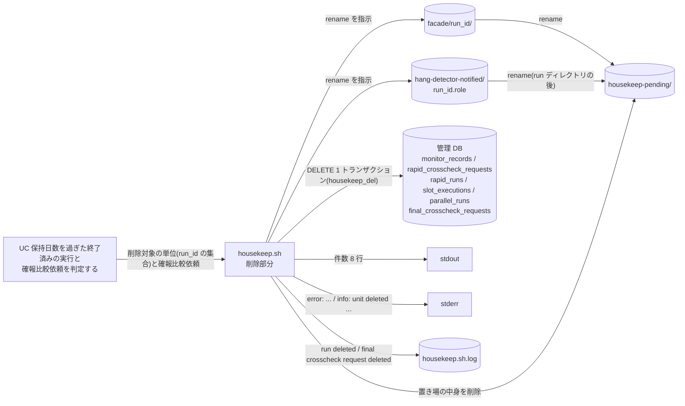
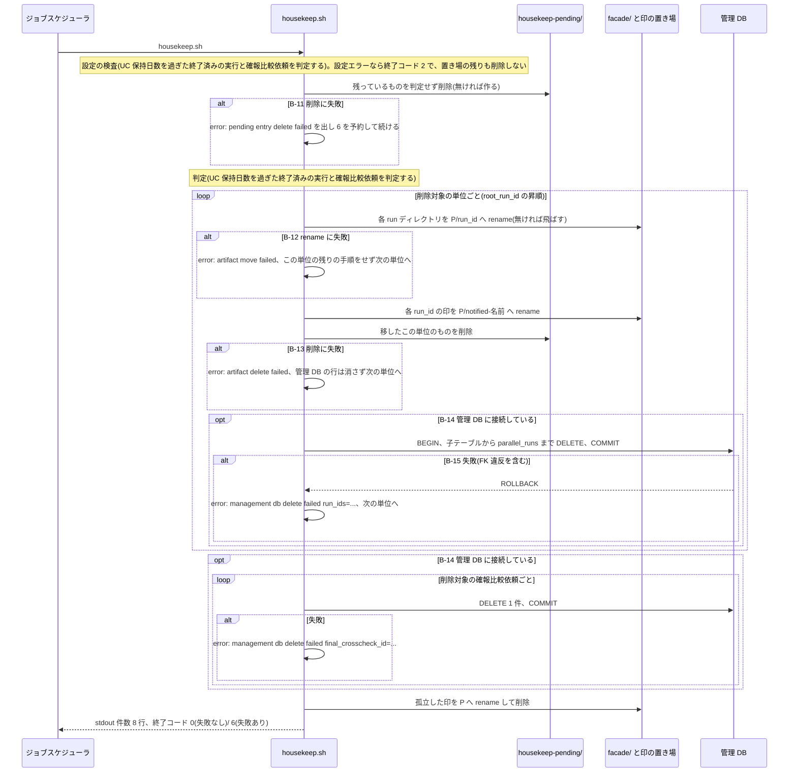

# 成果物と管理 DB の履歴を削除する

## 概要

`housekeep.sh` が、UC「[保持日数を過ぎた終了済みの実行と確報比較依頼を判定する](../保持日数を過ぎた終了済みの実行と確報比較依頼を判定する/spec.md)」で削除対象と判定した実行の単位と確報比較依頼を削除する。
単位ごとに、成果物(run ディレクトリと通知済みの印)を削除待ちの置き場へ移してから削除し、そのあと管理 DB の行をハウスキープ専用 DB ロール housekeep_del で 1 トランザクションとして削除する。
途中で失敗しても、次回の実行で置き場の残りと管理 DB の行を削除し終える。
運用者は削除件数を stdout で、失敗を stderr と終了コードで受け取る。

## データフロー



## シーケンス



## 分岐条件の接続

| 分岐ID | 条件の正本 | 成立 / 不成立の行先 |
|---|---|---|
| B-11 | [条件.tsv](../../../../../../rdra/latest/条件.tsv) の「ハウスキープの削除順序と回復」(置き場の残りは、設定の検査を通った次回の実行で無条件に削除) | 成立: error を出して続ける / 不成立: 判定へ |
| B-12 | [tier-ops](tier-ops.md) の単位の削除手順 | 成立: 単位の残りの手順を行わない |
| B-13 | [tier-ops](tier-ops.md) の単位の削除手順 | 成立: 管理 DB の行を残す |
| B-14 | [条件.tsv](../../../../../../rdra/latest/条件.tsv) の「速報クロスチェック有効判定」「ハウスキープの削除判定」、[契約](../../../_cross-cutting/api/cli-command-contract.yaml) `config_files` の housekeep.env `HOUSEKEEP_DB_CONN_REF` と `shared_rules.housekeep_rules.db_requirement` | 成立(接続参照名がある): 管理 DB の行を削除する / 不成立(管理 DB を一切使わない設置で接続参照名が無い・空): 成果物だけを削除する。管理 DB を使う設置で接続参照名が無い・空なら、判定 UC の設定の検査で終了コード 2 になり、ここへは来ない |
| B-15 | [条件.tsv](../../../../../../rdra/latest/条件.tsv) の「ハウスキープの削除順序と回復」(1 トランザクション)、[契約](../../../_cross-cutting/api/cli-command-contract.yaml) `shared_rules.housekeep_rules.race` | 成立: ロールバックし次回に続ける / 不成立: 単位を削除済みに数える |

stdout / stderr / 終了コードは [条件.tsv](../../../../../../rdra/latest/条件.tsv) の「CLI による提示」に従う。

## 状態遷移参照

この UC は状態を変更しない。
終端状態の行だけを削除する(状態モデルは [状態.tsv](../../../../../../rdra/latest/状態.tsv) の並行稼働実行・slot 実行・クロスチェック依頼)。
削除する行と条件は [_model-summary.yaml](_model-summary.yaml) にある。

## 関連 RDRA モデル

| モデル種別 | 要素名 | 関連 / 適用箇所 |
|-----------|--------|----------------|
| 業務 | ハウスキープ業務 | 所属 |
| BUC | ハウスキープフロー | 所属 |
| アクター | 運用者 | 受益者(削除件数と失敗を受け取る) |
| 外部システム | ジョブスケジューラ | イベント「削除件数と失敗の返却」(stdout / stderr / 終了コード) |
| 情報 | ハウスキープ設定 | `HOUSEKEEP_DB_CONN_REF`(B-14)。housekeep_del の接続参照名 |
| 情報 | 並行稼働実行(parallel_run) | `parallel_runs` の DELETE |
| 情報 | slot 実行 | `slot_executions` の DELETE |
| 情報 | 速報実行(rapid_run) | `rapid_runs` の DELETE |
| 情報 | 速報比較依頼(rapid_crosscheck_request) | `rapid_crosscheck_requests` の DELETE |
| 情報 | 確報比較依頼(final_crosscheck_request) | `final_crosscheck_requests` の DELETE |
| 情報 | Runner Result | run ディレクトリの削除 |
| 情報 | 監視記録 | `monitor_records` の DELETE、通知済みの印の削除 |
| 情報 | 実行ログ | 削除した run_id / final_crosscheck_id を 1 件 1 行で残す |
| 条件 | ハウスキープの削除順序と回復 | B-11 / B-12 / B-13 / B-15 |
| 条件 | CLI による提示 | stdout / stderr / 終了コード |
| 画面 | housekeep 削除結果出力 | stdout の件数 8 行と stderr(CLI 出力) |
| イベント | 削除件数と失敗の返却 | 終了コード 0 / 6 |

## 関連 USDM

| REQ ID | SPEC ID | 対応 BDD Scenario |
|---|---|---|
| REQ-014 | SPEC-014-05 | 前回置き場へ移したあとに失敗した成果物と管理 DB の行を次の実行で削除する(SPEC-014-05) / 前回管理 DB の行の削除に失敗した単位を次の実行で削除する(SPEC-014-05) / 削除し終えた直後にもう一度実行すると削除件数 0 で終わる(SPEC-014-05) / 成果物が消えて管理 DB の行が残った実行の blue・green リランは execution-spec not found で終わる(SPEC-014-05) |
| REQ-014 | SPEC-014-06 | 削除が成功すると削除件数を stdout に出して終了コード 0 で終わる(SPEC-014-06) / 置き場へ移したあとに削除が失敗すると stderr に出して非 0 で終わる(SPEC-014-06) / 管理 DB の行の削除が失敗すると stderr に出して非 0 で終わる(SPEC-014-06) |
| REQ-014 | SPEC-014-07 | ハウスキープ専用 DB ロールは対象 6 テーブルの SELECT と DELETE だけを持つ(SPEC-014-07) / 業務用と参照用の DB ロールは DELETE 権限を持たない(SPEC-014-07) / ハウスキープ設定は認証情報の値を含まず接続参照名だけを持つ(SPEC-014-07) |

## E2E 完了条件(BDD)

例示値は TZ=UTC を前提にする。
`RELAY_GATE_NOW=2026-11-28T12:00:00Z` のとき、保持日数 90 日の cutoff は 2026-08-30T12:00:00 である。
run_id=20260830T110000-JOB001-3f9a1c2e の単位は、すべて終端して completed_at の最大が 2026-08-30T11:20:00 である(削除対象)。

```gherkin
Feature: 成果物と管理 DB の履歴を削除する

  Background:
    Given RELAY_GATE_NOW=2026-11-28T12:00:00Z で TZ=UTC である
    And RAPID_CROSSCHECK_MODE=background で housekeep.env に HOUSEKEEP_DB_CONN_REF=relay_gate_housekeep がある

  Scenario: 前回置き場へ移したあとに失敗した成果物と管理 DB の行を次の実行で削除する(SPEC-014-05)
    Given 前回の housekeep.sh が facade/20260830T110000-JOB001-3f9a1c2e/ を housekeep-pending/20260830T110000-JOB001-3f9a1c2e/ へ移したあとで異常終了し、管理 DB に run_id=20260830T110000-JOB001-3f9a1c2e の行が残っている
    When housekeep.sh を実行する
    Then 終了コード 0 で housekeep-pending/ が空になり、管理 DB に run_id=20260830T110000-JOB001-3f9a1c2e の行が無い
    And stdout に purged_pending_entries=1 と deleted_run_units=1 と deleted_runs=1 が出る

  Scenario: 前回管理 DB の行の削除に失敗した単位を次の実行で削除する(SPEC-014-05)
    Given 前回の housekeep.sh が facade/20260830T110000-JOB001-3f9a1c2e/ と印を削除したあと管理 DB の行の削除に失敗し、管理 DB に同じ run_id の行が残っている
    When housekeep.sh を実行する
    Then 終了コード 0 で管理 DB の parallel_runs / slot_executions / rapid_runs / rapid_crosscheck_requests / monitor_records に run_id=20260830T110000-JOB001-3f9a1c2e の行が無い
    And stderr に error: 行は出ない

  Scenario: 削除し終えた直後にもう一度実行すると削除件数 0 で終わる(SPEC-014-05)
    Given housekeep.sh が単位 1 件と確報比較依頼 1 件を削除して終了コード 0 で終わった直後である
    When 同じ状態のまま housekeep.sh をもう一度実行する
    Then 終了コード 0 で stdout に purged_pending_entries=0 / deleted_run_units=0 / deleted_runs=0 / deleted_final_crosscheck_requests=0 / deleted_orphan_marks=0 が出る
    And 成果物ルートと管理 DB の内容は 1 回目の実行の後と同じである

  Scenario: 成果物が消えて管理 DB の行が残った実行の blue・green リランは execution-spec not found で終わる(SPEC-014-05)
    Given housekeep.sh が facade/20260830T110000-JOB001-3f9a1c2e/ を削除したあと管理 DB の行の削除に失敗し、行が残っている
    When 運用者が background-rerun.sh --source-run-id 20260830T110000-JOB001-3f9a1c2e --role green を実行する
    Then 終了コード 3 で stderr に "error: execution-spec not found run_id=20260830T110000-JOB001-3f9a1c2e path: $RELAY_GATE_ARTIFACT_ROOT/facade/20260830T110000-JOB001-3f9a1c2e/execution-spec.json" が出る
    And 新しい run ディレクトリと管理 DB の行は作られない

  Scenario: 削除が成功すると削除件数を stdout に出して終了コード 0 で終わる(SPEC-014-06)
    Given 削除対象の単位 20260830T110000-JOB001-3f9a1c2e(run 1 件)と、completed_at=2026-08-29T22:00:00 の SUCCEEDED の確報比較依頼 20260829T210000-final-7b2c9e1f があり、保持日数以内の単位が 1 件ある
    When housekeep.sh を実行する
    Then 終了コード 0 で stdout が次の 8 行である
      | retention_days=90                     |
      | cutoff=2026-08-30T12:00:00            |
      | purged_pending_entries=0              |
      | deleted_run_units=1                   |
      | deleted_runs=1                        |
      | deleted_final_crosscheck_requests=1   |
      | deleted_orphan_marks=0                |
      | kept_units=1                          |

  Scenario: 置き場へ移したあとに削除が失敗すると stderr に出して非 0 で終わる(SPEC-014-06)
    Given housekeep-pending/20260830T110000-JOB001-3f9a1c2e/blue/ の削除が権限不足で失敗する
    When housekeep.sh を実行する
    Then 終了コード 6 で stderr に "error: artifact delete failed path: $RELAY_GATE_ARTIFACT_ROOT/housekeep-pending/20260830T110000-JOB001-3f9a1c2e" が出る
    And 管理 DB の run_id=20260830T110000-JOB001-3f9a1c2e の行は残り、stdout に deleted_run_units=0 が出る

  Scenario: 管理 DB の行の削除が失敗すると stderr に出して非 0 で終わる(SPEC-014-06)
    Given run_id=20260830T110000-JOB001-3f9a1c2e の行の削除中に管理 DB がエラーを返す
    When housekeep.sh を実行する
    Then 終了コード 6 で stderr に "error: management db delete failed run_ids=20260830T110000-JOB001-3f9a1c2e" が出る
    And 管理 DB の run_id=20260830T110000-JOB001-3f9a1c2e の行はすべて残る(ロールバック)

  Scenario: 削除中に速報比較依頼だけのリランで新しい run ができたら単位を残す
    Given 判定のあと管理 DB の削除の前に、background-rerun.sh --role rapid-crosscheck が parent_run_id=20260830T110000-JOB001-3f9a1c2e の run_id=20261128T120000-JOB001-0badcafe を作った
    When housekeep.sh が単位 20260830T110000-JOB001-3f9a1c2e の parallel_runs を DELETE する
    Then 外部キー違反でロールバックし、終了コード 6 で stderr に "error: management db delete failed run_ids=20260830T110000-JOB001-3f9a1c2e" が出る
    And 次の housekeep.sh --verbose では stderr に "info: unit kept root_run_id=20260830T110000-JOB001-3f9a1c2e reason=unfinished" が出て、両方の run の管理 DB の行が残る

  Scenario: ハウスキープ専用 DB ロールは対象 6 テーブルの SELECT と DELETE だけを持つ(SPEC-014-07)
    Given 構築済みの管理 DB である
    When housekeep_del の権限を確認する
    Then parallel_runs / slot_executions / rapid_runs / rapid_crosscheck_requests / final_crosscheck_requests / monitor_records の 6 テーブルそれぞれに SELECT と DELETE があり、SELECT と DELETE 以外の権限は無い

  Scenario: 業務用と参照用の DB ロールは DELETE 権限を持たない(SPEC-014-07)
    Given 構築済みの管理 DB である
    When app_rw と ops_ro の権限を確認する
    Then どちらも 6 テーブルのいずれにも DELETE 権限を持たない

  Scenario: ハウスキープ設定は認証情報の値を含まず接続参照名だけを持つ(SPEC-014-07)
    Given CLI 契約の config_files に housekeep.env がある
    When housekeep.env のキーを確認する
    Then キーは HOUSEKEEP_RETENTION_DAYS と HOUSEKEEP_DB_CONN_REF だけで、HOUSEKEEP_DB_CONN_REF は接続情報の参照名であり、パスワードなどの認証情報の値を置くキーは無い
```

成果物が消えて管理 DB の行が残った実行に `background-rerun.sh --role rapid-crosscheck` を指定した場合は、execution-spec.json を読まないため、管理 DB の行が残っている間は依頼の再作成に成功する。
新しい run は同じ単位に加わり、その run が終わって保持日数を過ぎるまで単位ごと残る。

## ティア別仕様

- [実行監視・復旧ティア(housekeep.sh の削除部分)](tier-ops.md)
- [CLI コマンド契約](../../../_cross-cutting/api/cli-command-contract.yaml): `housekeep.sh`、`shared_rules.housekeep_rules`、`shared_rules.artifact_root_entries`、`background-rerun.sh`
- [RDB スキーマ](../../../_cross-cutting/datastore/rdb-schema.yaml): 6 テーブルの外部キー(on_delete は RESTRICT)、ハウスキープ専用 DB ロール housekeep_del
