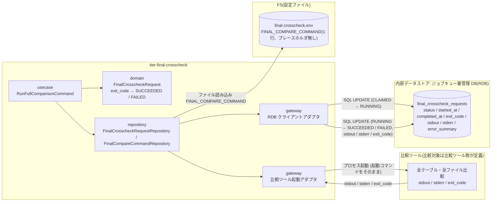
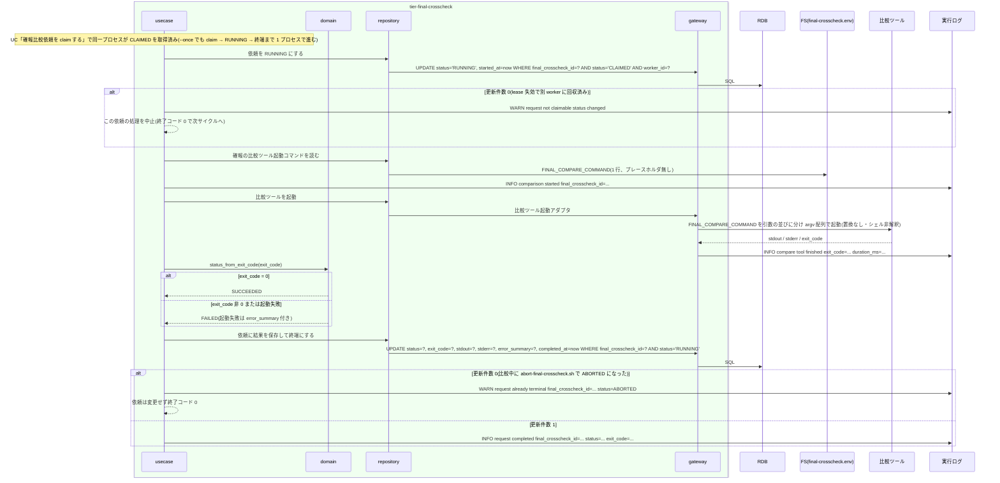

# 比較ツールで日次全量比較を実行して結果を保存する

## 概要

claim 済みの確報比較依頼を `final-crosscheck-worker.sh` が RUNNING にし、自分の設定ファイル(final-crosscheck.env)に 1 行で定義された確報の比較ツール起動コマンド(FINAL_COMPARE_COMMAND)を CLI 契約 `shared_rules.compare_command_argv` に従って空白区切りで引数の並び(argv)に分け(プレースホルダ無しのため置換はしない)、引数の並びをそのまま渡して起動し(文字列をシェルに解釈させない。`eval` / `bash -c` / `sh -c` / 引用符なし展開を使わない)、全テーブル・全ファイルの日次全量比較を行う。比較ツールの stdout / stderr / exit_code を依頼レコードへ保存し、exit_code 0 なら SUCCEEDED、非 0 または起動失敗なら FAILED にする。worker が読む入力は管理 DB の依頼レコードと自分の設定ファイルだけで、比較ツールにファイルパス(対象カタログのパスなど)を渡さず、worker 側で成果物ファイルを保存しない。runner と worker は別ネットワークセグメントで動き、worker は runner 側のファイルパスを読めない。この UC は確報の比較ツール起動コマンドの設定(final-crosscheck.env の FINAL_COMPARE_COMMAND)とその検証(`validate-config.sh --final-crosscheck`)も所有する。

## データフロー



| レイヤー | データモデル | 変換内容 |
|---------|------------|---------|
| usecase | RunFullComparisonCommand(final_crosscheck_id, worker_id) | RUNNING 遷移 → 比較ツール起動 → stdout / stderr / exit_code を依頼へ保存 → 終端遷移 |
| domain | FinalCrosscheckRequest | `status_from_exit_code(exit_code)` = 0 → SUCCEEDED、非 0 → FAILED。起動失敗(exit_code 取得不能)→ FAILED + error_summary |
| repository | FinalCompareCommandRepository | final-crosscheck.env から確報の比較ツール起動コマンド(FINAL_COMPARE_COMMAND)を 1 行読む。比較対象の設定(対象カタログ・ジョブ ID ごとの比較定義)は読まない |
| gateway | 比較ツール起動アダプタ | FINAL_COMPARE_COMMAND を shared_rules.compare_command_argv で引数の並びに分け(置換なし)、argv 配列のまま起動(シェルに解釈させない)。stdout / stderr を受け取り、exit_code を取得(ファイルへは保存しない) |
| gateway | RDB クライアントアダプタ | 条件付き UPDATE(RUNNING、終端)。比較ツールの stdout / stderr / exit_code を依頼レコードの列へ保存 |

## 処理フロー



## 確報の比較ツール起動コマンドの設定と検証

この UC は、worker が読む確報の比較ツール起動コマンド(final-crosscheck.env の `FINAL_COMPARE_COMMAND`)の設定と、その検証(`validate-config.sh --final-crosscheck`)を所有する。

- **設定**: `final-crosscheck.env` に `FINAL_COMPARE_COMMAND` を 1 行の文字列として置く。確報の起動コマンドにプレースホルダは無い(worker は shared_rules.compare_command_argv で引数の並びに分け、置換せずそのまま argv で起動する)。比較対象(テーブル・ファイル)の一覧やジョブ ID ごとの比較定義は relay-gate の設定に持たず、適用側が比較ツール側で定義する
- **検証**: `validate-config.sh --final-crosscheck <path>` が `FINAL_COMPARE_COMMAND` を検証する。検証はコマンド部分(先頭の語)だけに行い、引数部分の内容は検査しない。残す検証は 1 点だけ: コマンド部分が絶対パスで、存在し、実行可能であること(確報はプレースホルダ無しのため `{job_id}` の検査はしない)
- **stdout(固定順)**: `config=final-crosscheck` / `path: <path>` / `command_path: <FINAL_COMPARE_COMMAND の先頭の語>` / `status=valid|invalid` / `violations=N`(invalid 時)。入力の守備範囲の違反で値を使わないときは `command_path: -`(CLI 契約 `config_input_rules.env_files`)
- **違反文言(終了コード 2)**: 入力の守備範囲の違反(NUL / UTF-8 / BOM / CR / invalid line / 同じキーの重複 `error: duplicate key key=<KEY> lines=<n1,n2,...> path: ...`。文言と報告の順は CLI 契約 `config_input_rules.env_files`。この違反があるときは下記の検証を行わない)/ コマンド部分が絶対パスでない `error: path is not absolute key=FINAL_COMPARE_COMMAND path=...` / コマンド部分が存在しない・実行不可 `error: file not executable key=FINAL_COMPARE_COMMAND path=...`
- 検証の所有 tier は tier-facade(validate-config.sh 本体。arch CTR-007)。契約の正本は `_cross-cutting/api/cli-command-contract.yaml` の `validate-config.sh --final-crosscheck`

## バリエーション一覧

| バリエーション名 | 値 | 処理内容 | 適用 tier | 適用箇所 |
|----------------|---|---------|----------|---------|
| 比較ツール終了コード | 0(比較 OK) | 依頼を SUCCEEDED にする | tier-final-crosscheck | `status_from_exit_code` |
| 比較ツール終了コード | 3(比較 NG・警告終了) | 依頼を FAILED にする(exit_code=3 を保存) | tier-final-crosscheck | `status_from_exit_code` |
| 比較ツール終了コード | 6(実行エラー・エラー終了) | 依頼を FAILED にする(exit_code=6 を保存) | tier-final-crosscheck | `status_from_exit_code` |
| クロスチェック依頼状態 | RUNNING | 比較開始時 | tier-final-crosscheck | `mark_running` |
| クロスチェック依頼状態 | SUCCEEDED / FAILED | 比較終了時 | tier-final-crosscheck | `complete_request` |

## 分岐条件一覧

| 条件名 | 判定ルール | 適用 tier | 適用箇所 | BDD Scenario |
|--------|----------|----------|---------|-------------|
| 依頼状態遷移規則 | CLAIMED → RUNNING(比較開始)、RUNNING → SUCCEEDED(exit_code 0)/ FAILED(非 0 または起動失敗)。条件付き UPDATE で現在状態を WHERE に含める。RUNNING 遷移の更新件数 0(lease 失効で別 worker に回収済み)は比較ツールを起動しない。終端遷移の更新件数 0(比較中に ABORTED)は依頼を変更せず終了コード 0 | tier-final-crosscheck | `mark_running` / `complete_request` | exit_code=0 で SUCCEEDED になる / lease 失効で別 worker に回収された依頼は RUNNING にしない / 比較中に ABORTED された依頼の終端 UPDATE は 0 件になる |
| 比較ツール終了コードの対応 | 0 → SUCCEEDED、3 → FAILED、6 → FAILED、その他の非 0 → FAILED。値は変換せず exit_code 列に保存 | tier-final-crosscheck | `status_from_exit_code` | exit_code=3 で FAILED になる |
| 適用側で定義する事項 | 比較対象(テーブル・ファイル)の定義は比較ツール側が所有する。relay-gate が持つ確報の設定は比較ツール起動コマンド 1 行(FINAL_COMPARE_COMMAND)だけで、worker はそれをそのまま起動する。worker は依頼レコードと final-crosscheck.env 以外の入力(対象カタログのファイルなど)を読まない | tier-final-crosscheck | `FinalCompareCommandRepository` / 比較ツール起動アダプタ | 依頼レコードと設定以外の入力を読まない |
| 起動方式(シェルに解釈させない) | FINAL_COMPARE_COMMAND を shared_rules.compare_command_argv で空白区切りの引数の並びに分け、その並びをそのまま渡して起動する(`"${argv[@]}"` 相当)。クォート・`$`・`;` 等のシェル記法を解釈せず、`eval` / `bash -c` / `sh -c` / 引用符なし展開で起動しない。固定オプション・ファイルパスを追記しない | tier-final-crosscheck | 比較ツール起動アダプタ | 起動コマンドは引数の並びに分けてそのまま渡し、シェルに解釈させない |
| 確報の起動コマンドの検証 | `validate-config.sh --final-crosscheck` は FINAL_COMPARE_COMMAND のコマンド部分(先頭の語 = shared_rules.compare_command_argv で分けた先頭の引数)が絶対パスで存在・実行可能であることだけを検証する(プレースホルダ無しのため {job_id} / {params} 検査なし) | tier-facade | `validate-config.sh --final-crosscheck` | 確報の起動コマンドが絶対パスで実行可能なら valid になる / 絶対パスでない起動コマンドは invalid になる |

## 計算ルール一覧

| 計算名 | 入力情報 | 計算式/ロジック | 出力情報 | 適用 tier |
|--------|---------|---------------|---------|----------|
| exit_code → 依頼状態 | 比較ツール実行結果.exit_code | 0 → SUCCEEDED、それ以外 → FAILED。exit_code が取得できない(起動失敗)→ FAILED、exit_code=6、error_summary="launch failed" | 確報比較依頼.status | tier-final-crosscheck |
| 比較ツール起動コマンド | final-crosscheck.env.FINAL_COMPARE_COMMAND | 1 行の文字列を shared_rules.compare_command_argv に従って空白区切りで引数の並びに分け(プレースホルダ置換なし。クォート・`$`・`;` 等のシェル記法は解釈しない)、その並びをそのまま渡して起動する(文字列をシェルに解釈させない)。固定オプション・ファイルパスを追記しない(cli-command-contract.yaml external_interfaces「比較ツール(確報)」) | 起動コマンドの引数の並び(argv) | tier-final-crosscheck |

## 状態遷移一覧

| 状態モデル | 遷移元 | 遷移先 | トリガー | 事前条件 | 事後処理 | 適用 tier |
|-----------|--------|--------|---------|---------|---------|----------|
| クロスチェック依頼 | CLAIMED | RUNNING | worker の比較開始 | status=CLAIMED かつ worker_id が自分 | started_at 設定、比較ツール起動 | tier-final-crosscheck |
| クロスチェック依頼 | RUNNING | SUCCEEDED | 比較ツールが exit_code 0 で終了 | status=RUNNING | stdout / stderr / exit_code / completed_at を保存 | tier-final-crosscheck |
| クロスチェック依頼 | RUNNING | FAILED | 比較ツールが非 0 で終了、または起動失敗 | status=RUNNING | stdout / stderr / exit_code / error_summary / completed_at を保存 | tier-final-crosscheck |
| クロスチェック依頼 | ABORTED | ABORTED(変更なし) | 比較中に abort-final-crosscheck.sh で中止された後の終端 UPDATE | status=ABORTED(WHERE status='RUNNING' に該当せず更新件数 0) | 実行ログに `WARN request already terminal`。依頼は変更しない | tier-final-crosscheck |

## 関連 RDRA モデル

| モデル種別 | 要素名 | 関連 |
|-----------|--------|------|
| 業務 | クロスチェック業務 | この UC が属する業務 |
| BUC | 確報クロスチェックフロー | この UC を含む BUC |
| アクター | 運用者 | 受益者 |
| 情報 | 確報比較依頼(final_crosscheck_request) | RUNNING → 終端、結果の保存先 |
| 情報 | 確報クロスチェック worker 設定(final-crosscheck.env) | 確報の比較ツール起動コマンド 1 行 |
| 情報 | 比較ツール実行結果 | stdout / stderr / exit_code |
| 情報 | 実行ログ | worker の実行ログ |
| 状態 | クロスチェック依頼 | CLAIMED → RUNNING → SUCCEEDED / FAILED |
| 条件 | 依頼状態遷移規則 | 遷移規則 |
| 条件 | 比較ツール終了コードの対応 | 0 / 3 / 6 の対応 |
| 条件 | 適用側で定義する事項 | 比較対象は比較ツール側、relay-gate は起動コマンド 1 行だけ所有 |
| 画面 | final-crosscheck worker 比較実行出力(→ CLI 出力) | 実行ログの `comparison started` / `request completed` |
| イベント | 日次全量比較の起動 | 比較ツールのプロセス起動 |
| イベント | 確報結果の依頼レコード保存 | 管理 DB への UPDATE |
| 外部システム | 比較ツール | 全量比較の実行 |
| 内部データストア | ジョブキュー兼管理 DB(RDB) | 依頼レコード(relay-gate 内部の構成要素。外部システムではない) |

## 関連 USDM

| REQ ID | SPEC ID | 対応 BDD Scenario |
|--------|---------|------------------|
| REQ-006 | SPEC-006-02 | exit_code=0 で SUCCEEDED になる(SPEC-006-02) / exit_code=3 で FAILED になる(SPEC-006-02) / 依頼レコードと設定以外の入力を読まない(SPEC-006-02) / 起動コマンドは引数の並びに分けてそのまま渡し、シェルに解釈させない |
| REQ-007 | SPEC-007-01 | exit_code=0 で SUCCEEDED になる(SPEC-006-02) |
| REQ-007 | SPEC-007-03 | exit_code=3 で FAILED になる(SPEC-006-02) |
| REQ-003 | SPEC-003-03 | 起動失敗でも依頼を FAILED にする(SPEC-003-03) |
| REQ-004 | SPEC-004-04 | 確報の起動コマンドが絶対パスで実行可能なら valid になる / 絶対パスでない起動コマンドは invalid になる ※ 受け入れ基準 9(確報はプレースホルダ無しで終了コード 0)= 前者、基準 6 の確報側(コマンド部分が絶対パスでない)= 後者。基準 10(引数部分の任意文字列)は速報側の UC「クロスチェックのジョブマップと比較定義を定義する」で判定する |
| REQ-011 | SPEC-011-03 | exit_code=0 で SUCCEEDED になる(SPEC-006-02) ※ 比較ツールの stdout / stderr / exit_code を確報比較依頼レコードの結果列へ保存する(識別子・状態・時刻・結果だけを持つ) |

> 機械可読の正本は `spec-event.yaml` の `use_cases[].usdm`(本表と同内容)。「対応 BDD Scenario」列は本 UC の `Scenario:` 名(接尾の SPEC ID を含む完全名)を「 / 」で区切って列挙し、Scenario 名以外の補足は「※」以降に置く。区切りは人が読む用で、Scenario 名自体に「 / 」を含むものがあるため機械分割には使わず、機械照合は `spec-event.yaml` の `scenarios[]` を使う。

## E2E 完了条件(BDD)

### 正常系

```gherkin
Feature: 比較ツールで日次全量比較を実行して結果を保存する

  Scenario: exit_code=0 で SUCCEEDED になる(SPEC-006-02)
    Given final_crosscheck_requests に final_crosscheck_id=20260830T210000-final-7b2c9e1f status=REQUESTED requested_at=2026-08-30T21:00:00 の行がある(worker は自分がそのサイクルで claim した依頼だけを比較実行に進めるため、Given は REQUESTED に置き、claim → RUNNING → 終端までを 1 プロセスで検証する)
    And final-crosscheck.env の FINAL_COMPARE_COMMAND が終了コード 0、stdout "all 42 targets matched\n" を返す比較ツールを指す
    When final-crosscheck-worker.sh --once --worker-id final-worker-01 を実行する
    Then 該当行は status=SUCCEEDED worker_id=final-worker-01 exit_code=0 stdout="all 42 targets matched\n" stderr="" になり started_at と completed_at が設定される
    And worker は終了コード 0 で終了する

  Scenario: exit_code=3 で FAILED になる(SPEC-006-02)
    Given 同じ依頼が status=REQUESTED である
    And FINAL_COMPARE_COMMAND が終了コード 3、stdout "diff found: 12 rows\n"、stderr "warn: table T_ORDER differs\n" を返す比較ツールを指す
    When final-crosscheck-worker.sh --once --worker-id final-worker-01 を実行する
    Then 該当行は status=FAILED exit_code=3 stdout="diff found: 12 rows\n" stderr="warn: table T_ORDER differs\n" になる
    And worker は終了コード 0 で終了する

  Scenario: 依頼レコードと設定以外の入力を読まない(SPEC-006-02)
    Given 同じ依頼が status=REQUESTED である
    And final-crosscheck.env の FINAL_COMPARE_COMMAND が、起動時の引数を記録してから終了コード 0 で終わる比較ツールを指す
    When final-crosscheck-worker.sh --once --worker-id final-worker-01 を実行する
    Then 比較ツールは FINAL_COMPARE_COMMAND の文字列と完全一致する引数だけで起動され、ファイルパス(対象カタログのパスなど)は追加されない
    And worker は比較実行中に final_crosscheck_requests の該当行と final-crosscheck.env 以外のファイルを開かない

  Scenario: 起動コマンドは引数の並びに分けてそのまま渡し、シェルに解釈させない
    Given final-crosscheck.env の FINAL_COMPARE_COMMAND が `/opt/compare/final.sh --note a;b --glob *` で、/opt/compare/final.sh は受け取った引数を 1 行 1 引数で stdout に出して終了コード 0 を返す
    And 同じ依頼が status=REQUESTED である
    When final-crosscheck-worker.sh --once --worker-id final-worker-01 を実行する
    Then 比較ツールは `/opt/compare/final.sh`、`--note`、`a;b`、`--glob`、`*` をそれぞれ 1 引数として受け取る(空白区切りで引数の並びに分けただけで、`;` はコマンド区切りに解釈されず `*` はファイル名展開されない。argv 配列で起動し eval / bash -c / sh -c を使わない)
    And 依頼は status=SUCCEEDED exit_code=0 になる

  Scenario: 確報の起動コマンドが絶対パスで実行可能なら valid になる
    Given final-crosscheck.env の FINAL_COMPARE_COMMAND が "/opt/compare/final.sh --full" で、/opt/compare/final.sh が存在し実行可能である
    When validate-config.sh --final-crosscheck /etc/relay-gate/final-crosscheck.env を実行する
    Then 終了コード 0 で stdout に "config=final-crosscheck"、"command_path: /opt/compare/final.sh"、"status=valid" が出る
    And stderr に error 行は出ない(プレースホルダが 1 つも無くても違反にならない)
```

### 異常系

```gherkin
  Scenario: 起動失敗でも依頼を FAILED にする(SPEC-003-03)
    Given 同じ依頼が status=REQUESTED である
    And final-crosscheck.env の FINAL_COMPARE_COMMAND が存在しないパス /opt/compare/missing.sh を指す
    When final-crosscheck-worker.sh --once --worker-id final-worker-01 を実行する
    Then 該当行は status=FAILED exit_code=6 error_summary="launch failed" になる
    And stderr に "error: compare tool launch failed final_crosscheck_id=20260830T210000-final-7b2c9e1f command=/opt/compare/missing.sh" が含まれる
    And worker は終了コード 6 で終了する

  Scenario: 絶対パスでない起動コマンドは invalid になる
    Given final-crosscheck.env の FINAL_COMPARE_COMMAND が "compare-final.sh --full"(相対パス)である
    When validate-config.sh --final-crosscheck /etc/relay-gate/final-crosscheck.env を実行する
    Then 終了コード 2 で stderr に "error: path is not absolute key=FINAL_COMPARE_COMMAND path=compare-final.sh" が出る
    And stdout に "config=final-crosscheck"、"status=invalid"、"violations=1" が出る

  Scenario: lease 失効で別 worker に回収された依頼は RUNNING にしない
    Given final-worker-01 が該当依頼を claim した後、RUNNING 遷移前に lease が失効し、final-worker-02 の poll で該当行が status=CLAIMED worker_id=final-worker-02 に回収されている(usecase 単位で検証する: claim と RUNNING 遷移の間に回収 UPDATE を発行した DB 状態を用意する。abort-final-crosscheck.sh は RUNNING のみ中止できるため、CLAIMED の依頼が ABORTED になる経路は無い)
    When final-worker-01 が RUNNING への条件付き UPDATE(WHERE status='CLAIMED' AND worker_id='final-worker-01')を発行する
    Then 更新件数 0 のため比較ツールを起動せず、実行ログに "WARN request not claimable status changed final_crosscheck_id=20260830T210000-final-7b2c9e1f" を残す
    And 該当行は status=CLAIMED worker_id=final-worker-02 のままで、final-worker-01 は終了コード 0 で終了する

  Scenario: 比較中に ABORTED された依頼の終端 UPDATE は 0 件になる
    Given 同じ依頼が status=REQUESTED である
    And FINAL_COMPARE_COMMAND が起動後に停止シグナルを受けるまで待機するスタブを指す
    And final-crosscheck-worker.sh --once --worker-id final-worker-01 を起動し、該当行が status=RUNNING になった後に abort-final-crosscheck.sh --run-id 20260830T210000-final-7b2c9e1f --yes で status=ABORTED にする
    When スタブに停止シグナルを送り比較ツールが終了する
    Then 終端の条件付き UPDATE(WHERE status='RUNNING')は 0 件で、該当行は status=ABORTED exit_code=NULL のままである
    And 実行ログに "WARN request already terminal final_crosscheck_id=20260830T210000-final-7b2c9e1f status=ABORTED" が残り、worker は終了コード 0 で終了する
```

## ティア別仕様

- [確報クロスチェックティア](tier-final-crosscheck.md)

### 統合 API Spec

- [CLI コマンド契約](../../../_cross-cutting/api/cli-command-contract.yaml)(`final-crosscheck-worker.sh` / `validate-config.sh --final-crosscheck`)
- [AsyncAPI Spec](../../../_cross-cutting/api/asyncapi.yaml)(`channels.final-crosscheck-requests` subscribe)
