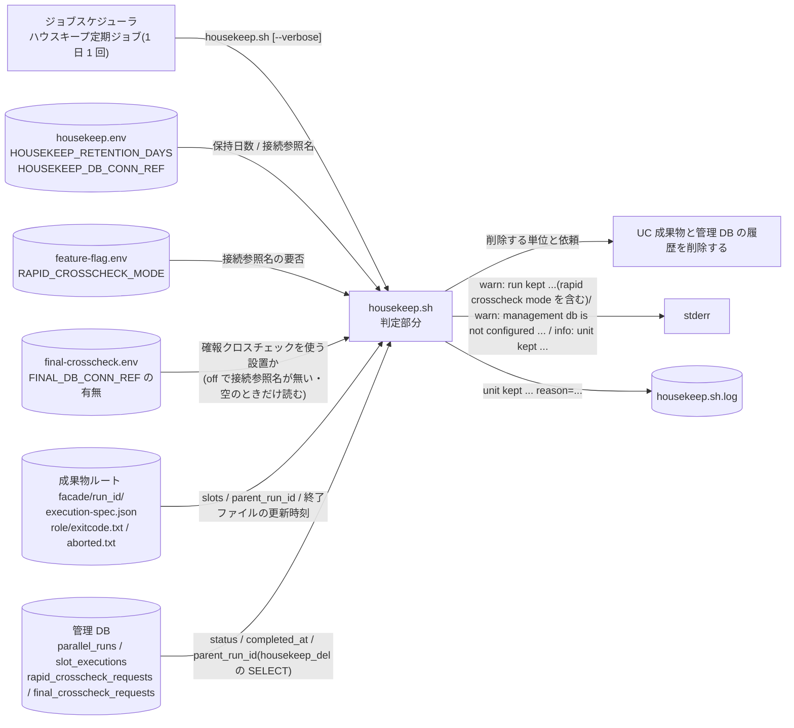
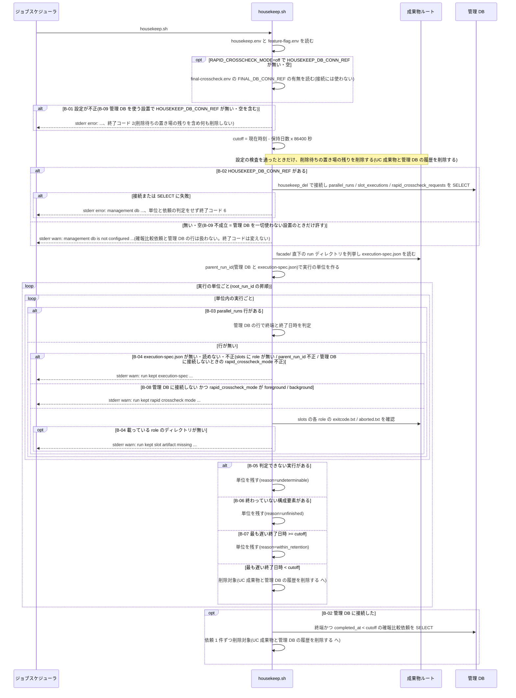

# 保持日数を過ぎた終了済みの実行と確報比較依頼を判定する

## 概要

ジョブスケジューラのハウスキープ定期ジョブ(1 日 1 回)が `housekeep.sh` を起動する。
`housekeep.sh` はハウスキープ設定の保持日数(既定 90 日)で期限 cutoff を決め、成果物ルートと管理 DB を毎回走査して、リランの親子をまとめた実行の単位と確報比較依頼 1 件ごとに、削除するか残すかを判定する。
削除すると判定した単位と依頼は、UC「[成果物と管理 DB の履歴を削除する](../成果物と管理%20DB%20の履歴を削除する/spec.md)」が同じ実行の中で削除する。
業務ジョブ(`facade.sh`)は判定も削除も行わない。

## データフロー



## シーケンス



## 分岐条件の接続

| 分岐ID | 条件の正本 | 成立 / 不成立の行先 |
|---|---|---|
| B-01 | [tier-facade](tier-facade.md) の保持日数の検証規則、[tier-ops](tier-ops.md) の起動時検証 | 成立: 終了コード 2 で終了 / 不成立: cutoff を決める |
| B-02 | [条件.tsv](../../../../../../rdra/latest/条件.tsv) の「速報クロスチェック有効判定」「ハウスキープの削除判定」、[契約](../../../_cross-cutting/api/cli-command-contract.yaml) `config_files` の housekeep.env `HOUSEKEEP_DB_CONN_REF` | 成立(接続参照名がある): RAPID_CROSSCHECK_MODE によらず管理 DB の行と確報比較依頼も判定する / 不成立(接続参照名が無い・空。B-09 不成立のときだけここへ来る): 成果物だけで判定し、`warn: management db is not configured ...` を 1 行出す(終了コードは変えない) |
| B-03 | [契約](../../../_cross-cutting/api/cli-command-contract.yaml) `shared_rules.housekeep_rules.member_source` | 成立: 管理 DB の行で判定 / 不成立: 成果物だけで判定 |
| B-04 | [条件.tsv](../../../../../../rdra/latest/条件.tsv) の「ハウスキープの削除判定」(判定できない成果物ディレクトリ)、[tier-ops](tier-ops.md) の成果物だけの判定表の順 1・2・4 | 成立(execution-spec.json が無い・読めない・不正、または載っている role のディレクトリが無い): warn を出し単位を残す / 不成立: 終了ファイルで判定。判定の順は tier-ops の表の順(順 1・2 → B-08 → 順 4) |
| B-05 | [tier-ops](tier-ops.md) の判定表 | 成立: 単位を残す |
| B-06 | [条件.tsv](../../../../../../rdra/latest/条件.tsv) の「ハウスキープの削除判定」(終わっていない構成要素) | 成立: 経過日数にかかわらず単位を残す |
| B-07 | [条件.tsv](../../../../../../rdra/latest/条件.tsv) の「ハウスキープの削除判定」(最も遅い終了日時と保持日数) | 成立: 単位を残す / 不成立: 削除対象 |
| B-08 | [条件.tsv](../../../../../../rdra/latest/条件.tsv) の「ハウスキープの削除判定」(管理 DB に接続しないとき)、[契約](../../../_cross-cutting/api/cli-command-contract.yaml) `shared_rules.housekeep_rules.member_source` | 成立(管理 DB に接続せず、execution-spec.json の `rapid_crosscheck_mode` が foreground / background): `warn: run kept rapid crosscheck mode ...` を出し、判定できないものとして単位を残す / 不成立: 終了ファイルで判定 |
| B-09 | [条件.tsv](../../../../../../rdra/latest/条件.tsv) の「ハウスキープの削除判定」(接続参照名が必須の設置)、[契約](../../../_cross-cutting/api/cli-command-contract.yaml) `shared_rules.housekeep_rules.db_requirement` | 成立(管理 DB を使う設置 = RAPID_CROSSCHECK_MODE が off 以外、または確報クロスチェックを使う設置(final-crosscheck.env があり FINAL_DB_CONN_REF が欠落していない)で、接続参照名が無い・空): `error: option required option=HOUSEKEEP_DB_CONN_REF path: ...` で終了コード 2(B-01。削除待ちの置き場の残りを含め何も削除しない) / 不成立: B-02 へ |

確報クロスチェックを使う設置かの判定(B-09)は、既存の確報系コマンド(`abort-final-crosscheck.sh` の「final-crosscheck.env 不在または FINAL_DB_CONN_REF 欠落 = 管理 DB なし」)と同じ規則の裏返しである。この判定は final-crosscheck.env が入力の守備範囲の検査(契約 `config_input_rules.env_files`)を通った後に行い、invalid line・同じキーの重複(例: `FINAL_DB_CONN_REF=` が 2 行)は要否の判定に進まず終了コード 2 になる。
final-crosscheck.env は、RAPID_CROSSCHECK_MODE=off で接続参照名が無い・空のときだけ読む。接続参照名があれば読まない。

管理 DB に接続しないとき(B-02 不成立。管理 DB を一切使わない設置で接続参照名が無い・空)は、確報比較依頼を扱わず、B-08 を slot のディレクトリと終了ファイルによる判定(B-04 のうち role のディレクトリが無い場合、B-06、B-07)より優先する(要求 SPEC-014-08)。execution-spec.json が無い・不正(B-04 の前半)は B-08 より先に判定する。

実行の単位のつながりは [条件.tsv](../../../../../../rdra/latest/条件.tsv) の「リラン系譜の追跡」を使う。
単位の作り方と判定表は [tier-ops](tier-ops.md) にある。

## 状態遷移参照

この UC は状態を変更しない。
終端の判定に使う状態は次の状態モデルの終端状態である。

| 状態モデル([状態.tsv](../../../../../../rdra/latest/状態.tsv)) | 終端として扱う状態 |
|---|---|
| 並行稼働実行 | COMPLETED / ABORTED |
| slot 実行 | SUCCEEDED / FAILED / ABORTED |
| クロスチェック依頼(速報比較依頼・確報比較依頼) | SUCCEEDED / FAILED / ABORTED |

成果物だけで判定する slot の終端は [条件.tsv](../../../../../../rdra/latest/条件.tsv) の「slot 実行の状態導出規則」に従い、exitcode.txt または aborted.txt があることで決める。

## 関連 RDRA モデル

| モデル種別 | 要素名 | 関連 / 適用箇所 |
|-----------|--------|----------------|
| 業務 | ハウスキープ業務 | 所属 |
| BUC | ハウスキープフロー | 所属 |
| アクター | 運用者 | 受益者(定期ジョブを登録し、stdout / stderr を受け取る) |
| アクター | 基盤適用設計者 | ハウスキープ設定の所有者 |
| 外部システム | ジョブスケジューラ | イベント「定期ハウスキープジョブの起動」 |
| 情報 | ハウスキープ設定 | housekeep.env の `HOUSEKEEP_RETENTION_DAYS` / `HOUSEKEEP_DB_CONN_REF`(B-01 / B-02 / B-09) |
| バリエーション | 設定所有区分「確報クロスチェック worker 設定」 | final-crosscheck.env の `FINAL_DB_CONN_REF` の有無で、確報クロスチェックを使う設置かを決める(B-09) |
| 情報 | 並行稼働実行(parallel_run) | `parallel_runs.status / completed_at / parent_run_id`(B-03 / B-06) |
| 情報 | slot 実行 | `slot_executions.status / completed_at`、成果物の exitcode.txt / aborted.txt(B-04 / B-06) |
| 情報 | 速報実行(rapid_run) | 単位の構成要素として run_id で特定する。終端の判定には使わない |
| 情報 | 速報比較依頼(rapid_crosscheck_request) | `rapid_crosscheck_requests.status / completed_at`(B-06) |
| 情報 | 確報比較依頼(final_crosscheck_request) | `final_crosscheck_requests.status / completed_at`(依頼ごとの判定) |
| 情報 | 実行設定(execution-spec) | `execution-spec.json` の `slots` / `parent_run_id`(B-04)、`rapid_crosscheck_mode`(B-08) |
| 情報 | Runner Result | exitcode.txt / aborted.txt の有無と更新時刻 |
| 情報 | 監視記録 | 削除対象の単位に含まれる行(判定には使わない) |
| 条件 | ハウスキープの削除判定 | B-02 / B-04 / B-06 / B-07 / B-08 / B-09 |
| 条件 | リラン系譜の追跡 | 実行の単位の作り方 |
| 条件 | 速報クロスチェック有効判定 | B-02 / B-08 / B-09 |
| 画面 | housekeep 判定出力 | stderr の warn / info 行(CLI 出力) |
| イベント | 定期ハウスキープジョブの起動 | `housekeep.sh` の起動 |

## 関連 USDM

| REQ ID | SPEC ID | 対応 BDD Scenario |
|---|---|---|
| REQ-014 | SPEC-014-01 | 保持日数を指定しないと 90 日を過ぎた終了済みの実行だけを削除する(SPEC-014-01) / 保持日数が正の整数でない設定は設定検証で拒否する(SPEC-014-01) / 業務ジョブの起動では期限切れの実行を削除しない(SPEC-014-01) / ハウスキープ設定の所有者は基盤適用設計者である(SPEC-014-01) |
| REQ-014 | SPEC-014-02 | すべて終端して保持日数を過ぎた実行は成果物・管理 DB の行・通知済みの印がすべて無くなる(SPEC-014-02) / すべて終端しても保持日数以内の実行は残る(SPEC-014-02) / リラン先が保持日数以内ならリラン元も残る(SPEC-014-02) / リランの親子すべてが保持日数を過ぎたら親子すべてが無くなる(SPEC-014-02) |
| REQ-014 | SPEC-014-03 | background slot が RUNNING の実行は残る(SPEC-014-03) / 速報比較依頼が終わっていない実行は残る(SPEC-014-03) / off で起動対象の slot がすべて終了し保持日数を過ぎた実行は成果物と印が無くなる(SPEC-014-03) / off で起動対象の slot がすべて終了しても保持日数以内の実行は残る(SPEC-014-03) / off で終了ファイルが無い slot がある実行は残る(SPEC-014-03) / mode が off の slot は判定に含めない(SPEC-014-03) / execution-spec.json か起動対象の slot のディレクトリが無い実行は warn を出して残る(SPEC-014-03) / 速報比較依頼だけのリランを含む親子が終端して保持日数を過ぎたら無くなる(SPEC-014-03) / 速報比較依頼だけのリランの依頼が RUNNING なら親子は残る(SPEC-014-03) |
| REQ-014 | SPEC-014-04 | 最も遅い終了日時が保持日数以内なら開始日時が古くても残る(SPEC-014-04) / 確報比較依頼は completed_at から保持日数を過ぎたものだけ無くなる(SPEC-014-04) / 終わっていない確報比較依頼は登録から日数が経っても残る(SPEC-014-04) / off でも確報クロスチェックを使う設置で接続参照名があれば保持日数を過ぎた確報比較依頼は無くなる(SPEC-014-04) |
| REQ-014 | SPEC-014-07 | off でも確報クロスチェックを使う設置で接続参照名が無い・空なら設定エラーで何も削除しない(SPEC-014-07) / off 以外で接続参照名が無い・空なら設定エラーで何も削除しない(SPEC-014-07) ※ ハウスキープ専用 DB ロールの権限と設定の内容の受け入れ基準は UC「成果物と管理 DB の履歴を削除する」で確認する |
| REQ-014 | SPEC-014-08 | 管理 DB に接続しない設定では警告を 1 行出し確報比較依頼と管理 DB の行を削除しない(SPEC-014-08) / 管理 DB に接続しない設定では off 以外の期間に作られた実行を warn を出して残す(SPEC-014-08) / 管理 DB に接続しない設定でも off の期間に作られた実行は成果物だけで判定して消す(SPEC-014-08) / 管理 DB に接続しない設定の warn は終了コードを変えない(SPEC-014-08) |

## E2E 完了条件(BDD)

例示値は TZ=UTC を前提にする。
「管理 DB には接続しない」は、テスト用の一時インスタンスで housekeep.sh の実行中と実行後に、ハウスキープ専用 DB ロール housekeep_del の接続が 1 件も記録されないこと(接続ログ)で確かめる。
`RELAY_GATE_NOW=2026-11-28T12:00:00Z` のとき、保持日数 90 日の cutoff は 2026-08-30T12:00:00 である。

```gherkin
Feature: 保持日数を過ぎた終了済みの実行と確報比較依頼を判定する

  Background:
    Given RELAY_GATE_NOW=2026-11-28T12:00:00Z で TZ=UTC である
    And シナリオに記載が無ければ RAPID_CROSSCHECK_MODE=background で housekeep.env に HOUSEKEEP_DB_CONN_REF=relay_gate_housekeep がある
    And シナリオに記載が無ければ $RELAY_GATE_CONFIG_DIR/final-crosscheck.env は無い(確報クロスチェックを使わない設置)

  Scenario: 保持日数を指定しないと 90 日を過ぎた終了済みの実行だけを削除する(SPEC-014-01)
    Given housekeep.env に HOUSEKEEP_RETENTION_DAYS が無く、RAPID_CROSSCHECK_MODE=background で HOUSEKEEP_DB_CONN_REF=relay_gate_housekeep がある
    And run_id=20260830T110000-JOB001-3f9a1c2e は parallel_runs が COMPLETED、slot_executions の blue / green が SUCCEEDED、rapid_crosscheck_requests が SUCCEEDED で、completed_at の最大が 2026-08-30T11:20:00 である
    And run_id=20260830T130000-JOB002-9a8b7c6d は同じくすべて終端し、completed_at の最大が 2026-08-30T13:10:00 である
    When housekeep.sh を実行する
    Then 終了コード 0 で stdout の 1 行目が retention_days=90、2 行目が cutoff=2026-08-30T12:00:00 である
    And facade/20260830T110000-JOB001-3f9a1c2e/ と管理 DB の run_id=20260830T110000-JOB001-3f9a1c2e の行が無い
    And facade/20260830T130000-JOB002-9a8b7c6d/ と管理 DB の run_id=20260830T130000-JOB002-9a8b7c6d の行は残る

  Scenario Outline: 保持日数が正の整数でない設定は設定検証で拒否する(SPEC-014-01)
    Given housekeep.env に HOUSEKEEP_RETENTION_DAYS=<value> がある
    When validate-config.sh --housekeep $RELAY_GATE_CONFIG_DIR/housekeep.env を実行する
    Then 終了コード 2 で stderr に "error: invalid value key=HOUSEKEEP_RETENTION_DAYS value=<value> path: $RELAY_GATE_CONFIG_DIR/housekeep.env" と "hint: use a positive integer" が出る
    And stdout に retention_days=- と status=invalid と violations=1 が出る

    Examples:
      | value |
      | 0     |
      | -1    |
      | 1.5   |

  Scenario: 業務ジョブの起動では期限切れの実行を削除しない(SPEC-014-01)
    Given run_id=20260830T110000-JOB001-3f9a1c2e がすべて終端し、completed_at の最大が 2026-08-30T11:20:00 である
    When ジョブスケジューラが facade.sh JOB001 20261128 を起動して終了コード 0 で終わる
    Then facade/20260830T110000-JOB001-3f9a1c2e/ と管理 DB の run_id=20260830T110000-JOB001-3f9a1c2e の行は残る

  Scenario: ハウスキープ設定の所有者は基盤適用設計者である(SPEC-014-01)
    Given CLI 契約の config_files に housekeep.env がある
    When housekeep.env の owner を確認する
    Then 基盤適用設計者(設定所有区分: ハウスキープ設定)である

  Scenario: すべて終端して保持日数を過ぎた実行は成果物・管理 DB の行・通知済みの印がすべて無くなる(SPEC-014-02)
    Given RAPID_CROSSCHECK_MODE=background で run_id=20260830T110000-JOB001-3f9a1c2e の parallel_runs / slot_executions(blue, green)/ rapid_runs / rapid_crosscheck_requests / monitor_records(green)の行があり、すべて終端して completed_at の最大が 2026-08-30T11:20:00 である
    And hang-detector-notified/20260830T110000-JOB001-3f9a1c2e.green がある
    When housekeep.sh を実行する
    Then 終了コード 0 で facade/20260830T110000-JOB001-3f9a1c2e/ と hang-detector-notified/20260830T110000-JOB001-3f9a1c2e.green が無い
    And parallel_runs / slot_executions / rapid_runs / rapid_crosscheck_requests / monitor_records に run_id=20260830T110000-JOB001-3f9a1c2e の行が無い
    And stdout に deleted_run_units=1 と deleted_runs=1 が出る

  Scenario: すべて終端しても保持日数以内の実行は残る(SPEC-014-02)
    Given run_id=20260830T130000-JOB002-9a8b7c6d がすべて終端し、completed_at の最大が 2026-08-30T13:10:00 である
    When housekeep.sh --verbose を実行する
    Then 終了コード 0 で facade/20260830T130000-JOB002-9a8b7c6d/ と管理 DB の行は残る
    And stderr に "info: unit kept root_run_id=20260830T130000-JOB002-9a8b7c6d reason=within_retention" が出て、stdout に kept_units=1 が出る

  Scenario: 最も遅い終了日時が cutoff と同時刻の実行は残る
    Given run_id=20260830T113000-JOB003-1a2b3c4d がすべて終端し、completed_at の最大が 2026-08-30T12:00:00 である
    When housekeep.sh を実行する
    Then facade/20260830T113000-JOB003-1a2b3c4d/ と管理 DB の行は残る

  Scenario: リラン先が保持日数以内ならリラン元も残る(SPEC-014-02)
    Given run_id=20260830T110000-JOB001-3f9a1c2e がすべて終端し completed_at の最大が 2026-08-30T11:20:00 である
    And background-rerun.sh --role green で作られた run_id=20260901T090000-JOB001-5d6e7f80 の parallel_runs.parent_run_id と execution-spec.json の parent_run_id が 20260830T110000-JOB001-3f9a1c2e で、completed_at の最大が 2026-09-01T09:30:00 である
    When housekeep.sh --verbose を実行する
    Then 両方の run の成果物ディレクトリと管理 DB の行が残る
    And stderr に "info: unit kept root_run_id=20260830T110000-JOB001-3f9a1c2e reason=within_retention" が出る

  Scenario: リランの親子すべてが保持日数を過ぎたら親子すべてが無くなる(SPEC-014-02)
    Given run_id=20260830T110000-JOB001-3f9a1c2e と、その parent_run_id を持つ run_id=20260830T113000-JOB001-5d6e7f80 がすべて終端し、親子全体の completed_at の最大が 2026-08-30T11:50:00 である
    When housekeep.sh を実行する
    Then 終了コード 0 で両方の run の成果物ディレクトリと管理 DB の行が無い
    And stdout に deleted_run_units=1 と deleted_runs=2 が出る

  Scenario: background slot が RUNNING の実行は残る(SPEC-014-03)
    Given run_id=20260601T100000-JOB004-0a0b0c0d の parallel_runs が COMPLETED(completed_at=2026-06-01T10:05:00)、slot_executions の blue(foreground)が SUCCEEDED(completed_at=2026-06-01T10:05:00)で、green(background)が RUNNING である
    When housekeep.sh --verbose を実行する
    Then 成果物ディレクトリと管理 DB の行は残り、stderr に "info: unit kept root_run_id=20260601T100000-JOB004-0a0b0c0d reason=unfinished" が出る

  Scenario Outline: 速報比較依頼が終わっていない実行は残る(SPEC-014-03)
    Given run_id=20260601T100000-JOB004-0a0b0c0d の parallel_runs が COMPLETED、slot_executions がすべて SUCCEEDED で completed_at の最大が 2026-06-01T10:30:00 である
    And rapid_crosscheck_requests の status が <status> である
    When housekeep.sh を実行する
    Then 成果物ディレクトリと管理 DB の行は残る

    Examples:
      | status    |
      | REQUESTED |
      | CLAIMED   |
      | RUNNING   |

  Scenario: off で起動対象の slot がすべて終了し保持日数を過ぎた実行は成果物と印が無くなる(SPEC-014-03)
    Given RAPID_CROSSCHECK_MODE=off で housekeep.env に HOUSEKEEP_DB_CONN_REF=relay_gate_housekeep があり、管理 DB に run_id=20260830T110000-JOB001-3f9a1c2e の行が無い
    And facade/20260830T110000-JOB001-3f9a1c2e/execution-spec.json の rapid_crosscheck_mode が off で、slots に blue と green があり、blue/exitcode.txt の更新時刻が 2026-08-30T11:05:00、green/exitcode.txt の更新時刻が 2026-08-30T11:40:00 である
    And hang-detector-notified/20260830T110000-JOB001-3f9a1c2e.green がある
    When housekeep.sh を実行する
    Then 終了コード 0 で facade/20260830T110000-JOB001-3f9a1c2e/ と hang-detector-notified/20260830T110000-JOB001-3f9a1c2e.green が無い

  Scenario: off で起動対象の slot がすべて終了しても保持日数以内の実行は残る(SPEC-014-03)
    Given RAPID_CROSSCHECK_MODE=off で HOUSEKEEP_DB_CONN_REF が無く、facade/20260830T110000-JOB001-3f9a1c2e/execution-spec.json の rapid_crosscheck_mode が off で、slots に blue と green がある
    And blue/exitcode.txt の更新時刻が 2026-08-30T11:05:00、green/aborted.txt の更新時刻が 2026-08-30T12:10:00 である
    When housekeep.sh --verbose を実行する
    Then facade/20260830T110000-JOB001-3f9a1c2e/ は残る
    And stderr に "info: unit kept root_run_id=20260830T110000-JOB001-3f9a1c2e reason=within_retention" が出て、"warn: run kept" で始まる行は出ない

  Scenario: off で終了ファイルが無い slot がある実行は残る(SPEC-014-03)
    Given RAPID_CROSSCHECK_MODE=off で HOUSEKEEP_DB_CONN_REF が無く、facade/20260301T100000-JOB005-11223344/ の execution-spec.json の rapid_crosscheck_mode が off で、slots に blue と green があり、blue/exitcode.txt はあるが green/ に exitcode.txt も aborted.txt も無い
    When housekeep.sh --verbose を実行する
    Then facade/20260301T100000-JOB005-11223344/ は残り、stderr に "warn: run kept" で始まる行は出ず、"info: unit kept root_run_id=20260301T100000-JOB005-11223344 reason=unfinished" が出る

  Scenario: mode が off の slot は判定に含めない(SPEC-014-03)
    Given RAPID_CROSSCHECK_MODE=off で HOUSEKEEP_DB_CONN_REF が無く、facade/20260830T110000-JOB001-3f9a1c2e/execution-spec.json の rapid_crosscheck_mode が off で、slots に green だけがあり(blue は mode=off)、blue/ ディレクトリが無い
    And green/exitcode.txt の更新時刻が 2026-08-30T11:40:00 である
    When housekeep.sh を実行する
    Then facade/20260830T110000-JOB001-3f9a1c2e/ が無くなる

  Scenario Outline: execution-spec.json か起動対象の slot のディレクトリが無い実行は warn を出して残る(SPEC-014-03)
    Given RAPID_CROSSCHECK_MODE=off で HOUSEKEEP_DB_CONN_REF が無く、facade/20260301T100000-JOB005-11223344/ が <state> である
    When housekeep.sh を実行する
    Then 終了コード 0 で facade/20260301T100000-JOB005-11223344/ は残り、stderr に "<warn>" が出る

    Examples:
      | state                                              | warn |
      | execution-spec.json が無い                          | warn: run kept execution-spec missing run_id=20260301T100000-JOB005-11223344 path: $RELAY_GATE_ARTIFACT_ROOT/facade/20260301T100000-JOB005-11223344/execution-spec.json |
      | execution-spec.json の rapid_crosscheck_mode が off で、slots に green があり green/ が無い | warn: run kept slot artifact missing run_id=20260301T100000-JOB005-11223344 role=green path: $RELAY_GATE_ARTIFACT_ROOT/facade/20260301T100000-JOB005-11223344/green |

  Scenario: 速報比較依頼だけのリランを含む親子が終端して保持日数を過ぎたら無くなる(SPEC-014-03)
    Given RAPID_CROSSCHECK_MODE=background で run_id=20260830T110000-JOB001-3f9a1c2e がすべて終端している
    And background-rerun.sh --role rapid-crosscheck で作られた run_id=20260830T113000-JOB001-77665544 は成果物ディレクトリを持たず、parallel_runs(parent_run_id=20260830T110000-JOB001-3f9a1c2e)が COMPLETED、rapid_crosscheck_requests が FAILED である
    And 親子全体の completed_at の最大が 2026-08-30T11:45:00 である
    When housekeep.sh を実行する
    Then 終了コード 0 で両方の run の管理 DB の行と facade/20260830T110000-JOB001-3f9a1c2e/ が無い
    And stdout に deleted_runs=2 が出る

  Scenario: 速報比較依頼だけのリランの依頼が RUNNING なら親子は残る(SPEC-014-03)
    Given 前のシナリオと同じ親子で、run_id=20260830T113000-JOB001-77665544 の parallel_runs が RUNNING、rapid_crosscheck_requests が RUNNING である
    When housekeep.sh --verbose を実行する
    Then 両方の run の管理 DB の行と facade/20260830T110000-JOB001-3f9a1c2e/ は残り、stderr に "info: unit kept root_run_id=20260830T110000-JOB001-3f9a1c2e reason=unfinished" が出る

  Scenario: 最も遅い終了日時が保持日数以内なら開始日時が古くても残る(SPEC-014-04)
    Given run_id=20260801T090000-JOB006-a1b2c3d4 の parallel_runs.requested_at が 2026-08-01T09:00:00、completed_at が 2026-08-01T09:10:00、slot_executions の blue の completed_at が 2026-08-01T09:10:00、green の completed_at が 2026-08-30T12:30:00 で、すべて終端している
    When housekeep.sh を実行する
    Then 成果物ディレクトリと管理 DB の行は残る

  Scenario: 確報比較依頼は completed_at から保持日数を過ぎたものだけ無くなる(SPEC-014-04)
    Given 管理 DB に接続する設定(RAPID_CROSSCHECK_MODE=background で HOUSEKEEP_DB_CONN_REF=relay_gate_housekeep)で、final_crosscheck_requests に final_crosscheck_id=20260829T210000-final-7b2c9e1f(SUCCEEDED、completed_at=2026-08-29T22:00:00)と 20260830T210000-final-8c3d0f2a(FAILED、completed_at=2026-08-30T22:00:00)がある
    When housekeep.sh を実行する
    Then 終了コード 0 で 20260829T210000-final-7b2c9e1f の行が無く、20260830T210000-final-8c3d0f2a の行は残る
    And stdout に deleted_final_crosscheck_requests=1 が出る

  Scenario Outline: 終わっていない確報比較依頼は登録から日数が経っても残る(SPEC-014-04)
    Given final_crosscheck_requests に final_crosscheck_id=20260501T210000-final-0f1e2d3c(status=<status>、requested_at=2026-05-01T21:00:00、completed_at=NULL)がある
    When housekeep.sh を実行する
    Then 20260501T210000-final-0f1e2d3c の行は残る

    Examples:
      | status    |
      | REQUESTED |
      | CLAIMED   |
      | RUNNING   |

  Scenario: off でも確報クロスチェックを使う設置で接続参照名があれば保持日数を過ぎた確報比較依頼は無くなる(SPEC-014-04)
    Given RAPID_CROSSCHECK_MODE=off で、final-crosscheck.env に FINAL_DB_CONN_REF=relay_gate_final があり(確報クロスチェックを使う設置)、housekeep.env に HOUSEKEEP_DB_CONN_REF=relay_gate_housekeep がある
    And final_crosscheck_requests に final_crosscheck_id=20260829T210000-final-7b2c9e1f(SUCCEEDED、completed_at=2026-08-29T22:00:00)と 20260830T210000-final-8c3d0f2a(FAILED、completed_at=2026-08-30T22:00:00)がある
    When housekeep.sh を実行する
    Then 終了コード 0 で 20260829T210000-final-7b2c9e1f の行が無く、20260830T210000-final-8c3d0f2a の行は残る
    And stdout に deleted_final_crosscheck_requests=1 が出て、stderr に "warn: management db is not configured" で始まる行は出ない

  Scenario Outline: off でも確報クロスチェックを使う設置で接続参照名が無い・空なら設定エラーで何も削除しない(SPEC-014-07)
    Given RAPID_CROSSCHECK_MODE=off で、final-crosscheck.env に FINAL_DB_CONN_REF=relay_gate_final があり(確報クロスチェックを使う設置)、housekeep.env に <conn_ref_line>
    And facade/20260830T110000-JOB001-3f9a1c2e/execution-spec.json の rapid_crosscheck_mode が off で、起動対象のすべての slot が終了し、終了ファイルの最も遅い更新時刻が 2026-08-30T11:40:00 である
    And final_crosscheck_requests に final_crosscheck_id=20260829T210000-final-7b2c9e1f(SUCCEEDED、completed_at=2026-08-29T22:00:00)がある
    And 前回の実行の残りとして housekeep-pending/20260801T090000-JOB006-a1b2c3d4/ がある
    When housekeep.sh を実行する
    Then 終了コード 2 で stdout は 0 行、stderr に "error: option required option=HOUSEKEEP_DB_CONN_REF path: $RELAY_GATE_CONFIG_DIR/housekeep.env" が出る
    And facade/20260830T110000-JOB001-3f9a1c2e/ と 20260829T210000-final-7b2c9e1f の行と housekeep-pending/20260801T090000-JOB006-a1b2c3d4/ は残り、管理 DB には接続しない

    Examples:
      | conn_ref_line                       |
      | HOUSEKEEP_DB_CONN_REF の行が無い      |
      | `HOUSEKEEP_DB_CONN_REF=` の行がある   |

  Scenario Outline: off 以外で接続参照名が無い・空なら設定エラーで何も削除しない(SPEC-014-07)
    Given RAPID_CROSSCHECK_MODE=<mode> で housekeep.env に <conn_ref_line>(<SP> は半角空白 1 個に置き換えて書き込む)
    And run_id=20260830T110000-JOB001-3f9a1c2e は parallel_runs / slot_executions / rapid_crosscheck_requests の行がすべて終端し、completed_at の最大が 2026-08-30T11:20:00 である
    And final_crosscheck_requests に final_crosscheck_id=20260829T210000-final-7b2c9e1f(SUCCEEDED、completed_at=2026-08-29T22:00:00)がある
    And 前回の実行の残りとして housekeep-pending/20260801T090000-JOB006-a1b2c3d4/ がある
    When housekeep.sh を実行する
    Then 終了コード 2 で stdout は 0 行、stderr に "error: option required option=HOUSEKEEP_DB_CONN_REF path: $RELAY_GATE_CONFIG_DIR/housekeep.env" が出る
    And facade/20260830T110000-JOB001-3f9a1c2e/ と run_id=20260830T110000-JOB001-3f9a1c2e の管理 DB の行と 20260829T210000-final-7b2c9e1f の行と housekeep-pending/20260801T090000-JOB006-a1b2c3d4/ は残る

    Examples:
      | mode       | conn_ref_line                                 |
      | foreground | HOUSEKEEP_DB_CONN_REF の行が無い                |
      | background | HOUSEKEEP_DB_CONN_REF の行が無い                |
      | background | `HOUSEKEEP_DB_CONN_REF=` の行がある             |
      | background | `HOUSEKEEP_DB_CONN_REF=<SP><SP>` の行がある     |

  Scenario: 管理 DB に接続しない設定では警告を 1 行出し確報比較依頼と管理 DB の行を削除しない(SPEC-014-08)
    Given RAPID_CROSSCHECK_MODE=off で final-crosscheck.env が無く(確報クロスチェック worker の設定が無い設置)、housekeep.env に HOUSEKEEP_DB_CONN_REF が無い
    And 管理 DB の final_crosscheck_requests に final_crosscheck_id=20260829T210000-final-7b2c9e1f(SUCCEEDED、completed_at=2026-08-29T22:00:00)がある
    And 管理 DB に run_id=20260601T100000-JOB004-0a0b0c0d の parallel_runs / slot_executions / rapid_runs / rapid_crosscheck_requests の行があり、すべて終端して completed_at の最大が 2026-06-01T10:30:00 で、facade/20260601T100000-JOB004-0a0b0c0d/execution-spec.json の rapid_crosscheck_mode が background である
    When housekeep.sh を実行する
    Then 終了コード 0 で stderr に "warn: management db is not configured; database rows are not deleted (HOUSEKEEP_DB_CONN_REF not set)" が 1 行だけ出る
    And 管理 DB には接続せず、20260829T210000-final-7b2c9e1f の行と run_id=20260601T100000-JOB004-0a0b0c0d の管理 DB の行と成果物ディレクトリは残り、stdout に deleted_final_crosscheck_requests=0 が出る

  Scenario: 管理 DB に接続しない設定では off 以外の期間に作られた実行を warn を出して残す(SPEC-014-08)
    Given RAPID_CROSSCHECK_MODE=off で final-crosscheck.env が無く(確報クロスチェック worker の設定が無い設置)、housekeep.env に HOUSEKEEP_DB_CONN_REF が無い
    And facade/20260830T110000-JOB001-3f9a1c2e/execution-spec.json の rapid_crosscheck_mode が background で、slots に blue と green があり、blue/exitcode.txt の更新時刻が 2026-08-30T11:05:00、green/exitcode.txt の更新時刻が 2026-08-30T11:40:00 である
    When housekeep.sh --verbose を実行する
    Then 終了コード 0 で facade/20260830T110000-JOB001-3f9a1c2e/ は残る
    And stderr に "warn: run kept rapid crosscheck mode run_id=20260830T110000-JOB001-3f9a1c2e mode=background" と "info: unit kept root_run_id=20260830T110000-JOB001-3f9a1c2e reason=undeterminable" が出る

  Scenario: 管理 DB に接続しない設定でも off の期間に作られた実行は成果物だけで判定して消す(SPEC-014-08)
    Given RAPID_CROSSCHECK_MODE=off で final-crosscheck.env が無く(確報クロスチェック worker の設定が無い設置)、housekeep.env に HOUSEKEEP_DB_CONN_REF が無い
    And facade/20260830T110000-JOB001-3f9a1c2e/execution-spec.json の rapid_crosscheck_mode が off で、slots に blue と green があり、blue/exitcode.txt の更新時刻が 2026-08-30T11:05:00、green/exitcode.txt の更新時刻が 2026-08-30T11:40:00 である
    And hang-detector-notified/20260830T110000-JOB001-3f9a1c2e.green がある
    When housekeep.sh を実行する
    Then 終了コード 0 で facade/20260830T110000-JOB001-3f9a1c2e/ と hang-detector-notified/20260830T110000-JOB001-3f9a1c2e.green が無い
    And 管理 DB には接続せず、stdout に deleted_run_units=1 が出る

  Scenario: 管理 DB に接続しない設定の warn は終了コードを変えない(SPEC-014-08)
    Given RAPID_CROSSCHECK_MODE=off で final-crosscheck.env が無く(確報クロスチェック worker の設定が無い設置)、housekeep.env に HOUSEKEEP_DB_CONN_REF が無い
    And facade/20260830T110000-JOB001-3f9a1c2e/execution-spec.json の rapid_crosscheck_mode が off で、起動対象のすべての slot が終了し、終了ファイルの最も遅い更新時刻が 2026-08-30T11:40:00 である
    And facade/20260830T113000-JOB002-9a8b7c6d/execution-spec.json の rapid_crosscheck_mode が foreground で、起動対象のすべての slot が終了し、終了ファイルの最も遅い更新時刻が 2026-08-30T11:50:00 である(cutoff より前でも B-08 で残る)
    And 成果物の移動と削除は失敗しない
    When housekeep.sh を実行する
    Then 終了コード 0 で終わる
    And stderr に "warn: management db is not configured; database rows are not deleted (HOUSEKEEP_DB_CONN_REF not set)" と "warn: run kept rapid crosscheck mode run_id=20260830T113000-JOB002-9a8b7c6d mode=foreground" が出る
    And stdout に deleted_run_units=1 と kept_units=1 が出る
```

## ティア別仕様

- [実行監視・復旧ティア(housekeep.sh の判定部分)](tier-ops.md)
- [facade ティア(validate-config.sh --housekeep)](tier-facade.md)
- [CLI コマンド契約](../../../_cross-cutting/api/cli-command-contract.yaml): `housekeep.sh`、`validate-config.sh --housekeep`、`shared_rules.housekeep_rules`、`config_files` の housekeep.env
- [RDB スキーマ](../../../_cross-cutting/datastore/rdb-schema.yaml): 6 テーブル、ハウスキープ専用 DB ロール housekeep_del
